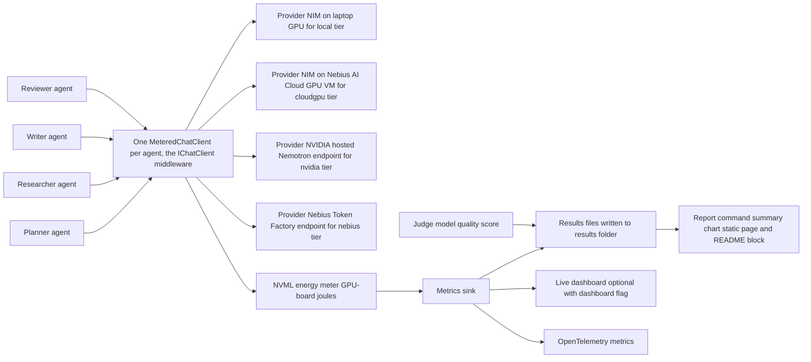
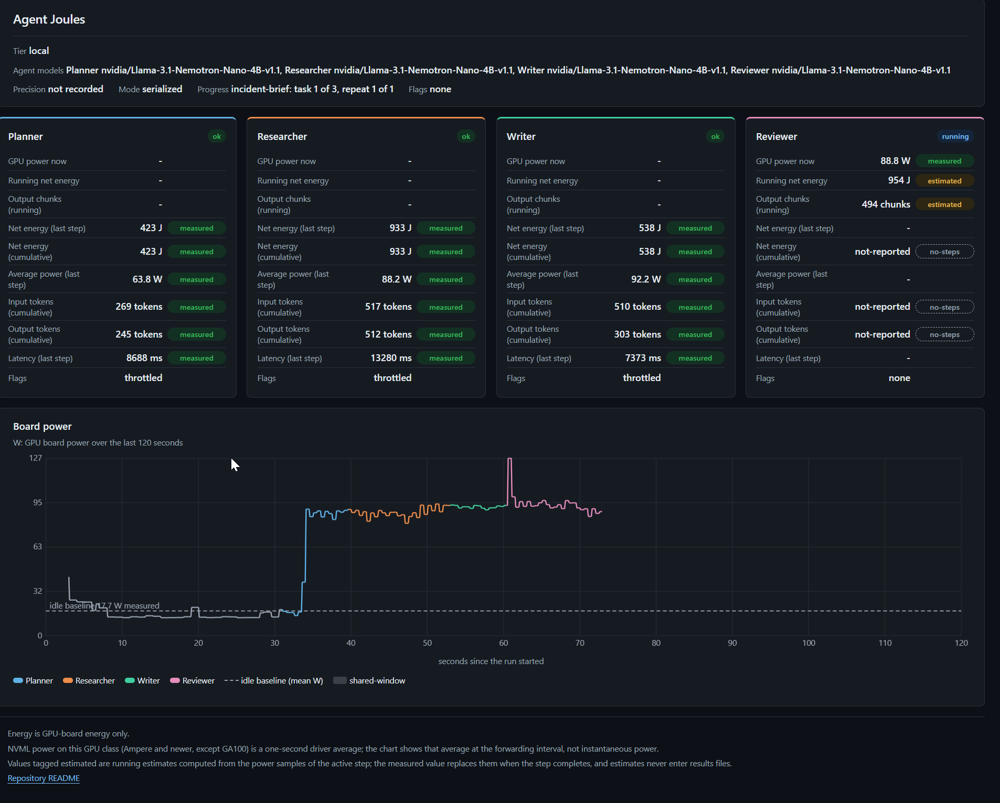

# Agent Joules

Agent Joules: energy per agent step, measured on your GPUs

Status: Agent Joules is a hackathon prototype, the submission of this repository to the Nebius x NVIDIA Global AI Hackathon on Devpost (submission deadline 2026-10-30 10:00 PDT, 17:00 UTC). The build is specified by [docs/agent-joules.prompt.md](docs/agent-joules.prompt.md). Every measured number comes from a committed file under `results/`; the cloud rental figures and the NIM-attempt figures come from the docs file named in the same paragraph (docs/cloudgpu-run.md, docs/nim-local-attempt.md); the results block below is generated from those files by `report --update-readme`, never typed by hand.

## What it measures

Agent Joules wraps each agent of a Microsoft Agent Framework workflow in a Microsoft.Extensions.AI IChatClient middleware that records tokens, latency and cost for every model call. On a GPU you control the same middleware also records joules and watts through NVML, the NVIDIA Management Library. A judge model adds a quality score to each run. Every metric carries one of five labels: measured, estimated, model-judged, N/A or not-reported, and a missing value is never written as zero. The same workflow runs on four tiers: locally through an NVIDIA NIM container first with Ollama as the fallback, on a Nebius AI Cloud GPU instance where the NIM container and the meter share one GPU, on Nebius Token Factory serving NVIDIA Nemotron, and on build.nvidia.com. Energy is measured on the laptop GPU and on the cloud GPU and reported in separate rows; hosted API energy is reported as N/A.

The four tiers run in this fixed order: `local` (the laptop GPU, Nemotron served by NIM), `cloudgpu` (one Nebius AI Cloud GPU VM, its own NIM container serving another Nemotron model), `nvidia` and `nebius` (hosted Nemotron endpoints, where energy is `N/A`). Energy is GPU-board energy only. Every value carries one label: `measured`, `estimated`, `model-judged`, `N/A` or `not-reported`.

## Architecture

The diagram shows the agents, the metered clients, the providers, the NVML meter, the results sink, the report and OpenTelemetry, and the path one measured step takes between them.



The diagram shows the components named in the design (docs/design/technical-design.md, sections 2.2 and 3) and the data flow of one run (section 4).

## Quick start

Prerequisites:

- The .NET SDK 10.0.4xx (the repository pins 10.0.401 in `global.json`, rolling forward to later patches).
- Windows or Linux.
- An NVIDIA GPU with its driver, for the measured tiers `local` and `cloudgpu`. The hosted tiers `nvidia` and `nebius` need no GPU, and their energy is `N/A`.

Three key variables are used: `NVIDIA_API_KEY` for the `nvidia` tier and the judge, `NEBIUS_API_KEY` for the `nebius` tier, and `NGC_API_KEY` for the NIM container pull of the `local` tier. Set each one by either route, with the value from your own account; the details, the precedence and the masking rules are under [Keys](#keys), and no key value belongs in any file of this repository.

```powershell
setx NVIDIA_API_KEY "<value>"
```

```bash
dotnet user-secrets set "NVIDIA_API_KEY" "<value>" --project src/AgentJoules.Cli
```

Repeat for `NEBIUS_API_KEY` and `NGC_API_KEY`. Then, from the repository root:

```text
dotnet run --project src/AgentJoules.Cli -- probe
dotnet run --project src/AgentJoules.Cli -- run --tier all --dry-run
dotnet run --project src/AgentJoules.Cli -- run --tier all
dotnet run --project src/AgentJoules.Cli -- report
```

`probe` prints the GPU, driver and energy method that will be measured. `run --tier all --dry-run` checks the keys, the endpoints, the model IDs and the GPU and makes no completion call. `run --tier all` runs the workflow on every tier enabled in the configuration and writes one file per tier under `results/`. `report` writes the summary, the chart and the static page to `docs/report/`. Every option is listed under [CLI reference](#cli-reference).

### Judges without a GPU

Four actions need neither a GPU nor a key. Run them from the repository root.

1. `dotnet test` runs the unit tests; the integration tests that need a network, a key or a GPU run without their live part because the AGENTJOULES_INTEGRATION gate is closed.
2. `dotnet run --project src/AgentJoules.Cli -- validate results/` checks the committed results files against the results schema and prints `Validated <n> files`.
3. Open `docs/report/index.html`, the committed report page, in a browser. It needs no script and no server.
4. `dotnet run --project src/AgentJoules.Cli -- dashboard --replay results/20261025T133440Z-nebius.json --speed 4 --exit-after 60` replays the committed `nebius` run on the live dashboard; open the printed `Dashboard:` address in a browser.

## How this project uses NVIDIA Nemotron

Every tier of the workflow runs an NVIDIA model; the model IDs below are the ones recorded in the named run files and listed as `- model:` lines in [docs/endpoints.md](docs/endpoints.md). Tier order is local, cloudgpu, nvidia, nebius.

- `local`: `nvidia/Llama-3.1-Nemotron-Nano-4B-v1.1`, served by an NVIDIA NIM container on the laptop GPU; run file `results/20261027T095519Z-local.json`.
- `cloudgpu`: `nvidia/nemotron-3-nano`, served by an NVIDIA NIM container on a Nebius AI Cloud virtual machine with one NVIDIA H100 80GB GPU (preset 1gpu-16vcpu-200gb, recorded in the run file and docs/cloudgpu-run.md); run file `results/20261026T124721Z-cloudgpu.json`.
- `nvidia`: `nvidia/nemotron-3-nano-omni-30b-a3b-reasoning`, called on the hosted build.nvidia.com endpoint; run file `results/20261025T135121Z-nvidia.json`.
- `nebius`: `nvidia/NVIDIA-Nemotron-3-Nano-30B-A3B`, called on the Nebius Token Factory endpoint; run file `results/20261025T133440Z-nebius.json`.

The quality judge is an NVIDIA Nemotron model too, `nvidia/nemotron-3-nano-omni-30b-a3b-reasoning`, called on the `nvidia` tier (see the judge disclosure under Methodology and honesty rules). Nemotron is the subject of every measurement: the same four-agent workflow runs on each model, and the results files record tokens, latency and, on the two measured tiers, GPU-board energy per agent step. The models differ and are not ranked against each other.

## Where Nebius Token Factory accelerated the workflow

The `nebius` tier calls the Nebius Token Factory endpoint, which served the hosted NVIDIA Nemotron model `nvidia/NVIDIA-Nemotron-3-Nano-30B-A3B` for the whole workflow; the run file is `results/20261025T133440Z-nebius.json`. What it changed: the workflow gained a hosted comparison tier next to the `nvidia` tier, with no GPU to own, rent or keep awake, so the same agents could be measured for tokens, latency and cost from a laptop with a key alone. The run file labels tokens and latency `measured`, and energy `N/A`, because a hosted API exposes no GPU meter; nothing is written as zero. The same file is the one the keyless dashboard replay in [Judges without a GPU](#judges-without-a-gpu) plays back.

## Other Nebius tools or services used

The `cloudgpu` tier ran on one Nebius AI Cloud GPU virtual machine, where the NIM container and the NVML meter share one GPU. Preset `1gpu-16vcpu-200gb`, region `eu-north1` (platform `gpu-h100-sxm`, GPU `NVIDIA H100 80GB HBM3`), all from the Instance section of [docs/cloudgpu-run.md](docs/cloudgpu-run.md). The engine that served the tier is NIM 2.1.4, from docs/cloudgpu-run.md, because the run file `results/20261026T124721Z-cloudgpu.json` records no runtime. The tier is completed: that file holds all thirty-six steps with outcome `ok`.

Rental time was 1.509 GPU-hours at USD 4.63 per hour (Cost and Teardown sections of docs/cloudgpu-run.md; the hourly price is the console figure, the GPU-hours and the cost are estimated), so the whole-run cost line is about USD 7 (estimated, docs/cloudgpu-run.md). The per-step estimated cost inside the results file is a different figure: it is the hourly price times each step's wall time. The whole-run cost covers the whole rental window from the handover of the VM to its deletion (docs/cloudgpu-run.md, Teardown), not only the measured steps. The balance difference the console showed is a lower bound, not the bill, and the usage-page figure is not yet recorded in docs/cloudgpu-run.md. The virtual machine was deleted by the user after the run.

## Methodology and honesty rules

[docs/methodology.md](docs/methodology.md) explains how energy is measured (Measurement), how it is attributed to an agent step (Attribution), the idle baseline (Baseline), the five labels (Labels) and the limits of NVML readings (Limitations). The honesty rules, in short:

1. Every measured number is measured on the named hardware and traceable to a file under `results/`; a rental or attempt figure comes from the docs file named in the same paragraph (docs/cloudgpu-run.md or docs/nim-local-attempt.md).
2. Every value carries one label of five: `measured`, `estimated`, `model-judged`, `N/A` or `not-reported`.
3. A missing value is `N/A` or `not-reported`, never written as zero.
4. The NIM-local attempt is reported whichever way it ends (see NIM-local outcome below).
5. Every table carries the GPU, driver, run date, local runtime and model tags.
6. Energy is GPU-board energy only.
7. No cross-model or cross-tier ranking: statements are scoped to this workload on this machine.

Judge disclosure: the quality judge is `nvidia/nemotron-3-nano-omni-30b-a3b-reasoning` on the `nvidia` tier, from `.judge` in `results/20261027T095519Z-local.json`; its calls are excluded from the workflow totals. Judge coverage is not complete in every file: the judge failed after 5 attempts (RetriesExhaustedException) for 3 of 36 steps in `results/20261027T095519Z-local.json` (the energy-explainer repeat 3 Planner, Researcher and Writer steps; the HTTP 429 status was seen in the console at the end of the run, the committed file records RetriesExhaustedException and the counts) and for 3 of 36 in `results/20261026T124721Z-cloudgpu.json`, and no score for 2 of 36 steps in `results/20261025T133440Z-nebius.json`; the quality of those steps is `N/A` with the reason recorded, never 0, while `results/20261025T135121Z-nvidia.json` has all 36 judged. Self-judging is disclosed per file with `run.selfJudged`: it is false in the `local`, `cloudgpu` and `nebius` run files, so those runs have no self-judging to disclose. It is true in `results/20261025T135121Z-nvidia.json`, because the `nvidia` tier's own model is the judge model, so that file's `model-judged` quality scores come from the model that produced the output.

The live dashboard (`--dashboard`) shows one-second driver averages and running estimates labelled `estimated`; estimates never enter a results file. The dashboard adds no GPU work and shows only what the meter already samples; a browser rendering it on the measured GPU adds compositing load, so published results files are recorded without a browser showing the dashboard, and only the demo recording shows the live page. The published local run of 2026-10-27 ran with no browser open; the applications that still held GPU contexts are listed in the notes paragraph after the results block, and that load sits in the baseline and in every local window (docs/methodology.md). The earlier 2026-10-25 local campaign, which ran with browsers open by the user's decision, stays in `results/` as history (the AJ-114 entry of docs/build-log.md). A replay (`dashboard --replay`) shows the recorded per-step average power of a committed results file, not a trace; it runs no agent and writes nothing; it needs no key, and a key variable that is set is used only to mask its value, so a file holding that value is refused.

## Results

<!-- results:begin -->
### Results
- local: file 20261027T095519Z-local&#8288;.json; run date 2026-10-27T09:55:19Z; status completed; mode serialized; GPU NVIDIA GeForce RTX 3080 Ti Laptop GPU; driver 616&#8288;.92; local runtime nim 1&#8288;.8&#8288;.5; precision BF16; reasoning mode off; power source ac; models Planner=nvidia/Llama-3&#8288;.1-Nemotron-Nano-4B-v1&#8288;.1, Researcher=nvidia/Llama-3&#8288;.1-Nemotron-Nano-4B-v1&#8288;.1, Writer=nvidia/Llama-3&#8288;.1-Nemotron-Nano-4B-v1&#8288;.1, Reviewer=nvidia/Llama-3&#8288;.1-Nemotron-Nano-4B-v1&#8288;.1; judge nvidia/nemotron-3-nano-omni-30b-a3b-reasoning; self-judging not determinable from the model ids \(judge model nvidia/nemotron-3-nano-omni-30b-a3b-reasoning; step model nvidia/Llama-3&#8288;.1-Nemotron-Nano-4B-v1&#8288;.1; compared by model id only\); energy method counter
  - Local runtime: nim 1&#8288;.8&#8288;.5, offload 100 percent, precision BF16
- cloudgpu: file 20261026T124721Z-cloudgpu&#8288;.json; run date 2026-10-26T12:47:21Z; status completed; mode serialized; GPU NVIDIA H100 80GB HBM3; driver 580&#8288;.173&#8288;.02; local runtime N/A; precision FP8; reasoning mode off; power source unknown; models Planner=nvidia/nemotron-3-nano, Researcher=nvidia/nemotron-3-nano, Writer=nvidia/nemotron-3-nano, Reviewer=nvidia/nemotron-3-nano; judge nvidia/nemotron-3-nano-omni-30b-a3b-reasoning; self-judging not determinable from the model ids \(judge model nvidia/nemotron-3-nano-omni-30b-a3b-reasoning; step model nvidia/nemotron-3-nano; compared by model id only\); energy method counter
- nvidia: file 20261025T135121Z-nvidia&#8288;.json; run date 2026-10-25T13:51:21Z; status completed; mode serialized; GPU N/A; driver N/A; local runtime N/A; precision N/A; reasoning mode off; power source ac; models Planner=nvidia/nemotron-3-nano-omni-30b-a3b-reasoning, Researcher=nvidia/nemotron-3-nano-omni-30b-a3b-reasoning, Writer=nvidia/nemotron-3-nano-omni-30b-a3b-reasoning, Reviewer=nvidia/nemotron-3-nano-omni-30b-a3b-reasoning; judge nvidia/nemotron-3-nano-omni-30b-a3b-reasoning; self-judging yes \(judge model nvidia/nemotron-3-nano-omni-30b-a3b-reasoning equals the step model id\); energy method N/A
- nebius: file 20261025T133440Z-nebius&#8288;.json; run date 2026-10-25T13:34:40Z; status completed; mode serialized; GPU N/A; driver N/A; local runtime N/A; precision N/A; reasoning mode off; power source ac; models Planner=nvidia/NVIDIA-Nemotron-3-Nano-30B-A3B, Researcher=nvidia/NVIDIA-Nemotron-3-Nano-30B-A3B, Writer=nvidia/NVIDIA-Nemotron-3-Nano-30B-A3B, Reviewer=nvidia/NVIDIA-Nemotron-3-Nano-30B-A3B; judge nvidia/nemotron-3-nano-omni-30b-a3b-reasoning; self-judging not determinable from the model ids \(judge model nvidia/nemotron-3-nano-omni-30b-a3b-reasoning; step model nvidia/NVIDIA-Nemotron-3-Nano-30B-A3B; compared by model id only\); energy method N/A

Energy is GPU-board energy only.
Judge calls are excluded from workflow totals.
Self-judging: the judge model is also a workflow model.
Models differ across tiers: local=nvidia/Llama-3&#8288;.1-Nemotron-Nano-4B-v1&#8288;.1 \(BF16\), cloudgpu=nvidia/nemotron-3-nano \(FP8\), nvidia=nvidia/nemotron-3-nano-omni-30b-a3b-reasoning \(N/A\), nebius=nvidia/NVIDIA-Nemotron-3-Nano-30B-A3B \(N/A\)

| tier | GPU | run date | status | net J (run total) | gross J (run total) | input tokens | output tokens | cost (run total) | labels | flags |
|---|---|---|---|---|---|---|---|---|---|---|
| local | NVIDIA GeForce RTX 3080 Ti Laptop GPU | 2026-10-27 | completed | 33134.2 | 43906.6 | 25770 | 17556 | 0.0028 EUR estimated | measured, estimated | |
| cloudgpu | NVIDIA H100 80GB HBM3 | 2026-10-26 | completed | 10389.6 | 16364.1 | 25379 | 15889 | 0.0647 USD estimated | measured, estimated | |
| nvidia | N/A | 2026-10-25 | completed | N/A (hosted-tier) | N/A (hosted-tier) | 25550 | 16548 | N/A (no priced step) | measured, N/A | |
| nebius | N/A | 2026-10-25 | completed | N/A (hosted-tier) | N/A (hosted-tier) | 26554 | 16991 | 0.0057 USD estimated | measured, estimated, N/A | |


<!-- results:end -->

Notes on the rows above. The local row comes from the 2026-10-27 laptop run (results/20261027T095519Z-local.json), recorded on AC power without a browser open and without the dashboard, with the other GPU applications closed except the Claude desktop app, two Edge WebView2 hosts, explorer, ShareX, Windows Terminal, Widget Board, TextInputHost, ApplicationFrameHost and NahimicSvc64 (no browser and no other chat or messaging application; the two Edge WebView2 hosts render web content on the GPU and are disclosed as such); 26 `dotnet` processes of the session's review agents ran test suites on the CPU during the run, which the meter does not read (GPU-board energy only) but which can lengthen a step and so its gross joules, and, through the laptop's shared power and thermal budget, can also lower the GPU's power limit and clocks (inferred: the run-start limit was 78.157 W in results/20261027T095519Z-local.json against 105 W in results/20261025T131930Z-local.json, both measured, and every step was SwPowerCap-throttled, as on 2026-10-25), so it is disclosed here (docs/methodology.md). The earlier 2026-10-25 campaign, which ran with the user's other GPU applications open, browsers among them, by the user's decision, remains in `results/` as `20261025T131930Z-local.json` and is not the published row (the AJ-114 entry of docs/build-log.md). The local cost is estimated from the electricity price `Cost:ElectricityPricePerKwh` (0.30 EUR per kWh in the committed configuration), an assumption recorded as `environment.assumptions.electricityPrice` with the label estimated in every local run file (results/20261027T095519Z-local.json), not a measurement.

## Demo URL

The demo page is the static HTML report, written by `report` to `docs/report/index.html` (the `--out` default is `docs/report/`; the run files are read from `results/` by default). It needs no script and no server. It holds the report header fields, the summary table with one row per task and agent for each tier, the chart `joules-per-step.svg` beside it, the sentence `Energy is GPU-board energy only.`, a link to the repository README when the repository URL is configured, and a `not run` row for each tier without a run file. The repository link comes from `Report:RepositoryUrl` in `config/appsettings.json`, which the committed file sets. `report` regenerates the page; see the `report` section under CLI reference.

GitHub Pages publishes the `docs/` folder. Set the Pages source to that folder once in the repository settings, and the page is served at the `/report/` path of the Pages site. The empty file `docs/.nojekyll`, committed beside the folder, stops Pages from processing it with Jekyll; `report` recreates it when it is missing and the `docs` folder exists.

## NIM-local outcome

The NIM-local attempt succeeded and NIM is the local runtime (`nim`, version 1.8.5): in the words of the Decision section of [docs/nim-local-attempt.md](docs/nim-local-attempt.md), the container served `GET /v1/models` with HTTP 200 inside the 90-minute box, 32 minutes 6 seconds of it (measured; docs/nim-local-attempt.md), with the BF16 vllm profile and `NIM_MAX_MODEL_LEN=16384`. The Ollama fallback was not needed. The limits docs/nim-local-attempt.md records are that the served model is `nvidia/Llama-3.1-Nemotron-Nano-4B-v1.1` (no Nemotron 3 Nano 4B NIM exists), that the context window is capped by the configured `NIM_MAX_MODEL_LEN=16384`, and that the support matrix does not list this GPU, so the working state is one successful start and has not been repeated. The next section has the detail.

## Local runtime: NIM attempt

The NIM-local attempt of 2026-10-24 succeeded inside the 90-minute box (started 17:19:23Z, ended 17:51:29Z, 32 minutes, measured): the NIM container nvcr.io/nim/nvidia/llama3.1-nemotron-nano-4b-v1.1:1.8.5 serves nvidia/Llama-3.1-Nemotron-Nano-4B-v1.1 in BF16 (vLLM profile, 16384-token context) on the laptop GPU, and it is the local runtime for the laptop measurements (configuration Local:Runtime nim; the local tier points at http://localhost:8000/v1). The NGC catalog has no Nemotron 3 Nano 4B NIM (checked 2026-10-24); the first start with the default TensorRT-LLM engine-build profile was killed during the engine build (exit 137, OOMKilled true; the 7.756 GiB container memory limit (measured with docker stats; docs/nim-local-attempt.md) is the inferred cause), and the vLLM BF16 profile with NIM_MAX_MODEL_LEN=16384 started in 3 minutes 27 seconds with 13449 MiB of the 16384 MiB GPU memory in use while serving (measured; docs/nim-local-attempt.md). Ollama with nemotron-3-nano:4b stays the REQ-020 fallback and was not needed. Commands with the key redacted, the image digest, the errors of the three failed starts and the decision: [docs/nim-local-attempt.md](docs/nim-local-attempt.md). The running container was re-created on 2026-10-24 with `-p 127.0.0.1:8000:8000` (18:54:58Z) and then without the NGC key in its environment (20:19:29Z), same image, profile and NIM_MAX_MODEL_LEN; the commands in the attempt document publish the port on all interfaces as they ran during the box: publish it on 127.0.0.1 only. Switching to the Ollama fallback needs three values together: `Local:Runtime` ollama, `Tiers:local:BaseUrl` http://localhost:11434/v1 and `Tiers:local:ModelId` nemotron-3-nano:4b.

Local numbers were produced with nim running nvidia/Llama-3.1-Nemotron-Nano-4B-v1.1.

## CLI reference

The command line has six commands: `probe`, `run`, `report`, `validate`, `calibrate` and `dashboard`. In the usage lines below `AJ` stands for `dotnet run --project src/AgentJoules.Cli --`, run from the repository root; `AJ <command> --help` prints the options of a command and exits 0. A parse error exits 2 and prints one stderr line `error: <message> (ParseError)`.

Note on the dashboard: it is off by default, stores nothing, and a browser on the measured GPU adds compositing load. The published results files were therefore recorded without a browser showing the dashboard, and only the demo recording shows the live page; the published local run of 2026-10-27 ran with no browser open and with the other GPU applications limited to those listed in the notes below the results block (docs/methodology.md).

### Exit codes

| Code | Meaning |
|---|---|
| 0 | success |
| 1 | unexpected error |
| 2 | invalid arguments or configuration |
| 3 | missing API key |
| 4 | model not found |
| 5 | unreachable, retries exhausted, step failed or run interrupted: Ctrl+C, SIGTERM or SIGHUP marks the in-flight steps `incomplete`; also when `dashboard --replay` finds no free loopback port |
| 6 | measurement precondition failed |
| 7 | generated content differs (`report --verify-readme`) |

### Results schema

Run files follow the JSON schema in `docs/results-schema.json`, which `validate` checks. The schema is generated from the results model and a test compares the committed file with the generated one. After a deliberate change of the model, update the committed schema with `AGENTJOULES_UPDATE_SCHEMA=1 dotnet test --filter "FullyQualifiedName~CommittedSchemaMatchesGenerated"`, then rebuild.

### report

`report` reads the newest usable run file of each tier and writes three files to `--out`: `summary.md` (the header lines, the honesty sentences and one row per tier, task and agent with fifteen columns, and a `not run` row for each tier without a file), `joules-per-step.svg` (the chart: one group per task and agent, one slot per tier) and `index.html` (the static page with the same summary table beside the chart). It needs no GPU, key or telemetry, and it builds no host. Usage: `AJ report [--in <path>]... [--out <folder>] [--update-readme] [--verify-readme] [--render-content] [--config <path>]`; from the repository root, `dotnet run --project src/AgentJoules.Cli -- report` runs it with the defaults.

- `--in <path>`: one run file or one folder of run files; repeat the option to combine inputs (one value per occurrence, so `--in a b` is a parse error). The default is `results`, relative to the working directory unless absolute. A folder is scanned at its top level only. For each tier the newest file whose status is `completed` or `partial` and whose flags lack `non-publishable` is used, and a `-baseline` file of the tier gives the baseline rows. Probe and calibration files are ignored by name. A run file with status `running`, `failed` or `incomplete`, or with the `non-publishable` flag, is listed on stdout as `Skipped <file>: <reason>`, at most 20 lines and then `Skipped <N> more files` (`Skipped 1 more file` for one); older files behind the one used are not opened. A run file the aggregator refuses (a status other than `completed` or `partial`, the `non-publishable` flag, or a tier, variant or timestamp that disagrees with its name) is printed as `<file>: <member text>` on stdout, with `report: 1 run file cannot be used` on stderr, and exits 2. A run file whose text would be changed by the secret redactor, because it holds a registered key, is refused as `<file>: (root) holds a registered key`, exits 2, and nothing is written. A path that does not exist, a named file whose name is not a run-file name, and a blank value exit 2 and name the value as typed (redacted, then cut to 256 characters).
- `--out <folder>`: where the three files are written. The default is `docs/report`, created when absent; a file at that path exits 2. Other files in the folder are left alone. Nothing is written until every input has passed its checks and every text has been rendered. Each text is staged as `<name>.partial` and flushed; the three files are then moved into place in the order summary.md, joules-per-step.svg, index.html. A staging failure leaves the previous report in place; a failed move (a read-only or locked target, a folder at the target) exits 1 naming the file and can leave a mixed set, the files moved before it new and the rest old, so re-run the command after any failure; in both cases the remaining partial files are discarded. The staged `*.partial` files are git-ignored. An `--out` that cannot be created (a path under a file) exits 1 with `report: the output folder could not be created`, naming no file. The output has no clock reading, is UTF-8 without BOM with LF line endings, so two runs over the same inputs give files with identical SHA-256 sums.
- `--config <path>`: the configuration file read for `Report:RepositoryUrl` only, which is the repository link of the page. The default is `config/appsettings.json`; an absent default file means no link, and an explicit missing file exits 2. The value must be an absolute `https` URL with no user information, query, fragment or surrounding whitespace, and it must not carry a secret: the configuration rule refuses a URL holding an `nvapi-` key (the redactor's key pattern) in every command that loads the file (`run`, `probe` and `report`; `validate` loads no configuration), and `report` additionally refuses a URL holding any registered key value before it reads a run file (the configuration is read before the input and output paths are resolved, so a configuration error precedes an input error). Any other value exits 2 with the one constant message `ReportOptions.RepositoryUrlMessage`, which names `Report:RepositoryUrl`; the value itself is never printed. The configuration file is read under a bound of 1 MiB: a larger file, a non-regular file (Unix), or malformed content (a lone surrogate included) exits 2 naming the file only. The whole file must pass the shape and type check: an unknown key, an empty value or a wrong type anywhere exits 2. Beyond that, `report` judges only `Report:RepositoryUrl`; the cross-field and range rules of other sections are not applied. The environment variable `AGENTJOULES__Report__RepositoryUrl` is read too.

- `--update-readme`: replaces the text between the results markers of `README.md` with the generated results block, so no number in the block is typed by hand. The link to the dashboard screenshot is part of that generated block and appears only when the screenshot file exists; it is never written by hand.
- `--verify-readme`: writes nothing when it is the only flag, and exits 7 when the text between the results markers is not the generated results block (a hand edit, or a dashboard screenshot link that disagrees with the file); exit 0 when it is.
- `--render-content`: renders `content/linkedin-posts.template.md` from the latest run files into `content/linkedin-posts.md`; a template that is malformed or holds a registered key exits 2.

Exit codes: 0 when the three files are written, and, with `--update-readme`, `--verify-readme` or `--render-content`, when the update, the verification or the rendering succeeded; 7 when `--verify-readme` finds a difference (see Exit codes above); 2 for a refused template or README, a parse error, an invalid or missing input, a run file that fails validation or holds a registered key, a run file the aggregator refuses, an `--out` that is a file, a bad `--config` file or `Report:RepositoryUrl`, a rendered text that would carry a registered key (`report: <name> holds a registered key; nothing written`), and a `docs/.nojekyll` marker that cannot be created; 1 for a write failure, including a staging or move failure and an `--out` that cannot be created; 5 when the command is interrupted. A run file that fails validation is reported as in `validate` (its failure lines on stdout, the file name only, and one stderr line), and nothing is written. `report` also writes an empty `docs/.nojekyll` when the `docs` folder exists and the marker is missing, so GitHub Pages serves the folder without Jekyll.

Do not run `report` or `validate` against a results folder while a `run` writes into it. On Windows, a reader that holds the newest run file open can make the `run` writer's rename of its checkpoint fail, which fails that tier's run; no retry is built in.

Example, the committed fixture run files (test data, never a published number), written to `artifacts/report`:

```text
dotnet run --project src/AgentJoules.Cli -- report --in tests/AgentJoules.TestSupport/Fixtures/results --out artifacts/report
Report written to artifacts/report: summary.md, joules-per-step.svg, index.html
```

### probe

Prints the GPU, driver, power limit and energy method that will be measured; without NVML or a device it prints `no GPU` and still exits 0. Stdout holds only the probe output; log lines and the energy-method disclosure go to stderr.

- `--json`: print the result as one JSON object instead of the ten `label: value` lines.
- `--save`: also write the JSON form (the same bytes `--json` prints) to `results/probe-<yyyyMMddTHHmmssZ>[-<suffix>].json` under the working directory, with the UTC time of the run, for example `results/probe-20261019T093015Z.json`; the `results` folder is created when missing and stderr gets one line `saved: results/<name>`. Stdout keeps the form you asked for. An existing file is never overwritten: the command exits 1 with `error: file exists: results/<name>` and prints nothing on stdout. Without a GPU the file records `gpuPresent: false`. The file name starts with `probe-`, so it is never mistaken for a run file. The file carries the full GPU UUID.
- `--suffix <text>`: only with `--save`; adds `-<text>` to the file name, for example `--suffix cloudgpu` gives `results/probe-20261019T093015Z-cloudgpu.json`. The text must be 1 to 20 ASCII letters or digits (`^[A-Za-z0-9]{1,20}$`), so it cannot hold a path separator or `..`; anything else, or `--suffix` without `--save`, exits 2 and writes nothing.
- `--config <path>`: read this configuration file instead of `config/appsettings.json`; a missing file exits 2.

### run

`run` validates the configuration, the keys and the model IDs of the selected tiers and, outside `--dry-run`, runs the measured workflow. The measured run (without `--dry-run`) runs the workflow for every selected tier, in the fixed order of `--tier all`. For a measured tier (`local`, `cloudgpu`) the GPU is opened, the meter started, the unmetered warm-up call made (its wall time is recorded as environment.modelLoadSeconds; a no-op when the tier has no local runtime) and the idle baseline measured for `--baseline-seconds`; a warning is printed on stderr when the baseline is unstable. The hosted tiers (`nvidia`, `nebius`) skip those steps and have no GPU energy meter. Every task runs `--repeat` times, each time with fresh agents and a fresh workflow. Before the first step line the console prints `Energy is GPU-board energy only.` once per command: the energy figures cover the GPU board and nothing else (a dry run shows no energy and prints no such line). One results file per tier is written under `--out`, named `<yyyyMMddTHHmmssZ>-<tier>[-baseline].json`; with `--tier all` every file of the command carries the same timestamp. The file is rewritten atomically after every task and repeat: `run.status` is `running` until the last task and repeat finish, then `completed`. The console prints one line per finished step, `<task> r<repeat> <agent> <outcome> netJ=<v|N/A> avgW=<v|N/A> in=<v|not-reported> out=<v|not-reported> latency=<ms>`, where a missing value prints its label and never 0; after each tier it prints `results: <--out as given>/<file name>` and `totals: grossJ=<v|N/A> netJ=<v|N/A> in=<v|not-reported> out=<v|not-reported> cost=<CUR v[,CUR v]|N/A> wallClockMs=<v|not-reported>`. A step the judge did not score holds `quality` N/A with its reason, never 0, and when a tier has no local runtime the runtime fields of `environment` are null. Ctrl+C, SIGTERM, SIGHUP or a host stop leaves a file whose `run.status` is `incomplete`, with the in-flight steps marked `incomplete`, and the command exits 5. The incomplete file is written before the incomplete step lines are printed. The write has a budget of at most 10 s and never more than 12 s after the signal (at least 1 s); if it fails, the command prints one stderr line `Warning: the run file could not be written after the shutdown (<Type>); the last complete checkpoint was kept` (or `...; no checkpoint of this tier was written` when no checkpoint of the tier exists yet, for example after a shutdown during the baseline or the first task and repeat) and still exits 5. A tier that had not started when the cancellation landed gets no file. A shutdown inside the local baseline wait leaves a file with a null baseline and zero steps, and its sums are not-reported (`no-steps`). A failed step stops the tier and exits 5. A step fails on a provider status other than 429, a refused connection, a timeout, or a 429 answer on every one of the 5 attempts (or on fewer, when a `Retry-After` above 60 s or a summed wait above 120 s ends the retries at once); no other status is retried. The file is then rewritten with `run.status` `failed` and holds every step published so far: the failed step with `outcome` `error` and its `retries`, and the steps finished before it unchanged; steps that never ran are absent, never zero-filled. When the failing agent's latest reading has outcome `incomplete` (a connection that dropped after the first update), `run.status` is `incomplete` instead. The console then prints `results: <--out as given>/<file name>` and `status: failed at <agent>` (or `status: incomplete at <agent>`), with no `totals:` line for that tier, and the error line ends with `; partial results in <that path>`. With `--tier all` the first failing tier stops the command and the files of earlier tiers remain. If the failed-step file cannot be written, stderr carries `Warning: the run file could not be written after the failed step (<Type>); the last complete checkpoint was kept` (or `...; no checkpoint of this tier was written`), the error line has no partial-file suffix, and the command still exits 5. Before any request, the command refuses a run file whose name already exists (exit 1: `The run file <name> exists already and is not replaced; wait a second and run again.`). Cost totals follow one rule: when every step is priced, `costByCurrency` holds the per-currency sums; when some step lacks a cost, each currency seen maps to N/A with the reason `missing-step-costs` and the `totals:` line prints `cost=N/A`; with no priced step the map is empty, as in M2. The console metrics exporter prints a metrics block on stdout about every 10 s during the run, between the step lines, and once more at the end; the interval is the default export interval of OpenTelemetry.Exporter.Console 1.18.0, ten seconds, read from the library (a setting, not a measurement), and `--no-console-telemetry` switches the block off.

- `--tier <local|cloudgpu|nvidia|nebius|all>` (required): the tier to run. `all` expands to the tiers enabled in the configuration, in the fixed order local, cloudgpu, nvidia, nebius. `cloudgpu` is disabled in the committed configuration and is enabled on the VM with `AGENTJOULES__Tiers__cloudgpu__Enabled=true`.
- `--task <name>`: run one task of the `tasks/` folder; by default every task runs, in file-name order. An unknown name exits 2 and lists the available names. The folder comes from `Paths:Tasks` (default `tasks`, relative to the working directory, never absolute and never containing `..`).
- `--mode <serialized|concurrent>` (default `serialized`): how the agents' calls share the GPU. `serialized` holds the process-wide meter gate for each metered window, so one step's energy is not mixed with another's. `concurrent` lets the calls overlap: every step on a measured tier whose metering window strictly overlaps another step's window is flagged `shared-window` (windows that only touch at a boundary are not flagged), and hosted-tier steps are never flagged. On a measured tier the energy totals (`grossJoules`, `netJoules`) of a concurrent run are computed over the union of the windows, so they are not the sum of the step energies. The hosted tiers keep the N/A totals with the reason `hosted-tier`, never 0. Tokens and cost are summed in both modes. Any other value exits 2.
- `--out <dir>` (default `results`): where the run files go, relative to the working directory unless absolute. A directory that cannot be written exits 1 before any request. A blank value exits 2; a drive-relative value such as `C:results` joins the working directory on that drive.
- `--baseline-seconds <n>` (default `Baseline:Seconds` (30); a whole number greater than 0 and at most 4294967; the configuration key accepts fractions down to 0.001, the flag whole seconds only): the length of the idle baseline for the measured tiers.
- `--repeat <n>` (default 3): how often each task runs; 1 or more.
- `--dry-run`: validate everything and make no completion call. The keys of every selected tier and the judge key are checked in one message (exit 3). `GET /v1/models` runs on each selected endpoint (exit 5 when it cannot be reached, exit 4 when a configured model ID is not listed, with up to 20 listed IDs printed, Nemotron and Qwen first). The GPU of the measured tiers is checked (exit 6 without a GPU or NVML, naming the missing library), and the task folder is checked. The command prints one line per tier, `<tier> <endpoint> <matched model ids> OK`, and exits 0. Nothing is written.
- `--no-console-telemetry`: do not print the OpenTelemetry metrics to the console at the end of a run (see Telemetry). A dry run prints none in any case.
- `--config <path>`: read this configuration file instead of `config/appsettings.json`; a missing file exits 2.
- `Dashboard:PowerIntervalMs` (configuration key, default 100, a whole number from 50 to 1000): how often, in milliseconds, the sampling meter forwards power samples it already took to the live dashboard sink; a value outside the range exits 2 naming the key without echoing the value. It applies when `--dashboard` is set.
- `--dashboard` (off by default): when set, the run serves a live dashboard on loopback and prints `Dashboard: http://127.0.0.1:<port>/` before the run starts. The page shows one-second driver-average power and running estimates labelled `estimated`; estimates never enter a results file. When no port of the range is free, the run prints on stderr `Warning: the dashboard did not start (no free dashboard port in <first>-<last>); the run continues without it` and continues without the dashboard, and the exit code is unchanged. The server stays up for 2 seconds after the run ends (at once after a shutdown). It serves loopback only: a request with a foreign `Host` or `Origin`, or a `Sec-Fetch-Site` other than `same-origin` or `none`, is refused, and at most 16 clients are served at once. With `--dry-run` the line is printed and the server is disposed at once. The warning names its reason: no free port in the range, a start that timed out after 5 s, `start failed (<Type>)`, or a repository link holding a registered secret. The isolation is measured per component (a start failure keeps the run and its results, a pump fault is logged once and dropped); the end-to-end test that a throwing dashboard leaves the results file equal to a run without it is not yet written (a planned story).
- `--dashboard-port <n>` (default 5178): the preferred port. When it is taken, the next 19 ports are tried, never above 65535. A value that is not a whole number from 1 to 65535 exits 2.

Dry-run example (the three endpoints and model IDs of `config/appsettings.json`):

```text
dotnet run --project src/AgentJoules.Cli -- run --tier all --dry-run
local http://localhost:8000/v1 nvidia/Llama-3.1-Nemotron-Nano-4B-v1.1 OK
nvidia https://integrate.api.nvidia.com/v1 nvidia/nemotron-3-nano-omni-30b-a3b-reasoning OK
nebius https://api.tokenfactory.nebius.com/v1 nvidia/NVIDIA-Nemotron-3-Nano-30B-A3B OK
```

A wrong option value exits 2 before anything runs and prints one stderr line `error: <message> (ParseError)` (several parse errors are joined with `; ` into that one line); the exit-code table is under Exit codes above. The three model IDs in the example were verified against their live endpoints on 2026-10-24, the local one again on 2026-10-25 (docs/endpoints.md).

### dashboard

`dashboard --replay <run file>` replays a committed results file on its recorded timeline into the same local dashboard that `run --dashboard` serves, so the live view can be seen without a GPU. The replay runs no agent and writes nothing to disk; it needs no key, and a key variable that is set is used only to mask its value, so a file holding that value is refused with exit 2. The page shows power as the recorded per-step average, with the banner `power shown as recorded per-step average` and a `replay` marker; a hosted step shows N/A, never 0.

Usage: `AJ dashboard --replay <run file> [--speed <factor>] [--exit-after <seconds>] [--start-delay <seconds>] [--dashboard-port <n>]`

- `--replay <run file>` (required): the results file. Its name must be a run-file name, it must pass `AJ validate`, hold no registered key's value or `nvapi-` string, and name one of the four agent roles or the judge in every step and in its environment model list; otherwise the command exits 2 and names the file.
- `--speed <factor>` (default 1.0): divides every recorded delay; a finite number above 0 and at most 4294967.294; a speed so small that a recorded gap divided by it would exceed the timer limit exits 2.
- `--exit-after <seconds>`: stops the replay after this many wall-clock seconds (at least 0.0000001), counted from the first replayed event; an event scheduled exactly at the deadline is still shown. Without it the server runs until Ctrl+C, which exits 0.
- `--start-delay <seconds>`: starts the replay after this delay (0, or at least 0.0000001 s) or at the first browser connection, whichever comes first; `0` starts at once. Without it the replay waits for the first browser connection, at most 120 s or `--exit-after` when that is shorter; if no browser connects, it prints a warning and exits 0.
- `--dashboard-port <n>` (default 5178): the preferred port, a whole number from 1 to 65535; the next 19 ports are tried. With no free port the command exits 5.

The committed nvidia fixture replays at speed 50 and exits 0:

```text
dotnet run --project src/AgentJoules.Cli -- dashboard --replay tests/AgentJoules.TestSupport/Fixtures/results/20260101T000000Z-nvidia.json --speed 50 --exit-after 5 --start-delay 0
```

### calibrate

`calibrate` measures one window of the task workflow with the energy counter and with power sampling at once, and writes both totals and their relative difference to `results/calibration-<yyyyMMddTHHmmssZ>[-<suffix>].json`. It works on a measured tier only: without a GPU it exits 6. A calibration file is never mistaken for a run file, so `validate` and `report` ignore it. Usage: `AJ calibrate [--task <name>] [--seconds <n>] [--out <dir>] [--suffix <text>] [--no-console-telemetry] [--config <path>]`.

- `--task <name>`: the task whose workflow repeats in the window; by default the first task of the `tasks/` folder in file order.
- `--seconds <n>`: the length of the window, 1 or more, default 60; the repeat in flight at the deadline completes, so the window can be longer.
- `--out <dir>` (default `results`): where the calibration file goes, relative to the working directory unless absolute.
- `--suffix <text>`: 1 to 20 ASCII letters or digits appended to the file name, for example `cloudgpu`; anything else exits 2.
- `--no-console-telemetry`: do not print the metrics to the console.
- `--config <path>`: read this configuration file instead of `config/appsettings.json`.

### validate

`validate` checks run files against the results schema and then against the results model; in that mode it needs no configuration, key or GPU, and builds no host. With `--config` it validates the model IDs of the configuration against docs/endpoints.md instead (the last bullet below). Usage: `AJ validate [path]` or `AJ validate --config [<path>]`.

- `[path]`: a run file or a folder; with no path the default is `results/` under the working directory. A folder is scanned at its top level only, and only names of the form `<yyyyMMddTHHmmssZ>-<tier>[-baseline].json` are checked; `probe-*.json` and `calibration-*.json` are not counted. A path that does not exist, a named file whose name is not a run-file name, and a folder that cannot be read exit 2 and name the path as given (redacted, then cut to 256 characters).
- Checks, in order, for each file: the text is read as strict UTF-8 (at most 16 MiB), parsed as JSON, checked against the embedded schema (`docs/results-schema.json`), and then read through the results model. The model reads only a file the schema accepts.
- Output: one stdout line per failure, `<file>: <location> <message>`, where the location is a JSON pointer for a schema failure, `(root)` for the whole document, and a serializer path such as `$.run.startUtc` or `(model)` for a failure of the model read; the line holds the file name only. At most the first 20 failures of a file are listed, then `<file>: (root) and <N> more failures`. The last stdout line is always `Validated <N> files`, where N counts the run files checked, valid or not. When any file is invalid, one stderr line `error: <k> of <n> run files are invalid (ConfigurationException)` follows.
- Exit codes: 0 when every checked file is valid; 2 when a file is invalid, a path is missing or unreadable, or a named file is not a run file; 5 when the host shuts down during a scan. With `--config`: 0 when every configured model ID is recorded, 4 for any problem line, and 2 for a positional path, or a missing, oversized (above 1 MiB) or unreadable configuration file or endpoints document.
- `--config [<path>]`: accepted with or without a value. `AJ validate --config` compares every `Tiers:<t>:ModelId`, every `Tiers:<t>:AgentModelIds` value and `Judge:ModelId` (in the `Judge:Tier` section) with the `- model: <id>` lines of docs/endpoints.md, file-only (no network); an enabled tier needs a `Verified: YYYY-MM-DD` line, a disabled tier only its heading. Success prints `Validated <n> model IDs` and exits 0; otherwise it prints one line per problem (`Missing in section ## <tier>: <id>`, `Verified date missing in section ## <tier>`, `Section ## <tier> missing`) and exits 4; `--config <path>` validates that configuration file instead, and a positional path together with `--config` exits 2.
- An unknown option is a parse error (exit 2, `error: <message> (ParseError)`). A path that starts with `-` must be written `./-x`; `--` does not escape it.
- Do not run `validate` against a results folder while a `run` writes a checkpoint into it either: on Windows the same rename conflict as for `report` can fail that write (see the warning under `report`).

Example, the three committed fixture run files:

```text
dotnet run --project src/AgentJoules.Cli -- validate tests/AgentJoules.TestSupport/Fixtures/results
Validated 3 files
```

## Keys

The hosted tiers read their API key from the environment variable named by `Tiers:<tier>:ApiKeyVariable` in `config/appsettings.json`: `NVIDIA_API_KEY` for `nvidia` and `NEBIUS_API_KEY` for `nebius`. The judge uses its tier's variable. `NGC_API_KEY` is the NIM container pull key of the local tier setup (M4), not a hosted-tier key.

- A variable name must end with `_API_KEY`; any other value stops the command with exit 2 and names the setting.
- Before any request, a run checks the variable of every selected tier. Missing variables are reported in one message that names each of them and the alternative, and the run exits 3 without sending a request.
- Outside `--dry-run`, a missing judge key only prints a warning and the run continues.
- With `CloudGpu:RequireSshVariables` true (the laptop default), `cloudgpu` also requires `CLOUDGPU_SSH_HOST` and `CLOUDGPU_SSH_USER`.

PowerShell, for your user account (new terminals only):

```powershell
setx NVIDIA_API_KEY "<value>"
```

Portable, into the user-secrets store of the CLI project:

```bash
dotnet user-secrets set "NVIDIA_API_KEY" "<value>" --project src/AgentJoules.Cli
```

An environment variable of the same name overrides the user-secrets value (the host reads the JSON file, then user secrets, then environment variables), and on Windows a User-scope variable overrides a Machine-scope one. When a key that you know is valid is refused with HTTP 401, check which copy the process sees before replacing it.

Values are never printed. Every output line masks a registered key to `****`: the full value, its JSON-encoded form, its first 64 characters and every cut the 64-character echo limit can produce. Up to 7 characters can remain when a key starts after more than 56 characters of other text, and a URL-encoded or base64 copy of a key is not masked. Note that `setx` leaves the value in the shell history (PSReadLine) and that the user-secrets store is unencrypted JSON under your profile; clear the history line after setting a key.

## Telemetry

Every metered agent step records OpenTelemetry metrics on the meter named `AgentJoules`.

| Instrument | Kind | Unit | Attribute |
|---|---|---|---|
| `agentjoules.step.energy` | histogram | J | `aj.energy.kind`: `gross` or `net` |
| `agentjoules.step.power` | histogram | W | the step average |
| `agentjoules.step.tokens` | counter | `{token}` | `aj.token.type`: `input` or `output` |
| `agentjoules.step.latency` | histogram | ms | none |
| `agentjoules.step.cost` | counter | none (the currency is in `aj.currency`) | `aj.currency` |

Only the instruments whose names start with `agentjoules.` leave the process; the instruments of the agent middleware on the same meter are dropped.

Every measurement carries `gen_ai.agent.name`, `aj.tier` and `gen_ai.request.model`. A value that does not exist (hosted-tier energy, unreported tokens, unpriced cost) is not recorded rather than recorded as 0. No prompt or output text is ever exported: `EnableSensitiveData` is off. Net energy is not recorded for a step that ends below the idle baseline, so the count of net points can be lower than the count of gross points; the results file keeps the value.

- Console exporter: on by default for `run` and `calibrate`; switch it off with `--no-console-telemetry`. It is never on for `probe`, whose stdout holds only the probe output.
- OTLP exporter: enabled when `OTEL_EXPORTER_OTLP_ENDPOINT` is set to an absolute http or https URL without user-info, query or fragment; a set but invalid value stops the command with exit 2 and names the variable, never its value. `OTEL_EXPORTER_OTLP_METRICS_ENDPOINT` and `OTEL_EXPORTER_OTLP_TRACES_ENDPOINT` enable their own signal on their own. It carries the metrics and the traces of the sources `AgentJoules` and `Microsoft.Agents.AI.Workflows*`. Blank or unset means no OTLP exporter is added.
- OTLP protocol and headers: `OTEL_EXPORTER_OTLP_PROTOCOL` and the headers keys `OTEL_EXPORTER_OTLP_HEADERS`, `OTEL_EXPORTER_OTLP_METRICS_HEADERS` and `OTEL_EXPORTER_OTLP_TRACES_HEADERS` are read from the same configuration as the endpoint and sent only to that endpoint. With headers configured for a signal, its endpoint must be https unless its host is loopback, so a header token never travels in cleartext; use an https collector you trust.

```bash
OTEL_EXPORTER_OTLP_ENDPOINT=http://localhost:4317 dotnet run --project src/AgentJoules.Cli -- run --tier nvidia
```

## Reproduce

The steps to regenerate the results files and the report on your own NVIDIA GPU, in order. Set the keys first (see [Quick start](#quick-start)). Run steps one to four and six to ten from the repository root.

1. `dotnet run --project src/AgentJoules.Cli -- probe --json --save` writes `results/probe-<ts>.json`, the GPU, driver and energy method.
2. `dotnet run --project src/AgentJoules.Cli -- run --tier all --dry-run` prints one line per enabled tier (endpoint, matched model IDs, `OK`) and writes no file.
3. `dotnet run --project src/AgentJoules.Cli -- run --tier all` writes `results/<ts>-local.json`, `results/<ts>-nvidia.json` and `results/<ts>-nebius.json`; energy is measured on the laptop GPU and is `N/A` on the hosted tiers.
4. `dotnet run --project src/AgentJoules.Cli -- calibrate` writes `results/calibration-<ts>.json`.
5. On the Nebius AI Cloud VM, when you rent one: `./AgentJoules.Cli probe --json --save --suffix cloudgpu`, then `./AgentJoules.Cli run --tier cloudgpu`, then `./AgentJoules.Cli calibrate --suffix cloudgpu`, which write `results/probe-<ts>-cloudgpu.json`, `results/<ts>-cloudgpu.json` and `results/calibration-<ts>-cloudgpu.json`. The commands as run are in [docs/cloudgpu-run.md](docs/cloudgpu-run.md).
6. `dotnet run --project src/AgentJoules.Cli -- validate results/` prints `Validated <n> files` and exits 0.
7. `dotnet run --project src/AgentJoules.Cli -- report --update-readme --render-content` writes `docs/report/summary.md`, `docs/report/joules-per-step.svg` and `docs/report/index.html`, the results block of this README and `content/linkedin-posts.md`.
8. `dotnet run --project src/AgentJoules.Cli -- report --verify-readme` exits 0 when the results block is the generated one.
9. For the live page: `dotnet run --project src/AgentJoules.Cli -- run --tier local --task energy-explainer --repeat 1 --out artifacts/demo-run --dashboard` serves the dashboard at the printed `Dashboard:` address. The run file lands in the git-ignored `artifacts/demo-run` and is not a published result.
10. Without a GPU: `dotnet run --project src/AgentJoules.Cli -- dashboard --replay results/<ts>-nebius.json --speed 4 --exit-after 60` replays a committed hosted run on the same page and writes nothing.

## Prior art

Published work on LLM inference energy measures the model or the request. Links checked on 2026-10-26.

- [The Price of Prompting: Profiling Energy Use in Large Language Models Inference](https://arxiv.org/abs/2407.16893), arXiv 2407.16893 (Husom, Goknil, Shar, Sen).
- [TokenPowerBench: Benchmarking the Power Consumption of LLM Inference](https://ojs.aaai.org/index.php/AAAI/article/view/40535), AAAI-26; the preprint is [arXiv 2512.03024](https://arxiv.org/abs/2512.03024).
- [Watt Counts: Energy-Aware Benchmark for Sustainable LLM Inference on Heterogeneous GPU Architectures](https://arxiv.org/abs/2604.09048), arXiv 2604.09048, a preprint under review.
- [greenToken](https://github.com/abidedavana/greenToken), a Python library and command-line tool that measures energy, CO2e and cost per token of LLM inference through NVML, nvidia-smi and RAPL; the repository is early-stage.

None of these attributes energy to an individual agent step of a multi-agent workflow, as far as the search of 2026-10-17 found. That attribution is what Agent Joules adds.

## Hackathon submission

The Devpost elevator pitch and project story live in [docs/devpost-pitch.md](docs/devpost-pitch.md) and [docs/devpost-story.md](docs/devpost-story.md). The story is filled from the committed results files (every figure names its file). The technical design is [docs/design/technical-design.md](docs/design/technical-design.md); the delivery plan with milestones, stories, BDD scenarios and the traceability matrix is under [docs/plan/](docs/plan/plan.md). The submitted release is v0.2.0 (https://github.com/tomas-rampas/agent-joules/releases/tag/v0.2.0), tagged at the final documentation commit, with the CLI build, the results and the report as assets; v0.1.0 marks the M7 exit snapshot.

## License

MIT, see [LICENSE](LICENSE).
