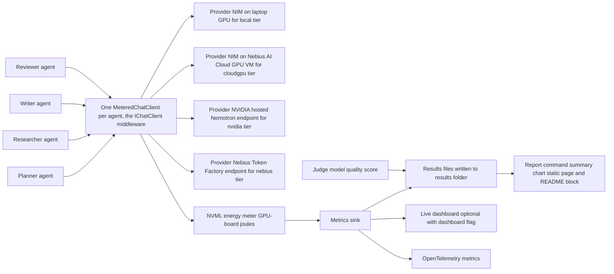

# Agent Joules

Agent Joules: energy per agent step, measured on your GPUs

Status: Agent Joules is a hackathon prototype, the submission of this repository to the Nebius x NVIDIA Global AI Hackathon on Devpost (deadline 2026-10-30 10:00 PDT, 17:00 UTC). Every measured number comes from a committed file under `results/`, and the results block below is generated from those files by `report --update-readme`, never typed by hand. Demo URL: https://tomas-rampas.github.io/agent-joules/report/ (see [Hackathon submission](#hackathon-submission)).

## What it measures

Agent Joules wraps each agent of a Microsoft Agent Framework workflow in a Microsoft.Extensions.AI IChatClient middleware that records tokens, latency and cost for every model call. On a GPU you control the same middleware also records joules and watts through NVML, the NVIDIA Management Library, and a judge model adds a quality score to each run. The same workflow runs on four tiers in this fixed order: `local` (the laptop GPU, Nemotron served by NIM), `cloudgpu` (one Nebius AI Cloud GPU VM with its own NIM container), `nvidia` and `nebius` (hosted Nemotron endpoints, where energy is `N/A`). Energy is GPU-board energy only. Every value carries one of five labels, `measured`, `estimated`, `model-judged`, `N/A` or `not-reported`, and a missing value is never written as zero.

## Results

<!-- results:begin -->
### Results
- local: file 20261027T095519Z-local&#8288;.json; run date 2026-10-27T09:55:19Z; status completed; mode serialized; GPU NVIDIA GeForce RTX 3080 Ti Laptop GPU; driver 616&#8288;.92; local runtime nim 1&#8288;.8&#8288;.5; precision BF16; reasoning mode off; power source ac; models Planner=nvidia/Llama-3&#8288;.1-Nemotron-Nano-4B-v1&#8288;.1, Researcher=nvidia/Llama-3&#8288;.1-Nemotron-Nano-4B-v1&#8288;.1, Writer=nvidia/Llama-3&#8288;.1-Nemotron-Nano-4B-v1&#8288;.1, Reviewer=nvidia/Llama-3&#8288;.1-Nemotron-Nano-4B-v1&#8288;.1; judge nvidia/nemotron-3-nano-omni-30b-a3b-reasoning; self-judging not determinable from the model ids \(judge model nvidia/nemotron-3-nano-omni-30b-a3b-reasoning; step model nvidia/Llama-3&#8288;.1-Nemotron-Nano-4B-v1&#8288;.1; compared by model id only\); energy method counter
  - Local runtime: nim 1&#8288;.8&#8288;.5, offload 100 percent, precision BF16
- cloudgpu: file 20261026T124721Z-cloudgpu&#8288;.json; run date 2026-10-26T12:47:21Z; status completed; mode serialized; GPU NVIDIA H100 80GB HBM3; driver 580&#8288;.173&#8288;.02; local runtime N/A; precision FP8; reasoning mode off; power source unknown; models Planner=nvidia/nemotron-3-nano, Researcher=nvidia/nemotron-3-nano, Writer=nvidia/nemotron-3-nano, Reviewer=nvidia/nemotron-3-nano; judge nvidia/nemotron-3-nano-omni-30b-a3b-reasoning; self-judging not determinable from the model ids \(judge model nvidia/nemotron-3-nano-omni-30b-a3b-reasoning; step model nvidia/nemotron-3-nano; compared by model id only\); energy method counter
- nvidia: file 20261025T135121Z-nvidia&#8288;.json; run date 2026-10-25T13:51:21Z; status completed; mode serialized; GPU N/A; driver N/A; local runtime N/A; precision N/A; reasoning mode off; power source ac; models Planner=nvidia/nemotron-3-nano-omni-30b-a3b-reasoning, Researcher=nvidia/nemotron-3-nano-omni-30b-a3b-reasoning, Writer=nvidia/nemotron-3-nano-omni-30b-a3b-reasoning, Reviewer=nvidia/nemotron-3-nano-omni-30b-a3b-reasoning; judge nvidia/nemotron-3-nano-omni-30b-a3b-reasoning; self-judging yes \(judge model nvidia/nemotron-3-nano-omni-30b-a3b-reasoning equals the step model id\); energy method N/A
- nebius: file 20261025T133440Z-nebius&#8288;.json; run date 2026-10-25T13:34:40Z; status completed; mode serialized; GPU N/A; driver N/A; local runtime N/A; precision N/A; reasoning mode off; power source ac; models Planner=nvidia/NVIDIA-Nemotron-3-Nano-30B-A3B, Researcher=nvidia/NVIDIA-Nemotron-3-Nano-30B-A3B, Writer=nvidia/NVIDIA-Nemotron-3-Nano-30B-A3B, Reviewer=nvidia/NVIDIA-Nemotron-3-Nano-30B-A3B; judge nvidia/nemotron-3-nano-omni-30b-a3b-reasoning; self-judging not determinable from the model ids \(judge model nvidia/nemotron-3-nano-omni-30b-a3b-reasoning; step model nvidia/NVIDIA-Nemotron-3-Nano-30B-A3B; compared by model id only\); energy method N/A

Energy is GPU-board energy only.
Judge calls are excluded from workflow totals.
Self-judging: the judge model is also a workflow model.
Models differ across tiers: local=nvidia/Llama-3&#8288;.1-Nemotron-Nano-4B-v1&#8288;.1 \(BF16\), cloudgpu=nvidia/nemotron-3-nano \(FP8\), nvidia=nvidia/nemotron-3-nano-omni-30b-a3b-reasoning \(N/A\), nebius=nvidia/NVIDIA-Nemotron-3-Nano-30B-A3B \(N/A\)

| tier | GPU | run date | status | net J (run total) | gross J (run total) | input tokens | output tokens | cost (run total) | labels | flags |
|---|---|---|---|---|---|---|---|---|---|---|
| local | NVIDIA GeForce RTX 3080 Ti Laptop GPU | 2026-10-27 | completed | 33134.2 | 43906.6 | 25770 | 17556 | 0.0028 EUR estimated | measured, estimated | |
| cloudgpu | NVIDIA H100 80GB HBM3 | 2026-10-26 | completed | 10389.6 | 16364.1 | 25379 | 15889 | 0.0647 USD estimated | measured, estimated | |
| nvidia | N/A | 2026-10-25 | completed | N/A (hosted-tier) | N/A (hosted-tier) | 25550 | 16548 | N/A (no priced step) | measured, N/A | |
| nebius | N/A | 2026-10-25 | completed | N/A (hosted-tier) | N/A (hosted-tier) | 26554 | 16991 | 0.0057 USD estimated | measured, estimated, N/A | |


<!-- results:end -->

Notes on the rows above. The local row is the 2026-10-27 laptop run results/20261027T095519Z-local.json, recorded on AC power and recorded without a browser showing the dashboard, with the other GPU applications listed in docs/methodology.md. The local cost is estimated from `Cost:ElectricityPricePerKwh` (0.30 EUR per kWh in the committed configuration), an assumption recorded as `environment.assumptions.electricityPrice` with the label estimated in results/20261027T095519Z-local.json. The earlier 2026-10-25 campaign stays in `results/` as history and is not the published row.

The image above is the live dashboard captured on 2026-10-27 during a rehearsal run on the local tier whose git-ignored run file is outside `results/`, so none of its figures enters the block.

## Architecture

The diagram shows the agents, the metered clients, the providers, the NVML meter, the results sink, the report and OpenTelemetry, and the path one measured step takes between them.



The components and the data flow of one run are detailed in docs/design/technical-design.md.

## Quick start

Prerequisites:

- The .NET SDK 10.0.4xx (the repository pins 10.0.401 in `global.json`).
- Windows or Linux.
- An NVIDIA GPU with its driver for the measured tiers `local` and `cloudgpu`; none for `nvidia` and `nebius`.

Three key variables are used: `NVIDIA_API_KEY` for the `nvidia` tier and the judge, `NEBIUS_API_KEY` for the `nebius` tier, and `NGC_API_KEY` for the NIM container pull. Set each one by either route, with the value from your own account:

```powershell
setx NVIDIA_API_KEY "<value>"
```

```bash
dotnet user-secrets set "NVIDIA_API_KEY" "<value>" --project src/AgentJoules.Cli
```

Repeat for the other two (`setx` leaves the value in the shell history and the user-secrets store is unencrypted JSON); details, precedence and masking in [docs/cli-reference.md](docs/cli-reference.md#keys); no key value belongs in any file of this repository. Then, from the repository root:

```text
dotnet run --project src/AgentJoules.Cli -- probe
dotnet run --project src/AgentJoules.Cli -- run --tier all --dry-run
dotnet run --project src/AgentJoules.Cli -- run --tier all
dotnet run --project src/AgentJoules.Cli -- report
```

`probe` prints the GPU, driver and energy method that will be measured. `run --tier all --dry-run` checks the keys, the endpoints, the model IDs and the GPU and makes no completion call. `run --tier all` runs the workflow on every enabled tier and writes one file per tier under `results/`. `report` writes the summary, the chart and the static page to `docs/report/`.

### Judges without a GPU

Four actions need neither a GPU nor a key. Run them from the repository root.

1. `dotnet test` runs the unit tests; the integration tests that need a network, a key or a GPU run without their live part because the AGENTJOULES_INTEGRATION gate is closed.
2. `dotnet run --project src/AgentJoules.Cli -- validate results/` checks the committed results files against the results schema and prints `Validated <n> files`.
3. Open https://tomas-rampas.github.io/agent-joules/replay/, the live dashboard page replaying the committed `cloudgpu` and `local` runs in the browser (no server, no key), or `docs/report/index.html`, the committed report page, which needs no script and no server.
4. `dotnet run --project src/AgentJoules.Cli -- dashboard --replay results/20261026T124721Z-cloudgpu.json --speed 4 --exit-after 60` replays the committed `cloudgpu` run on the live dashboard; open the printed `Dashboard:` address in a browser.

## How this project uses NVIDIA Nemotron

Every tier runs an NVIDIA model; the model IDs below are the ones recorded in the named run files and listed as `- model:` lines in [docs/endpoints.md](docs/endpoints.md).

- `local`: `nvidia/Llama-3.1-Nemotron-Nano-4B-v1.1`, served by an NVIDIA NIM container on the laptop GPU; run file `results/20261027T095519Z-local.json`.
- `cloudgpu`: `nvidia/nemotron-3-nano`, served by an NVIDIA NIM container on a Nebius AI Cloud virtual machine with one NVIDIA H100 80GB GPU (preset 1gpu-16vcpu-200gb, docs/cloudgpu-run.md); run file `results/20261026T124721Z-cloudgpu.json`.
- `nvidia`: `nvidia/nemotron-3-nano-omni-30b-a3b-reasoning`, called on the hosted build.nvidia.com endpoint; run file `results/20261025T135121Z-nvidia.json`.
- `nebius`: `nvidia/NVIDIA-Nemotron-3-Nano-30B-A3B`, called on the Nebius Token Factory endpoint; run file `results/20261025T133440Z-nebius.json`.

The quality judge is `nvidia/nemotron-3-nano-omni-30b-a3b-reasoning` on the `nvidia` tier. The models differ and are not ranked against each other.

## Where Nebius Token Factory accelerated the workflow

The `nebius` tier calls the Token Factory endpoint, which served `nvidia/NVIDIA-Nemotron-3-Nano-30B-A3B` for the whole workflow (run file `results/20261025T133440Z-nebius.json`). It gave the workflow a hosted comparison tier with no GPU to own or rent, so the same agents were measured for tokens, latency and cost from a laptop with a key alone. The run file labels tokens and latency `measured` and energy `N/A`, nothing is written as zero, and the same file replays with the `dashboard --replay` command of [Judges without a GPU](#judges-without-a-gpu), with tokens and latency and the energy cells `N/A`.

## Other Nebius tools or services used

The `cloudgpu` tier ran on one Nebius AI Cloud GPU virtual machine, where the NIM container and the NVML meter share one GPU. Preset `1gpu-16vcpu-200gb`, region `eu-north1`, GPU `NVIDIA H100 80GB HBM3` and engine NIM 2.1.4 all come from [docs/cloudgpu-run.md](docs/cloudgpu-run.md); the run file `results/20261026T124721Z-cloudgpu.json` holds all thirty-six steps with outcome `ok`.

Rental time was 1.509 GPU-hours at USD 4.63 per hour (the hourly price is the console figure, the GPU-hours and the cost are estimated; docs/cloudgpu-run.md), so the whole-run cost is about USD 7 (estimated, docs/cloudgpu-run.md), covering the whole rental window, not only the measured steps. The per-step estimated cost in the results file is the hourly price times each step's wall time, and the VM was deleted after the run.

## Methodology and honesty rules

[docs/methodology.md](docs/methodology.md) explains Measurement, Attribution, Baseline, Labels and Limitations. The honesty rules, in short:

1. Every measured number is measured on the named hardware and traceable to a file under `results/`; a rental or attempt figure comes from the docs file named in the same paragraph (docs/cloudgpu-run.md or docs/nim-local-attempt.md).
2. Every value carries one label of five: `measured`, `estimated`, `model-judged`, `N/A` or `not-reported`.
3. A missing value is `N/A` or `not-reported`, never written as zero.
4. The NIM-local attempt is reported whichever way it ends (see NIM-local outcome below).
5. Every table carries the GPU, driver, run date, local runtime and model tags.
6. Energy is GPU-board energy only.
7. No cross-model or cross-tier ranking: statements are scoped to this workload on this machine.

Judge disclosure: the quality judge is `nvidia/nemotron-3-nano-omni-30b-a3b-reasoning` on the `nvidia` tier; its calls are excluded from the workflow totals.
Coverage is not complete in every file: the judge failed after 5 attempts (RetriesExhaustedException) for 3 of 36 steps in `results/20261027T095519Z-local.json` and for 3 of 36 in `results/20261026T124721Z-cloudgpu.json`, there is no score for 2 of 36 steps in `results/20261025T133440Z-nebius.json`, and all 36 are judged in `results/20261025T135121Z-nvidia.json`; those steps are `N/A` with the reason recorded, never 0.
Self-judging (`run.selfJudged`) is true in `results/20261025T135121Z-nvidia.json` because the tier's own model is the judge, and false in the other three files.

The live dashboard (`--dashboard`) shows one-second driver averages and running estimates labelled `estimated`; estimates never enter a results file. A browser on the measured GPU adds compositing load, so published results files are recorded without a browser showing the dashboard, and a replay (`dashboard --replay`) runs no agent, writes nothing and needs no key.

## NIM-local outcome

The NIM-local attempt succeeded and NIM is the local runtime (`nim`, version 1.8.5): the container served `GET /v1/models` with HTTP 200 inside the 90-minute box, 32 minutes 6 seconds of it (measured; docs/nim-local-attempt.md), with the BF16 vLLM profile and `NIM_MAX_MODEL_LEN=16384`. The Ollama fallback was not needed. No Nemotron 3 Nano 4B NIM exists in the NGC catalog (checked 2026-10-24), which is why the served model is `nvidia/Llama-3.1-Nemotron-Nano-4B-v1.1`. The support matrix does not list this GPU, so the working state is one successful start; the detail is in [docs/nim-local-attempt.md](docs/nim-local-attempt.md). Switching to the fallback needs three values together: `Local:Runtime` ollama, `Tiers:local:BaseUrl` http://localhost:11434/v1 and `Tiers:local:ModelId` nemotron-3-nano:4b. The commands in docs/nim-local-attempt.md publish the port on all interfaces as they ran during the box: publish it on 127.0.0.1 only (`-p 127.0.0.1:8000:8000`), because the endpoint has no authentication (the local tier sends no key; config/appsettings.json), and once the model cache is filled re-create the long-running container without `-e NGC_API_KEY`, as was done on 2026-10-24.

Local numbers were produced with nim running nvidia/Llama-3.1-Nemotron-Nano-4B-v1.1.

## CLI reference

Six commands: `probe`, `run`, `report`, `validate`, `calibrate` and `dashboard`. `AJ` below stands for `dotnet run --project src/AgentJoules.Cli --` from the repository root; `AJ <command> --help` prints the options. The full option semantics, the key handling and the OpenTelemetry export are in [docs/cli-reference.md](docs/cli-reference.md). Telemetry: the meter `AgentJoules` records `agentjoules.step.energy`, `agentjoules.step.power`, `agentjoules.step.tokens`, `agentjoules.step.latency` and `agentjoules.step.cost`; an OTLP exporter is enabled when `OTEL_EXPORTER_OTLP_ENDPOINT` is set (details in [docs/cli-reference.md](docs/cli-reference.md#telemetry)).

| Code | Meaning |
|---|---|
| 0 | success |
| 1 | unexpected error |
| 2 | invalid arguments or configuration |
| 3 | missing API key |
| 4 | model not found |
| 5 | unreachable, retries exhausted, step failed or run interrupted: Ctrl+C, SIGTERM or SIGHUP marks the in-flight steps `incomplete`; also when `dashboard --replay` finds no free loopback port |
| 6 | measurement precondition failed |
| 7 | generated content differs (`report --verify-readme`) |

### probe

Prints the GPU, driver, power limit and energy method that will be measured; without NVML or a device it prints `no GPU` and still exits 0.

Usage: `AJ probe [--json] [--save] [--suffix <text>] [--config <path>]`. Options: `--json` one JSON object, `--save` also write it under `results/`, `--suffix` only with `--save`, `--config` another configuration file.

### run

Validates the configuration, the keys and the model IDs of the selected tiers and, outside `--dry-run`, runs the measured workflow and writes one results file per tier. The console prints `Energy is GPU-board energy only.` once per measured run (a dry run prints none).

Usage: `AJ run --tier <local|cloudgpu|nvidia|nebius|all> [options]`. Options: `--tier` required, `--task` one task by name, `--mode` serialized (default) or concurrent, `--out` results folder, `--baseline-seconds` idle baseline length (default 30), `--repeat` runs per task (default 3), `--dry-run` check everything and make no completion call, `--no-console-telemetry`, `--dashboard`, `--dashboard-port`, `--config`.

```text
dotnet run --project src/AgentJoules.Cli -- run --tier all --dry-run
local http://localhost:8000/v1 nvidia/Llama-3.1-Nemotron-Nano-4B-v1.1 OK
nvidia https://integrate.api.nvidia.com/v1 nvidia/nemotron-3-nano-omni-30b-a3b-reasoning OK
nebius https://api.tokenfactory.nebius.com/v1 nvidia/NVIDIA-Nemotron-3-Nano-30B-A3B OK
```

### report

Reads the newest usable run file of each tier and writes `summary.md`, `joules-per-step.svg` and `index.html`; it needs no GPU or key.

Usage: `AJ report [--in <path>]... [--out <folder>] [--update-readme] [--verify-readme] [--render-content] [--config <path>]`. Options: `--in` run file or folder, `--out` output folder, `--update-readme` rewrite the results block of this README, `--verify-readme` exit 7 when the block differs, `--render-content`, `--config`.

### validate

Checks run files against the results schema and the results model; it needs no configuration, key or GPU.

Usage: `AJ validate [path]` or `AJ validate --config [<path>]`. Options: `[path]` a run file or folder (default `results/`), `--config` check the configured model IDs against docs/endpoints.md.

### calibrate

Measures one window of the task workflow with the energy counter and with power sampling at once; it works on a measured tier only.

Usage: `AJ calibrate [--task <name>] [--seconds <n>] [--out <dir>] [--suffix <text>] [--no-console-telemetry] [--config <path>]`. Options: `--seconds` window length (default 60), `--suffix` as for `probe`, the others as for `run`.

### dashboard

Replays a committed results file on its recorded timeline into the live dashboard, so the view can be seen without a GPU; it runs no agent and writes nothing.

Usage: `AJ dashboard --replay <run file> [--speed <factor>] [--exit-after <seconds>] [--start-delay <seconds>] [--dashboard-port <n>]`. Options: `--replay` required, `--speed` divides the recorded delays, `--exit-after` stop after some seconds, `--start-delay`, `--dashboard-port` preferred port.

## Reproduce

The steps to regenerate the results files and the report on your own NVIDIA GPU, in order. Set the keys first (see [Quick start](#quick-start)). Run steps one to four and six to ten from the repository root.

1. `dotnet run --project src/AgentJoules.Cli -- probe --json --save` writes `results/probe-<ts>.json`, the GPU, driver and energy method.
2. `dotnet run --project src/AgentJoules.Cli -- run --tier all --dry-run` prints one line per enabled tier (endpoint, matched model IDs, `OK`) and writes no file.
3. `dotnet run --project src/AgentJoules.Cli -- run --tier all` writes `results/<ts>-local.json`, `results/<ts>-nvidia.json` and `results/<ts>-nebius.json`; energy is measured on the laptop GPU and is `N/A` on the hosted tiers.
4. `dotnet run --project src/AgentJoules.Cli -- calibrate` writes `results/calibration-<ts>.json`.
5. On the Nebius AI Cloud VM, when you rent one: `./AgentJoules.Cli probe --json --save --suffix cloudgpu`, then `./AgentJoules.Cli run --tier cloudgpu`, then `./AgentJoules.Cli calibrate --suffix cloudgpu`, which write `results/probe-<ts>-cloudgpu.json`, `results/<ts>-cloudgpu.json` and `results/calibration-<ts>-cloudgpu.json`. The commands as run are in [docs/cloudgpu-run.md](docs/cloudgpu-run.md).
6. `dotnet run --project src/AgentJoules.Cli -- validate results/` prints `Validated <n> files` and exits 0.
7. `dotnet run --project src/AgentJoules.Cli -- report --update-readme --render-content` writes `docs/report/summary.md`, `docs/report/joules-per-step.svg` and `docs/report/index.html`, the results block of this README and `content/linkedin-posts.md`.
8. `dotnet run --project src/AgentJoules.Cli -- report --verify-readme` exits 0 when the results block is the generated one.
9. For the live page: `dotnet run --project src/AgentJoules.Cli -- run --tier local --task energy-explainer --repeat 1 --out artifacts/demo-run --dashboard` serves the dashboard at the printed `Dashboard:` address. The run file lands in the git-ignored `artifacts/demo-run` and is not a published result.
10. Without a GPU: `dotnet run --project src/AgentJoules.Cli -- dashboard --replay results/<ts>-nebius.json --speed 4 --exit-after 60` replays a committed hosted run on the same page and writes nothing.

## Prior art

Published work on LLM inference energy measures the model or the request. Links checked on 2026-10-26.

- [The Price of Prompting: Profiling Energy Use in Large Language Models Inference](https://arxiv.org/abs/2407.16893), arXiv 2407.16893 (Husom, Goknil, Shar, Sen).
- [TokenPowerBench: Benchmarking the Power Consumption of LLM Inference](https://ojs.aaai.org/index.php/AAAI/article/view/40535), AAAI-26; the preprint is [arXiv 2512.03024](https://arxiv.org/abs/2512.03024).
- [Watt Counts: Energy-Aware Benchmark for Sustainable LLM Inference on Heterogeneous GPU Architectures](https://arxiv.org/abs/2604.09048), arXiv 2604.09048, a preprint under review.
- [greenToken](https://github.com/abidedavana/greenToken), a Python library and command-line tool that measures energy, CO2e and cost per token of LLM inference through NVML, nvidia-smi and RAPL; the repository is early-stage.

None of these attributes energy to an individual agent step of a multi-agent workflow, as far as the search of 2026-10-17 found. That attribution is what Agent Joules adds.

## Hackathon submission

Demo URL: https://tomas-rampas.github.io/agent-joules/report/ (the static report `docs/report/index.html` written by `report`, published by GitHub Pages from the `docs/` folder at the `/report/` path; the empty `docs/.nojekyll` stops Pages from processing the folder with Jekyll). The site root https://tomas-rampas.github.io/agent-joules/ is a one-page presentation for the judges (`docs/index.html`, no script, no external resource) that links to the report. The pitch and story are in [docs/devpost-pitch.md](docs/devpost-pitch.md) and [docs/devpost-story.md](docs/devpost-story.md), the design in [docs/design/technical-design.md](docs/design/technical-design.md) and the plan in [docs/plan/plan.md](docs/plan/plan.md). The submitted release is v0.2.0 (https://github.com/tomas-rampas/agent-joules/releases/tag/v0.2.0) with the CLI build, the results and the report as assets; v0.1.0 marks the M7 exit snapshot.

## License

MIT, see [LICENSE](LICENSE).
