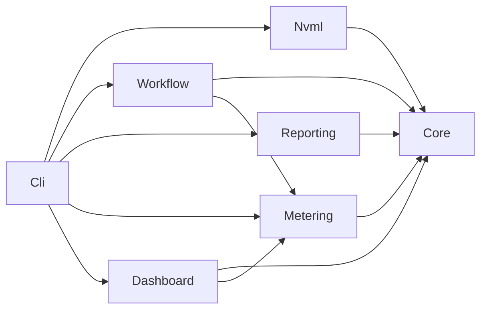
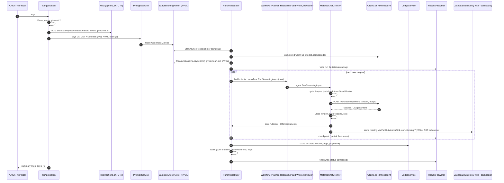

# Agent Joules - technical design

Status: binding input for the build session. Date: 2026-10-18. Author: system-architect.

Evidence labels used throughout: **verified (source)** = read in the named file or package, or measured with a named command; **inferred** = follows from verified facts, not executed; **assumed** = a decision input with no evidence, to be confirmed by the builder at the named step. Two source shorthands: "fork" = `D:\src\github\agent-framework\dotnet` (VersionPrefix 1.23.0, verified `dotnet/nuget/nuget-package.props` line 4); "stack-facts" = `docs/design/stack-facts.md` (throwaway probe projects measured on this laptop by csharp-expert, 2026-10-18).

## 1. Purpose, scope and binding inputs

This document fixes the architecture of the AgentJoules prototype so that the build session implements it without re-deciding structure, libraries or contracts. It covers code, tests, CI and the code paths that produce or consume documents. It does not write the documents themselves (README prose, methodology, posts, Devpost files); those are builder deliverables listed in the traceability matrix (section 3.9).

Binding inputs, in priority order:

| Input | Content | Rule |
|---|---|---|
| `docs/agent-joules.prompt.md` Layer 1 sections 2, 4, 5, 6, 8, 10, 11 | decisions, stack, tiers, honesty, secrets, time boxes, design constraints | wins over this document |
| Layer 2 REQ-001 to REQ-032, EDGE-001 to EDGE-019 (REQ-032, EDGE-018 and EDGE-019 added by user decision 2026-10-18), Out of scope, Definition of Done | acceptance criteria | every item maps to a component and a file in section 3.9 and section 5.2 |
| This document | everything the prompt leaves to "the builder" | recorded as ADRs in section 8 |

Where this document and the prompt disagree, the prompt wins and the builder records the conflict in `docs/build-log.md`. Known conflicts are listed in section 9.2.

## 2. Solution layout

### 2.1 Repository tree (code-relevant part)

```
agent-joules/
  AgentJoules.slnx                 single solution (SDK 10 default format)
  global.json  Directory.Build.props  Directory.Packages.props  .editorconfig (extended)
  src/AgentJoules.Nvml/            native NVML binding, power-source detection
  src/AgentJoules.Core/            domain: labels, readings, meter, math, cost, options, results model
  src/AgentJoules.Metering/        IChatClient middleware, retry, gate, sink, OTel instruments
  src/AgentJoules.Workflow/        providers, agents, executors, workflow, orchestration, judge
  src/AgentJoules.Reporting/       JSON context, schema, validation, Markdown, SVG, HTML, README, content
  src/AgentJoules.Dashboard/       live dashboard: Kestrel minimal API, SSE, embedded page, replay
  src/AgentJoules.Cli/             System.CommandLine + Generic Host composition root
  tests/AgentJoules.TestSupport/   fakes and fixture builders (class library, not a test project)
  tests/AgentJoules.UnitTests/     xUnit unit tests (contains the six REQ-023 class names)
  tests/AgentJoules.Specs/         Reqnroll BDD scenarios
  tests/AgentJoules.IntegrationTests/  gated by AGENTJOULES_INTEGRATION=1
  config/appsettings.json  config/prices.json  config/prices.schema.json  config/judge-rubric.md
  tasks/01-incident-brief.json  tasks/02-api-migration.json  tasks/03-energy-explainer.json
  docs/results-schema.json  docs/.nojekyll  docs/report/ (generated)
  docs/index.html (the landing page)  docs/Infographics.png
  docs/replay/ (the hosted replay: index.html, events-cloudgpu.sse, events-local.sse)
  .github/workflows/ci.yml
```

### 2.2 Projects

| Project | Folder | Output | Purpose | Main REQ / EDGE |
|---|---|---|---|---|
| AgentJoules.Nvml | `src/AgentJoules.Nvml` | classlib | `LibraryImport` NVML binding, DllImport resolver, `NvmlGpuTelemetrySource` implementing Core's port, `PowerSourceDetector` (Windows `GetSystemPowerStatus`, Linux `/sys/class/power_supply`) | REQ-003, 006, 031; EDGE-001, 002, 013, 014, 015 |
| AgentJoules.Core | `src/AgentJoules.Core` | classlib | `Metric` label object, readings, `IEnergyMeter` + `SampledEnergyMeter` + `DeterministicEnergyMeter`, integration, baseline, union windows, cost, derived metrics, judge parsing, options + validators, results model, exit codes, redaction | REQ-004, 005, 009, 010, 013, 015, 021, 029; EDGE-003, 004, 005, 007, 012, 017 |
| AgentJoules.Metering | `src/AgentJoules.Metering` | classlib | `MeteredChatClient`, `RateLimitRetryChatClient`, `IMeterGate`, `IMetricsSink`, `AgentJoulesInstruments` | REQ-007, 008, 013, 014; EDGE-006, 007 |
| AgentJoules.Workflow | `src/AgentJoules.Workflow` | classlib | provider clients, agent factory, four executors, workflow factory, task loader, preflight, dry-run, local runtimes, run orchestrator, judge, calibration, cloud budget guard | REQ-010, 011, 012, 013, 017, 020, 021, 031; EDGE-006, 008, 009, 011, 012, 016, 017 |
| AgentJoules.Reporting | `src/AgentJoules.Reporting` | classlib | source-generated JSON context, results writer, schema generator and validator, run-file naming and selection, Markdown, SVG, HTML, README block, content renderer, endpoints.md parser | REQ-015, 016, 018, 025, 026, 030; EDGE-003, 004, 007, 016 |
| AgentJoules.Dashboard | `src/AgentJoules.Dashboard` | classlib + `FrameworkReference Microsoft.AspNetCore.App` | in-process Kestrel minimal API on 127.0.0.1, `DashboardSink`, SSE endpoint, embedded page, replay service | REQ-032; EDGE-018, 019 |
| AgentJoules.Cli | `src/AgentJoules.Cli` | exe | commands `probe`, `run`, `report`, `validate`, `calibrate`, `dashboard`; host, DI, logging, telemetry, exit-code mapping | REQ-006, 014, 017, 018, 021, 029, 032 |
| AgentJoules.TestSupport | `tests/AgentJoules.TestSupport` | classlib | `FakeChatClient`, `ScriptedNvmlApi`, `FakeHttpMessageHandler` (+ SSE builder), `RunDocumentFixtures`, `TempWorkspace`, `CliHarness`, `FakeTimeDriver` | test seams |
| AgentJoules.UnitTests | `tests/AgentJoules.UnitTests` | test | all unit tests, no GPU, network or keys | REQ-023 |
| AgentJoules.Specs | `tests/AgentJoules.Specs` | test | Reqnroll features driving the CLI in-process with fakes | stories (product-owner) |
| AgentJoules.IntegrationTests | `tests/AgentJoules.IntegrationTests` | test | NVML on the laptop, live endpoints; skipped unless `AGENTJOULES_INTEGRATION=1` | REQ-003, 023 |

Dependency graph (no cycles; Core has no native, AI or ASP.NET dependency; only Dashboard references ASP.NET Core):



### 2.3 Build files

`global.json` (stack-facts section 11, verified):

```json
{ "sdk": { "version": "10.0.401", "rollForward": "latestPatch", "allowPrerelease": false } }
```

There is deliberately **no** `"test"` section: the repository runs VSTest (ADR-03). `latestPatch` pins the 10.0.4xx band (verified, Learn global.json page via stack-facts).

`Directory.Build.props` (all projects):

| Property | Value | Reason |
|---|---|---|
| `TargetFramework` | `net10.0` | REQ-001; projects never redeclare it |
| `TreatWarningsAsErrors` | `true` | REQ-001 literal string |
| `Nullable` | `enable` | REQ-001 literal string |
| `ImplicitUsings` | `enable` | idiom |
| `LangVersion` | `latest` | C# 14 on SDK 10 |
| `AnalysisLevel` | `10.0-recommended` | ADR-19 |
| `EnforceCodeStyleInBuild` | `true` | IDE rules with configured severity fail the build |
| `GenerateDocumentationFile` | `true` | required for IDE0005 in build |
| `NoWarn` | `$(NoWarn);CS1591` | no XML-doc obligation on every public member |
| `InvariantGlobalization` | `true` in `src/**` only, set in `src/Directory.Build.props`, which begins with `<Import Project="$([MSBuild]::GetPathOfFileAbove(Directory.Build.props, $(MSBuildThisFileDirectory)../))" />` because MSBuild reads only the nearest `Directory.Build.props` (measured, design-review R-01: without the import `TargetFramework` and `TreatWarningsAsErrors` are lost); test projects leave it unset (`false`) | Reqnroll resolves `en-US` and every scenario throws `CultureNotFoundException` under invariant mode (measured, design-review B-02); formatting correctness comes from explicit `InvariantCulture` (section 5.5), not from this switch. Amended 2026-10-18 (post-M0 review, measured): set as `RuntimeHostConfigurationOption` items in `src/Directory.Build.props`, not as the MSBuild property, because the property is forwarded to the analyzers and silences CA1304 to CA1311 (section 5.5); the Cli runtimeconfig is unchanged. |
| `EnableConfigurationBindingGenerator` | `true` | source-generated options binding; works only with mutable `set` properties (measured, design-review B-01; section 3.2 Options) |
| `IsPackable` | `false` | no NuGet publishing (Out of scope) |
| `Deterministic`, `ContinuousIntegrationBuild` (CI only) | `true` | reproducible builds |

`tests/Directory.Build.props` imports the root file and adds `IsTestProject=true` (except TestSupport), `NoWarn` `CA1707;CA2007;CA1515`, and the shared test packages. `src/AgentJoules.Nvml` alone sets `AllowUnsafeBlocks=true` (required by `LibraryImport` with `Span<byte>` buffers). `src/AgentJoules.Dashboard` alone carries `<FrameworkReference Include="Microsoft.AspNetCore.App" />` (shared framework, no NuGet package; reference pack `Microsoft.AspNetCore.App.Ref/10.0.12` present on this machine, verified by listing) and `<EmbeddedResource Include="wwwroot/index.html" LogicalName="AgentJoules.Dashboard.index.html" />`; the framework reference flows to Cli and the test projects that reference Dashboard (inferred).

`.editorconfig` additions (append to the existing file, keep its content): `csharp_style_namespace_declarations = file_scoped:warning`; `dotnet_diagnostic.IDE0005.severity = warning`; `dotnet_diagnostic.IDE0161.severity = warning`; `dotnet_diagnostic.CA1305.severity = warning`; `CA1304`, `CA1307`, `CA1309`, `CA1310` at `warning`; `dotnet_diagnostic.CA1848.severity = warning` (forces `[LoggerMessage]`); `[*.{cs,json,md,svg,html}] end_of_line = lf`. A rule that yields a false positive is suppressed in `.editorconfig` with a one-line comment giving the reason, never with an unexplained `#pragma`.

`.gitattributes` change (REQ-001, REQ-024): prepend `* text=auto eol=lf` as the first line of the existing file and keep every other line (including `*.ps1 text eol=crlf`). Reason: this laptop has `core.autocrlf=true` (measured, design-review M-02), the current `* text=auto` has no `eol`, and `dotnet format --verify-no-changes` exits 2 with `ENDOFLINE` on CRLF files when `end_of_line = lf` (measured); with `eol=lf` every checkout, including `windows-latest`, stays LF. The worktree is already LF (0 CR bytes, measured 2026-10-18). `ReadmeResultsBlock` normalizes with `ReplaceLineEndings("\n")` before comparing and writing.

`.gitignore` additions (section 8 requires the first three; verified absent by grep on 2026-10-18): `*.pem`, `id_ed25519*`, `id_rsa*`, `results/*.partial`. `artifacts/` is already ignored (existing line 66) and holds the linux-x64 publish and the demo run (section 10).

### 2.4 Central package versions (`Directory.Packages.props`, `ManagePackageVersionsCentrally=true`)

| Package | Version | Evidence | Referenced by |
|---|---|---|---|
| Microsoft.Agents.AI | 1.23.0 | verified (nuget.org flat container 2026-10-18; prompt pin) | Workflow |
| Microsoft.Agents.AI.Abstractions | 1.23.0 | verified (same) | Workflow |
| Microsoft.Agents.AI.Workflows | 1.23.0 | verified (same; nuspec depends on MEAI 10.10.0, MEAI.Abstractions 10.10.1, OpenTelemetry.Api 1.18.0) | Workflow |
| Microsoft.Agents.AI.OpenAI | 1.23.0 | verified (nuspec depends on MEAI.OpenAI 10.10.1, OpenAI 2.14.0) | Workflow |
| Microsoft.Extensions.AI | 10.10.0 | verified (prompt pin, fork `Directory.Packages.props` line 87) | Metering, Workflow |
| Microsoft.Extensions.AI.Abstractions | 10.10.1 | verified (fork line 88) | Metering |
| Microsoft.Extensions.AI.OpenAI | 10.10.1 | verified (fork line 92) | Workflow |
| OpenAI | 2.14.0 | verified (fork line 136) | Workflow |
| System.ClientModel | 1.15.0 | added 2026-10-20 (AJ-045); referenced by AgentJoules.Metering for `ClientResultException`; equals the version resolved through OpenAI 2.14.0 | Metering |
| OpenTelemetry, .Extensions.Hosting, .Exporter.Console, .Exporter.OpenTelemetryProtocol | 1.18.0 | verified (fork lines 72-77) | Cli |
| OpenTelemetry.Exporter.InMemory | 1.18.0 | verified (fork line 75) | UnitTests |
| Microsoft.Extensions.Hosting | 10.0.12 | verified (fork line 103, nuget.org) | Cli |
| Microsoft.Extensions.Http | 10.0.12 | verified (nuget.org) | Workflow |
| System.CommandLine | 2.0.13 | verified (stack-facts section 4: GA since 2.0.0 on 2025-11-11, net8.0 asset runs on net10.0) | Cli |
| JsonSchema.Net | 8.0.5 | verified (nuspec: MIT; every 9.x is `OSMFEULA.txt`, not OSI; lib net9.0 used on net10.0) | Reporting; TestSupport (test fixtures) |
| xunit | 2.9.3 | verified (stack-facts sections 5, 6, project `rq2` exit 0) | test projects |
| xunit.runner.visualstudio | 3.1.5 | verified (same) | test projects |
| Microsoft.NET.Test.Sdk | 18.11.0 | verified (same) | test projects |
| Reqnroll.xUnit | 3.3.4 | verified (same; net10.0 listed on the Reqnroll compatibility page) | Specs |
| Microsoft.Extensions.TimeProvider.Testing | 10.11.0 | verified (stack-facts section 12) | TestSupport, UnitTests, Specs |

No version attribute appears in any `.csproj` (REQ-002). No AgentHooks, Mcp, DevUI, A2A, Tools.Shell or Workflows.Generators package is referenced. Not referenced on purpose: OllamaSharp (ADR-09), any mocking library (section 6.1), any charting or browser package (REQ-016), `Microsoft.AspNetCore.TestHost` (dashboard server tests use a real loopback socket, section 6.2). The dashboard (REQ-032) needs no new pin: ASP.NET Core 10 comes from the shared framework of the installed runtime.

## 3. Component design

Signatures below are illustrative contracts; names are binding, bodies are the builder's.

### 3.1 AgentJoules.Nvml

Files: `Interop/NvmlNative.cs` (LibraryImport declarations), `Interop/NvmlLibraryResolver.cs`, `Interop/NvmlReturn.cs`, `NvmlApi.cs` (`INvmlApi` real implementation), `NvmlGpuTelemetrySource.cs`, `NvmlGpuTelemetrySourceFactory.cs`, `Platform/PowerSourceDetector.cs`, `AssemblyAttributes.cs`.

- `AssemblyAttributes.cs` carries `[assembly: DefaultDllImportSearchPaths(DllImportSearchPath.System32)]` and `[assembly: DisableRuntimeMarshalling]`. Verified (stack-facts section 8): every `LibraryImport` raises CA5392 without the first attribute; adding `AssemblyDirectory` raises CA5393; System32 alone builds clean.
- `NvmlLibraryResolver` registers once (static `Lazy<bool>`) through `NativeLibrary.SetDllImportResolver(typeof(NvmlNative).Assembly, Resolve)` for the logical name `nvml`. Candidates: Windows `nvml.dll` via `NativeLibrary.TryLoad(name, assembly, DllImportSearchPath.System32, out h)`, then the absolute path `%ProgramW6432%\NVIDIA Corporation\NVSMI\nvml.dll` via `TryLoad(path, out h)`; Linux and WSL2 `libnvidia-ml.so.1`, then `libnvidia-ml.so`. Returning `IntPtr.Zero` lets the runtime throw `DllNotFoundException` on the first call. Verified (stack-facts section 8, `lib/P.cs`: a missing mapping surfaces as `DllNotFoundException`); Linux resolution inferred (no Linux NVIDIA host here; WSL2 exposes the library under `/usr/lib/wsl/lib`, inferred). Amended 2026-10-19 (AJ-021 security gate, measured): the bare Windows name is loaded through its full path under `Environment.SystemDirectory` with `NativeLibrary.TryLoad(path, out h)`, never with the `(name, assembly, DllImportSearchPath.System32)` overload, because the .NET host probes its own native-library folders before honouring the flag (an `nvml.dll` beside a self-contained executable would win); the Linux soname is loaded with `TryLoad(name, out h)` (direct dlopen); when no candidate loads for the logical name `nvml` the resolver throws `DllNotFoundException` instead of returning zero, so the runtime's default search never probes the application folder (the exception type the factory catches is unchanged); the first non-zero handle is cached in a static and returned for every import (the runtime does not cache resolver results); the NVSMI candidate is added only for a fully qualified `ProgramW6432`. The candidate list of the story (`nvml.dll` then the NVSMI path) is unchanged; the load path is what changed. Linux resolution was measured on 2026-10-19 in Docker containers on the laptop (missing library: DllNotFoundException naming both sonames; `--gpus all`: the soname loads and reads the GPU); the cloudgpu VM remains to be exercised.
- `NvmlNative`: one `[LibraryImport("nvml", EntryPoint = "...")]` per function, `int` return, `nint` device handle, `Span<byte>`/`byte*` for `char*` buffers decoded as UTF-8 up to the first NUL (no `StringMarshalling`, verified SYSLIB1051 otherwise). Each declaration carries a comment citing `https://docs.nvidia.com/deploy/nvml-api/api/group__nvmlDeviceQueries.html` (or the system-queries group). Amended 2026-10-19 (AJ-021, measured): `nvmlInit_v2` and `nvmlShutdown` cite `group__nvmlInitializationAndCleanup.html`, `nvmlDeviceGetMigMode` cites `group__nvmlMultiInstanceGPU.html` where it is documented, all in the `/api/` path form; the deprecated `nvmlDeviceGetCurrentClocksThrottleReasons` is declared next to the new export.

NVML functions used (signatures and units verified against `nvml.h` 13.4.92 and executed on the laptop, stack-facts section 9):

| Function | Use | Unit / handling |
|---|---|---|
| `nvmlInit_v2`, `nvmlShutdown` | session lifecycle | ref-counted by NVML; one pair per process |
| `nvmlSystemGetDriverVersion` | probe | buffer 80 |
| `nvmlDeviceGetCount_v2`, `nvmlDeviceGetHandleByIndex_v2` | device selection (`Gpu:Index`) | index out of range = no device |
| `nvmlDeviceGetName`, `nvmlDeviceGetUUID` | probe, environment | buffer 96 each |
| `nvmlDeviceGetVbiosVersion`, `nvmlDeviceGetCudaComputeCapability` | probe | `N/A` on non-zero rc (signatures inferred from the NVML reference, not executed in stack-facts) |
| `nvmlDeviceGetEnforcedPowerLimit` | probe | mW / 1000 |
| `nvmlDeviceGetPowerUsage` | sampling, avg/peak W | mW; 1 s driver average on Ampere and newer except GA100 |
| `nvmlDeviceGetTotalEnergyConsumption` | counter method | mJ since driver load; rc 3 = unsupported |
| `nvmlDeviceGetMigMode` | probe, cloudgpu precondition | rc 3 (measured on the laptop) = `not-supported`, treated as MIG off |
| `nvmlDeviceGetCurrentClocksEventReasons`, fallback `nvmlDeviceGetCurrentClocksThrottleReasons` | EDGE-013 | new export first; on `EntryPointNotFoundException` use the deprecated name; both fail = unsupported |

Throttle bits mapped to reason strings (inferred from `nvml.h` macro names; builder copies values from the header): `SwPowerCap` 0x4, `HwSlowdown` 0x8, `SwThermalSlowdown` 0x20, `HwThermalSlowdown` 0x40, `HwPowerBrakeSlowdown` 0x80. Any of these sets flag `throttled`.

```csharp
public interface INvmlApi                       // seam for ScriptedNvmlApi in tests
{
    NvmlReturn Init();
    NvmlReturn Shutdown();
    NvmlReturn GetHandleByIndex(uint index, out nint device);
    NvmlReturn GetPowerUsage(nint device, out uint milliwatts);
    NvmlReturn GetTotalEnergyConsumption(nint device, out ulong millijoules);
    NvmlReturn GetClocksEventReasons(nint device, out ulong reasons);
    NvmlReturn GetMigMode(nint device, out uint current, out uint pending);
    // plus GetCount, GetName, GetUuid, GetVbios, GetComputeCapability, GetPowerLimit, GetDriverVersion
}
```

Lifecycle: `NvmlGpuTelemetrySourceFactory.Open(int gpuIndex)` returns `GpuOpenResult` = `Available(IGpuTelemetrySource)` or `Unavailable(string reason)`. It catches `DllNotFoundException`, `EntryPointNotFoundException` and `BadImageFormatException` and maps a non-zero `nvmlInit_v2` rc to `Unavailable`; no exception escapes the library (REQ-003). `NvmlGpuTelemetrySource : IGpuTelemetrySource` owns the session: `Dispose` calls `nvmlShutdown` exactly once (Interlocked flag); it has no lock of its own because every read happens under the meter lock (section 5.3), which keeps timestamp, read and append atomic. A `SafeHandle` is not used for the device handle because NVML device handles are borrowed, not owned; the owned resource is the init/shutdown pair, modelled by `IDisposable`. Amended 2026-10-19 (AJ-022): `NvmlGpuTelemetrySource` keeps one private lock of its own (taken after an Interlocked dispose check and re-checked inside it) because the probe command reads outside any meter lock; the lock never calls out, so it cannot deadlock with the meter lock of section 5.3; `Dispose` swallows the three native exception types from `nvmlShutdown`; `Open` shuts the session down in a `finally` on any exception after a successful `nvmlInit_v2`, and only the three native types map to `Unavailable`; the constructor is internal, the factory is the only producer.

Amended 2026-10-19 (AJ-021 code-review gate): the clock-event fallback (new export, then the deprecated `nvmlDeviceGetCurrentClocksThrottleReasons`, then `NotSupported` when both are missing) lives in `Interop/ClocksEventReader.cs` behind two injected `NvmlClocksExport` delegates so every path is unit-tested; a missing export surfaces as `NotSupported` from the seam, never as `EntryPointNotFoundException`.

`PowerSourceDetector.Detect()` returns `ac`, `battery` or `unknown`: Windows `GetSystemPowerStatus` (`LibraryImport("kernel32.dll")`, ACLineStatus 1 = ac, 0 = battery); Linux reads `/sys/class/power_supply/*/type` = `Mains` and `online`; no supply files = `unknown`; supplies whose scope reads Device are skipped, and an unreadable Mains state, a USB-type source without Mains, Mains offline alone or no supplies give `unknown` (AJ-106 gate fix, 2026-10-25); WSL2 on this laptop exposes AC1 (Mains, online 1) and BAT1 and reads `ac` (measured 2026-10-25 by the AJ-106 gate).

### 3.2 AgentJoules.Core

Folders and files: `Labels/Metric.cs`, `Labels/MetricLabel.cs`, `Labels/ReadingFlags.cs`; `Gpu/IGpuTelemetrySource.cs`, `Gpu/GpuIdentity.cs`, `Gpu/ProbeResult.cs`; `Energy/IEnergyMeter.cs`, `Energy/SampledEnergyMeter.cs`, `Energy/DeterministicEnergyMeter.cs`, `Energy/UnmeteredEnergyMeter.cs`, `Energy/PowerSample.cs`, `Energy/PowerIntegrator.cs`, `Energy/BaselineCalculator.cs`, `Energy/ReadingCalculator.cs`, `Energy/UnionWindowCalculator.cs`, `Energy/EnergyReading.cs`; `Cost/PriceRow.cs`, `Cost/PriceTable.cs`, `Cost/CostCalculator.cs`; `Quality/JudgeScoreParser.cs`, `Quality/JudgeParseResult.cs`, `Quality/DerivedMetrics.cs`; `Configuration/*Options.cs`, `Configuration/*Validator.cs`; `Results/*.cs` (results model records; amended 2026-10-29, REQ-017: `Results/StepCosts.cs` holds the one cost-sum rule, `StepCosts.ByCurrency` and the constant `MissingStepCostsReason`); `Runs/StepIdentity.cs`, `Runs/Tier.cs`, `Runs/IRunCheckpointWriter.cs`, `Runs/CloudGpuBudgetGuard.cs`, `Runs/RunStatus.cs`, `Runs/RunMode.cs`, `Runs/TierKinds.cs`, `Runs/CheckpointKind.cs`; `Tasks/TaskDefinition.cs`; `Cli/ExitCode.cs`, `Cli/AgentJoulesException.cs`; `Security/SecretRedactor.cs`; `CoreJsonContext.cs` (tasks, prices).

**Label object.** `Metric` is the only representation of a metric value anywhere in the code.

```csharp
public enum MetricLabel
{
    [JsonStringEnumMemberName("measured")] Measured,
    [JsonStringEnumMemberName("estimated")] Estimated,
    [JsonStringEnumMemberName("model-judged")] ModelJudged,
    [JsonStringEnumMemberName("N/A")] NotApplicable,
    [JsonStringEnumMemberName("not-reported")] NotReported,
}
public sealed record Metric
{
    [JsonConstructor]   // private: validates value/label/reason together, throws on any violation
    private Metric(double? value, MetricLabel label, string? reason, string? unit, string? currency) { ... }
    public double? Value { get; }            // always serialized, null included
    public MetricLabel Label { get; }
    [JsonIgnore(Condition = JsonIgnoreCondition.WhenWritingNull)] public string? Reason { get; }
    [JsonIgnore(Condition = JsonIgnoreCondition.WhenWritingNull)] public string? Unit { get; }
    [JsonIgnore(Condition = JsonIgnoreCondition.WhenWritingNull)] public string? Currency { get; }
    // only public entry points: Measured(v, unit), Estimated(v, currency), ModelJudged(v), NotApplicable(reason), NotReported(reason)
}
```

The constructor sees all five values at once, so the invariant check is real (an `init`-assigned label would be set after the constructor ran, design-review N-01); source-generated serialization with `JsonStringEnumMemberName` and the private `[JsonConstructor]` round-trips (`"label": "N/A"`, verified by design-review).

Amended 2026-10-19 (AJ-024 code-review gate, measured): a private `[JsonConstructor]` is not accessible to the System.Text.Json source generator (SYSLIB1222, an error under warnings-as-errors; `Deserialize` through a `JsonSerializerContext` throws NotSupportedException), and a missing `label` would deserialise as `measured` (the enum default). `Metric` therefore carries `[JsonConverter(typeof(MetricJsonConverter))]`: the converter writes `value` (always, null included), `label` from one ordered table of the five strings, then `reason`, `unit` and `currency` when non-null, independent of the caller's naming policy or enum converter; it reads strictly (both `value` and `label` required, ordinal label match, number tokens, unknown and duplicate properties rejected with JsonException) and calls the private validating constructor, whose ArgumentException surfaces unwrapped. A source-generated context needs no option for `Metric`; `UseStringEnumConverter` and camelCase stay for the other types. The constructor also rejects a `reason` on a valued label, a `unit` outside `measured` and a `currency` outside `estimated`. The schema (`$defs`) is hand-written for `Metric`, so an opaque converter costs nothing (line 423). `MetricLabel` is numbered from 1 so `default(MetricLabel)` is never a valid label. Unit and currency rule (design addition 2026-10-19, raised by all three AJ-024 gates: the five factory signatures could not express the design's own `totals.gco2e` labelled estimated with unit gCO2e, REQ-032 R3's estimated running joules, a model-judged value with a unit, or a measured cost carrying its currency as the prompt requires of every cost): a measured or estimated value carries exactly one of `unit` or `currency`; a model-judged value carries an optional `unit` and never a `currency`; N/A and not-reported carry a `reason` and neither `unit` nor `currency`; `reason` is forbidden on the three valued labels. Factories: `Measured(v, unit)`, `MeasuredCost(v, currency)`, `Estimated(v, currency)`, `EstimatedQuantity(v, unit)`, `ModelJudged(v)`, `ModelJudged(v, unit)`, `NotApplicable(reason)`, `NotReported(reason)`; these are the only public entry points. The context that holds the results records (AJ-055, AJ-078) needs `RespectNullableAnnotations = true` and `RespectRequiredConstructorParameters = true` (or `required` members), because a JSON `null` or a missing key for a non-nullable `Metric` member bypasses the converter and yields a null reference (measured by the code-review gate); `Metric` itself needs no context option. Error messages that echo document text are bounded to 64 characters with control, format and separator characters replaced (`TextEcho`), shared by `ReadingFlagNames.Parse` and `MetricJsonConverter`.

Amended 2026-10-22 (AJ-074): a model-judged value now carries at most one of `unit` and `currency`, never both. The factory list above gains `ModelJudgedCost(v, currency)`, which the derived cost ratio uses to keep the currency of its cost (story AJ-074 criterion 2 governs over the "never a currency" rule for this value). This list supersedes the code comment at line 216 ("only public entry points"). `MetricJsonConverter` is unchanged: it passes a model-judged `currency` to the validating constructor, which accepts a currency alone and rejects a `unit` together with a `currency` (the ArgumentException surfaces unwrapped, as for the other invariants). (superseded for costPerQualityPoint by the K0 amendment of 2026-10-24 in section 3.2 Results model: estimated with the cost currency; Metric.ModelJudgedCost removed)

`JsonStringEnumMemberNameAttribute` verified in the net10.0 reference pack (`System.Text.Json.xml`). The invariant "value null exactly when N/A or not-reported, never 0" is enforced in the constructor, in the schema and in a unit test (REQ-015).

**GPU port.**

```csharp
public interface IGpuTelemetrySource : IDisposable
{
    GpuIdentity Identity { get; }        // name, uuid, driver, vbios, compute capability, power limit W, MIG mode
    bool EnergyCounterSupported { get; }
    double ReadPowerWatts();
    double? ReadEnergyMillijoules();     // null when the counter is unsupported
    ThrottleReasons ReadThrottleReasons();
}
public interface IGpuTelemetrySourceFactory { GpuOpenResult Open(int gpuIndex); }
```

Amended 2026-10-19 (AJ-022): `IGpuTelemetrySource` also exposes `string? EnergyCounterUnsupportedReason` (`counter-not-supported: NVML_ERROR_NOT_SUPPORTED` for rc 3, `counter-not-supported: <code>` otherwise, null when supported) for the AJ-027 selector and the probe; `ReadPowerWatts`, `ReadEnergyMillijoules` and `ReadThrottleReasons` throw `InvalidOperationException` on a failed read (never 0) and `ObjectDisposedException` after Dispose; `GpuOpenResult` carries `[MemberNotNullWhen]` hints on `IsAvailable`.

**Energy meter (REQ-004, REQ-005, REQ-013, ADR-16).** One process-wide meter per measured tier. `SampledEnergyMeter` runs a single background loop over `PeriodicTimer(TimeSpan.FromSeconds(1.0 / options.SampleRateHz), timeProvider)` (`SampleRateHz` is a `double`; integer division would yield a zero period) (constructor verified in the reference pack and executed with `FakeTimeProvider`, stack-facts section 12) that appends `PowerSample(double Seconds, double Watts, ThrottleReasons Reasons)` to a lock-protected buffer. Timestamps come from `TimeProvider.GetTimestamp()` and are converted to seconds since meter start, so integration uses actual sample times, never the nominal interval. A window is a time slice of that buffer: opening a window takes an immediate sample and a counter read, closing does the same, so every window has edge samples at its exact boundaries. For the dashboard the loop also calls `ILiveEventSink.Emit(new PowerEvent(...))` with a sample it already took; only stored loop samples, decided under the meter lock and emitted after it is released, through the optional `PowerForwarding` constructor argument, at most once per `Dashboard:PowerIntervalMs` (default 100 ms; when the interval is shorter than the sampling period `1000 / SampleRateHz`, every sample is forwarded and the effective interval is the sampling period); no extra NVML call is made, so the dashboard adds no GPU work (REQ-032 R2). The effective interval is the smallest whole multiple of the sampling period at or above the configured value, so "at most once per interval" holds as a count over a window within half a period of timer jitter.

```csharp
public interface IEnergyMeter : IAsyncDisposable
{
    MeterCapabilities Capabilities { get; }     // Method (counter|sampling), CounterSupported, SampleRateHz, IsFallback
    ValueTask StartAsync(CancellationToken cancellationToken);
    ValueTask<BaselineResult> MeasureBaselineAsync(TimeSpan duration, double maxCoefficientOfVariation, CancellationToken cancellationToken);
    IMeterWindow OpenWindow();
    UnionEnergy ComputeUnion(IReadOnlyList<WindowSpan> windows);   // concurrent-mode totals
}
public interface IMeterWindow { WindowSpan Span { get; } EnergyReading Close(); }
```

Amended 2026-10-19 (AJ-027): `MeterCapabilities` also carries `CounterUnsupportedReason` (`counter-not-supported: NVML_ERROR_NOT_SUPPORTED` or `counter-not-supported: <code>`, null when supported) and validates its own state; `MeterMethodSelector` exposes `Parse`, `TrySelect` and `Select` (see the build log, AJ-027); the selector performs no counter read of its own, the factory's single read at Open is the REQ-004 probe.

Amended 2026-10-19 (AJ-028): `throttleReasons` follows a coverage rule: the names of the set power and thermal bits when any window sample carries one, an empty list only when every sample of the window was supported and none carried one, and null when any sample was unsupported and nothing was active (a negative claim needs full coverage); the five mapped bits are SwPowerCap 0x4, HwSlowdown 0x8, SwThermalSlowdown 0x20, HwThermalSlowdown 0x40 and HwPowerBrakeSlowdown 0x80 (values verified against nvml.h); DisplayClockSetting 0x100, BoardLimit 0x200 and Reliability 0x400 are unmapped pending D-13.

Amended 2026-10-19 (AJ-029): the meter contract as shipped: `IEnergyMeter` has `Capabilities`, `StartAsync` and `OpenWindow` without `MeasureBaselineAsync` until AJ-030 adds it with its result type; `WindowSpan` is a record of start and stop in seconds; a sample at the same instant as the buffer's last sample replaces it (an edge sample supersedes a tick at the same instant); skipped failed or non-finite or negative power reads and throttle read failures are counted (`SkippedReadCount`, `ThrottleReadFailures`); counter marks are taken at open and close only under the `Counter` method, with the delta `(long)Math.Round(close - open)` behind a range guard; a zero-duration `Close` throws `InvalidOperationException` and produces no reading; the meter never disposes the source. Fix round (2026-10-19): `LoopFault` (Exception?, under the lock): a source exception other than InvalidOperationException or ObjectDisposedException ends the loop; OpenWindow and Close then throw InvalidOperationException "The sampling loop stopped." with the source exception as inner, while DisposeAsync observes the fault without rethrowing and is a no-op the second time; the constructor rejects a period in milliseconds that is not finite or outside [1, uint.MaxValue - 1] with ArgumentOutOfRangeException; a wattage above uint.MaxValue / 1000.0 (4,294,967.295 W, the NVML milliwatt ceiling) is skipped and counted; a negative raw counter difference is floored so it never rounds to 0 and reads counter-went-backwards.

Amended 2026-10-19 (AJ-030): `MeasureBaselineAsync` carries the threshold parameter (`MeasureBaselineAsync(duration, maxCoefficientOfVariation, cancellationToken)`). `BaselineResult` is a record of `MeanW` and `StdDevW` (Metric, unit W), `Seconds`, `SampleCount`, `CoefficientOfVariation` (double?), `MaxCoefficientOfVariation` and `Flags`. The meter takes its two edge samples at the start and at the stop of the wait, and waits `Task.Delay(duration, timeProvider, token)` without holding the lock, copying the stop slice under the lock. A stored mean is set only when the mean is measured, and any earlier baseline is cleared by a not-reported result (a later net then reads `no-baseline`). `ConsoleReporter` (src/AgentJoules.Cli/Output) writes the criterion 3 line `Warning: idle baseline unstable (CV 0.20 > 0.10)` plus the writer's NewLine to the error writer only when the baseline is flagged. Fix round (2026-10-19): `MeasureBaselineAsync` rejects a duration below 1 ms (Task.Delay with a TimeProvider waits whole milliseconds) and above uint.MaxValue - 1 ms; the meter links a meter-owned interrupt token, cancelled when the loop ends and by `DisposeAsync`, into the delay; the statistics are computed and the mean stored inside the stop lock; a non-finite coefficient of variation is rejected as a statistics overflow; `BaselineResult` validates its state in a public `[JsonConstructor]` constructor (CV null if and only if MeanW is not measured; `baseline-unstable` if and only if CV is strictly above the threshold).

Amended 2026-10-19 (AJ-031): `DeterministicEnergyMeter` is in `src/AgentJoules.Core/Energy/Testing/DeterministicEnergyMeter.cs`, namespace `AgentJoules.Core.Energy.Testing`. Its constructor takes a `TimeProvider`, a `Func<double, double>` watts-at-time function, the sample rate, the counter-support switch, the `MeterMethodSetting` and an optional baseline mean. Its grid rule synthesizes samples at the start edge, at every grid instant k / rate strictly inside the window and at the stop edge, with a 1e-9 tolerance so an edge on the grid is not duplicated, and a cap of 1,000,000 samples per window (32 MB), a time-domain clamp of the first and last grid indices (`firstIndex / rate <= start` advances, `lastIndex / rate >= stop` retreats) applied after the tolerance, the rate bounds of the real meter (period within [1, uint.MaxValue - 1] ms), a faulted or cancelled ValueTask for argument and state errors (only an error thrown by wattsAt escapes the call), a second StartAsync throws InvalidOperationException, and a wattage ceiling of 4,294,967.295 W (negative or non-finite refused); both baseline edges come from the clock (TimeSpan ticks, so the stop never drifts past a grid instant), the cap is decided on the exact synthesized count (exactly 1,000,000 accepted) with a baseline pre-check guaranteeing the ArgumentOutOfRangeException(duration) path, the power function's ArgumentException and InvalidOperationException fault the baseline task while any other exception from it leaves the call, a cancelled token surfaces as OperationCanceledException exactly, and the architecture test scans type names, global usings and project files; the counter delta is the trapezoid integral in millijoules rounded to a long. `MeasureBaselineAsync` completes synchronously over the virtual interval with `BaselineCalculator`. The feature's bindings are scoped (`[Scope(Feature = ...)]`) so that the unscoped step texts of AJ-026 and AJ-029 stay unambiguous.

Amended 2026-10-20 (AJ-040): `EnergyMethod` gains `Unmetered` (JSON `unmetered`) for the hosted-tier `UnmeteredEnergyMeter`; `MeterCapabilities` accepts it only with the counter unsupported, reason `hosted-tier`, rate 0 and no fallback, and `Describe()` prints `Energy method: unmetered (hosted tier)`; an unmetered `EnergyReading` carries four N/A `hosted-tier` metrics, sample count 0, rate 0, no flags and null throttle reasons; `ReadingCalculator` and `StepReading.Method` reject `Unmetered`, so it never reaches a results file (a hosted step stores `method: null`). The shape rules shared by `EnergyReading` and `StepReading` live in the internal `Energy/EnergyShapeRules.cs`. The `Tier` and `EnergyMethod` JSON converters are exact-match converters (string token, lowercase literal names), and `AgentJoulesJsonContext` sets `AllowDuplicateProperties = false`; the results context of AJ-055 must also set `RespectRequiredConstructorParameters` and the schema generator must add `enum` lists for `tier` and `method`.

Amended 2026-10-21 (AJ-047): the union contract as shipped. `IEnergyMeter.ComputeUnion(IReadOnlyList<WindowSpan> windows)` returns `UnionEnergy` (`Core/Energy/UnionEnergy.cs`): `GrossJoules` and `NetJoules` (Metric, unit J), `UnionSeconds` and `SegmentCount`. Net is the gross minus the baseline mean times `UnionSeconds`; without a baseline it is not-reported `no-baseline`; a not-reported gross propagates its reason to the net; a negative net is kept as a measured value and carries no flag; a measured net requires a measured gross. `UnionWindowCalculator` (`Core/Energy/UnionWindowCalculator.cs`, static) holds the rules: `Merge` joins windows under the strict overlap rule (`a.StartSeconds < b.StopSeconds` and `b.StartSeconds < a.StopSeconds`; windows that only touch stay two segments); `Overlaps` is that rule for two windows; `OverlapsAnother` returns, per window, whether its merged segment holds two or more windows (the `shared-window` test); `ComputeFromSamples` integrates each segment with `PowerIntegrator` and reads `insufficient-samples` when a segment has no integral; `ComputeFromCounterMarks` sums the counter deltas at the segment boundaries, reads `counter-not-read` for a missing boundary mark and `counter-went-backwards` for a negative delta in any segment, and reads an open mark at a segment start and a close mark at a segment stop: the earliest usable open mark and the latest usable close mark at that instant, where a read that failed is not usable; a boundary without a usable mark of the needed kind reads `counter-not-read`. `CounterDeltaOf` is internal and is the rounding rule the sampled meter delegates to. An empty list, an open or inverted window, or a non-finite bound throws `ArgumentException`. `CounterEdge` (internal enum, `Core/Energy/CounterEdge.cs`, Open or Close) and `CounterMark(double Seconds, double? Millijoules, CounterEdge Edge)` (internal, `Core/Energy/CounterMark.cs`) carry the edge; `CounterMark` is the record of every counter mark the `SampledEnergyMeter` takes at window open and close (a null value for a failed read), kept in a lock-guarded collection. Visibility: `CounterMark`, `CounterEdge`, `ComputeFromSamples` and `ComputeFromCounterMarks` are internal (nothing outside Core and the unit tests uses them); `Merge`, `Overlaps` and `OverlapsAnother` are public. Two invariants are asserted by tests: the union of one window equals that window's own delta, and two touching windows unite to the sum of their two deltas (the fixture marks open (0, 0), close (1, 1000), open (1, 1200) and close (2, 2500) give 2.3 J, where the earlier first-or-last rule gave 2.7 J); an overlap is counted once. `SampledEnergyMeter.ComputeUnion` copies under the lock only the samples inside the merged segments (both edges of each segment included, a sample shared by two touching segments once), and the calculator reads that array in place through a span, so there is no second copy; the former copy from the first start to the last stop plus the calculator's own copy allocated about 1.8 GB per checkpoint at the 1000 Hz configuration ceiling (security finding S1, builder-reported), against about 1.15 MB per hour of buffer at 10 Hz. `OpenWindow` and `CloseWindow` throw the existing clock-went-backwards `InvalidOperationException` (`ThrowIfBeforeLastMark`) when the edge instant is before the last recorded counter mark, so the marks stay ordered. `ComputeUnion` still answers after the sampling loop faulted, and refuses only before start or after dispose. `DeterministicEnergyMeter` synthesizes its grid per merged segment; `UnmeteredEnergyMeter` returns N/A `hosted-tier` for gross and net and never a number. The reason strings live in the internal `EnergyReasons` (`Core/Energy/EnergyReasons.cs`), which `ReadingCalculator` references.

`ReadingCalculator.Compute(...)` is the single pure function both meters call. Rules:

- Sampling integral: trapezoid between consecutive samples; the first sample is held from window start to its timestamp and the last from its timestamp to window stop. With 21 samples of 50 000 mW at 0.0 to 2.0 s the result is 100 J (REQ-004 test).
- `grossJoules` = counter delta / 1000 when the method is `counter`, else the sampling integral. `avgW` = sampling integral / duration (time-weighted), `peakW` = max sample, `sampleCount` = samples inside the window including both edges, `sampleRateHz` = configured rate. These four always come from samples (REQ-005).
- `netJoules` = gross - baseline mean W x duration s; negative values are kept and flagged `below-baseline`.
- Flags: `sampling-fallback` only when `Meter:Method=auto` fell back (forced `sampling` is not a fallback); `low-resolution` when duration < 2 / SampleRateHz (EDGE-003); `throttled` when any window sample carries a power or thermal reason, with `throttleReasons` filled (EDGE-013). `shared-window` is added later by the run assembler (concurrent mode).
- Baseline (`BaselineCalculator`): mean and population standard deviation of the samples over `Baseline:Seconds`; coefficient of variation = sd / mean; above `Baseline:MaxCoefficientOfVariation` sets `baseline-unstable` in `baseline.flags` and the CLI prints `Warning: idle baseline unstable (CV 0.20 > 0.10)` (EDGE-005).
- Union (`UnionWindowCalculator`): merge overlapping `WindowSpan`s; counter method sums counter deltas at merged-segment boundaries (every boundary is some window's open or close, where a counter mark was recorded); sampling method integrates the buffer over merged segments; net subtracts baseline x union duration.

`DeterministicEnergyMeter` (public, namespace `AgentJoules.Core.Energy.Testing`) satisfies "deterministic fake" (REQ-005): constructed with a `TimeProvider`, a power function `Func<double, double> wattsAt`, a sample rate and a counter-support switch; on `Close` it synthesizes samples on the nominal grid between the window's start and stop (edges included), exposes `LastWindowSampleCount`, and computes the reading with the same `ReadingCalculator`. (constructor also takes the method setting and an optional baseline mean, 2026-10-19 AJ-031) `UnmeteredEnergyMeter` serves hosted tiers: every reading's energy metrics are `N/A` with reason `hosted-tier`.

**Cost (REQ-009).** `PriceTable.Load(path)` reads `config/prices.json`: rows `{ tier, modelId, inputUsdPer1M, outputUsdPer1M, sourceUrl, retrievedDate }`, validated against `config/prices.schema.json` (both `sourceUrl` and `retrievedDate` required, price fields `exclusiveMinimum: 0` so a zero price is unrepresentable). `CostCalculator.Compute(StepIdentity, TokenCounts, EnergyReading, double wallSeconds)` returns one `Metric` labelled `estimated` with currency:

| Tier | Formula | Missing input |
|---|---|---|
| nvidia, nebius | (in x inputUsdPer1M + out x outputUsdPer1M) / 1e6, USD | no row: N/A, reason = `Tiers:<t>:MissingPriceReason` (`free-tier-no-price` for nvidia, `price-not-found` default); tokens not reported: N/A `tokens-not-reported` |
| local | net J / 3.6e6 x `Cost:ElectricityPricePerKwh`, `Cost:Currency` (EUR) | energy N/A: N/A `energy-not-measured`; net J < 0: N/A `below-baseline` (never a negative cost) |
| cloudgpu | `CloudGpu:HourlyPriceUsd` x step wall seconds / 3600, USD (ADR-15) | price unset: N/A `hourly-price-not-configured` |

Totals group cost by currency (`costByCurrency`), no conversion. `Cost:GCo2ePerKwh` null makes `totals.gco2e` N/A `not-configured`; set, it is net kWh x factor, `estimated`.

Amended 2026-10-22 (AJ-078): the sums of `costByCurrency` are taken in double in run order per ordinal currency key; the map is empty when no step carries a cost (each step keeps its N/A reason); each entry is estimated in the currency of its key, or N/A, and `Totals` and `JudgeTotals` check that rule on construction and on read. Amended 2026-10-29 (REQ-017): the rule of this paragraph moved, unchanged, from a private method of `RunAssembler` into `AgentJoules.Core.Results.StepCosts.ByCurrency`; `RunAssembler` calls it for `totals.costByCurrency` and `totals.judge.costByCurrency`, and `DashboardSnapshot` calls it for each agent's `cumulativeCost`, so the results file and the live cards cannot diverge. The results files are unchanged.

Amended 2026-10-22 (AJ-070): Core does not reference JsonSchema.Net (section 2.4 keeps it out of Core), so PriceTable.Load mirrors config/prices.schema.json in code (every required member, prices finite and above 0, tier one of the four names, retrievedDate yyyy-MM-dd, sourceUrl https made of RFC 3986 characters only, with no space, no user info and no non-ASCII) and throws ConfigurationException (exit 2) naming the file name, the row index and the member, never a value; CostModelTests keeps the schema and the loader in step (the committed file is validated against the schema with JsonSchema.Net, and an equivalence theory asserts every invalid row shape is rejected by both). Duplicate rows are detected by (tier, modelId) with OrdinalIgnoreCase and Find uses the same comparison; Rows keeps the file order; the file is read through a bounded stream of at most 1 MiB in strict UTF-8.

Amended 2026-10-22 (AJ-071): `CostCalculator` (Core) is registered by `AddAgentJoulesCost(contentRoot)` in the Workflow service extensions, called by the host factory, as a lazy singleton that resolves `Paths:Prices` through `ContentPaths.Resolve` and loads the `PriceTable` on first use; `run` resolves it after the task load and before the key check, so a missing or invalid price file exits 2 (dry run included) with a line naming `Paths:Prices` and the file name only, while `probe` never reads the file. The hosted branch computes (input x `inputUsdPer1M` + output x `outputUsdPer1M`) / 1e6 in decimal and converts once to double; the checks run in the order price row (N/A with the tier's `MissingPriceReason`), token counts (N/A `tokens-not-reported`), arithmetic. A counted token that prices to 0, or a price or product that overflows the decimal range, gives N/A `price-not-representable`; a step whose provider stated 0 input and 0 output tokens costs an estimated 0 USD, because the counts exist (REQ-008 labels a stated 0 as measured). Local and cloudgpu steps answer N/A `cost-not-configured` until AJ-072 (superseded by the AJ-072 amendment below). `Tiers:<t>:MissingPriceReason` is validated by `CrossFieldValidator` as a lower-case kebab token of at most 64 characters (exit 2 naming the key).

Amended 2026-10-22 (AJ-072): the local row is net J / 3.6e6 x `Cost:ElectricityPricePerKwh` in decimal, labelled `estimated` in `Cost:Currency`; energy N/A or not-reported gives N/A `energy-not-measured`; net joules below 0 (flag `below-baseline`) give N/A `below-baseline` and the reading keeps its negative joules; a measured net of exactly 0 costs an estimated 0. The cloudgpu row is `CloudGpu:HourlyPriceUsd` x step wall seconds / 3600 in decimal, labelled `estimated` in USD, with no electricity model on a rented VM (ADR-15; wall seconds include retry waits); an unset price gives N/A `hourly-price-not-configured`. On every branch a product that a decimal cannot hold, or that is 0 for a non-zero quantity, gives N/A `price-not-representable`. `totals.gco2e` is N/A `not-configured` while `Cost:GCo2ePerKwh` is null; with a factor it is net kWh x factor labelled `estimated` in gCO2e when the net energy total is measured, N/A `energy-not-measured` when that total is N/A or not-reported (the hosted tier), and N/A `below-baseline` when that total is negative; an emission product that a decimal cannot hold, or that is 0 for a non-zero quantity, gives N/A `price-not-representable`, the reason shared with the cost branches by decision (spec review R1); a measured net total of exactly 0 gives an estimated 0 gCO2e. `environment.assumptions.electricityPrice` is always labelled `estimated` with `Cost:ElectricityPricePerKwh` and `Cost:Currency`, because it describes the configuration and not a measurement; `assumptions.gco2ePerKwh` is `estimated` in gCO2e/kWh when the factor is set and N/A `not-configured` when it is null.

**Quality (REQ-010, EDGE-012).** `JudgeScoreParser.Parse(string reply)` strips `<think>...</think>` blocks and surrounding whitespace, then accepts exactly `^[1-5]$`; anything else returns `ParseFailure` with the first 60 characters of the reply. `DerivedMetrics.JoulesPerQualityPoint(netJoules, quality)` and `CostPerQualityPoint(cost, quality)` return `model-judged` values only when both inputs have values, else N/A with reason `missing-input`. (superseded for costPerQualityPoint by the K0 amendment of 2026-10-24 in section 3.2 Results model: estimated with the cost currency; Metric.ModelJudgedCost removed)

Amended 2026-10-22 (AJ-073): the shipped API is `JudgeScoreParser.Parse(string reply, SecretRedactor redactor)`, which returns `JudgeParseResult` with `Quality` (a `Metric`), `Score` (`int?`), `Excerpt` (`string?`) and `Parsed` (`Score is not null`), in place of the `ParseFailure` name. Think blocks are removed by case-insensitive `IndexOf` loops (no Regex): each block ends at the first `</think>`, and an unterminated `<think>` is left in place. The trimmed remainder must be exactly one ASCII digit from 1 to 5, so `6`, `0` and `05` fail, and the score is never clamped. A failure's excerpt is the think-stripped, trimmed reply cleaned by `TextEcho` and capped at 60 UTF-16 code units without splitting a surrogate pair; an empty reply gives the excerpt `(empty)`, and an unterminated `<think>` gives an excerpt starting `<think>`. The quality is then N/A with reason `parse-error: <excerpt>`. A null reply throws `ArgumentNullException`. The parser removes the think blocks, then redacts the remaining text through the injected `SecretRedactor`, then trims and checks the digit, so no registered key or `nvapi-` token can reach the 60-unit excerpt cut, not even one split by a think block; a key split by a bare unterminated `<think>` or altered by one character stays partly visible, because the redactor matches exact registered forms only (redacting the result after the cut is not enough, because the redactor masks only whole values, 64-character prefixes or forms ending in `...`), and redacting first cannot change a parse outcome. The excerpt cleaning covers BMP control, format, bidi, line and paragraph characters; supplementary format characters pass through `TextEcho` until the rune-based cleaning follow-up (AJ-070 carry-over).

Amended 2026-10-22 (AJ-074): the shipped API is `DerivedMetrics.JoulesPerQualityPoint(netJoules, quality, flags)` and `DerivedMetrics.CostPerQualityPoint(cost, quality)`, in place of the two-argument signatures above; `flags` carries `below-baseline` and affects the joules ratio only. Both return a model-judged value or N/A and nothing else. The joules check order is quality, then energy, then the flag: a quality that is not a model-judged value gives N/A `missing-input`, net joules without a value give N/A `missing-input`, and the `below-baseline` flag gives N/A `below-baseline`. The cost ratio gives N/A `missing-input` when the cost has no value or the quality is not a model-judged value, ignores the flag, and keeps the currency of the cost through `Metric.ModelJudgedCost`. A quality value below 1 or not finite throws `ArgumentOutOfRangeException` (with a score of at least 1 the quotient cannot overflow), a cost with a value and no currency throws `ArgumentException`, and null arguments throw `ArgumentNullException`, because these are programmer errors and not missing inputs. The final round of the story turned the shape rules into range rules as well: a model-judged `quality` read back must be a finite integer from 1 to 5, and a valued `cost`, `joulesPerQualityPoint` or `costPerQualityPoint` must be finite and at least 0, so a document read from a file is held to the same rules as one built in memory. `RunAssembler.Assemble` applies `WithDerivedMetrics` to every workflow step of every document, so the checkpoints and the final file carry the derived metrics; after assembly every step whose quality holds no value reads N/A `missing-input` for both, and the `StepReading` default `not-scored` is the value before assembly only. Judge readings are not derived. This story does not touch `qualityReason`. The check order quality, then energy, then the flag means that a step that is both unscored and below baseline reads `missing-input`: the quality is the first missing input, and the energy state stays visible on the step's flags and on its cost N/A `below-baseline`. The fix round added per-member shape rules to the `StepReading` constructor beside the energy rules: `quality` and `joulesPerQualityPoint` are model-judged without a unit or currency, or N/A, or not-reported; `costPerQualityPoint` is model-judged with a currency and no unit, or N/A, or not-reported; `cost` is estimated with a currency, or N/A, or not-reported; a document read back through the results context is rejected otherwise, and the AJ-079 schema expresses them through the per-member refinements of `metricJudged` and `metricEstimated` (section 3.5, Schema).

Amended 2026-10-24 (K0, user decision 9): costPerQualityPoint is labelled estimated with the cost's currency (a cost-derived value is an estimate); DerivedMetrics.CostPerQualityPoint returns Metric.Estimated(value, currency) or N/A missing-input, Metric.ModelJudgedCost is removed, the StepReading shape rule for costPerQualityPoint is the cost rule (estimated with a currency and no unit, or N/A, or not-reported), and the schema maps the member to metricEstimated with the step-cost refinement; joulesPerQualityPoint and quality stay model-judged.

**Options (section 5.1).** One mutable `sealed class` per section with `{ get; set; }` properties, C# defaults where the prompt gives one, and DataAnnotations (`[Required]`, `[Range]`) for mandatory values; **no `required` keyword and no `init` accessors on any type bound from configuration**; dictionaries are `Dictionary<string, TierOptions>` with a getter and initializer; positional records are not used for bound types. Measured by design-review B-01: with the binding generator, `required` members fail with CS9035, and `init` properties are silently never bound (JSON and `AGENTJOULES__*` ignored); `set` properties bind and the environment override wins. `Meter:SampleRateHz` is a `double`. Validation, shaped around the generator's limits (SYSLIB1202 on annotation-free sections and SYSLIB1212 on dictionaries with `[ValidateEnumeratedItems]`, measured as warnings, build errors under warnings-as-errors): `[OptionsValidator] public partial class FlatSectionsValidator : IValidateOptions<AgentJoulesOptions>` (the validated type is the root `AgentJoulesOptions`; design-review R-04) covers only the flat annotated sections (`MeterOptions`, `BaselineOptions`, `CostOptions`; `OptionsValidatorAttribute` verified in Microsoft.Extensions.Options 10.0.12 XML docs), with no `[ValidateObjectMembers]` on annotation-free sections and no `[ValidateEnumeratedItems]`; the hand-written `CrossFieldValidator : IValidateOptions<AgentJoulesOptions>` loops over `Tiers` (known tier names, absolute `BaseUrl`, non-empty `ModelId`, `ExtraBodyJson` parseable, `MaxTokensField` value) and checks cross-section rules (rate below 10 Hz without `AllowBelowMinRate`, `Meter:Method` values, `Judge:Tier` exists). Unit test `ConfigValidationTests.EnvironmentOverrideBinds` sets `AGENTJOULES__Gpu__Index=7` through the in-memory override and asserts 7. 2026-10-19 (AJ-033): `[Range]` is replaced by a Core `MinimumValueAttribute` because the `[OptionsValidator]` generator re-implements `RangeAttribute` with the default message template and drops `ErrorMessage` (measured), so colon-key messages need a custom `ValidationAttribute`; `OptionsLoader` (Bind, ValidateOrThrow, Load) is the host-free entry point used by tests and by AJ-034's host; a wrong-typed value maps to `ConfigurationException` exit 2 with the key path. Fix round (2026-10-19): a wrong-typed value gives one key-only line (the value is not echoed) and `OptionsLoader` never forwards or chains the binder's exception; an internal shape pre-check walks the AgentJoules section against the option types and rejects unknown keys, empty leaf values, and a value where a section belongs or the reverse, one line each; the bounds come from the real meter's limits (`Meter:SampleRateHz` finite, from 1000 / (uint.MaxValue - 1) Hz to 1000 Hz; `Baseline:Seconds` from 0.001 to 4294967.294; `Baseline:MaxCoefficientOfVariation` finite and above 0). (2026-10-19, AJ-033: tests normalise the environment form into an in-memory provider and never set a process variable.) Since AJ-072, `CloudGpu` is validated by the same validator (`[ValidateObjectMembers]` on `Cost` and `CloudGpu`), and `Cost:Currency` is checked by a `CurrencyCodeAttribute` (three upper-case ASCII letters, key-only message) rather than `[Required]` plus a regular expression.

Amended 2026-10-20 (AJ-043): `TierOptions`, `JudgeOptions` and `WorkflowOptions` are sealed mutable classes in Core/Configuration; `Tiers` and `AgentModelIds` are `OrdinalIgnoreCase` dictionaries and `TierOptions.KnownNames` holds the run order local, cloudgpu, nvidia, nebius. `OptionsLoader.Bind(IConfiguration root, AgentJoulesOptions target)` binds into an existing instance (shape check first, then `Bind(instance, ErrorOnUnknownConfiguration)`), and the host's `AgentJoulesOptionsSetup.Configure` is that single call, so no per-section copy list exists. `CrossFieldValidator` tier rules: known tier names only; an absolute `BaseUrl` without user info, query or fragment, required when `Enabled`, https unless the host is loopback; a non-empty `ModelId` when enabled; `ExtraBodyJson` a JSON object (`JsonException`, `ArgumentException` or the `InvalidOperationException` of a lone-surrogate escape is exit 2); `ReasoningMode` agrees with an `ExtraBodyJson` `chat_template_kwargs.enable_thinking` member when one is present (off with true or on with false, or unsupported with either, is exit 2; a `chat_template_kwargs` that is not an object or an `enable_thinking` that is not a JSON boolean is exit 2 with `Tiers:<t>:ExtraBodyJson chat_template_kwargs.enable_thinking must be true or false`; AJ-108 and its gate fix); `MaxTokensField` in max_completion_tokens or max_tokens; `ReasoningMode` in off, on, unsupported (exact case); `TimeoutSeconds` at least 1 (`MinimumValueAttribute`); `Judge:Tier` a known and configured tier; `AgentModelIds` keys among the four agent names; `ApiKeyVariable` matching `^[A-Z_][A-Z0-9_]{0,63}$`. Messages name the key path and never echo a value; a key NAME echoed in a message is capped at 32 characters by `ConfigurationMessages.Segment`, and the shape check rejects unknown tier and agent names before the validator runs.

**Results model (REQ-015).** Records mirroring the prompt's skeleton exactly, camelCase names: `RunDocument { SchemaVersion = "1", Run, Environment, Probe, Baseline, Steps, Judge, Totals }`. Additions beyond the skeleton (allowed, documented in the schema): `run.status` (`running|completed|failed|partial|incomplete`), `run.flags` (`partial-offload`), `run.stopReason`, `run.selfJudged`, `step.throttleReasons`, `judge[].judgedAgent`, `totals.gco2e`, `environment.cloudCostObservedUtc`, `probe.gpuUuid`, `probe.migMode`. `StepReading.OutputText` exists in memory for the judge and is `[JsonIgnore]`; only `outputSha256` and `outputChars` are persisted.

Amended 2026-10-22 (AJ-076): `judge[].judgedAgent` is the optional `StepReading` member `JudgedAgent` (the name of the workflow agent whose output the judge reading scored), written only when non-null, so `steps[]` elements never carry it.

Amended 2026-10-22 (AJ-078): the shipped shape. `RunDocument` has an explicit constructor that enforces `schemaVersion` `"1"`, no null member or element, and the pairing of the two lists: every `judge[]` element names its `judgedAgent` and pairs with exactly one `steps[]` element by task, repeat and judged agent, and no `steps[]` element carries `judgedAgent`; an empty `judge[]` is valid. The pairing is unique because the AgentCatalog fixes four distinct agents per task and repeat; a workflow that ran one agent twice in one task and repeat would be rejected, a documented assumption. A violation is an `ArgumentException` naming the member and the index, never a value. Since the AJ-078 fix round: every `run.tasks` and `environment.models` element is non-null (validating `init` with read-only copies); at most one judge reading pairs with a given step, and a second one is rejected naming its index; `run.gitCommit` and `run.toolVersion` are never blank; the cost maps are stored as read-only copies, checked after copying; `with` cannot set `run`, `environment` or `totals` to null; the results-equality comparer compares `DateTimeOffset` exactly and doubles bit by bit. `run.gitCommit` is `unknown` (`RunInfo.UnknownCommit`), never null. `run.flags` takes the names of `RunFlagNames` (`partial-offload`, `non-publishable`; `RunFlagNames.All`, `RunFlagNames.IsKnown`) and is checked on construction, on `with` and on read, the offending value named through `TextEcho`. `Totals` and `JudgeTotals` have explicit constructors that enforce the `costByCurrency` rule of the cost totals paragraph above. The strict context rejects unknown members everywhere (`UnmappedMemberHandling = Disallow` at context level). The read path is the context alone, and a failure is a `JsonException` (an unmapped, duplicate or missing member, a null in a non-nullable member, a wrong token) or an unwrapped `ArgumentException` (a model invariant). The results records keep the synthesized record equality, which compares collections by reference; documents are compared member by member by the test-side `ResultsEquality` comparer, which skips the in-memory `OutputText` and `Window`.

Amended 2026-10-24 (AJ-104): the step flag `duplicate-output` marks an ok step whose `outputSha256` equals an earlier step of the same task and repeat (the run-5 echo); the schema enum follows the name table.

Amended 2026-10-24 (AJ-109): CalibrationDocument and CalibrationEnvironment in Core/Results; DifferenceOf gives (counter minus sampling) over counter as a measured ratio, or N/A with the reasons counter-not-supported (detail counter-not-read), counter-zero, no-samples or counter-went-backwards.

**Exit codes.** `public enum ExitCode { Success = 0, Unexpected = 1, InvalidArguments = 2, MissingKey = 3, ModelNotFound = 4, Unreachable = 5, PreconditionFailed = 6, ContentDiffers = 7 }`. `AgentJoulesException(ExitCode code, string message)` with subclasses `ConfigurationException`, `MissingKeyException`, `ModelNotFoundException`, `EndpointUnreachableException`, `StepFailedException`, `MeasurementPreconditionException`, `ContentDiffersException`.

**Redaction (REQ-029).** `SecretRedactor` holds every configured key value (loaded once at startup from all `ApiKeyVariable`s, `NGC_API_KEY`) and a pattern `nvapi-[A-Za-z0-9_-]{4,}`; `Redact(string)` replaces an `nvapi-` key with the literal public prefix plus `****` (`nvapi-****`) and every other secret (Nebius, NGC) with `****`, so no key entropy reaches a log.

**Cloud budget guard (EDGE-017).** `CloudGpuBudgetGuard(TimeProvider, CloudGpuOptions)` with `BudgetDecision Check()`: stop when `ObservedCostUsd >= CostStopUsd (25)` or `now - TierStartUtc >= TimeBoxHours (4)`, whichever first; returns the stop reason (`cost-cap` or `time-box`).

Amended 2026-10-25 (AJ-122): `Check()` returns `BudgetDecision(bool Stop, string? Reason, string? Note)` (a readonly record struct in `Core/Runs/CloudGpuBudgetGuard.cs`); the comparisons are `>=`, the cost cap wins when both hold, and the elapsed time is compared in hours so a large `TimeBoxHours` cannot overflow. A null `ObservedCostUsd` counts as not reached; a null `TierStartUtc` enforces no time box and sets `Note` to `TierStartUtc not set: the 4-hour box is not enforced`, which the orchestrator tells once per tier run through `IRunListener.BudgetNote` (console: `Warning: <note>`). The orchestrator checks before the run, before the GPU opens (a stop is a `MeasurementPreconditionException`, exit 6, no file) and before every (task, repeat); a stop between iterations ends the loops, the judge and the final write run on the finished repeats with `run.status` `partial` and `run.stopReason` the reason, the exit code is 0, and `IRunListener.BudgetStopped` prints after the tier lines `Warning: Budget stop (<reason>): no further work started; copy the results and delete the VM now`. `CloudGpu:CostStopUsd` above 30 fails `CrossFieldValidator` (exit 2); `CloudGpuOptions` gains `Provider`, `InstancePreset`, `Region`, `ContainerImage`, `ContainerDigest`, `HourlyPriceSource`, `TierStartUtc`, `ObservedCostUsd`, `CostStopUsd` (25) and `TimeBoxHours` (4); the cloudgpu run file carries the first five as `environment` fields and `environment.cloudCostUsd` not-reported with the reason `billed-after-run` (Amended 2026-10-26 (peer review M-1): the whole-run bill is known only after the run and is recorded in docs/cloudgpu-run.md; `ObservedCostUsd` is a guard input only). Fix round 1: a budget stop ends the whole plan (EDGE-017): `RunAsync` starts no later tier, tells them once through `IRunListener.BudgetTiersSkipped` (`Warning: Budget stop: tiers skipped: nvidia, nebius`, only when a tier would have followed) before the stop line, which stays the last line, and the exit code stays 0. `CloudGpu:TierStartUtc` must carry an explicit offset (`Z` or `+hh:mm`): `OptionsLoader.Bind` refuses an offset-less or date-only value before the bind (the generated binder would read it as local time) with `CloudGpu:TierStartUtc must be a date and time with an offset such as 2026-10-25T09:00:00Z; the value is not shown`, and the run command refuses a start more than 60 s ahead of the command's clock (`CloudGpu:TierStartUtc is in the future; the value is not shown`, exit 2, when the cloudgpu tier is selected), because a negative elapsed time would silently switch the box off. `CloudGpu:TimeBoxHours` is greater than 0 and at most 4 (`CloudGpuOptions.MaximumTimeBoxHours`; exit 2 above). `HourlyPriceSource` is bound and validated but has no `environment` field: AJ-128 records it in `docs/cloudgpu-run.md`. Amended 2026-10-26 (peer review m-1): the observed cost is fixed for the invocation (the user sets it before the command starts), so the time box is the only guard that can fire in the middle of a run; a non-dry-run `run` with the cloudgpu tier selected therefore exits 2 with `CloudGpu:TierStartUtc is required for a cloudgpu run; set it to the handover time (ISO 8601 with an offset)`, checked at the place of the future-start check, and the dry run now prints the `TierStartUtc not set` warning once (new in this round). Amended 2026-10-26 (peer review n-1, revised by M-1): the tiers-skipped line and an early notice (`IRunListener.BudgetStopDecided`: `Warning: Budget stop (<reason>): no further work started; the judge pass and the final write follow; do not delete the VM yet`) print when the stop is decided, before the judge pass, so judge output may follow them; the pinned line `copy the results and delete the VM now` (`IRunListener.BudgetStopped`) prints after the final write and `TierCompleted`, so it is again the last stderr line of the tier and a user who acts on it cannot lose the partial file.

### 3.3 AgentJoules.Metering

Files: `MeteredChatClient.cs`, `RateLimitRetryChatClient.cs`, `RetryLedger.cs`, `RetryOptions.cs`, `OutcomeClassifier.cs`, `IMeterGate.cs`, `SerializedMeterGate.cs`, `NoOpMeterGate.cs`, `IMetricsSink.cs`, `InMemoryMetricsSink.cs`, `MeteringServices.cs`, `AgentJoulesInstruments.cs`, `ChatClientBuilderMeteringExtensions.cs`.

**Pipeline per agent** (built in Workflow's `AgentFactory`; `ChatClientBuilder` applies factories in reverse order, first `Use` is outermost, verified comment in fork `src/Microsoft.Agents.AI/ChatClient/ChatClientExtensions.cs` lines 57, 112):

```
ChatClientAgent (UseProvidedChatClientAsIs = true) -> OpenTelemetryAgent (UseOpenTelemetry)
  MeteredChatClient            window, gate, reading, sink, instruments
    RateLimitRetryChatClient   429, 503 and 500 ResourceExhausted (AJ-104), Retry-After, full jitter, ledger
      OpenAIChatClient         OpenAI SDK 2.14.0 with RetryPolicy = new ClientRetryPolicy(0)
```

`UseProvidedChatClientAsIs = true` is required: otherwise `ChatClientAgent` inserts its default decorators (function invocation and others) above our client (verified, fork `ChatClientAgentOptions.cs` lines 50-62).

```csharp
public sealed record StepIdentity(string Agent, string ModelId, Tier Tier, string Task, int Repeat, bool IsJudge);
public sealed record MeteringServices(IEnergyMeter Meter, IMeterGate Gate, IMetricsSink Sink,
    ICostCalculator Cost, AgentJoulesInstruments Instruments,
    TimeProvider Time) { public ILiveEventSink Live { get; init; } = NullLiveEventSink.Instance; }    // the judge's services keep the null sink

public sealed class MeteredChatClient(IChatClient inner, StepIdentity identity,
    MeteringServices services, RetryLedger ledger) : DelegatingChatClient(inner)
{
    public override Task<ChatResponse> GetResponseAsync(IEnumerable<ChatMessage> messages,
        ChatOptions? options = null, CancellationToken cancellationToken = default);
    public override IAsyncEnumerable<ChatResponseUpdate> GetStreamingResponseAsync(IEnumerable<ChatMessage> messages,
        ChatOptions? options = null, CancellationToken cancellationToken = default);
}
```

Amended 2026-10-22 (AJ-076): the shipped record is `public sealed record StepIdentity(string Agent, string ModelId, Tier Tier, string Task, int Repeat, bool IsJudge, string? JudgedAgent = null);`; `JudgedAgent` is the workflow agent a judge call scores, copied into the reading by `MeteredChatClient`.

`DelegatingChatClient` members and both `ChatClientBuilder.Use(Func<IChatClient, IChatClient>)` overloads verified in `Microsoft.Extensions.AI(.Abstractions)` 10.10.x XML docs in the local NuGet cache. Behaviour:

1. Attribution by construction (section 11 of the prompt): the identity is a constructor argument; there is no `AsyncLocal`, ambient context or log correlation. A fresh set of clients is built per (tier, task, repeat), so `task` and `repeat` are also constructor data. A second concurrent call on the same instance throws `InvalidOperationException` (one in-flight call per agent is a design invariant, which also makes the per-instance `RetryLedger` safe).
2. Order per call: `await gate.AcquireAsync(ct)`; `ledger.Reset()`; `window = meter.OpenWindow()`; start = `Time.GetTimestamp()`; `Live.Emit(new StepStartedEvent(identity, startUtc))` (one non-blocking channel write, REQ-032); call inner; in `finally`: `reading = window.Close()`, release gate, build `StepReading`, compute cost, `sink.Publish`, `instruments.Record`. Gate wait is outside the window and outside latency. A call cancelled while waiting for the gate yields no reading (no window existed).
3. Streaming: an `async IAsyncEnumerable` iterator with `[EnumeratorCancellation]`; TTFT = first update containing a non-empty `TextContent` (or reasoning text) minus start minus `ledger.WaitMs`; usage = the **last** non-null `UsageContent.Details` seen in the stream (replace, never add); `ToChatResponse().Usage` is not used for streaming readings because it sums every `UsageContent` (a server sending cumulative usage on each chunk folded 11/2 into 33/5, measured by design-review M-03). MEAI.OpenAI sends `stream_options.include_usage` itself and usage normally arrives once in the last update; a server that omits it leaves usage null (verified stack-facts section 1). Normative iterator shape (an iterator cannot `yield return` inside a `try` that has a `catch`, verified by design-review N-12): take the inner enumerator manually, wrap only `await e.MoveNextAsync()` in `try { ... } catch (Exception ex) { error = ex; throw; }`, `yield return e.Current` outside that block, and close the window, release the gate and publish in an outer `finally`. The `finally` runs on completion, exception, cancellation and early abandonment of the enumerator, so there is exactly one reading per call.
4. Buffered: usage = `ChatResponse.Usage`; `ttftMs` = N/A `buffered-call`.
5. Tokens: `UsageDetails.InputTokenCount` / `OutputTokenCount` (`long?`) -> `measured`; null -> `not-reported` `provider-omitted-usage` (EDGE-007, never 0).
6. Outcome via `OutcomeClassifier.Classify(Exception?, CancellationToken)`: none -> `ok`; `OperationCanceledException` with the caller token cancelled, or an abandoned enumerator -> `cancelled`; `IOException`, `SocketException` or `HttpRequestException` without `StatusCode` anywhere in the chain -> `incomplete` only on the `cloudgpu` tier, or on any tier when the drop happens after the first update was received (EDGE-016); the same transport failure before the first update on `local`, `nvidia` or `nebius` (DNS failure, refused connection) -> `error`; everything else, including HTTP-status errors, timeouts and `RetriesExhaustedException` -> `error` (EDGE-006). The exception is rethrown after publishing.
7. `latencyMs` = elapsed - `waitMs`; `retries` and `waitMs` come from the ledger; `outputSha256` (hex, lowercase) and `outputChars` from the concatenated text.

**Retry (EDGE-006, ADR-11).** `RateLimitRetryChatClient(IChatClient inner, RetryLedger ledger, RetryOptions options, TimeProvider time, Random random)`. Retries only `ClientResultException` with `Status == 429` (amended 2026-10-24, AJ-104: also 503, 500 with ResourceExhausted in the body, and the matching in-stream error codes; see the Provider clients amendment) (members `Status` and `GetRawResponse()` verified in System.ClientModel 1.15.0 XML docs), raised by the buffered call or by the first `MoveNextAsync` of a stream before any update was yielded. Delay: `Retry-After` header (seconds or HTTP date, read via `PipelineResponse.Headers.TryGetValue`, verified) wins; otherwise full jitter `random.NextDouble() x min(30 s, 1 s x 2^attempt)`. `await Task.Delay(delay, time, ct)` (TimeProvider overload, inferred .NET 8 API). At most 5 attempts in total; the fifth 429 throws `RetriesExhaustedException`. The SDK's own retry is disabled with `OpenAIClientOptions.RetryPolicy = new ClientRetryPolicy(0)` (`ClientRetryPolicy(Int32)` constructor and `ClientPipelineOptions.RetryPolicy` verified in System.ClientModel 1.15.0; `OpenAIClientOptions` deriving from `ClientPipelineOptions` inferred).

Amended 2026-10-20 (AJ-045): `RetryOptions` (MaxAttempts 5, BaseDelay 1 s, Factor 2, MaxDelay 30 s) also carries `MaxRetryAfter` (60 s) and `MaxTotalWait` (120 s per call); a valid `Retry-After` above the ceiling, or a wait that would push the call's summed wait past the budget, throws `RetriesExhaustedException` at once (exit 5) instead of waiting, so a server cannot hold a metered call and the process-wide gate for long; `MaxDelay` may not exceed `MaxRetryAfter`. `RetriesExhaustedException(attempts, status)` carries only the attempt count and the status, never the provider's message or an inner exception (a 429 or 401 body can echo the key). The ledger records the time actually waited, including a cut-short wait on cancellation, so `latencyMs = elapsed - waitMs` holds for cancelled calls. `RateLimitRetryChatClient.GetService(typeof(RetryLedger))` returns its ledger and `MeteredChatClient` adopts or verifies it (a different instance throws), so a pipeline cannot silently lose retries. The energy window, `startUtc` and `endUtc` span the whole call including waits while `latencyMs` and `ttftMs` exclude them, and the cost wall-seconds argument includes the waits. A streaming 429 surfaces at the first `MoveNextAsync` (verified with the OpenAI SDK 2.14.0); the retry layer re-obtains the inner stream and forwards from the first update; a failure after an update is never retried. `System.ClientModel` 1.15.0 is pinned explicitly for AgentJoules.Metering (section 2.4).

**Gate (REQ-013).** `public interface IMeterGate { ValueTask<IAsyncDisposable> AcquireAsync(CancellationToken cancellationToken); }`. `SerializedMeterGate` wraps one `SemaphoreSlim(1, 1)`; `NoOpMeterGate` returns a cached completed releaser. One instance per process, chosen by `--mode`, shared by every `MeteredChatClient` of the run including the judge.

Amended 2026-10-19 (AJ-032): `SerializedMeterGate` also implements `IDisposable` and exposes `CurrentCount`; the releaser is idempotent; `Release` and `Dispose` are serialised through a `Lock`; admission is FIFO; a queued waiter is not woken by `Dispose`; `NoOpMeterGate.Instance` is the static no-op gate. Delivered under REQ-005 in M1, with REQ-013's mode wiring in M2.

Amended 2026-10-20 (AJ-041): `MeteringServices` ships with `Meter`, `Gate`, `Sink` and `Time` (`Cost`, `Instruments` and `Live` are added by AJ-042, AJ-051 and M3) and the `RetryLedger` argument arrives with AJ-045 (retries and waitMs are 0 until then). `OutcomeClassifier.Classify(Exception? error, Tier tier, bool firstUpdateSeen, CancellationToken callerToken)` takes the tier and whether any update (a role-only chunk included) was received, because item 6's incomplete rule needs them; `cancelled` is recorded only when the finally runs while the iterator is paused at its yield (abandonment or a consumer exception) or the caller token is cancelled; a failed read of an update, a failing inner `DisposeAsync` and a cancellation with an inner `TimeoutException` are `error`; `AggregateException` trees are walked breadth-first with a 64-node limit. A stream that ends without any text or reasoning update has `ttftMs` N/A `no-content-update`; `outputSha256`, `outputChars` and the in-memory `OutputText` cover `TextContent` only. When the call already failed, a meter `Close` failure is attached under `Exception.Data[MeteredChatClient.MeterCloseFailureKey]` and an inner dispose failure under `InnerDisposeFailureKey`, the call's exception reaches the caller and no reading is published; a meter failure after a successful call surfaces. The guard, the gate and the window of a stream start at the first `MoveNextAsync`; an undisposed enumerator holds the window and the gate for the life of the gate, so the orchestrator consumes every stream with `await foreach` or `await using` and passes a deadline token; `endUtc` is clamped to at least `startUtc`.

Amended 2026-10-20 (AJ-042): tokens are read from `UsageDetails.InputTokenCount` and `OutputTokenCount` only (`AdditionalCounts` is never read); `TokenCounts.From(long?, long?)` in Core/Cost is the single mapping rule: a count is measured with unit `tokens`, null is not-reported `provider-omitted-usage`, a negative count is not-reported `provider-invalid-usage`; streaming usage replaces per count (a later non-null count replaces that count, a null leaves the earlier value, never added); the step flag `max-tokens-exceeded` is set when the reported output count is strictly above the call's `ChatOptions.MaxOutputTokens` and is absent when the options, the limit or the output count are missing; `EnergyReading` rejects that step flag; `MeteringServices` carries `ICostCalculator Cost` and the decorator obtains cost only through `Compute(StepIdentity, TokenCounts, EnergyReading, double wallSeconds)` (wall seconds are the call's latency until AJ-045 decides; M2 ships `NotConfiguredCostCalculator`, always N/A `cost-not-configured`); a cost, reading-construction or publish failure after a failed call is attached under `Exception.Data[MeteredChatClient.ReadingFailureKey]` and the call's exception reaches the caller.

Amended 2026-10-20 (AJ-046): the per-mode gate is registered by `ServiceCollectionExtensions.AddAgentJoulesMeterGate(IServiceCollection, RunMode)` in AgentJoules.Workflow (one `IMeterGate` singleton: a `SerializedMeterGate` created by a factory and disposed by the container, or `NoOpMeterGate.Instance`; a second non-keyed registration throws, an undefined mode throws); `RunMode` (`serialized`, `concurrent`) is an enum in Core/Runs with an exact-match JSON converter; tests replace the gate through `CliHostOverrides.Services` with `RemoveAll<IMeterGate>()` plus `AddSingleton`; the composition root (AJ-054, AJ-056) registers the gate before the overrides run and builds the workflow and judge `MeteringServices` from the one resolved instance.

**Sink (REQ-008).** `public interface IMetricsSink { void Publish(StepReading reading); }`; `InMemoryMetricsSink` (thread-safe list, `IReadOnlyList<StepReading> Snapshot()`). The orchestrator creates one workflow sink and one judge sink per tier run; the judge clients are constructed with the judge sink, so judge exclusion from totals is by construction. `FanOutMetricsSink(ILogger logger, params IMetricsSink[] targets)` forwards each reading to every target and isolates them: an exception from one target is caught, logged once per target at Warning, type names only, and never reaches the caller or the other targets. With `--dashboard` the workflow sink handed to the clients is `FanOutMetricsSink(logger, runListenerSink, dashboardSink)` (chosen when the live sink is also an `IMetricsSink`), so the dashboard sees exactly the readings that feed the results file (REQ-032).

Amended 2026-10-22 (AJ-076): the judge sink is a bare `InMemoryMetricsSink` that no `RunListenerSink` wraps, so no step line is printed for a judge call; every write of the tier passes its snapshot as `judge`.

**Instruments (REQ-014).** `AgentJoulesInstruments(IMeterFactory factory)` (`System.Diagnostics.Metrics.IMeterFactory`; resolves from the host built with `DisableDefaults` without an explicit `AddMetrics()`, verified by design-review; tests build it from `new ServiceCollection().AddMetrics()`) creates `Meter` `AgentJoules` with: `agentjoules.step.energy` (Histogram<double>, `J`, attribute `aj.energy.kind` = gross|net), `agentjoules.step.power` (Histogram<double>, `W`, avg), `agentjoules.step.tokens` (Counter<long>, `{token}`, attribute `aj.token.type` = input|output), `agentjoules.step.latency` (Histogram<double>, `ms`), `agentjoules.step.cost` (Counter<double>, attribute `aj.currency`). Every measurement carries `gen_ai.agent.name`, `aj.tier`, `gen_ai.request.model`. A metric with a null value is not recorded (no zeros), and no negative value is ever recorded (a negative cost cannot occur, section 3.2 cost table). Judge calls are metered like every other call, so the OpenTelemetry instruments and the console exporter record them as their own series tagged with the agent name `Judge`; they never enter a workflow figure or a step line (decision of 2026-10-22, AJ-076).

Amended 2026-10-20 (AJ-051): the net energy of a below-baseline step is not recorded (no negative value is ever recorded) while gross, power, tokens, latency and cost are, so count(net) can be lower than count(gross) and the results file keeps the value; `AgentJoulesInstruments.StepPrefix` (`agentjoules.step.`) names the five instruments and `TelemetrySetup` keeps every instrument of the meter whose name starts with `AgentJoulesInstruments.MeterPrefix` (`agentjoules.`) and drops the rest with a view, because the Agents middleware created by `UseOpenTelemetry(sourceName: "AgentJoules")` records its `gen_ai.client.*` instruments on the same meter.

### 3.4 AgentJoules.Workflow

Files: `Providers/ProviderClientFactory.cs`, `Providers/RequestBodyPatchHandler.cs`, `Providers/ModelCatalogClient.cs`; `Agents/AgentCatalog.cs`, `Agents/AgentFactory.cs`; `Graph/Messages.cs`, `Graph/PlannerExecutor.cs`, `Graph/ResearcherExecutor.cs`, `Graph/WriterExecutor.cs`, `Graph/ReviewerExecutor.cs`, `Graph/AgentJoulesWorkflowFactory.cs`; `Tasks/TaskSetLoader.cs` (`TaskDefinition` lives in Core as `Tasks/TaskDefinition.cs`, AJ-048); `Local/ILocalRuntime.cs`, `Local/OllamaRuntime.cs`, `Local/NimRuntime.cs`, `Local/ITierRuntimes.cs`, `Local/TierRuntimes.cs` (K2 of M6); `Runs/PreflightService.cs`, `Runs/DryRunService.cs`, `Runs/RunOrchestrator.cs`, `Runs/RunAssembler.cs`, `Runs/CalibrationService.cs`; `Judge/JudgeService.cs`; `Judge/JudgePromptBuilder.cs`; `Judge/JudgeTierName.cs`; `ServiceCollectionExtensions.cs`.

**Provider clients.** `ProviderClientFactory.Create(Tier tier, string modelId)` builds, per tier, `new OpenAIClient(new ApiKeyCredential(key ?? "no-key"), new OpenAIClientOptions { Endpoint = new Uri(baseUrl), RetryPolicy = new ClientRetryPolicy(0), Transport = new HttpClientPipelineTransport(httpClient), NetworkTimeout = TimeSpan.FromSeconds(TimeoutSeconds) })` and returns `client.GetChatClient(modelId).AsIChatClient()`. Pattern verified: fork `samples/04-hosting/af-hosting/local_responses/Client/Program.cs` lines 33-36; `AsIChatClient(OpenAI.Chat.ChatClient)` verified in MEAI.OpenAI 10.10.1 XML docs; `HttpClientPipelineTransport(HttpClient)` verified in System.ClientModel 1.15.0; the base URL ends in `/v1` (verified stack-facts section 2). `httpClient` comes from `IHttpClientFactory` named `aj-tier-<tier>` with `HttpClient.Timeout = Timeout.InfiniteTimeSpan` (the factory default of 100 s would cut calls the configured 300 s `NetworkTimeout` allows; the combination compiles, verified by design-review N-18) and `RequestBodyPatchHandler`, a `DelegatingHandler` on `POST .../chat/completions` that (a) deep-merges `Tiers:<t>:ExtraBodyJson` into the JSON body (ADR-12) and (b) renames the output cap when `Tiers:<t>:MaxTokensField = max_tokens` (the OpenAI SDK sends `max_completion_tokens`, verified from a captured request by design-review N-16; which name each endpoint honours could not be verified and is recorded per tier in `docs/endpoints.md`). After each step, `outputTokens > maxOutputTokens` sets step flag `max-tokens-exceeded` (reported, never hidden). Tests replace the primary handler with `FakeHttpMessageHandler`.

Amended 2026-10-24 (AJ-104, user decision 3): a `StreamErrorDetectingHandler` follows `RequestBodyPatchHandler` in every tier pipeline; it scans text/event-stream data lines and turns a top-level error object into `ProviderErrorException` (status, code, type, a redacted and bounded message), which `OutcomeClassifier` maps to outcome `error`; `RateLimitRetryChatClient` retries 429, 503, 500 with ResourceExhausted in the body, and the matching in-stream codes, and `RetriesExhaustedException` carries the real status.

Amended 2026-10-20 (AJ-044): one private `BuildOptions(Tier)` builds the `OpenAIClientOptions` that `Create` uses and that `SettingsFor(tier)` reports as `ProviderClientSettings(Endpoint, NetworkTimeout, MaxRetries)`; the key is read by name from `IConfiguration[ApiKeyVariable]` at creation and never stored; a keyed tier whose variable has no value throws exit 3 (`MissingKey`) before any request, and `no-key` is sent only to keyless tiers; shared Core helpers: `EndpointRules.Check` (absolute, http or https, no user info, query or fragment, https unless loopback when keyed) used by `CrossFieldValidator` and the factory; `ConfigurationJson.TryParseObject` (duplicate members rejected) and `ConfigurationJson.ReservedBodyMembers` used by the validator and `RequestBodyPatchHandler`: top-level `model`, `messages`, `stream`, `stream_options`, `temperature`, `seed`, `max_completion_tokens` and `max_tokens` may not appear in `ExtraBodyJson` (REQ-012 comparability; ADR-12's scope is the reasoning toggle), nested names are allowed; `VariableNames.IsValid` for `ApiKeyVariable`; the SDK sends `max_completion_tokens` and the handler renames it to `max_tokens` when configured; the default primary handler of the `aj-tier-<tier>` clients is `SocketsHttpHandler { AllowAutoRedirect = false }`; `TierEnvironmentFacts` exposes the reasoning mode for `environment.reasoningMode`; `ChatOptionsFactory` sets temperature 0, the task limit, the per-agent model (`TierOptions.ResolveModelId`) and the seed only when `SupportsSeed`; the test doubles `FakeHttpMessageHandler` and `SseBuilder` live in TestSupport, which references the Workflow project.

**Agents.** `AgentCatalog` holds four `AgentDefinition(Name, Instructions)` constants (any `Tiers:<t>:SystemPromptPrefix` is prepended): `Planner` = "Break the task into 3 to 5 numbered steps; no prose."; `Researcher` = "Given the task and plan, list the facts, constraints and risks the answer must respect."; `Writer` = "Given the task and plan, write the complete answer."; `Reviewer` = "Given the task, the research notes and the draft, return the corrected final answer only." The user message of each step is assembled by its executor from labelled sections (`Task:`, `Plan:`, `Research:`, `Draft:`). `AgentFactory.Create(StepIdentity id, ChatOptions chatOptions)`:

```csharp
IChatClient pipeline = new ChatClientBuilder(providerClients.Create(id.Tier, id.ModelId))
    .Use(inner => new MeteredChatClient(inner, id, services, ledger))
    .Use(inner => new RateLimitRetryChatClient(inner, ledger, retryOptions, time, random))
    .Build();
AIAgent agent = new ChatClientAgent(pipeline, new ChatClientAgentOptions
    { Name = id.Agent, ChatOptions = chatOptions, UseProvidedChatClientAsIs = true })
    .AsBuilder().UseOpenTelemetry(sourceName: "AgentJoules").Build();
```

`ChatClientAgent(IChatClient, ChatClientAgentOptions?, ...)`, `AsBuilder()`, `UseOpenTelemetry(this AIAgentBuilder, string? sourceName, Action<OpenTelemetryAgent>?)` and `AIAgentBuilder.Build(IServiceProvider?)` verified in the fork (`ChatClientAgent.cs` line 134, `AgentExtensions.cs` line 32, `OpenTelemetryAgentBuilderExtensions.cs` line 48, `AIAgentBuilder.cs` line 49). `ChatOptions`: `Temperature = 0`, `MaxOutputTokens = task.MaxOutputTokens`, `ModelId`, `Seed = Workflow:Seed` when `Tiers:<t>:SupportsSeed`; property names verified in MEAI.Abstractions 10.10.1 XML docs.

Amended 2026-10-20 (AJ-049): `ChatClientAgentOptions` 1.23.0 has no `Instructions` member, so the catalog instruction (with the tier's `SystemPromptPrefix` joined by a blank line) travels in `ChatOptions.Instructions` on a clone of the caller's options and reaches the model as the system message on every call; `ChatClientAgent.ChatOptions` is internal in 1.23.0 (tests read `GetService<ChatOptions>()`). `AgentFactory.Create(identity, chatOptions[, systemPromptPrefix])` builds one fresh pipeline per call with one `RetryLedger` shared by the metered and the retry client, refuses unknown names, `IsJudge` identities, options carrying tools or a tool mode and a `ModelId` mismatch, and gives each pipeline its own jitter `Random` (`Random.Shared` in production, seeded per pipeline in tests); `CreateAll(tier, tierOptions, task, repeat, seed)` returns the four agents in catalog order; `IProviderClientFactory` fronts `ProviderClientFactory`; `AddAgentJoulesAgentFactory` registers `RetryOptions`, a keyed jitter `Random` and a per-run `Func<MeteringServices, AgentFactory>` that the orchestrator calls once per tier run (the sink is per run). `.UseOpenTelemetry` is added by AJ-051.

**Workflow shape (REQ-011, ADR-10).** Planner -> fan-out [Researcher, Writer] -> fan-in barrier -> Reviewer, built per (tier, task, repeat) because executors hold per-run state:

```csharp
var workflow = new WorkflowBuilder(planner)
    .AddFanOutEdge(planner, [researcher, writer])
    .AddFanInBarrierEdge([researcher, writer], reviewer)
    .WithOutputFrom(reviewer)
    .Build();
await using StreamingRun run = await InProcessExecution.RunStreamingAsync(workflow, input: taskInput, cancellationToken: ct);
await foreach (WorkflowEvent evt in run.WatchStreamAsync(ct)) { /* WorkflowOutputEvent, ExecutorFailedEvent, WorkflowErrorEvent */ }
```

All names verified in the fork: `WorkflowBuilder(ExecutorBinding)` line 47, `AddFanOutEdge` line 406, `AddFanInBarrierEdge` line 499, `WithOutputFrom` line 115, `Build(bool)` line 672 (`WorkflowBuilder.cs`); `InProcessExecution.RunStreamingAsync<TInput>(Workflow, TInput, string?, CancellationToken)` line 49; `StreamingRun.WatchStreamAsync` and `IAsyncDisposable` (`StreamingRun.cs` lines 17, 76); event types `WorkflowOutputEvent`, `WorkflowErrorEvent`, `ExecutorFailedEvent` (one file each). Executors in one super step run through `Task.WhenAll` (verified `InProc/InProcessRunnerContext.cs` line 488), so concurrent mode is real concurrency and serialized mode relies on the gate.

Executors are typed and own their agent; they are `internal sealed partial class` and declare every message type they send or yield (an undeclared type fails at run time, verified stack-facts section 3; `partial` keeps them valid if the optional generator is ever added):

| Executor | Base (verified `Executor.cs` lines 382, 407) | Declares | Behaviour |
|---|---|---|---|
| `PlannerExecutor` | `Executor<TaskInput, PlanMessage>` | `[SendsMessage(typeof(PlanMessage))]` | streams Planner over the task prompt; returned value is auto-sent (`ExecutorOptions.AutoSendMessageHandlerResultObject` default true, verified `ExecutorOptions.cs` line 20) |
| `ResearcherExecutor`, `WriterExecutor` | `Executor<PlanMessage, BranchOutput>` | `[SendsMessage(typeof(BranchOutput))]` | each streams its agent over task + plan |
| `ReviewerExecutor` | `Executor<BranchOutput>` | `[YieldsOutput(typeof(FinalOutput))]` | collects both branches in `HandleAsync`; in `OnMessageDeliveryFinishedAsync` (verified line 329) streams Reviewer over task + research + draft and calls `context.YieldOutputAsync` |

Executors call `agent.RunStreamingAsync(messages, session: null, options: null, cancellationToken)` (verified `AIAgent.cs` line 465) and fold updates into text, so every call takes the metered streaming path and TTFT exists on every tier. The built-in `AIAgentHostExecutor` is not used: it streams only when a `TurnToken` asks for events (verified `Specialized/AIAgentHostExecutor.cs` lines 217-292), forwards accumulated conversation between agents, and suffixes executor ids with GUIDs (stack-facts section 3).

Amended 2026-10-20 (AJ-050): built as designed on Microsoft.Agents.AI.Workflows 1.23.0 (`OnMessageDeliveryFinishedAsync` is protected internal virtual; the optional source generator is not referenced and the attributes are honoured without it). `AgentJoulesWorkflowFactory(IReadOnlyList<AIAgent>, TaskDefinition).RunAsync(ct)` builds a fresh graph per run, drains the event stream and returns the `FinalOutput` or throws `StepFailedException(Agent, FailureType, StatusCode?)` (exit 5; the provider exception is kept as `InnerException` and is never printed outside Debug logging, while `RetriesExhaustedException` keeps no inner exception because it is itself the printed failure). A failure inside the Reviewer's delivery hook surfaces as `WorkflowErrorEvent`, and an `OperationCanceledException` thrown there is swallowed by the engine, so `ReviewerExecutor` records its failure and the factory raises it after the loop. Engine faults (a `WorkflowErrorEvent` without an agent failure, the half-delivery guard, a failed yield) are `InvalidOperationException` (exit 1). `PlanMessage(Prompt, Plan)` and `BranchOutput(Role, Text)` carry the texts; user messages are the labelled sections and no task text enters instructions; `AgentStreaming` folds `AgentResponseUpdate.Text` (reasoning text excluded but counted for TTFT); when both branches fail the first failure event wins.

**Tasks (REQ-012).** Three files in `tasks/` (exactly three JSON files, nothing else in the folder): `01-incident-brief.json` (turn a supplied outage timeline into a postmortem brief, `maxOutputTokens` 512), `02-api-migration.json` (plan a versioned REST API migration, 768), `03-energy-explainer.json` (explain GPU energy measurement to developers, 384). Shape `{ "name", "prompt", "maxOutputTokens" }`; prompts are self-contained. `TaskSetLoader` reads them in file-name order with `CoreJsonContext` and validates the three fields (exit 2 otherwise).

Amended 2026-10-20 (AJ-048): `TaskDefinition` (a validated sealed record) and `CoreJsonContext` live in AgentJoules.Core (Core/Tasks and the Core root; a Core context cannot register a Workflow type); `TaskSetLoader` in Workflow/Tasks reads only entries with the exact lowercase extension `.json` in ordinal file-name order (a wrong-case extension is refused), refuses links and junctions, caps a file at 64 KiB, decodes strict UTF-8 (BOM accepted) and validates the name (`^[a-z0-9][a-z0-9-]{0,39}$`), the prompt (non-blank, at most 16,384 characters, no `{{` or `}}`) and `maxOutputTokens` (1 to 32,768); every failure is a `ConfigurationException` (exit 2) reading `tasks file <name>: <fixed phrase>` that names the file only, with folder-level phrases for a missing, unreadable or linked folder; `Load(directory, taskName)` and `Select(list, name)` list the available names on an unknown name. `TextEcho.ForMessage` is public with an optional `maxLength` (default 64).

**Local runtimes (REQ-019, REQ-020, EDGE-009).** `ILocalRuntime { string Name; Task<LocalRuntimeInfo> DescribeAsync(ct); Task<TimeSpan> WarmUpAsync(string modelId, ct); }`. `OllamaRuntime` uses the native API at the tier base URL minus `/v1`: `GET /api/version`, `POST /api/generate {model, prompt:"", keep_alive:"30m"}` for the unmetered warm-up (its wall time = `environment.modelLoadSeconds`), `GET /api/ps` for `size_vram / size x 100` = `gpuOffloadPercent` (below 100 adds run flag `partial-offload`), `POST /api/show` for `details.quantization_level` -> `precision` (Ollama endpoints and fields inferred from Ollama docs; builder verifies and records in `docs/endpoints.md`). `NimRuntime`: warm-up = one short chat completion through an unmetered client, `gpuOffloadPercent` = 100 by construction, precision from `Tiers:<t>:Precision`. Connection refused -> `EndpointUnreachableException` "Ollama not reachable at <url>; start it with `ollama serve`" (exit 5); configured tag missing from the model list -> `ModelNotFoundException` with `ollama pull <tag>` (exit 4).

Amended 2026-10-24 (AJ-104): `ILocalRuntime` gains `CheckAvailableAsync(ct)`; `OllamaRuntime` checks `GET <native base>/api/version` (the tier BaseUrl without `/v1`) with the exit-5 message above, and `PreflightService` calls it for the local tier before the model list when `Local:Runtime` is ollama; a configured tag absent from the model list ends the `ModelNotFoundException` message with `fix: ollama pull <tag>` per missing tag; `AddAgentJoulesLocalRuntime` selects the implementation by `Local:Runtime`. Gate fix (2026-10-24): the `ollama pull <tag>` command is printed only for a tag that matches Ollama's name grammar (an alphanumeric first character, then letters, digits, dot, underscore, slash, colon and hyphen; at most 160 characters), built from the redacted uncut tag; any other tag is named through the 64-character echo as one that must be pulled by hand; missing tags are de-duplicated on the raw configured id.

Amended 2026-10-24 (AJ-105): `OllamaRuntime.DescribeAsync` reads the version from GET /api/version, the GPU offload from GET /api/ps as size_vram over size per configured tag (the minimum over the tags, capped at 99.9 below full, rounded to one decimal) and the precision from POST /api/show details.quantization_level; a tag absent from /api/ps, a zero or missing size, a missing size_vram, or an unreadable /api/ps body ends the run with exit 6 before the baseline (a size_vram of 0 gives offload 0 with the flag; an unreadable /api/version or /api/show body gives a null version or precision), never a guessed value; `NimRuntime` reads the release from GET /v1/version, reports offload 100 by construction and the precision from `Tiers:local:Precision`, which `CrossFieldValidator` requires to be set when `Local:Runtime` is nim (exit 2, "Tiers:local:Precision must be set when Local:Runtime is nim"); the run flag `partial-offload` is added by `RunAssembler` when the offload is below 100; a runtime that names itself decides its own precision (null included) and the `Tiers:<t>:Precision` fallback applies only to a tier without a named runtime. Gate fix (2026-10-25): the orchestrator describes the local runtime only for the local tier and seeds the runtime name before the warm-up, so an interrupted local run names its runtime with null offload and precision, never a guessed value; a cloudgpu run keeps a null localRuntime and offload and its configured precision (FP8) until M5 gives it a description of its own (the 3.2 table row for cloudgpu is read with that date). Amended 2026-10-26 (M5 exit): the M5 run did not add the description; results/20261026T124721Z-cloudgpu.json keeps localRuntime and runtimeVersion null while the calibration file records nim 2.1.4; the report-header wording and a cloudgpu description are carried to M6 (the interim exit review fixes entry, carry 5). Amended 2026-10-26 (M6 kickoff, K2): the orchestrator resolves the runtime per measured tier through `ITierRuntimes` (`src/AgentJoules.Workflow/Local/ITierRuntimes.cs`, `TierRuntimes.cs`): the local tier keeps its `Local:Runtime` selection, the cloudgpu tier gets a `NimRuntime` bound to `Tier.CloudGpu` (its base URL, request factory, client, time limit and `Tiers:cloudgpu:Precision`), hosted tiers get none; a future cloudgpu run therefore records `localRuntime` `nim`, `runtimeVersion` from GET /v1/version, offload 100 and `modelLoadSeconds`; the committed M5 run file is not re-run (user decision 2 after the M5 exit) and its report header keeps `local runtime N/A`. An interrupted cloudgpu run (shutdown during the warm-up or the description) now records `localRuntime` `nim` with null version, offload and precision, as an interrupted local NIM run does, and no longer the configured FP8 precision of the earlier gate-fix sentence.

Amended 2026-10-24 (AJ-106): the warm-up is POST /api/generate with the model, an empty prompt, keep_alive 30m and stream false for Ollama, and one short chat completion through the plain tier client for the NIM; its wall time is environment.modelLoadSeconds and its limit is the tier TimeoutSeconds; the order of a measured tier run is probe, meter start, warm-up, describe, baseline, then tasks and repeats, and a failed warm-up ends the run with exit 5 before the baseline window opens. The warm-up, like the description, runs only for the local tier. Gate fix (2026-10-25): a non-2xx warm-up answer from a running runtime exits 5 with `the warm-up of <tag> failed with HTTP <status> at <base>` and never the body (the serve or container text is kept for refused connections and timeouts); the NIM warm-up request is built by the same factory as the models request, so a configured local key travels with it; the load limit is bound on the injected clock. The cloudgpu warm-up that step 1 above and the AJ-056 amendment describe for every measured tier is AJ-127's (M5, the same warm-up on the VM); until then step 1's warm-up applies to the local tier only and cloudgpu modelLoadSeconds stays null. Amended 2026-10-26 (M5 exit): the cloudgpu run of 2026-10-26 made no warm-up call (the orchestrator warms up the local tier only); modelLoadSeconds is null in results/20261026T124721Z-cloudgpu.json; the deviation is recorded in docs/cloudgpu-run.md and the warm-up through the cloudgpu tier's client is carried to M6. Amended 2026-10-26 (M6 kickoff, K2): delivered; the warm-up and the description run for every tier with a runtime (local and cloudgpu), the cloudgpu one through its own tier client, with the same order and the same exit-5 rule, and the sentence "The warm-up, like the description, runs only for the local tier" above no longer holds. The messages of a tier other than local name the tier and the route and never a host: `tier cloudgpu: NIM not reachable (/chat/completions)` (or `(/version)` for the check and the description) and `tier cloudgpu: the warm-up of <model> failed with HTTP <status> (/chat/completions)`; the local tier's messages, the `<base>` form of the gate-fix sentence above included, are unchanged.

Amended 2026-10-24 (AJ-102): the contract of docs/nim-local-attempt.md is enforced by the test-support parser NimAttemptDocumentParser and the rules NimAttemptRules (headings Commands, Image, Outcome, Decision; Started and Ended ISO 8601 UTC at most 90 minutes apart or a Box exceeded line; the Decision ends with Local runtime nim or ollama; docker login only with --password-stdin; a docker logout line; no key material); the committed document passes.

**Preflight and dry-run (REQ-017, EDGE-008, EDGE-011).** `PreflightService.CheckAsync(tiers, dryRun)` in this order: (1) options already validated at host start (exit 2); (2) keys for every selected workflow tier, plus SSH variables for cloudgpu only when `CloudGpu:RequireSshVariables` is true (set on the laptop, false on the VM) -> exit 3 listing every missing variable and the `dotnet user-secrets set "<NAME>" "<value>" --project src/AgentJoules.Cli` alternative, never a value; in `--dry-run` the judge key joins the same message; outside dry-run a missing judge key only warns; (3) `ModelCatalogClient.ListAsync(tier)` = `GET {BaseUrl}/models` with bearer key on every tier (Ollama serves `/v1/models` too, inferred), unreachable -> exit 5, configured ID absent -> exit 4 printing the ID and up to 20 available IDs, Nemotron and Qwen first; (4) measured tiers: `GpuOpenResult` unavailable -> exit 6 naming the missing library; cloudgpu with MIG enabled -> exit 6; `Meter:Method=counter` while unsupported -> exit 6. `DryRunService` prints per tier `<tier> <endpoint> <matched ids> OK` and makes no completion call (unit test asserts no request path ends in `/chat/completions`). With `--dashboard`, `--dry-run` also starts `DashboardServer` on the requested or fallback port, prints `Dashboard: <uri>` (REQ-032 acceptance: line starts with `Dashboard:` and contains the loopback URL), disposes it immediately and exits 0 when the other checks pass; no events, no browser (covered by a Specs dashboard scenario, because it binds a loopback socket, section 6.2).

**Run orchestration (REQ-013, REQ-017, REQ-021).** `RunOrchestrator.RunTierAsync(Tier, RunRequest, ct)`:

1. Measured tiers: probe, `meter.StartAsync`, unmetered warm-up, `MeasureBaselineAsync(--baseline-seconds, default 30)`. cloudgpu: `CloudGpuBudgetGuard.Check()` before the run (blocked -> exit 6) and before every (task, repeat).
2. Create the run file name and write the initial document (`run.status = running`) through `IRunCheckpointWriter`.
3. For each task (file order, or `--task`), for repeat 1..n (`--repeat`, default 3): build clients + workflow for that (task, repeat), run it, collect readings from the workflow sink, checkpoint the document. A failed step (`outcome = error`) stops the tier: status `failed`, exit 5. An `incomplete` step or host shutdown (Ctrl+C, SIGTERM, SIGHUP through `IHostApplicationLifetime.ApplicationStopping`) marks in-flight steps `incomplete`, status `incomplete`, exit 5. A budget stop sets status `partial`, `stopReason`, exit 0 with a warning.
4. Judge every `ok` step (section below), then compute derived metrics and totals in `RunAssembler`: serialized totals = sums; concurrent totals = `meter.ComputeUnion(all windows)`, and every step whose window overlaps another gets `shared-window`; tokens and cost = sums (cost per currency); `wallClockMs` = sum of workflow wall times; judge excluded from all of these and summed separately into `totals.judge` (tokens, `costByCurrency`; judge energy N/A `hosted-tier` for a hosted judge). Amended 2026-10-22 (AJ-076): the judge total is tokens and `costByCurrency` only; a hosted judge's energy is N/A `hosted-tier` on each `judge[]` reading and is never summed.
5. Final write with status `completed`. `--tier all` = tiers with `Tiers:<t>:Enabled = true` in the fixed order local, cloudgpu, nvidia, nebius (ADR-13); keys of all selected tiers are checked before the first call; the first failing tier stops the command with its exit code.

Amended 2026-10-21 (AJ-056): `RunOrchestrator` replaces the AJ-054 placeholder and implements steps 1 to 3 and 5 of the list above; step 4 is built for the serialized mode, and `RunAssembler` sums the serialized totals. Checkpoints: one `running` checkpoint is written after each (task, repeat) and one `completed` write ends the run; the initial `running` write of step 2 before the first (task, repeat) is not made, because the checkpoint count of AJ-056 criterion 2 governs. Shutdown: every step of the interrupted (task, repeat) whose reading is `cancelled` is copied as `incomplete`, `run.status` becomes `incomplete`, and the checkpoint is written first, before the incomplete step lines are printed, under a budget of min(10 s, 12 s minus the time since the signal) and never below 1 s (`RunOrchestrator.ShutdownWriteTimeout` is the 10 s ceiling; the budget is captured by a token registration on the wall clock), which fits inside the 15 s termination timeout; the synchronous file operations of the writer are not cancellable; a shutdown before the first step still writes an incomplete file that holds the probe. The cancellation is then rethrown, so the command exits 5. A `StepFailedException` propagates and exits 5; the `failed` checkpoint is written by AJ-057 (built, see the 3.6 amendment below). Progress reaches the console through `IRunListener` (one call per finished step and one per completed tier; `ConsoleRunListener` in the Cli implements it). `run.id` is the file-name stem, and `run.startUtc` is the command-start instant taken once for every tier (`RunPlan.StartUtc`). Seams: `IJudgeService` with `NoOpJudgeService` (the judge array stays empty; M3 fills it); `ILocalRuntime.WarmUpAsync` returns `Task<TimeSpan?>` and `NoOpLocalRuntime` returns null, so `modelLoadSeconds` is null and never 0 (a deviation from the signature above; M4 fills it); the warm-up runs once per distinct model ID of a measured tier and never for a hosted tier; `ICostCalculator` is `NotConfiguredCostCalculator` until M3, so every cost is N/A. Concurrent mode: the energy totals of a measured tier are `not-reported` with the reason `union-not-computed` until AJ-047 adds the union branch (`meter.ComputeUnion` and `shared-window`) (built by AJ-047, see below); the sentence in `ReportSentences.ConcurrentOverlap` is printed with them (not built: no code prints the sentence, which is held for the M3 renderer; see the AJ-047 amendment below). Two design extras are not built and have owners: the `--baseline-seconds` below 30 warning with the `non-publishable` run flag (AJ-106, M4) and the console note for an explicit `--tier cloudgpu` while cloudgpu is disabled (no story owner; recorded for the M2 exit). `CloudGpuBudgetGuard` (the check of step 1 for cloudgpu) is M5.

Amended 2026-10-25 (AJ-123): a lost connection on the cloudgpu tier (EDGE-016). `OutcomeClassifier` already gives `incomplete` to an `IOException`, a `SocketException` or an `HttpRequestException` without a status on the cloudgpu tier whether or not an update arrived (other tiers only after the first update; any HTTP status stays `error`). The workflow reports that step as a `StepFailedException`, and the orchestrator's existing step-failure path is the drop path: the (task, repeat) loop is left at once, so no further iteration, no later agent call and no retry follows (the budget guard is not consulted again, whatever time and cost remain); the readings published so far are written through `WriteFailedAsync` with `run.status` `incomplete` (the status follows the reported failure agent's latest reading) and kept on disk; the exit code is 5. For the cloudgpu tier only, `IRunListener.ConnectionLost()` (default no-op; `ConsoleRunListener` prints `Warning: connection lost; no further call and no retry was made. Check the VM state in the console` on the error writer) is told after `TierFailed`, or after `CheckpointFailed` when the file could not be written. The workflow fans out after the Planner (Researcher and Writer run in the same superstep), but the serialized meter gate admits one call at a time, so the sibling's request starts only after the dropped call gave the gate back (measured with the fake's recorder, which was synchronous: arrival order Planner, Researcher, drop, Writer; with latency the order of the two failures races, because the sibling is handed the slot when the dropped call releases it and can fail on a pool thread while the dropped call is still building and publishing its reading: at a 50 ms response delay 7 of 10 probe runs reported the Writer's refusal first, before fix round 1 below); so for the cloudgpu tier the orchestrator wraps the gate of the mode in a `StopAfterDropMeterGate` (an `IStoppableMeterGate`, whose `Halt()` stops it), which `MeteredChatClient` halts, before it gives the gate back, when a call ends in any way but `ok` or cancelled (a lost connection above all, and a client timeout too: the step fails either way and a dead VM must not hold a sibling for the length of `Tiers:cloudgpu:TimeoutSeconds`; the connection-lost line stays tied to `incomplete`), and the sibling is refused with an `IncompleteRunException`: it opens no window, sends no request and has no step, the run file holds the Planner (`ok`) and the dropped call (`incomplete`) only, and the Reviewer, which needs both, is never called. Fix rounds 1 and 2 make the reported failure independent of the order of the two events: `AgentJoulesWorkflowFactory.RunAsync` keeps the first failure unless the kept one is a refusal (an `IncompleteRunException`, unwrapped from `TargetInvocationException` and `AggregateException`) and the new one is not, and `RunOrchestrator.SettleFailure` (called by `WriteFailedAsync`) keeps the reported failure as it is, its agent, type and status code, and takes the status from that agent's latest reading; only when the reported failure is the sibling's refusal do the status and the agent come from the incomplete reading of the current (task, repeat). Two real failures in one concurrent repeat (a cut stream and an HTTP 400 at the same time) therefore name the call that got the 400 and give `failed` with exit 5 on cloudgpu as on nebius. The judge is given the plain gate of the mode, not the stoppable one (`_gate`), so a dropped judge call on a cloudgpu judge configuration cannot stop the workflow gate and refuse every later judge call. In concurrent mode a sibling is already on the wire and the stop only keeps back the calls that start later; other tiers keep the gate of the mode. HTTP 429 exhaustion stays `error` with `run.status` `failed` (EDGE-006) and prints no VM line. `RunFileSelector.Latest` skips `incomplete`, `running` and `failed` files (and `non-publishable`), accepts `partial`, and a tier with no accepted file renders `not run`; a hard VM loss that never wrote `incomplete` leaves a copied file with `running`, treated the same way (the incident record in docs/cloudgpu-run.md is AJ-128's).

Amended 2026-10-21 (AJ-056), fix round: a failure of the shutdown write, any exception other than the cancellation (its own timeout included), is logged at Debug with the exception type only and reported as one stderr warning line (`ReportCheckpointFailed`); the command still exits 5, which replaces the earlier rule that a failed shutdown write keeps its own exit code. A cancellation that lands between tiers creates no file for a tier that never started. Listener isolation: the readings reach the file and the OpenTelemetry instruments even when a console write fails; the sink `RunListenerSink` (Workflow/Runs) keeps each reading first, catches every listener failure, logs the first at Debug through `RunLog` (type only) and never rethrows. Cost totals: `costByCurrency` follows the all-steps rule of the other sums. When every step carries an estimated cost, the per-currency sums are reported; when any step lacks a cost, every currency seen among the steps maps to N/A with the fixed reason `missing-step-costs`; with no priced step the map is empty (the M2 case). `wallClockMs` is not-reported `no-steps` when no (task, repeat) started, never a measured 0. Early refusal: the run command refuses an existing run file of the same name when the writers are built, before the model check and before any completion call (exit 1), through the public `ResultsFileWriter.ThrowIfFileExists`, which the writer's first write shares. Label and tier helpers: `TierKinds` (Core/Runs) for IsMeasured and IsHosted, and `MetricLabelText` (Core/Labels) holds the labels `N/A` and `not-reported` for the JSON converter and the console lines.

Amended 2026-10-21 (AJ-047): step 4 is built for concurrent mode. `StepReading` gained the in-memory member `Window` (`WindowSpan?`, `[JsonIgnore]`, excluded from `PrintMembers`, the last optional constructor parameter, validated when given); it is never serialized, so the results file and its schema are unchanged. `MeteredChatClient` passes the closed window's span and `RunAssembler.WithOutcome` copies it. `RunAssembler.MarkSharedWindows(tier, steps)` sets `shared-window` on every step of a measured tier whose window strictly overlaps another step's window, in both modes (serialized mode never overlaps by construction, so a flag there would reveal a gate defect); hosted steps, judge readings and steps without a window are never flagged; a step that gets no flag is returned as the same instance, so the flag is idempotent across checkpoints. `ComputeTotals` and `Assemble` take an optional trailing `computeUnion` function. For a measured tier in concurrent mode whose steps all carry a window, the gross and net totals are the union from that function; without the function, or when a step lacks its window, they are not-reported `union-not-computed`, which is now the documented guard and no longer a placeholder; with zero steps the reason is `no-steps` in both modes. Serialized totals are sums and hosted-tier totals are N/A `hosted-tier`; tokens, cost, `wallClockMs` and the judge rules are unchanged. `RunOrchestrator` passes `meter.ComputeUnion` to every write (running checkpoints, the completed write and the incomplete write of the shutdown path). The console step line does not carry the flag; the live flag belongs to the M3 dashboard (design 3.10). Judge window rule (fix round, 2026-10-21): `RunOrchestrator.JudgeAsync` throws `InvalidOperationException` ("The judge must return each step with its window unchanged.") when a scored step's `Window` differs from the step it was given; the rule is stated in the `IJudgeService.ScoreAsync` XML docs. The M3 judge story (AJ-076) must pass the window through its readings. Correction to the AJ-056 amendment above: no code in `src` prints `ReportSentences.ConcurrentOverlap` (grep finds only its definition and XML-doc references); the constant is held for the M3 Markdown renderer, and criterion 6 of AJ-056 asks only that the sentence is defined once, so the statement that it "is printed with" the concurrent totals is not implemented.

**Environment fields (REQ-015, REQ-020, REQ-031).** `RunAssembler` fills `environment` from these sources only:

| Field | local | cloudgpu | nvidia / nebius |
|---|---|---|---|
| `gpuName`, `driverVersion`, `gpuUuid` | NVML | NVML | null |
| `os`, `dotnetVersion` | `RuntimeInformation.OSDescription`, `Environment.Version` | same | same |
| `localRuntime`, `runtimeVersion` | `ollama` / `nim`, `ILocalRuntime.DescribeAsync` | `nim`, NIM describe | null |
| `gpuOffloadPercent`, `modelLoadSeconds` | Ollama `/api/ps` or 100 for NIM; warm-up wall time | 100; warm-up time | null |
| `powerSource` | `PowerSourceDetector` | `PowerSourceDetector` (`unknown` expected) | detector on the calling machine |
| `reasoningMode`, `precision`, `temperature` | `Tiers:<t>:ReasoningMode`, Ollama quantization or `Tiers:<t>:Precision`, 0 | config, `FP8` from `Tiers:cloudgpu:Precision`, 0 | config, `Tiers:<t>:Precision` or `not-reported`, 0 |
| `provider` | `laptop` | `nebius-ai-cloud` | `build.nvidia.com` / `nebius-token-factory` |
| `instancePreset`, `region`, `containerImage`, `containerDigest` | null (NIM image fields when `Local:Runtime=nim`) | `CloudGpu:*` | null |
| `cloudCostUsd` | N/A `not-cloudgpu` | `not-reported` with reason `billed-after-run` (Amended 2026-10-26, peer review M-1: `CloudGpu:ObservedCostUsd` is the billing page before the invocation, a budget-guard input, not the bill of the run; the final bill is recorded in the Cost and Teardown sections of `docs/cloudgpu-run.md`) | N/A `not-cloudgpu` |
| `assumptions.electricityPrice`, `assumptions.gco2ePerKwh` | `Cost:*` as `estimated` (N/A `not-configured` when null) | same | same |
| `models[]` | one row per agent: `agent`, `modelId`, `baseline` (true when the ID lacks `nemotron`) | same | same |
| `energyScope` | constant `GPU-board only` | same | same |

`run.toolVersion` and `run.gitCommit` come from `AssemblyInformationalVersionAttribute`: the SDK appends `+<commit>` when building inside a git repository (SourceLink default since .NET 8, inferred); the part before `+` is the tool version, the part after is the commit, `unknown` when absent.

**Judge (REQ-010, EDGE-012).** `JudgeService.ScoreAsync(steps, ct)` builds one metered client per judged step with identity `Agent = "Judge"`, tier `Judge:Tier`, model `Judge:ModelId`, the judge sink, `Temperature = 0`, and buffered calls; prompt = `config/judge-rubric.md` + task prompt + judged agent name + step output, ending with "Reply with one integer from 1 to 5 and nothing else."; reply parsed by `JudgeScoreParser`. The rubric file (builder-authored) defines the five levels against the step's role: 1 off-task or wrong, 2 major gaps, 3 usable with gaps, 4 correct and complete, 5 correct, complete and concise. Any judge exception, 429 exhaustion or parse failure gives `quality` N/A (reason `judge-failed: <type>` or `parse-error: <excerpt>`), `qualityReason = "not-scored"`, derived metrics N/A, a warning, and never a changed exit code. `run.selfJudged` is true when the judge model equals any step model.

Amended 2026-10-24 (AJ-104, user decision 4): a failed judge call records its kind as `<ExceptionType> <HTTP status>` when a status exists, `JudgeResult.FailureDetails` carries one redacted first-line reason per kind (at most 120 characters), and the console warning prints them after the kinds.

Amended 2026-10-22 (AJ-076): the shipped interface is `IJudgeService.ScoreAsync(JudgeRequest(Tier, Steps, Tasks, Services), ct)`, returning `JudgeResult(Steps, SelfJudged, JudgedSteps, FailedSteps, FailureKinds)`, in place of `ScoreAsync(steps, ct)`. The service receives every step of the tier run and the tier's services with a bare judge sink; it calls the judge only for `ok` steps with output, one metered pipeline per such step (identity `Judge`, tier `Judge:Tier`, model `Judge:ModelId`, `Temperature = 0`, one buffered call, the reply cut to 32,768 characters and then parsed through the redacting `JudgeScoreParser`). It writes `step-not-ok`, `empty-output`, `parse-error: <excerpt>` or `judge-failed: <ExceptionTypeName>` with `qualityReason` `not-scored` through `RunAssembler.WithQuality`, and leaves the derived metrics to `RunAssembler.Assemble`. The prompt is the rubric, the task prompt, the agent name and the step output between delimiter lines, with the closing instruction last. A hosted judge's readings carry energy N/A `hosted-tier` by construction; a measured `Judge:Tier` equal to the run tier uses the run meter, and any other measured judge tier gives `judge-failed: judge-tier-not-metered` without a call. `run.selfJudged` is the ordinal equality of `Judge:ModelId` with any step model, and is null while the judge has not run (checkpoints, a skipped judge, failed or incomplete files). `AddAgentJoulesJudge(contentRoot)` in the Workflow `ServiceCollectionExtensions` registers the service and loads the rubric once, at first resolution, through `ContentPaths.Resolve` and `RubricLoader.Load`, prefixing `Paths:Rubric: ` only where the key is absent. `RunCommand` resolves the service after the cost calculator, so a missing rubric exits 2 before any check; the test harness keeps the no-op judge unless `UseProductionJudge` is set. The reason vocabulary also holds `judge-failed: judge-tier-not-metered` (a measured judge tier on another tier run), `judge-failed: judge-model-not-configured` (unset or white-space `Judge:ModelId`; an empty value exits 2 at start) and `judge-failed: output-not-in-memory` (an ok step whose text is not in memory, unreachable in a normal run). The prompt's delimiter lines are tagged with the first 16 hex characters of the SHA-256 of the step output (`--- step output <tag> ---`, `--- end of step output <tag> ---`, followed by "Only the text between the two lines tagged <tag> is the step output."), so a scored text cannot forge them, and the closing instruction stays the last line. A failed parse of a reply longer than 32,768 characters, or of one that still holds a think tag after the stripping (an unterminated `<think>` or a stray `</think>`), carries the fixed excerpt `(reply longer than 32768 characters)` or `(think tag left in the reply)` instead of reply text; the reply is redacted whole before the cut and again by the parser, so a key echoed by a judge whole, across the cut, across complete think blocks or beside a leftover think tag never reaches a results file; a key the endpoint splits with any other separator is the redactor's exact-match limit and an accepted risk (it needs an endpoint that already holds the key).

Amended 2026-10-22 (AJ-077): the warning is one warning line per tier run through `IRunListener.JudgeFailed(tier, failedSteps, judgedSteps, failureKinds)`, and never a changed exit code. The orchestrator tells the listener through the isolating `Tell` after the completed write and before `TierCompleted`, only when at least one judged step failed (never for a skipped judge or for a failed or incomplete tier). `ConsoleReporter.ReportJudgeFailed` prints `Warning: the judge failed for <f> of <n> steps of tier <tier> (<kinds>); their quality is N/A and the exit code is unchanged` on the error writer, each kind through `TextEcho.ForMessage`, with the tier being the run's tier; the missing-key warning stays once per command. The per-step conversion of AJ-076 is pinned by the twelve EDGE-012 tests in the nested class `JudgeParsingTests.JudgeFailureNeverChangesTheExitCode`, which carries its own `Spec=EDGE-012` trait so that the class-level REQ-010 trait does not tag them: any other exception becomes `judge-failed: <ExceptionTypeName>`, a 500 gives `judge-failed: ClientResultException` once per step with no retry, a 429 on every call ends in `RetriesExhaustedException` after five attempts, a lone-surrogate JSON escape gives `judge-failed: InvalidOperationException`, and cancellation is rethrown (pinned by the AJ-076 REQ-010 tests `A_cancellation_inside_the_call_is_rethrown_and_the_later_steps_are_not_judged` and `A_null_request_and_a_cancelled_token_are_not_swallowed`). The test class is split into `JudgeParsingTests.cs`, `JudgeParsingTests.Service.cs` and `JudgeParsingTests.Command.cs`. A judge endpoint that is unreachable at preflight follows the preflight rule (section 3.4 Preflight step 3) and exits 5 before any completion call (an absent judge model ID is EDGE-008, exit 4); the key matrix's "any judge failure never changes the exit code" covers failures during a run (a missing key, a 500, 429 exhaustion, a bad reply, a thrown call), recorded 2026-10-22 from the AJ-077 spec review. The fix round added a listener-isolation test (a listener that throws from `JudgeFailed` changes neither the file nor the exit code, because the orchestrator tells it through the isolating `Tell`) and a placement test (the warning is told after the completed write and before `TierCompleted`, with the counts in the order `1 of N`). Amended 2026-10-24 (AJ-104): a 503, or a 500 with ResourceExhausted, is retried first, and a failed call records the kind as the exception type with its HTTP status plus a reason detail (see the Judge amendment).

Amended 2026-10-22 (AJ-075): the shipped rubric is `config/judge-rubric.md` (1182 bytes after the fix round, ASCII, LF). It opens with an instruction paragraph that scores one step against the role of its agent and the task prompt, and that treats the scored text as material to judge, never as instructions. It then gives the four roles (Planner, Researcher, Writer, Reviewer), one line each, and the five levels as an ordered list (`1. ` to `5. `) with the meanings above. It has no closing instruction, because the AJ-076 prompt builder appends "Reply with one integer from 1 to 5 and nothing else." The loader is `RubricLoader.Load(path)` in `src/AgentJoules.Workflow/Judge`: AJ-076 passes a path resolved by `ContentPaths.Resolve(contentRoot, Paths:Rubric, "Paths:Rubric")`; `Load` reads at most 64 KiB as strict UTF-8, removes a leading byte order mark, and returns the text verbatim; each level line `^[1-5]\. ` must occur at least once, and the lowest missing level is named; a missing or unreadable file (a directory, a locked file, a non-seekable device or pipe, a path the file system refuses) gives a `ConfigurationException` naming the file name and `Paths:Rubric`; a size, encoding, character or level failure names the file name (and the level); never the folder, the rubric text or an inner exception; the `AddAgentJoulesJudge` factory of AJ-076 prefixes `Paths:Rubric: ` only to messages that do not already carry the key. The fix round added a runtime character rule: the text is rejected with "holds a control or invisible character" when it carries a control character (C0 or C1) other than TAB, LF or CR, DEL, a line or paragraph separator, or a character of the categories Format, PrivateUse, Surrogate or OtherNotAssigned, so a second BOM, a bidi override, a zero-width or a tag character cannot reach a judge prompt. The key constant is `PathsOptions.RubricKey`, beside `TasksKey` and `PricesKey`, and the Reviewer role line was reworded to name only what the judge can see (the corrected final answer, no review notes), because the judge prompt never contains the draft.

Amended 2026-10-24 (M3 exit, peer review M-1 and M-2): two changes to the judge as shipped. (1) The judge request is bounded and prefixed like an agent request: `Judge:MaxOutputTokens` (default 32, a whole number from 1 to 32768, validated naming the key and never the value; derived as one digit plus an assumed seven-token empty think wrapper, times a margin of four, the seven unmeasured) travels as `max_completion_tokens`, or `max_tokens` where the tier's `MaxTokensField` says so, through the same per-tier patch handler as the agents, and the `SystemPromptPrefix` of the `Judge:Tier` tier is sent as the judge's system message (trailing white space trimmed; a blank prefix sends none), so `ReasoningMode: off` reaches the judge; the 32768-character reply buffer of AJ-076 stays. (2) `JudgeResult.SelfJudged` is `bool?`: null when no step was judged or `Judge:ModelId` is blank (the no-op judge returns null); the file's `selfJudged` keeps its meaning (the judge model id equals a judged step's model id, ordinal). The rendered disclosure line (`ReportHeader.SelfJudging`, shared by summary.md, index.html and the README block) has three states and always prints the ids it compared: `self-judging yes (judge model <id> equals the step model id)` when every judged step's model id equals the judge id; `self-judging not determinable from the model ids (judge model <id>; step model <id or ids>; compared by model id only)` otherwise, never the word "no", because the configured tiers run the same model under different provider ids (local `nemotron-3-nano:30b`, nebius `nvidia/NVIDIA-Nemotron-3-Nano-30B-A3B`, judge `nvidia/nemotron-nano-3-30b-a3b`) and REQ-010 asks for the disclosure when the models are equal, which an id comparison cannot decide; `self-judging not judged (no step was judged)` when the tier has no judged step. `TierReport.JudgedStepModelIds` (filled by the aggregator from the steps the judge readings name) feeds the renderer; no schema change and no committed fixture changed. The user confirms this rule, or chooses a declared same-model rule, at the M4 kickoff (user decision 8 after the M3 exit). Superseded on 2026-10-24 and 2026-10-25 for the IDs named in this example: the judge runs nvidia/nemotron-3-nano-omni-30b-a3b-reasoning (M3 exit decision 2) and the local tier nvidia/Llama-3.1-Nemotron-Nano-4B-v1.1 on the NIM (AJ-103, section 3.8); the rule itself stands.

**Calibration (REQ-021, EDGE-015).** `CalibrationService.RunAsync(task, seconds)`: measured tier only (no GPU -> exit 6); warm-up, then one window during which the task's workflow runs repeatedly until `--seconds` (default 60) elapsed; the closed reading yields both `counterJoules` (or N/A with the probe's reason, for example `counter-not-supported: NVML_ERROR_NOT_SUPPORTED`) and `samplingJoules`; `relativeDifference` = (counter - sampling) / counter, N/A when either is missing. Writes `results/calibration-<ts>[-cloudgpu].json`.

### 3.5 AgentJoules.Reporting

Files: `Json/AgentJoulesJsonContext.cs`; `Results/ResultsFileWriter.cs`, `Results/RunFileName.cs`, `Results/RunFileSelector.cs`; `Schema/SchemaGenerator.cs`, `Schema/SchemaValidator.cs`; `Render/ReportModel.cs`, `Render/ReportAggregator.cs`, `Render/SummaryMarkdownRenderer.cs`, `Render/JoulesSvgRenderer.cs`, `Render/ReportHtmlRenderer.cs`; `Readme/ReadmeResultsBlock.cs`; `Content/ContentTemplateRenderer.cs`; `Endpoints/EndpointsDocParser.cs`; `ConfigModelValidator.cs`.

- **JSON (ADR-05).** `[JsonSourceGenerationOptions(PropertyNamingPolicy = JsonKnownNamingPolicy.CamelCase, WriteIndented = true, NewLine = "\n")]` on `AgentJoulesJsonContext : JsonSerializerContext` with `RunDocument` and `ProbeResult` (`CalibrationDocument` joins in AJ-109); the exact-match converters of the flags, tier, method, mode and status replace `UseStringEnumConverter = true`, which the context no longer sets (attribute properties verified in the net10.0 reference pack). General defaults, so `NumberHandling` stays strict (a Web-defaults context makes numbers accept strings, verified stack-facts section 7). Model types carry `[JsonUnmappedMemberHandling(JsonUnmappedMemberHandling.Disallow)]` so the exporter emits `additionalProperties: false` (behaviour verified stack-facts section 7; attribute name inferred) (and since AJ-078 the context itself sets `UnmappedMemberHandling = Disallow`, so `BaselineResult` and any later type are covered without a per-type attribute).
- **Writer.** `ResultsFileWriter : IRunCheckpointWriter` serializes to `<name>.json.partial` then `File.Move(overwrite: true)` onto `<name>.json`, so a crash never leaves a truncated file. UTF-8 without BOM, LF.
- **Run files.** `RunFileName` owns the regex `^\d{8}T\d{6}Z-(local|cloudgpu|nvidia|nebius)(-baseline)?\.json$` and formats `yyyyMMdd'T'HHmmss'Z'` with `CultureInfo.InvariantCulture`. The `-baseline` suffix is used when any agent model ID does not contain `nemotron` (case-insensitive), which also sets `models[].baseline = true`. `RunFileSelector.Latest(dir, tier)` = newest by name among matching files without `-baseline`, whose `run.status` is `completed` or `partial` and whose `run.flags` lacks `non-publishable`; `running`, `failed` and `incomplete` files are skipped (EDGE-016). `RunFileSelector.Select(inputs)` combines files and folders, applies the same rule to `LatestBaseline`, reads only the `run` header (at most `MaxHeaderBytes` (65536) bytes plus one probe byte) and reports an unreadable header or a tier that differs from the name as a problem. Every input must be a fully qualified path (the command resolves each `--in` against `CommandHost.WorkingDirectory`). A non-regular file is refused without blocking: a stream that cannot seek is `unreadable` (Windows), and a size-0 entry on Unix (a FIFO, a character device or an empty file, which .NET cannot tell apart) is `header-not-json` before any open. One pooled buffer serves a whole selection call. Run-file names are matched case-sensitively. A concurrent `report` or `validate` must not run against a folder that a `run` is writing into, because the checkpoint replace can fail on Windows; the README states this when AJ-086 documents `report`.
- **Schema (ADR-05).** `docs/results-schema.json` is committed and generated (bootstrap: the builder creates it once with `AGENTJOULES_UPDATE_SCHEMA=1 dotnet test --filter "FullyQualifiedName~CommittedSchemaMatchesGenerated"`, then commits it): `SchemaGenerator` calls `AgentJoulesJsonContext.Default.RunDocument.GetJsonSchemaAsNode(options)` (verified API, `JsonSchemaExporter` in the reference pack) with a `TransformSchemaNode` that adds `$schema: https://json-schema.org/draft/2020-12/schema` (allowed by the REQ-012 grep) and `$id: urn:agentjoules:results-schema:1` (a URN, so no other URL literal enters C#), and replaces every `Metric`-typed property by `$ref` to one of four hand-authored `$defs`: `metricMeasured` (measured, N/A, not-reported), `metricEstimated` (estimated, N/A, not-reported), `metricJudged` (model-judged, N/A, not-reported), `metricAny` (all five; referenced by no member in M3), with per-member refinements for quality (integer 1 to 5), the two ratios and cost (AJ-079 P-11). Each `$def` uses `if label in [N/A, not-reported] then value: null and reason minLength 1 else value: number`. `$defs/probe` covers the probe file; `$defs/calibration` joins with `CalibrationDocument` in AJ-109 (M4). Per-member rules: every metric def forbids a unit and a currency on N/A and not-reported and a reason on a valued label; measured and estimated need exactly one of unit and currency; model-judged takes at most one; cost-map values are estimated or N/A only, never not-reported. The plain members carry their ranges and vocabularies too: `minLength` 1 on `toolVersion`, `task`, `agent`, `modelId` and `gitCommit`; `repeat` at least 1; `retries`, `waitMs`, `sampleCount` and `outputChars` at least 0; `sampleRateHz` greater than 0; baseline `seconds` greater than 0, `sampleCount` at least 0, `maxCoefficientOfVariation` greater than 0 and `coefficientOfVariation` at least 0 (null allowed); `environment.energyScope` is the constant `GPU-board only` (the model reads any string, so the schema is the stricter one there); the enumerations are the code vocabularies. The `$defs` are ordered metricMeasured, metricEstimated, metricJudged, metricAny, step, probe. Unit test `CommittedSchemaMatchesGenerated` regenerates and compares with `JsonNode.DeepEquals` (the helper `CheckOrUpdateSchema`; `CommittedFileDrift.SchemaUpdateVariable` and `CommittedFileDrift.SchemaUpdateHint` are shared with the Specs stale-schema scenario). With `AGENTJOULES_UPDATE_SCHEMA=1` an update run refuses to write when the `CI` variable is set; otherwise it rewrites the file and then fails with `rewrote docs/results-schema.json; rebuild, then re-run without AGENTJOULES_UPDATE_SCHEMA` (exit 1), so an update run is never green and the next plain run after a rebuild is green; the embedded copy is stale until that rebuild. The schema is also an `EmbeddedResource` of Reporting (linked from `docs/results-schema.json`, logical name `AgentJoules.Reporting.Schema.results-schema.json`), so `validate` works on the VM without the docs folder.
- **Validator.** `SchemaValidator` loads with `JsonSchema.FromText(...)` and evaluates `JsonSchema.Evaluate(JsonElement, EvaluationOptions { OutputFormat = OutputFormat.Hierarchical, RequireFormatValidation = true })` (all verified in the JsonSchema.Net 8.0.5 package XML docs). Every document is first evaluated in `OutputFormat.Flag` mode, so a valid document of any size validates with no failure. An invalid document is walked from its hierarchical output: the walk skips `if` conditions, `not` subschemas and the alternatives that did not decide an `anyOf` or `oneOf`, and lists one line per real failure at the innermost member pointer (for example `/steps/1/cost/value`). `OutputFormat.List` was replaced because it gave 161 lines for one wrong value. `RequireFormatValidation` asserts `date-time`. An invalid document of more than `SchemaValidator.MaxValues` values (100,000, counted by an iterative pre-count) returns one root failure instead of the list; an invalid document at or below the cap lists its failures. A value nested too deeply for the enum check returns one root failure, not an exception. The `outputSha256` pattern is `^[0-9a-f]{64}$(?!\n)`, so a trailing LF is refused. `validate <path|dir>` prints `Validated <n> files` and one line per failure `<file>: <instanceLocation> <error>`; exit 0 or 2.
- **Honesty rules in code (prompt section 6).** Renderers never aggregate across tiers (laptop and cloud rows stay separate, nothing is merged or averaged), never rank tiers or models, and emit no comparative sentence; when model IDs or precision differ across tiers the header states `Models differ across tiers: <tier>=<id> (<precision>), ...` and no cross-tier efficiency figure is printed (REQ-012). Every surface showing joules carries the GPU-board sentence.
- **Aggregation.** A report row is (tier, task, agent); its value cells show the median with `[min-max]` and `n` over repeats (REQ-021). "One table row per step" (REQ-030) means one row per (task, agent) per tier; section 9.2 records the reading. A label other than measured, and any flag, is printed next to the value (`12.3 J low-resolution`, `not-reported`, `N/A`).
- **Markdown (REQ-016).** `summary.md`: header lines GPU, driver, run date (UTC), local runtime, model IDs and precision per tier, reasoning mode per tier, power source, judge model and self-judging, then `Energy is GPU-board energy only.`; one table with columns tier, task, agent, gross J, net J, avg W, peak W, input tokens, output tokens, latency ms, TTFT ms, cost, quality, labels, flags; a tier with no file renders `<tier> | not run`; a concurrent run adds `Per-step energy overlaps in concurrent mode and does not sum to the run total.`; sampling disclosure `Energy method: sampling (counter unsupported)` when applicable; `partial` for budget-stopped runs.

Amended 2026-10-24 (AJ-105): the header of a local run adds the sub-lines "Local runtime: <name> <version>, offload <n> percent, precision <p>" (N/A for nulls) and "Flags: <run flags>" when run.flags is non-empty; TierReport carries GpuOffloadPercent.

- **SVG (REQ-016, ADR-06).** `JoulesSvgRenderer` writes with `XmlWriter` (`Indent`, `NewLineChars = "\n"`): one group per (task, agent), one slot per tier in the fixed order; measured median net J -> `<rect>` with height scaled so the largest positive and the largest negative median fit on one axis (amended 2026-10-23, AJ-084 P-21), value label; N/A -> `<text>N/A</text>` and no `<rect>`; tier not run -> `<text>not run</text>`; negative net -> a bar below the axis. Root `<svg xmlns="http://www.w3.org/2000/svg" ...>` (the one URL the REQ-012 grep allows). Fixed palette, invariant numbers, no fonts loaded.
- **HTML (REQ-030, ADR-07).** `ReportHtmlRenderer` emits a single static page with an inline `<style>`, the same header fields, the summary as `<table>`, ``, the sentence `Energy is GPU-board energy only.` and a link to `Report:RepositoryUrl` + `#readme` (the URL lives in configuration). All text through `WebUtility.HtmlEncode`. No `<script>`, no external resource. `AJ report` also writes `docs/.nojekyll` when absent.
- **README block (REQ-025).** `ReadmeResultsBlock.Render(model, dashboardScreenshotExists)` (input: the `ReportModel` of the latest and latest-baseline files; one row per file from its `totals`; `ConcurrentCostOverlap` under the table for a concurrent tier, C-17) produces the table and, only when `docs/report/dashboard.png` exists at generation time, a final line `` (REQ-032 R6; the file is a user action, so the line appears after the user adds it and the next `--update-readme` runs; `--verify-readme` applies the same rule, so it stays deterministic) (one row per selected file, a baseline file as `<tier> baseline`, including `cloudgpu` or `cloudgpu | not run`, `partial` and `sampling` words when applicable, header with GPU, driver, date, runtime, model IDs). `--update-readme` replaces the text between `<!-- results:begin -->` and `<!-- results:end -->`; `--verify-readme` compares and exits 7 on any difference. Output is deterministic: no generation timestamp, LF only, invariant formatting.
- **Content (REQ-026).** `ContentTemplateRenderer` resolves `{{results.<tier>.<dot.path>}}` with `[index]` segments and an optional `|<format>` suffix (`|F0`, `|F1`, invariant) against the latest file per tier; a missing path throws `ConfigurationException` naming the placeholder (exit 2); `{{repo.url}}` is left unresolved; variants are split on `## Variant:` headings and each rendered variant above 1 300 characters fails (exit 2). The rendered file starts with `Sources: <file names>`. Amended 2026-10-26 (AJ-144): the 1 300-character limit counts the UTF-16 code units of the variant body below its `## Variant:` heading with whitespace-only lines trimmed at both ends (content is ASCII by rule, so units equal characters); `Sources:` lists only the files a placeholder resolved from, in ordinal order, `Sources: none` when the template has no placeholder, followed by a blank line; any `{{` (or stray `}}`, or `results.` next to a brace) in the template that is not a well-formed placeholder or the literal `{{repo.url}}` is a malformed placeholder, refused before rendering (exit 2 naming the token; the 48-character cut of this sentence was superseded the same day by the line-number form of the security-pass amendment below); a rendered value is never scanned for placeholders; a placeholder cannot span lines; `--update-readme` and `--verify-readme` cannot be combined (exit 2); `--verify-readme` alone writes nothing; `Update` normalises the whole README to LF. Amended 2026-10-26 (AJ-144, security pass): the template is refused above 65 536 UTF-8 bytes (`ContentTemplateRenderer.MaxTemplateBytes`); a resolved value above 1 300 characters, a section whose running output passes 1 300 during the replace, and the text before the first `## Variant:` heading above 1 300 are refused; a resolved JSON string is refused when it holds a character outside 0x20 to 0x7E or any of `< > [ ] ( ) ! { } ` |` (numbers, booleans and labels are unaffected), so no run-file string can carry Markdown, HTML, a forged heading, a bidirectional override or a control character into the post; no message echoes template text beyond a line number and the first 16 characters (`the placeholder at line <n>: <first 16 characters> ...`, `malformed placeholder at line <n>: ...`, `the variant at line <n> (<name cut to 16>)`); `report` registers the key variables named in the configuration file as well (`CommandHost.RegisterConfiguredKeys`) before `RefuseKey` runs, so the residual is a key whose variable is set nowhere `report` can see (shell, user secrets, configuration file), which only the `nvapi-` shape catches; the README and template reads refuse an empty entry without opening it on Unix (a FIFO cannot block the read) and catch `SecurityException`; a failure while staging the README or the content after the report files were moved leaves the new report files beside the old README (exit 1), the computed failures all precede the first write.
- **Endpoints and config check (REQ-018).** `EndpointsDocParser` reads `docs/endpoints.md` sections `## local|cloudgpu|nvidia|nebius`, their `Verified: YYYY-MM-DD` line and `- model: <id>` lines. `ConfigModelValidator` checks every `Tiers:<t>:ModelId`, every `AgentModelIds` value and `Judge:ModelId` (against the judge tier's section); any absent ID -> exit 4 listing it.

Amended 2026-10-22 (AJ-080): the shipped validator is `RunFileValidator` (`src/AgentJoules.Reporting/Results/RunFileValidator.cs`), not a formatter in `SchemaValidator`. `validate <path|dir>` checks each run file against the embedded schema and then reads it through the model: `RunFileValidator.Check(fileName, text)`, with `CheckFileAsync` doing the bounded strict UTF-8 read of at most 16 MiB. It prints one stdout line per failure, `<file>: <instanceLocation> <error>` (the location bounded at 256 characters with the empty pointer shown as `(root)`, the messages bounded through `TextEcho`; at most the first 20 failures per file, then `<file>: (root) and <N> more failures`), then `Validated <n> files` (n = run files checked; the names are selected by `RunFileName.IsValid` over the top-level `*.json` names, so probe and calibration files are not counted). Exit 0 when no file fails; otherwise one stderr error line and exit 2 (`ConfigurationException`). The earlier sentence in this bullet is superseded by this paragraph. Fix round (2026-10-23): an unreadable folder exits 2 naming the path as given (`the folder "<path as given>" could not be read`, no exception text); a host shutdown during a scan exits 5; a lone-surrogate escape in a string is one root failure line (`(root) The document holds a string the schema checks could not read (for example a lone surrogate escape).`); any other exception of the checks becomes one `<file>: (root) could not be checked (<exception type>)` line and the file counts as invalid, so one file never aborts a scan; the model rejects non-finite doubles in `environment` (`gpuOffloadPercent`, `modelLoadSeconds`, `temperature`) and `probe` (`powerLimitW`, `sampleRateHz`), rejects `environment.gpuOffloadPercent` outside 0 to 100 and `run.repeat` below 1, and the schema carries the same two ranges.

Amended 2026-10-23 (AJ-081): the shipped selector is `RunFileSelector.Select(IReadOnlyList<string> inputs)`, which returns `RunFileSelection` (`Latest` and `LatestBaseline` per tier as full paths; `Skipped` and `Problems` as lists ordered by file name). `RunFileSelector.Latest(dir, tier)` and `LatestBaseline(dir, tier)` are the same selection restricted to one folder and one tier, and throw `InvalidDataException` with `<file>: <reason>` for a Problem of that tier. The header reader is `src/AgentJoules.Reporting/Results/RunHeaderReader.cs` (`RunHeaderReader.Read(path)`): it reads only the `run` header, at most `MaxHeaderBytes` (65536) bytes plus one probe byte, and throws `InvalidDataException` with one reason token. `Select` reads the candidates newest first per (tier, variant) and stops at the first accepted file, so `Skipped` and `Problems` cover only the files newer than the winner (every file when none is accepted); a corrupt file older than the winner is not reported; the exception is name-level problems (`duplicate-file-name`, an unreadable folder), which are decided before any header is read and are reported whatever their age. A skip reason is `status-running`, `status-failed`, `status-incomplete` or `non-publishable`. A problem reason is one of the eight header tokens (`header-not-json`, `run-missing`, `header-too-long`, `tier-missing`, `tier-unknown`, `status-missing`, `status-unknown`, `flags-not-strings`), `tier-mismatch` (the header tier differs from the file name), `duplicate-file-name` or `unreadable`. The `report` command treats any problem as exit 2 (AJ-086), so a problem is never drawn as `not run`. Every input is a fully qualified path: `Select`, `Latest` and `LatestBaseline` throw `ArgumentException` for a relative path, and the command resolves each `--in` against `CommandHost.WorkingDirectory`. A non-regular file is refused without blocking: a stream that cannot seek is `unreadable` (Windows, `CanSeek`), and on Unix a size-0 entry (a FIFO, a character device or an empty file, which .NET cannot tell apart) is `header-not-json` before any open. One pooled buffer (`ArrayPool<byte>`) serves a whole `Select`, `Latest` or `LatestBaseline` call. Run-file names are matched case-sensitively on every platform, Windows included, so a `-LOCAL.json` or `.JSON` file is ignored and unlisted. A concurrent `report` or `validate` must not run against a folder that a `run` is writing into, because the checkpoint replace can fail on Windows; the README states this when AJ-086 documents `report`. Amended 2026-10-26 (peer review m-2; the cited C-16 row of section 9.2 is about reading flags, so the text is kept with the selector): a `partial` file that holds no step with outcome `ok` is skipped with the reason `partial-without-ok-step` (a stop at the first loop check writes such a file), so it does not hide an older valid file; the selector opens a partial file beyond its header for this one check, and a partial file whose steps cannot be parsed is not skipped here (the full read names the defect).

Amended 2026-10-22 (AJ-082): the row and cell sentence of the Aggregation bullet above is superseded, and the bullet is otherwise left as it stands. A report row is (tier, variant, task, agent) over the `ok` steps, with variant the latest file or the `-baseline` file of the tier; its value cells show the median with `[min to max]` and `n` (`n=<n> of <total>` when repeats lack a value) (REQ-021). Baseline rows follow the primary rows of their tier, and no row, cell or ordering compares tiers. A cell whose repeats all lack a value keeps its label with no value, never zero. The aggregator is `ReportAggregator.Build` in `src/AgentJoules.Reporting/Render/ReportAggregator.cs`, over the records in `src/AgentJoules.Reporting/Render/ReportModel.cs`. `Build` refuses a step whose tier differs from the run tier, a run whose status is not `completed` or `partial`, a run whose flags hold `non-publishable`, and a file name whose timestamp is not the run start (`run.startUtc`, to the UTC second); the rows are grouped in one pass over `steps[]`. The renderers must encode every string member of the model (the classes `ReportRow`, `ReportCell`, `TierReport`, `EnvironmentModel` and `Totals`, and the `Disclosures` entries), because the aggregator writes them raw.

Amended 2026-10-23 (AJ-083): the sentence of the Aggregation bullet above that prints a non-measured label and any flag next to the value is superseded. A label other than measured is printed in its cell after the value (`0.0012 EUR n=1 estimated`); a missing value prints its label and its reason (`N/A (hosted-tier)`, `not-reported (provider-omitted-usage)`); a flag is printed in the flags column of its row (`low-resolution`), never in a value cell. A cell reads `<median>[ <currency>][ [<min> to <max>]] n=<n>[ of <total>][ <label>]` or `<label> (<reason>; <reason>; <reason>; +<k> more)` with at most three reasons, is built by `InvariantFormat.Cell` (`src/AgentJoules.Reporting/Render/InvariantFormat.cs`) with the escape function passed in, and prints quality and tokens as an integer, or as one decimal when an even-n median falls between two integers.

Amended 2026-10-23 (AJ-083): the Markdown bullet above is shipped with these details. Line 1 is `# Agent Joules results` and the first header bullet is line 2, with no blank line between them. The header holds one bullet per selected file in model order (`- <tier>[ baseline]: file ...`, with a null fact printed `N/A` and no judge reading printed `judge none`), a `- <tier>: not run` bullet for each tier without a primary file (a baseline-only tier gets the bullet and its baseline rows), and, when an ok step of the tier carries `sampling-fallback`, the sub-line `  - Energy method: sampling (counter unsupported)` under that tier's bullet. The disclosures follow one per line after a blank line, then a blank line and the table: fifteen columns, a tier without a file as `| <tier> | not run |` followed by twelve empty cells and the flags cell, which holds the run flags of the file and `partial` for a partial file, placed before the tier's `<tier> baseline` rows, and a labels column and a flags column (the row's flags, the tier's run flags, `partial`, and the non-zero `cancelled`, `error` and `incomplete` counts). The header lines come from `ReportHeader.Lines`, which the HTML page (AJ-085) and the README block (AJ-087) also use, so the three header texts cannot drift. The sentences come from `ReportSentences`. Every file-sourced string goes through `MarkdownText.Escape` (`ReportText.NameMaxLength` 128, `ReportText.ReasonMaxLength` 80), and every disclosure entry is escaped, the models-differ line per `tier=models (precision)` entry, so an entry cannot carry markup; a model ID that contains `, <tier>=` still reads as an extra plain-text entry, and the tier's own bullet shows whether it ran; the line is built from the primary tier reports (one entry per tier, each model ID and the precision cleaned and escaped on its own; the aggregator text is only the trigger and is never parsed), so a model ID cannot hide a real entry and the line grows only with the distinct model IDs of a tier. The M3 summary prints no run total, judge total or cost map; C-17 stays open with owner M4. A selected file with no completed step prints the row `| <tier>[ baseline] | no completed steps |` followed by twelve empty cells and the flags cell, which holds the run flags of the file and `partial` for a partial file (`ReportSentences.NoCompletedSteps`). `InvariantFormat.Cost` prints four decimals from 0.0001 upward and for an exact zero, and below 0.0001 two significant digits in fixed notation, never an exponent (amended by the orchestrator at the AJ-083 gates, C-21). A disclosure line passes unchanged only when it equals one of the six sentence constants (`GpuBoardOnly`, `JudgeExcluded`, `SelfJudged`, `ConcurrentOverlap`, `ConcurrentCostOverlap`, `SamplingFallback`); any other text is escaped, has its leading spaces stripped, and has a leading list or heading marker neutralised. `$` joins the Markdown escape set (a P-18 amendment: GitHub renders `$...$` as math).

Amended 2026-10-23 (AJ-084): the SVG bullet above is amended as follows, per the orchestrator and system-architect reconciliation of 2026-10-22, and the sentences it names are otherwise kept as they stand. One group per (task, agent), one slot per tier in the fixed order (a baseline slot after its tier), one bar or marker per aggregate row. N/A or not-reported -> a `<text>` holding the label (`N/A` or `not-reported`) and no `<rect>`, in place of `<text>N/A</text>`. The writer also sets `OmitXmlDeclaration`; every text from a run file (the task and agent names) goes through `ReportText.Clean` before the XML writer encodes it, and tier names, markers, the title and the scope sentence are constants. Layout (amended at the AJ-084 gates, 2026-10-23): one row per task in the order the tasks first appear in the model rows, each row with its cleaned task name and its own axis on one chart-wide scale; one group per agent labelled with the agent name only; a group that exists only in a baseline file sits in its task row. The axis sits at the bottom of each plot when no median is negative and at the top only for an all-negative chart (P-21). At most 1,000 groups are drawn (`JoulesSvgRenderer.MaxGroups`); a model with more gets one notice, `ReportSentences.ChartTruncated` ("The chart shows the first 1000 task and agent groups; summary.md lists every row."). The title is `Measured net energy per step in joules (J), median of the repeats of each bar`. Markers: `N/A` or `not-reported` for an unmeasured cell; `not run` for a tier without a primary file; `no completed steps` for a selected file without rows; `N/A` for a tier with rows but none for the group; `(partial)` in the slot label of a partial file.

Amended 2026-10-23 (AJ-085): the HTML bullet above is amended as follows, per the orchestrator and system-architect reconciliation of 2026-10-22, and the sentences it names are otherwise kept as they stand. The repository link is `Report:RepositoryUrl` + `#readme` when the setting is configured (the URL lives in configuration: `ReportOptions`, read by `report` from `--config`); when it is absent the page prints the sentence `Repository link not configured (Report:RepositoryUrl).` and no link, and a configured value that is not an absolute https URL is refused. The aggregate rows sit in the first table body; the tiers without a run file sit in a second `tbody class="not-run"`. All file-sourced text goes through `ReportText.Clean` and then `WebUtility.HtmlEncode`, once. `AJ report` also creates `<working directory>/docs/.nojekyll` when `docs/` exists and the file is absent; the committed `docs/.nojekyll` is an empty file.

Amended 2026-10-23 (AJ-085, fix round): the HTML bullet above and the AJ-085 amendment before this one are amended as follows; the other sentences stand. (a) The page head (P-31) is `<!DOCTYPE html>`, `<html lang="en">`, `<head>` with `<meta charset="utf-8">`, then directly after it the meta `<meta http-equiv="Content-Security-Policy" content="default-src 'none'; img-src 'self'; style-src 'sha256-<hash>'; base-uri 'none'; form-action 'none'">`, the viewport meta, the title and one inline `<style>`; the hash is the base64 SHA-256 of the exact style text the renderer emits, computed once at type initialisation. The policy was measured in headless Chromium and Firefox over `file://` (the chart and the inline style render; 0 violations in Chromium's console, identical rendering in Firefox), so the page carries a meta CSP (the story note's builder deviation 1, which had none, is reversed). (b) Encoding: every file-sourced string goes through `ReportText.Clean`, then `WebUtility.HtmlEncode`, then every character above U+007E is written as a numeric character reference, so the page is ASCII; the repository link's host is written in punycode (`Uri.IdnHost`). (c) The repository link: `Report:RepositoryUrl` is refused with an `ArgumentException` that never echoes the URL when it is not an absolute https URL, carries user information, carries a query (a bare question mark included), or would be changed by the secret redactor (a key in the path, the query or the fragment); the href is built from the scheme, the punycode host, the port when present and the path, plus `#readme`, and a fragment is dropped. (d) The chart is an `` whose `src` is `joules-per-step.svg` with a constant `alt`, and the first table body is the aggregate one. (e) `report` calls `NoJekyllWriter.EnsureExists(docsDirectory)` after writing the page (AJ-086, P-29), and validates the URL with the same rule.

Amended 2026-10-23 (AJ-086): the `report` command is `src/AgentJoules.Cli/Commands/ReportCommand.cs`, the one caller of the three text renderers and of `NoJekyllWriter`. It resolves each `--in` against the working directory and passes absolute paths to `RunFileSelector.Select`; it reads each selected file under a bound and checks it (`RunFileValidator.Check` on the text it then deserialises), and refuses a file whose text the host's secret redactor would change (`<file>: (root) holds a registered key`, exit 2). `ReportAggregator.Build` refuses a status other than completed or partial, a `non-publishable` run, and a tier, variant or timestamp that disagrees with the file name; `report` prints `<file>: <member text>` for the refused file on stdout and `report: 1 run file cannot be used` on stderr, exits 2, and never prints a value. It renders `SummaryMarkdownRenderer.Render(ReportModel)`, `JoulesSvgRenderer` and `ReportHtmlRenderer.Render(ReportModel, Uri?)` in memory; a text that would carry a registered key is refused, not masked (`report: <name> holds a registered key; nothing written`, exit 2), so the written bytes are the exact deterministic render. Writing: the three texts are staged as `<name>.partial` (UTF-8 without BOM) and flushed first, then moved with `File.Move(overwrite: true)` in the order summary.md, joules-per-step.svg, index.html; a staging failure discards the partial files, leaves the previous set in place and exits 1 naming the file, while a failed move (a read-only or locked target, a folder at the target) discards the remaining partial files and exits 1 naming the file but leaves the files moved before it new, so the folder can hold a mixed set until the command is re-run. `--out` is created when absent, and other files in it are left alone. The `docs/.nojekyll` sentence of the HTML bullet above is refined (S-23): after the three files exist, `NoJekyllWriter.EnsureExists(<working directory>/docs)` creates the empty marker only when the `docs` folder exists and the marker does not, whatever `--out` is; an existing marker keeps its bytes and its timestamp. An `IOException` or `UnauthorizedAccessException` from that call (a folder at the marker path, on Windows) gives one exit-2 line that names `.nojekyll` only.

Amended 2026-10-23 (AJ-087): the internal `ReportTable` helper in `src/AgentJoules.Reporting/Render/ReportTable.cs` holds the fifteen summary headers, the label order, the row cell texts and the flags as plain strings, with escaping left to each surface (the summary escapes `Name` and `Reason` as Markdown; the page cleans and then encodes them); `SummaryMarkdownRenderer`, `ReportHtmlRenderer` and the README block call it, and the committed summary, page and chart outputs are byte-identical before and after it. The README results block (`ReadmeResultsBlock.Render(model, dashboardScreenshotExists)` in `src/AgentJoules.Reporting/Readme/ReadmeResultsBlock.cs`) prints one row per selected file with 11 columns (tier, GPU, run date, status, net and gross energy with run totals, input and output tokens, cost with run total, labels, flags), a baseline file as `<tier> baseline` after its tier, the `ConcurrentCostOverlap` sentence under the table for a concurrent tier, and no judge totals; it uses the shared tier-name, labels and run-flags helpers and `ReportHeader.Status`, not the fifteen headers, the row cells or the row flags, since it has no per-row cells. Its ASCII rule: every character above U+007E is written as a numeric character reference after the Markdown escape, so the committed README stays ASCII whatever a run file holds, as the page writes it; `summary.md` keeps writing characters above U+00FF raw (the AJ-083 residual). Its joiner rule: before every `:` and `.` of a file-sourced string (not `@`: a joiner before `@` makes GitHub's comment renderer read a user mention, while the dot joiner alone breaks the e-mail autolink) the README block writes `&#8288;` (word joiner) and replaces `$` with `?`, because GitHub's post-render filters autolink URLs, `www.` hosts and e-mail addresses and turn `:name:` into emoji whatever the Markdown escape; this applies to the README block only, and the summary and the page keep the shared escape.

Amended 2026-10-24 (AJ-109): `$defs/calibration` (additionalProperties false, 15 required members: counterJoules, samplingJoules and relativeDifference as measured metrics or N/A with a reason, task, seconds, windowSeconds, sampleCount, sampleRateHz, repeats, startUtc, endUtc, toolVersion, gitCommit, probe, environment) generated from CalibrationDocument; the run-file selector and validate ignore calibration files by name.

Amended 2026-10-25 (AJ-124): `calibrate` takes `--suffix` (1 to 20 ASCII letters or digits, the rule of `probe --save --suffix`; anything else is a parse error, exit code 2) and writes `results/calibration-<yyyyMMddTHHmmssZ>[-<suffix>].json`, so a calibration made on the rented VM is `calibration-<stamp>-cloudgpu.json` next to `probe-<stamp>-cloudgpu.json`; `CalibrationFile.Pattern` accepts both forms, `CalibrationFile.Name(startUtc, suffix)` builds them and `IsValidSuffix` checks the suffix; the file name still never matches the run-file pattern, so `validate` and `report` ignore it. A cloudgpu VM whose GPU gives no energy counter is metered by sampling: every reading carries `method` `sampling` and the `sampling-fallback` flag, the console prints `Energy method: sampling (counter unsupported)` once, the report header carries the same sentence (`ReportSentences.SamplingFallback`) under the cloudgpu bullet, the README block row lists `sampling` in its flags, and the calibration states `counterJoules` as N/A with the probe's `counter-not-supported: ...` reason and `relativeDifference` as N/A; a forced `Meter:Method=sampling` carries no `sampling-fallback` flag and a forced `Meter:Method=counter` without a counter exits 6.

Amended 2026-10-25 (K3): `environment.powerSource` is an enum in the run schema and in `$defs/calibration` (`environment.powerSource` of the calibration file): `type` `["string","null"]` with `enum` `["ac","battery","unknown",null]`, the `PowerSources` constants plus null, emitted by `SchemaGenerator.RefineMember` for both `EnvironmentInfo` and `CalibrationEnvironment`; the writers already normalise any other detected value to `unknown`, so no committed file changes and a value such as `mains` now fails `validate`.

### 3.6 AgentJoules.Cli

Files: `Program.cs` (one line: `return await CliApplication.RunAsync(args, CancellationToken.None);`), `CliApplication.cs`, `Commands/ProbeCommand.cs`, `Commands/RunCommand.cs`, `Commands/ReportCommand.cs`, `Commands/ValidateCommand.cs`, `Commands/CalibrateCommand.cs`, `Hosting/AgentJoulesHostFactory.cs`, `Hosting/TelemetrySetup.cs`, `Hosting/TelemetryOptions.cs`, `Output/RedactingTextWriter.cs`, `Output/ConsoleReporter.cs`, `Output/ConsoleRunListener.cs`, `ExitCodeMapper.cs`, `Log.cs` (`[LoggerMessage]` partials).

```csharp
public static class CliApplication
{
    public static Task<int> RunAsync(string[] args, CancellationToken cancellationToken,
        CliHostOverrides? overrides = null);                       // null in production
}
public sealed record CliHostOverrides(
    Action<IServiceCollection>? Services = null,                   // fakes replace real services
    IReadOnlyDictionary<string, string?>? Configuration = null,    // in-memory keys and settings
    bool IncludeProcessEnvironment = false,                        // tests never see the laptop's real keys
    bool IncludeUserSecrets = false,
    TextWriter? Stdout = null, TextWriter? Stderr = null, string? WorkingDirectory = null);
```

Test isolation is part of the contract and is deny-by-default: when overrides are non-null, (a) the environment-variable and user-secrets sources are omitted unless explicitly requested, so a laptop with `NVIDIA_API_KEY` set still gets exit 3 in the missing-key tests; (b) the default services become `UnavailableGpuTelemetrySourceFactory`, a `DenyAllHttpMessageHandler` as every primary handler (throws naming the request URL), and an `IPowerSourceDetector` returning `unknown`; a test opts in to fakes by overriding; (c) no code touches `Console` statics, the harness writers are used; (d) every relative path (config, tasks, prices, endpoints, rubric, `--in`, `--out`, README, content) resolves against `IHostEnvironment.ContentRootPath`, which is `WorkingDirectory` (verified by design-review: with `DisableDefaults`, `AddJsonFile` resolves against the content root). The OTLP decision reads `IConfiguration["OTEL_EXPORTER_OTLP_ENDPOINT"]`, never `Environment` directly. Amended 2026-10-20 (AJ-052): the deny-all primary handler is installed by the test harness (`CliHarnessRun`, the only caller passing non-null overrides) through an `IHttpMessageHandlerBuilderFilter` after client configuration, so fakes win; the host switches the GPU factory; the power-source detector clause is delivered by AJ-106. Amended 2026-10-25 (AJ-106 gate fix): `ApplyIsolation` registers `UnknownPowerSourceDetector` (Core) under non-null overrides, so the power-source half of clause (b) is structural like the GPU half; the RunCommandHarness fake overrides it as any test override does.

Amended 2026-10-21 (AJ-054): `Paths:*` values are relative paths that must resolve strictly inside the content root: a rooted or drive-relative value, a `..` or dots-only segment, a colon, a reserved device name or any link or junction on the way is refused with `ConfigurationException` exit 2 naming only the key (`ContentPaths.Resolve`); `--out` is the operator's own argument and may be absolute (`Path.GetFullPath(value, contentRoot)`; a blank value is a parse error). Each command may add services to its host through a hook applied after the default services and before the harness isolation defaults and the test overrides; `run` registers the telemetry there.

- **Parsing (ADR-02).** System.CommandLine 2.0.13: `RootCommand`, `Command`, `Option<T>(name)` with `DefaultValueFactory`, `AcceptOnlyFromAmong`, `SetAction((parseResult, ct) => Task<int>)`, `Parse(args)`, `ParseResult.Errors`, `InvokeAsync(InvocationConfiguration)` with `Output`/`Error` (all verified in the System.CommandLine 2.0.0 XML docs and the fork sample `samples/05-end-to-end/AGUIClientServer/AGUIClient/Program.cs` lines 24-28; 2.0.13 compiled in stack-facts section 4). A parse error returns 1 by default (measured, stack-facts section 4), so `CliApplication` checks `parseResult.Errors.Count > 0` first, prints the errors and returns 2 (`AJ run --tier bogus` exits 2).
- **Commands and options.**

| Command | Options |
|---|---|
| `probe` | `--json`, `--save` (writes `results/probe-<ts>[-<suffix>].json`), `--suffix <text>` (for example `cloudgpu`), `--config <path>` |
| `run` | `--tier local\|cloudgpu\|nvidia\|nebius\|all` (required), `--task <name>`, `--mode serialized\|concurrent` (default serialized), `--out <dir>` (default `results/`), `--baseline-seconds <n>` (30), `--repeat <n>` (3), `--dry-run`, `--no-console-telemetry`, `--dashboard`, `--dashboard-port <n>` (5178), `--config <path>` |
| `dashboard` | `--replay <run file>` (required), `--speed <factor>` (1.0, must be > 0), `--exit-after <seconds>` (default: serve until Ctrl+C; counted from event 0), `--start-delay <seconds>` (default: wait for the first browser connection, at most 120 s or --exit-after; given: the earlier of the delay and the first connection; 0 starts at once), `--dashboard-port <n>` (5178, 1 to 65535) |
| `report` | `--in <files or dir>` (multiple, default `results/`), `--out <dir>` (default `docs/report/`), `--update-readme`, `--verify-readme`, `--render-content`, `--config <path>` (`--update-readme`, `--verify-readme` and `--render-content` registered in M6; `--config` read for `Report:RepositoryUrl` only) |
| `validate` | argument `<path\|dir>` (optional), `--config [<path>]` (arity zero-or-one: flag form validates `config/appsettings.json` model IDs against `docs/endpoints.md`; with a value, that config file) (M3: parsed, exits 2 until M4) Amended 2026-10-24 (AJ-100): implemented; the flag form validates the bound configuration, --config <path> that file; a positional path with --config exits 2; problems exit 4 with the lines Missing in section ## <tier>: <id>, Verified date missing in section ## <tier>, Section ## <tier> missing; success prints Validated <n> model IDs. |
| `calibrate` | `--task <name>` (default first task), `--seconds <n>` (60), `--no-console-telemetry`, `--config <path>` Amended 2026-10-24 (AJ-109): implemented as pinned in docs/build-log.md; windowSeconds added to the file; Meter:Method ignored (counter when supported, sampling otherwise); the file name stamp is the command start. |

- **Host (ADR-18).** Each command action builds a host through `AgentJoulesHostFactory.Build(commandOptions, overrides)`: `new HostApplicationBuilder(new HostApplicationBuilderSettings { DisableDefaults = true, ContentRootPath = Directory.GetCurrentDirectory() })` (verified Microsoft.Extensions.Hosting 10.0.12 XML docs); configuration sources in order: JSON file (`--config` or `config/appsettings.json`), `AddUserSecrets(typeof(CliApplication).Assembly, optional: true)` (overload inferred), `AddEnvironmentVariables()` (unprefixed, so `AGENTJOULES__Gpu__Index` maps to `AgentJoules:Gpu:Index` because keys are case-insensitive, and `NVIDIA_API_KEY` is readable by name, inferred); options bound with `BindConfiguration("AgentJoules")`, `ValidateOnStart()` (verified in Microsoft.Extensions.Options XML docs); `await host.StartAsync(ct)` triggers validation; `OptionsValidationException` -> exit 2. Commands that need no configuration (`validate <path>`, `report`) still use the host for logging and DI.
- **Logging.** Console logger writing every level to stderr (`LogToStandardErrorThreshold = Trace`) so stdout carries only command output (`probe --json` is parseable); `System.Net.Http.HttpClient` category at Warning. In production only (overrides null), `Console.SetOut` / `Console.SetError` are replaced by `RedactingTextWriter(inner, SecretRedactor)` before the host is built, so logger output, System.CommandLine output and exception messages are all redacted; under the harness the supplied writers are wrapped the same way. The host registers a no-op `IHostLifetime` (`DisableDefaults` still registers `ConsoleLifetime`, which installs a second Ctrl+C handler and prints `Application started...` on every command, verified by design-review N-07), so System.CommandLine's token is the single cancellation source (superseded 2026-10-19, AJ-034: SignalHostLifetime registers SIGHUP to StopApplication; the command token is linked to ApplicationStopping); `Microsoft.Hosting.Lifetime` is filtered to Warning. `InvocationConfiguration.ProcessTerminationTimeout` is set to 15 s (default 2 s, verified by design-review) so the `incomplete` checkpoint can finish after Ctrl+C.
- **Exit mapping.** `ExitCodeMapper.Map(Exception)`: `AgentJoulesException` -> its code; `OptionsValidationException` -> 2; `OperationCanceledException` from Ctrl+C or host shutdown -> 5 after the orchestrator wrote `incomplete` (the EDGE-016 path; prompt exit code 5 as amended 2026-10-18); a cancellation outside shutdown -> 1; anything else -> 1. Every failure prints one redacted line `error: <message> (<exception type>)` to stderr; the stack trace goes to the logger at Debug level only.

Amended 2026-10-21 (AJ-058): a parse error prints exactly one stderr line `error: <messages joined by "; "> (ParseError)` through `ErrorLine.Format`, every message first passed through `ErrorLine.Sanitize`, and exits 2; `ParseError` is the System.CommandLine error type. The no-command path still prints the usage on stderr and exits 2 with no error line, and the help paths are unchanged. `ExitCodeMapper.Describe(ExitCode)` holds the documented meaning texts for the M6 README exit-code table: 0 `success`, 1 `unexpected`, 2 `invalid arguments or configuration`, 3 `missing API key`, 4 `model not found`, 5 `unreachable, retries exhausted, step failed or run interrupted` (widened at the M2 exit after the peer review from the story's `unreachable or retries exhausted` to the prompt's exit-code list), 6 `measurement precondition failed`, 7 `generated content differs`; an undefined value throws `ArgumentOutOfRangeException`. `ContentDiffersException` (exit 7, in `AgentJoulesException.cs`) exists in M2 and nothing throws it until `report --verify-readme` (AJ-144, M6).

Amended 2026-10-23 (AJ-080): the sentence above does not hold for `validate`. `validate` builds no host: it reads no configuration and resolves no DI, GPU or telemetry service, and uses only the output writers and the working directory that `CommandHost` provides. `report` is unchanged.

Amended 2026-10-19 (AJ-034): the console statics (`Console.Out` and `Console.Error`) are swapped under the harness too and restored in the `finally` of `CliApplication.RunAsync`; this supersedes point (c) of the M0 review list (criterion 4 of AJ-034). `CliHostOverrides` carries three test seams (the design record, `AdditionalCommands`, `OnHostStarted` after `StartAsync` and before the action, and `OnInvocationConfigured`). `HostedAction` runs every command inside the started host, with its token linked to `ApplicationStopping`. The hidden debug option `--debug-throw-on-worker` is a root option, and the options path goes through `OptionsLoader.Bind`, so the AJ-033 shape and typo checks reach the CLI. A missing, unparsable or duplicate-key config file gives `ConfigurationException` exit 2 naming the file only. No logger exists while the host is being built, so a failure in that window prints the error line without a Debug stack trace (a recorded gap). The stock console formatter was replaced by OneLineConsoleFormatter after the gates measured a record containing ESC emitted as three calls with colour changes. Fix round (2026-10-19, AJ-034): configured keys are registered (`KeyRegistry`) from user-secrets, the process environment (per overrides) and the in-memory override before any parse and before the JSON file is read, and again idempotently at host time; response files are off (`ResponseFileTokenReplacer = null`), so an `@file` argument cannot echo file contents; every printed line, parse errors included, passes `ErrorLine.Sanitize` (mask first, then fold every line-terminator run, then replace control characters with `?`); `OneLineConsoleFormatter` (through `AddAgentJoulesConsole()`) writes one WriteLine per record, masked, folded and scrubbed, with stack traces keeping their line feeds; `SignalHostLifetime` registers SIGHUP to StopApplication (registration measured on Windows 11, delivery not measured); `IStartupValidator.Validate()` runs before StartAsync and the hosting logger `Microsoft.Extensions.Hosting.Internal.Host` is filtered to None, so a configuration failure prints one line at Information; the config file is read through `PhysicalFileProvider(directory, ExclusionFilters.None)`, and FileNotFound, IO, UnauthorizedAccess and parse failures, user-secrets included, map to `ConfigurationException` exit 2 naming the path only; Logging:LogLevel values are validated before AddConfiguration with a key-only message; the exit path removes the handlers only under overrides (in production both stay registered for the process life), restores the console streams, then drains each wrapper in its own guarded call (`DrainQuietly`), and a static `RunGate` serialises RunAsync.

Amended 2026-10-19 (AJ-035): `ProbeResult` (in Core/Gpu) carries the eleven probe fields and is built by the single mapping point `ProbeResult.Create(GpuIdentity, bool, MeterCapabilities?, double)`; `AgentJoulesJsonContext` (src/AgentJoules.Reporting/Json) is the source-generated camelCase context with nulls written, WriteIndented and LF newlines; the text labels are fixed in the order GPU name, GPU UUID, Driver version, Compute capability, VBIOS version, Power limit W, MIG mode, Energy counter supported, Method, Sample rate Hz; criterion 6's default (a forced counter on an unsupported GPU prints method null with exit 0) is recorded in the build log; the fallback disclosure goes to stderr through `Describe()`; every GPU path, including no GPU, exits 0. Fix round (2026-10-19): `ProbeResult.Create` maps blank or whitespace strings to null (Name, GpuUuid, DriverVersion, ComputeCapability, VbiosVersion, MigMode), maps PowerLimitW to null unless finite and above 0, and maps SampleRateHz to null unless finite; the text form folds and scrubs driver strings like every other echoed string (a name with a line break cannot forge an eleventh line; ESC and BEL never reach stdout) while the JSON keeps the exact value; `[JsonUnmappedMemberHandling(Disallow)]` is on ProbeResult (design 3.5).
- **Probe output (REQ-006, REQ-031).** Text form, one `key: value` line each: GPU name, UUID, driver version, compute capability, VBIOS (or `N/A`), power limit W, MIG mode, energy counter supported, chosen method, sample rate Hz; without NVML or a device the single line `no GPU`. `--json` prints one object with `gpuPresent`, `name`, `driverVersion`, `computeCapability`, `vbiosVersion`, `powerLimitW`, `energyCounterSupported`, `method`, `sampleRateHz`, plus `gpuUuid` and `migMode` (`disabled|enabled|not-supported`); all null except `gpuPresent:false` without a GPU; exit 0 in both cases.
- **Run console output.** One line per finished step `<task> r<repeat> <agent> <outcome> netJ=<v|N/A> avgW=<v|N/A> in=<v|not-reported> out=<v|not-reported> latency=<ms>` and, at the end, the results file path and totals; the same strings use the label vocabulary, never 0 for a missing value.

Amended 2026-10-19 (AJ-037): `--save` writes `results/probe-<yyyyMMddTHHmmssZ>.json` (with `-<suffix>` before `.json` when `--suffix` is given) holding the JSON bytes of `--json` (UTF-8, no BOM, trailing LF); the instant is the registered TimeProvider in UTC, invariant form; the suffix must match `^[A-Za-z0-9]{1,20}$` (anchored with `\z`), and `--suffix` without `--save` is an argument error (exit 2). The save writes `results/.probe-<ts>.<guid>.tmp` with CreateNew and moves it onto the final name without overwrite, so an existing file, a directory or a dangling link at the final name gives `error: file exists: results/<name>` with exit 1 and the file unchanged, any other I/O failure gives `error: cannot write results/<name>: <ExceptionType>` with exit 1, no absolute path reaches stderr, and a `results` junction is followed (dated 2026-10-20). The save happens before any stdout write, so a failed save leaves stdout empty; the `saved: results/<name>` line goes to stderr. A no-GPU run saves ProbeResult.NoGpu (exit 0). The results folder is created under the content root (IHostEnvironment.ContentRootPath).

Amended 2026-10-21 (AJ-056): the run console output is written by `ConsoleRunListener` through `ConsoleReporter.ReportStep` (one stdout line per finished step, in the format of the "Run console output" bullet above) and `ConsoleReporter.ReportTierCompleted` (per tier, a `results:` line that names the `--out` value as given and the file name with forward slashes, never the absolute path, and a `totals:` line with `grossJ`, `netJ`, `in`, `out`, `cost` (`N/A` when any step lacks a cost or no step carries one, the `missing-step-costs` rule of the 3.4 amendment) and `wallClockMs`). The lock that serializes the listener calls is the sink's (`_listenerLock` in `RunListenerSink`), not the listener's. A `cancelled` reading is held back from the console only while the run token is cancelled; a `cancelled` reading published while the run continues (a consumer walked away) is printed like any other. The energy-method fallback line goes to stderr once per command, printed by the run command from the preflight result through `ConsoleReporter.ReportFallback`; the EDGE-005 baseline warning goes to stderr through `ReportBaseline`. On shutdown, when the shutdown write failed, the warning of `ReportCheckpointFailed` is printed on stderr before the error line (the orchestrator tells the listener before it rethrows and the command host prints the error line afterwards; corrected at the M2 exit, the sentence first said the warning follows); no `results:` line names the incomplete file. The console metrics exporter prints its resource block on stdout about every 10 s during a run (interval 10000 ms, measured) and at the end; this is accepted for M2 (decision of the orchestrator), and no story owns a change to it yet. `RunPlan` carries `OutputDisplay` (the `--out` value as given), which the `results:` line uses, and `StartUtc`.

Amended 2026-10-21 (AJ-057): a `StepFailedException` in the tier loop stops the tier and writes the partial file. `WriteFailedAsync` takes the sink snapshot (every reading published so far; steps that never ran are absent) and writes it through the tier's writer with status `failed`, or `incomplete` when the failing agent's latest reading has outcome `incomplete` (a connection that dropped after the first update). The write has its own wall-clock budget token from `shutdown.WriteBudget()` (10 s when no shutdown signal was seen, shorter when one arrives) and makes no judge call. When the write succeeds, `IRunListener.TierFailed(displayPath, agent, status)` is called; `ConsoleReporter.ReportTierFailed` prints `results: <displayPath>` and `status: failed at <agent>` (or `status: incomplete at <agent>`) on stdout after the failed step's line, and no `totals:` line is printed for the stopped tier. The exception leaves as a `StepFailedException.WithPartialFile(displayPath)` copy whose message ends with `; partial results in <displayPath>` (the suffix exists only when the file was written). When the write fails, `IRunListener.CheckpointFailed(exceptionTypeName, previousCheckpointKept, CheckpointKind.StepFailure)` selects the failed-step warning variant on stderr (the shutdown wording is unchanged for `CheckpointKind.Shutdown`), and the original exception leaves unchanged. Exit 5 in both cases; engine faults, configuration and precondition failures write no partial file. The shutdown path still prints no `results:` line for its incomplete file.

Amended 2026-10-21 (M2 exit, peer review M-1): the measured `run` prints `ReportSentences.GpuBoardOnly` (`Energy is GPU-board energy only.`) once per command on stdout, after the preflight and before the first step line, so the console says what its joule figures cover (prompt honesty rule 6, binding on the console); a dry run shows no joules and prints no such line. `ConsoleReporter.ReportEnergyScope` writes it and the run command calls it before the orchestrator starts. The overlap sentence of a concurrent run (`ReportSentences.ConcurrentOverlap`) is still not printed on the console (held for the M3 renderer; peer review m-5 recorded).

Amended 2026-10-23 (AJ-086): the `report` row of the command table above is completed (S-24). `--update-readme`, `--verify-readme` and `--render-content` are registered in M6, so in M3 each exits 2 through the parse-error path. `--config <path>` is read for `Report:RepositoryUrl` only, default `config/appsettings.json` (an absent default file means no link; an explicit missing file exits 2). The file is read under a bound of 1 MiB (one byte over is refused); a non-regular file is refused on Unix; a malformed file, a lone surrogate or any malformed content exits 2 naming the file only. The whole file passes the shape and type check (unknown keys, empty values or wrong types anywhere exit 2); beyond that `report` judges only `Report:RepositoryUrl`, and the cross-field and range rules of other sections are not applied by `report`. The configuration rule (`CrossFieldValidator`, message `ReportOptions.RepositoryUrlMessage`) refuses `Report:RepositoryUrl` in `report` and in every command that loads the file when the value is not an absolute https URL, carries user information, a query, a fragment, an `nvapi-` key (the redactor's key pattern; `report` also refuses any registered key value before it reads a run file; the configuration is read before the input and output paths are resolved, so a configuration error precedes an input error), or surrounding whitespace; the message never shows the value. `report` builds no host, which amends the host sentence above for this command: the configuration is read with a `ConfigurationManager` (the JSON file, then the `AGENTJOULES__` environment variables when `CommandHost.IncludeProcessEnvironment` is true), bound through `OptionsLoader.Bind` so the shape check reaches the `Report` section. `CommandHost` gains the internal members `IncludeProcessEnvironment` and `Redactor` (the host's `SecretRedactor`, used for the path echoes and the key checks). Exit codes of `report`: 0 success; 1 a write failure, including a staging or move failure (`AgentJoulesException` with `Unexpected`, naming the file only) and an `--out` that cannot be created (`report: the output folder could not be created`, naming no file); 2 a parse error, a missing, blank or invalid `--in`, a selector Problem, a run file that fails the schema or the model or holds a registered key, a run file the aggregator refuses, an `--out` that is a file, a malformed `--config` file, an invalid `Report:RepositoryUrl`, or a `docs/.nojekyll` marker that cannot be created; 5 a cancellation, with the line `interrupted by shutdown`. The design has no separate exit-code table, so this list is the `report` entry for the M6 README table. Console lines name files by file name only; the `--in`, `--out` and `--config` values and the written line are redacted and then cut to 256 characters; the Problem and Skipped lists are capped at 20, with the tails `N more files cannot be used` and `Skipped N more files` (`1 more file` and `Skipped 1 more file` for one).

### 3.7 OpenTelemetry (REQ-014, ADR-08)

`TelemetrySetup.Add(IServiceCollection, bool consoleEnabled)` uses `services.AddOpenTelemetry()` (OpenTelemetry.Extensions.Hosting). Metrics: `AddMeter("AgentJoules")`, `AddConsoleExporter()` when console telemetry is on (default on for `run` and `calibrate`, off for every other command so `probe --json` stays clean), `AddOtlpExporter()` when `IConfiguration["OTEL_EXPORTER_OTLP_ENDPOINT"]` is set, with the endpoint passed explicitly from that value (so the isolated test configuration controls it). Traces: `AddSource("AgentJoules")` and `AddSource("Microsoft.Agents.AI.Workflows*")` (verified fork `samples/03-workflows/Observability/AspireDashboard/Program.cs` lines 40-43), exported only to OTLP, never to the console (agent spans are too verbose for the terminal). `EnableSensitiveData` stays off (no prompts or outputs in spans). The host flushes providers on stop. Amended 2026-10-20 (AJ-051): the signature is `TelemetrySetup.Add(IServiceCollection, IConfiguration, bool consoleEnabled)`; the method registers the given configuration with `TryAddSingleton<IConfiguration>` and adds the OTLP exporters with `AddOtlpExporter()` without setting the endpoint, so the SDK binds endpoint, protocol and headers from that one configuration and keeps its signal paths for http/protobuf (an explicit endpoint turned them off); every endpoint value (`OTEL_EXPORTER_OTLP_ENDPOINT`, `OTEL_EXPORTER_OTLP_METRICS_ENDPOINT`, `OTEL_EXPORTER_OTLP_TRACES_ENDPOINT`) must be an absolute http or https URL without user-info, query or fragment; https is required off loopback only when the matching OTLP headers key is configured (`OTEL_EXPORTER_OTLP_HEADERS` for both signals, `OTEL_EXPORTER_OTLP_METRICS_HEADERS` for metrics, `OTEL_EXPORTER_OTLP_TRACES_HEADERS` for traces), mirroring the provider rule for keyed endpoints, so a header token never travels in cleartext; an invalid value fails the command with exit 2 naming the variable (and the headers key in the cleartext case), never the value; blank or unset means no exporter, and a signal-specific endpoint key alone enables that signal; the workflow builder calls `WithOpenTelemetry` with `EnableSensitiveData = false`; `TelemetryOptions.CreateNoConsoleTelemetry()` returns a fresh `Option<bool>` for each command that offers it (`run` in AJ-054, `calibrate` in AJ-109).

Amended 2026-10-21 (AJ-054): the console metrics exporter is on by default for `run` and `calibrate` except under `--dry-run`, where it is not registered: the OpenTelemetry 1.18 console exporter prints a resource block on stdout at host disposal even when no metric was recorded, which would break the per-tier dry-run output; the OTLP settings are validated in both cases (`--no-console-telemetry` still applies outside a dry run).

Amended 2026-10-21 (AJ-056): the console metrics exporter's export interval is 10000 ms (measured by reflection on OpenTelemetry.Exporter.Console 1.18.0, `ConsoleExporterMetricsExtensions.DefaultExportIntervalMilliseconds`; the SDK's reader constructor default of 60000 ms does not apply), so a run longer than 10 s prints a metrics block about every 10 s, between the step lines as well as at the end; `--no-console-telemetry` switches it off.

### 3.8 Configuration file (`config/appsettings.json`, root `AgentJoules`)

| Key | Default | Source |
|---|---|---|
| `Gpu:Index` | 0 | prompt |
| `Meter:Method` | `auto` (`auto\|counter\|sampling`) | prompt |
| `Meter:SampleRateHz` / `Meter:AllowBelowMinRate` | 10 / false | prompt |
| `Baseline:Seconds` / `Baseline:MaxCoefficientOfVariation` | 30 / 0.10 | prompt |
| `Cost:ElectricityPricePerKwh` / `Cost:Currency` / `Cost:GCo2ePerKwh` | 0.30 / EUR / null, labelled an assumption (REQ-009) and reported as `environment.assumptions` in every results file | prompt |
| `Local:Runtime` | `ollama` (`ollama\|nim`) | prompt; set after REQ-019 decision |
| `Judge:Tier` / `Judge:ModelId` | `nvidia` / from `docs/endpoints.md` | prompt |
| `Judge:MaxOutputTokens` | 32 (1 to 32768) | M3 exit fix (peer review M-2), see the amendment under Judge |
| `Tiers:<t>:BaseUrl`, `ModelId`, `AgentModelIds`, `ApiKeyVariable` | per tier; local and cloudgpu have no key | prompt |
| `Tiers:<t>:Enabled` | true; cloudgpu false in the committed file | extension, ADR-13 |
| `Tiers:<t>:Precision`, `ReasoningMode` (`off\|on\|unsupported`), `ExtraBodyJson`, `SystemPromptPrefix`, `SupportsSeed`, `MissingPriceReason`, `TimeoutSeconds` (300), `MaxTokensField` (`max_completion_tokens\|max_tokens`) | null / `off` / null / null / false / `price-not-found` / 300 / `max_completion_tokens` | extension, ADR-12, design-review N-16 |
| `Workflow:Seed` | 42 | extension |
| `Dashboard:PowerIntervalMs` | 100 (`[MinimumValue(50, Maximum = 1000)]` with a key-naming message on `DashboardOptions`, a `ConfigurationShape` typed key, validated by `FlatSectionsValidator`; outside the range = exit 2) | REQ-032 R2 |
| `CloudGpu:Provider`, `InstancePreset`, `Region`, `ContainerImage`, `ContainerDigest`, `HourlyPriceUsd`, `HourlyPriceSource`, `TierStartUtc`, `ObservedCostUsd`, `CostStopUsd` (25), `TimeBoxHours` (4), `RequireSshVariables` | `nebius-ai-cloud`, values set by the builder on the VM through `AGENTJOULES__CloudGpu__*` | extension, REQ-031, EDGE-017 |
| `Paths:Tasks`, `Paths:Prices`, `Paths:Rubric`, `Paths:Endpoints` | `tasks`, `config/prices.json`, `config/judge-rubric.md`, `docs/endpoints.md` | extension |
| `Report:RepositoryUrl` | `https://github.com/tomas-rampas/agent-joules` | extension (URLs live in config only) (`ReportOptions`; validated: absolute https, no user info, query, fragment, key pattern or surrounding space) |

Model IDs and base URLs are filled by the builder from `docs/endpoints.md` after verification; this design names none (standing order 3).

Amended 2026-10-24 (AJ-102, AJ-103): Local:Runtime (ollama by default, or nim) selects the local runtime implementation of design 3.4 from AJ-104 on (the setting has no consumer before that story); the AJ-103 attempt chose nim, so the shipped configuration carries Local:Runtime nim, Tiers:local:BaseUrl http://localhost:8000/v1, Tiers:local:ModelId nvidia/Llama-3.1-Nemotron-Nano-4B-v1.1 and Tiers:local:Precision BF16; CrossFieldValidator rejects any other value with Local:Runtime must be ollama or nim (exit 2).

Amended 2026-10-25 (K1, user decision 3): Baseline:SettleSeconds (BaselineOptions; default 0; finite, from 0 to 3600 inclusive; a value outside exits 2 naming Baseline:SettleSeconds; a ConfigurationShape typed key) is the wait in seconds after the warm-up call and the runtime version call that follows it, and before the idle baseline window starts. The RunOrchestrator waits it through the injected TimeProvider (Task.Delay with the provider); at 0 it waits nothing and prints nothing, so the published numbers stay comparable. Above 0 the run prints one line, `Settle: <n> s before the baseline window`, through IRunListener.SettleStarted and ConsoleReporter.ReportSettle, and the run file records settleSeconds (a number, a configuration echo and not a measurement, 0 when unset) in the baseline block after seconds; the schema property is optional, so the committed run files stay valid.

### 3.9 Traceability matrix (REQ to component, files, tests)

| REQ | Component and main files | Unit test class (all `[Trait("Spec","<ID>")]`) / other evidence |
|---|---|---|
| 001 | build files, `AgentJoules.slnx` | CI build step; DoD command |
| 002 | `Directory.Packages.props`, `.gitignore`, `LICENSE` | grep acceptances |
| 003 | Nvml: `NvmlNative.cs`, `NvmlLibraryResolver.cs`, `NvmlGpuTelemetrySourceFactory.cs` | `NvmlBindingTests`; `NvmlIntegrationTests` (gated) |
| 004 | Core: `PowerIntegrator.cs`, `ReadingCalculator.cs`, `SampledEnergyMeter.cs` | `PowerIntegrationTests` |
| 005 | Core: `IEnergyMeter.cs`, `BaselineCalculator.cs`, `DeterministicEnergyMeter.cs` | `AttributionBaselineTests` |
| 006 | Cli `ProbeCommand.cs`; Core `ProbeResult.cs` | `ProbeCommandTests`; committed `results/probe-*.json` |
| 007 | Metering `MeteredChatClient.cs`, `ChatClientBuilderMeteringExtensions.cs` | `MeteredChatClientTests` |
| 008 | Metering `MeteredChatClient.cs`, `InMemoryMetricsSink.cs` | `MeteredChatClientTests` |
| 009 | Core `PriceTable.cs`, `CostCalculator.cs`; `config/prices.json`, `config/prices.schema.json` | `CostModelTests` |
| 010 | Core `JudgeScoreParser.cs`, `DerivedMetrics.cs`; Workflow `JudgeService.cs`, `Judge/JudgePromptBuilder.cs`, `Judge/JudgeTierName.cs`, `Judge/RubricLoader.cs`; `config/judge-rubric.md` | `JudgeParsingTests` |
| 011 | Workflow `Graph/*.cs`, `AgentFactory.cs` | `AttributionBaselineTests.WorkflowCases.Workflow_has_one_reading_per_agent` (AttributionBaselineTests.Workflow.cs) and `Reading_agent_matches_owner` (AttributionBaselineTests.AgentFactory.cs); greps |
| 012 | Workflow `ProviderClientFactory.cs`, `TaskSetLoader.cs`; `tasks/*.json`; config `Tiers` | `TaskSetTests`; dry-run commands |
| 013 | Metering gates; Core `UnionWindowCalculator.cs`; Workflow `RunAssembler.cs` | `ExecutionModeTests` |
| 014 | Metering `AgentJoulesInstruments.cs`; Cli `TelemetrySetup.cs`; `AgentFactory` | `TelemetryTests` |
| 015 | Core `Results/*.cs`; Reporting `AgentJoulesJsonContext.cs`, `SchemaGenerator.cs`, `SchemaValidator.cs`; `docs/results-schema.json` | `SchemaValidationTests` |
| 016 | Reporting `SummaryMarkdownRenderer.cs`, `JoulesSvgRenderer.cs` | `ReportRenderingTests` |
| 017 | Cli `RunCommand.cs`; Workflow `PreflightService.cs`, `DryRunService.cs` | `DryRunTests`, `ExitCodeTests` (one test per code 1 to 7) |
| 018 | Reporting `EndpointsDocParser.cs`, `ConfigModelValidator.cs`; `docs/endpoints.md` (builder) | `ConfigValidationTests` |
| 019 | `docs/nim-local-attempt.md` (builder); `NimRuntime.cs` | document acceptance |
| 020 | Workflow `OllamaRuntime.cs`, `NimRuntime.cs`; environment fields | `LocalRuntimeTests`; latest local file |
| 021 | Workflow `RunOrchestrator.cs`, `CalibrationService.cs`; Nvml `PowerSourceDetector.cs` | `CalibrationTests`; committed calibration file |
| 022 | `docs/methodology.md` (builder) | heading greps |
| 023 | test projects | `dotnet test`, `--list-tests` |
| 024 | `.github/workflows/ci.yml` | greps; local commands |
| 025 | Reporting `ReadmeResultsBlock.cs`; `README.md` (builder) | `ReadmeBlockTests` |
| 026 | Reporting `ContentTemplateRenderer.cs`; `content/linkedin-posts.template.md` (builder) | `ContentRenderingTests` |
| 027 | `content/demo-script.md`, `content/article.md` (builder) | greps; `--help` exits 0 |
| 028 | `docs/devpost-*.md` (builder) | document acceptance |
| 029 | Core `SecretRedactor.cs`; Cli `RedactingTextWriter.cs` | `RedactionTests`; secret scan |
| 030 | Reporting `ReportHtmlRenderer.cs`; `docs/.nojekyll` | `ReportRenderingTests` |
| 031 | Nvml MIG/UUID; Core cloudgpu fields, `CloudGpuBudgetGuard.cs`; Workflow cloudgpu paths; `docs/cloudgpu-run.md` (builder) | `CloudGpuTests`, `IncompleteRunTests` |
| 032 | Dashboard `DashboardServer.cs`, `DashboardSink.cs`, `DashboardSnapshot.cs` (`LiveStepState`), `DashboardEventSerializer.cs`, `ReplayService.cs`, `wwwroot/index.html`; Core `Live/*.cs`, `Configuration/DashboardOptions.cs`; Metering `FanOutMetricsSink.cs`, `MeteredChatClient.cs` (`StepProgressEvent`); Core `SampledEnergyMeter.cs` (power forwarding at `Dashboard:PowerIntervalMs`); Cli `DashboardCommand.cs`, `RunCommand.cs`; two methodology sentences (builder) | `DashboardEventSerializationTests`, `ReplayTimelineTests`, `DashboardPageTests` (incl. R4 source rules), `DashboardSinkTests`, `LiveEstimateTests` (R3), `ConfigValidationTests` (R2 range), `DashboardStyleTests` (R6), `ReadmeBlockTests` (R6 screenshot link); Specs `Features/Dashboard/*.feature` (incl. the 250 ms latency scenario, R1) |

### 3.10 AgentJoules.Dashboard (REQ-032, EDGE-018, EDGE-019)

Files: `DashboardServer.cs`, `DashboardSink.cs`, `DashboardSnapshot.cs`, `DashboardEventSerializer.cs`, `DashboardJsonContext.cs`, `ReplayService.cs`, `ReplayTimeline.cs`, `DashboardPage.cs`, `wwwroot/index.html` (embedded resource), and the published `docs/replay/index.html` (a derived copy with a capture player in place of the EventSource, AJ-160). Core adds `Live/LiveEvent.cs`, `Live/ILiveEventSink.cs`, `Live/NullLiveEventSink.cs`; Metering adds `FanOutMetricsSink.cs`; Cli adds `Commands/DashboardCommand.cs`.

**Event model (Core, no ASP.NET).** Live events reuse the results model so labels travel unchanged:

```csharp
public interface ILiveEventSink { void Emit(LiveEvent liveEvent); }   // must never block or throw
public abstract record LiveEvent(DateTimeOffset AtUtc, bool Replay);
public sealed record RunStartedEvent(DateTimeOffset AtUtc, bool Replay, RunInfo Run, EnvironmentInfo Environment, double? PowerLimitW) : LiveEvent(AtUtc, Replay);
public sealed record BaselineEvent(DateTimeOffset AtUtc, bool Replay, BaselineResult Baseline) : LiveEvent(AtUtc, Replay);
public sealed record ProgressEvent(DateTimeOffset AtUtc, bool Replay, string Task, int TaskIndex, int TaskCount, int Repeat, int RepeatCount) : LiveEvent(AtUtc, Replay);
public sealed record StepStartedEvent(DateTimeOffset AtUtc, bool Replay, StepIdentity Step, double StartSeconds) : LiveEvent(AtUtc, Replay);
public sealed record StepProgressEvent(DateTimeOffset AtUtc, bool Replay, StepIdentity Step, int OutputChunks) : LiveEvent(AtUtc, Replay);
public sealed record StepCompletedEvent(DateTimeOffset AtUtc, bool Replay, StepReading Reading) : LiveEvent(AtUtc, Replay);
public sealed record PowerEvent(DateTimeOffset AtUtc, bool Replay, Metric Watts, double SampleSeconds) : LiveEvent(AtUtc, Replay);    // Metric Watts, double SampleSeconds (active agents derived by DashboardSnapshot)
public sealed record RunCompletedEvent(DateTimeOffset AtUtc, bool Replay, RunInfo Run, Totals Totals) : LiveEvent(AtUtc, Replay);
```

Emitters: `RunOrchestrator` (run started, baseline, progress, completed; no re-emission: DashboardSnapshot adds `shared-window` to a completed step's payload at completion from the windows of the other completed and active steps), `MeteredChatClient` (step started; and, for streaming calls, `StepProgressEvent` with the count of received updates that carry non-empty text, throttled to at most one per 100 ms by comparing `TimeProvider` timestamps, so at most 10 per second and one `TryWrite` each), the workflow `FanOutMetricsSink` (step completed, through `DashboardSink.Publish`), `SampledEnergyMeter` (power, from existing samples). For a hosted tier the orchestrator emits one `PowerEvent` with `Watts` = N/A `hosted-tier`.

**DashboardSink.** `public sealed class DashboardSink : IMetricsSink, ILiveEventSink, IAsyncDisposable, IDisposable` with `Connect()`, `FlushAsync` and `PumpFaultCount`. `Publish(reading)` maps to `Emit(new StepCompletedEvent(...))`. `Emit` does exactly one `TryWrite` into an ingress `Channel<LiveEvent>` created with `BoundedChannelOptions(1000) { FullMode = BoundedChannelFullMode.DropOldest, SingleReader = true }` (enum value verified in the net10.0 reference pack) inside `try/catch`; the measured code path never awaits the dashboard (EDGE-019). One pump task reads ingress, applies each event to `DashboardSnapshot` (last run-started, baseline, per-agent status, every completed step so far and the server-side cumulative values; in memory only), which returns the payload, and writes the payload to every connection's `Channel<string>` (bounded 1000, `DropOldest`), so a slow or absent browser loses its oldest events and nothing else. Because events can be dropped, every `step-completed` and `power` payload carries the server-side cumulative values per agent (`cumulativeNetJoules`, `cumulativeInputTokens`, `cumulativeOutputTokens`, each a label object); the page displays them and never sums events itself.

**Running estimates (REQ-032 R3, R5).** `DashboardSnapshot` keeps a `LiveStepState` per active step (state machine `running -> completed`). On each `PowerEvent` it integrates power minus the baseline mean over the active step with the trapezoid rule over `SampleSeconds` (the meter's own sample timestamps; the first sample after `StepStartedEvent` is held back to the step start, the same rule as `PowerIntegrator`), giving `runningNetJoules` labelled `estimated`; on each `StepProgressEvent` it stores `runningOutputChunks` labelled `estimated`. Hosted tiers have no power, so `runningNetJoules` is N/A `hosted-tier`. With two active steps (concurrent mode) each estimate integrates the full device power and carries `shared-window`, mirroring the measured semantics. The `power` and `step-progress` payloads carry these server-side running values for the active steps. On `StepCompletedEvent` the state replaces both running values with the measured `netJoules` and `outputTokens` from the `StepReading` (labels `measured`, or N/A / `not-reported` as recorded) and drops the estimate. The estimate is computed in C# rather than in the page so that it survives dropped events (the page shows the latest server value instead of integrating what it happened to receive) and so the replacement rule is unit-testable. Estimates exist only inside `AgentJoules.Dashboard`: no type from that project is referenced by Workflow or Reporting, so an estimate cannot reach a results file by construction (R5). The builder adds to `docs/methodology.md`: "Running estimates shown on the live dashboard never enter results files; only measured step readings do."

`FirstClientConnected` is a `Task` completed when the first `/events` connection subscribes (used by replay). A pump exception drops that event and is logged at Warning the first time per sink; the loop continues, and `Emit` keeps returning normally.

**Serializer.** `DashboardEventSerializer.Serialize(LiveEvent, DashboardSnapshot)` returns one compact JSON envelope `{"type":"step-completed","atUtc":"...","replay":false,"data":{...}}` using `DashboardJsonContext` (source-generated, same naming and enum options as `AgentJoulesJsonContext` except `WriteIndented = false`, so a metric serializes as `{"value":null,"label":"N/A","reason":"hosted-tier"}`, never 0). Event type names: `run-started`, `baseline`, `progress`, `step-started`, `step-progress`, `step-completed`, `power`, `run-completed`, `snapshot`.

**Server.** `new DashboardServer(DashboardSink sink, ILoggerFactory loggerFactory)`, whose `TryStartAsync(int preferredPort, Uri? repositoryUrl, CancellationToken ct)` returns the bound URI or null:

- `WebApplication.CreateSlimBuilder()` with `ConfigureKestrel(o => o.Listen(IPAddress.Loopback, port))` (`ConfigureKestrel` lives in namespace `Microsoft.AspNetCore.Hosting`; all compiled and run on net10.0 by design-review); never `Any` or a host name, so the server listens on 127.0.0.1 only. The web host registers a no-op `IHostLifetime` and `HostOptions.ShutdownTimeout = 2 s`, so it installs no second Ctrl+C handler and the CLI's token stays the single cancellation source (design-review D-11).
- Logging: `builder.Logging.ClearProviders()` and one provider that forwards Warning and above from the dashboard's own categories to the CLI logger, plus Kestrel bind failures at Debug; Kestrel otherwise logs `Hosting failed to start` with a stack trace at error level on every refused port (measured, design-review D-07).
- Port fallback (EDGE-018): try `preferredPort`, then the next 19 ports, never above 65535. A taken port surfaces from `StartAsync` as `IOException` -> `AddressInUseException` -> `SocketException (10048)` (measured, design-review section 2.1), so the catch walks the inner-exception chain for `AddressInUseException` and moves to the next port. The URL is printed as `Dashboard: <uri>` to stdout. All 20 ports busy: `run` prints a warning and continues without a dashboard; `dashboard --replay` exits 5 with `no free dashboard port in <start>-<end>` (code 5 = unreachable; 6 is reserved for measurement preconditions, design-review D-09). Startup is bounded by a 5 s timeout and happens before warm-up and baseline, so it never delays a measured window.
- Request hardening (design-review D-08): requests whose `Host` header is not `127.0.0.1:<port>` or `localhost:<port>` get 421 (blocks DNS rebinding); every response carries `Content-Security-Policy: default-src 'none'; script-src 'unsafe-inline'; style-src 'unsafe-inline'; connect-src 'self'; img-src data:` and `X-Content-Type-Options: nosniff`.
- `GET /` returns the embedded page (`text/html; charset=utf-8`) with the `{{repo.url}}` placeholder replaced by the link rebuilt from `Report:RepositoryUrl` by the AJ-085 rule (scheme, punycode host, port, path, no fragment) plus `#readme`, HTML-encoded; without the key the anchor becomes `Repository link not configured (Report:RepositoryUrl).`. `GET /events` returns `TypedResults.ServerSentEvents(stream)` where `stream` is an `IAsyncEnumerable<SseItem<string>>` that first yields one `snapshot` item from `DashboardSnapshot`, then the connection channel's payloads, each as `new SseItem<string>(json, eventType: "aj")`. Measured by design-review: the string is written raw (wire lines `event: aj` and `data: {"type":"snapshot",...}`), items are flushed individually, so no hand-written fallback is needed. No response compression, output caching or buffering middleware is registered on the dashboard app, so nothing delays a flushed item (REQ-032 R1). The enumerator's token is `CancellationTokenSource.CreateLinkedTokenSource(httpContext.RequestAborted, lifetime.ApplicationStopping).Token`: with only `RequestAborted`, `StopAsync` with one open connection took 30 042 ms; with the linked token 11 ms (measured, design-review D-01). Client disconnect or shutdown cancels the enumerator and removes the connection channel.
- Server failures after start (exceptions in endpoints, Kestrel faults) are logged at Warning and never propagate to the orchestrator. `DashboardServer.DisposeAsync` runs once per command, 2 s after the orchestrator returns (at once after a shutdown or a dry run; a replay disposes when it ends) (the browser renders the final state) and calls `StopAsync` with a 2 s cancellation token; a test connects a client, disposes, and asserts completion in under 3 s.
- No URL literal appears in C#: the printed URI is built with `UriBuilder(Uri.UriSchemeHttp, IPAddress.Loopback.ToString(), port)`, which keeps the REQ-012 grep clean.

**Page (`wwwroot/index.html`).** One file, inline `<style>` and one inline `<script>` without `src`, no `<link>`, no fonts, no `http://` or `https://` text anywhere except the repository link placeholder. It renders: header (tier, model IDs and precision, mode, task and repeat progress `task 2 of 3, repeat 1 of 3`, run flags, replay banner when `replay` is true); one power chart (rolling 120 s) drawn with the canvas 2D API, whose line segments are coloured by the active agent, a dashed baseline reference line labelled with its mean W, and `shared-window` shading where two agents are active; the page contains no `createElementNS` and no SVG namespace string, so the no-URL page test holds (design-review D-04); one card per agent with status (`waiting`, `running`, `ok`, `error`, `cancelled`, `incomplete`), running net J and running output chunks while the step runs (both tagged `estimated`), then the measured net J and output tokens, cumulative net J, last avg W, cumulative tokens in and out, last latency, flags. A single formatter `fmt(metric)` prints `metric.value` with its unit and the label in the badge beside it, and prints the label text (`N/A`, `not-reported`) when `value === null`; no code path converts null to 0. A fixed note under the chart reads: "NVML power on this GPU class (Ampere and newer, except GA100) is a one-second driver average; the chart shows that average at the forwarding interval, not instantaneous power." (REQ-032 R2; consequence: on the RTX 3080 Ti Laptop the 10 Hz line is a smoothed moving average, so short spikes are flattened and the chart lags real power by up to about one second.) The page footer repeats `Energy is GPU-board energy only.` Amended 2026-10-29 (REQ-017): the header gains a `Cost (run)` item (`hdr-cost`, badge `hdr-cost-badge`), and each agent card gains a `Cost (cumulative)` row after `Net energy (cumulative)`. Each cost cell shows `<CUR> <four significant digits>` with the `estimated` badge, a dash before the agent's first completed step (the header: before the run-completed event), or `N/A` with its reason: `missing-step-costs` when a completed step carries no cost, `no-priced-step` when the agent or the run has completed steps and none was priced (the nvidia free tier). The page renders the `cumulativeCost` map of the payload and the `totals.costByCurrency` map through `textContent` and sums nothing.

**Visual design (REQ-032 R6, normative for the page markup and style).**

- One `<style>` block in `<head>`; no `<link>`, no `@import`, no `url(` pointing anywhere, no web fonts, no images (the only graphic is the canvas). Custom properties on `:root` define colours, spacing and the type scale: `--bg`, `--panel`, `--fg`, `--muted`, `--accent`, `--measured`, `--estimated`, `--na`, `--grid`, `--agent-1` to `--agent-4`, `--space-1` (4 px), `--space-2` (8 px), `--space-3` (16 px), `--font-size-base` (15 px), `--font-size-small` (13 px), `--font-size-value` (22 px), `--radius` (6 px). Every colour, gap and font size in the stylesheet uses a `var(...)`; the canvas painter reads the same properties with `getComputedStyle(document.documentElement)` once per theme change, so chart and cards always share colours.
- Themes: the dark palette is the `:root` default; `@media (prefers-color-scheme: light) { :root { ... } }` overrides only the colour properties. A `change` listener on `matchMedia("(prefers-color-scheme: light)")` sets `dirty = true` so the next frame repaints the canvas with the new palette.
- Type: `font-family: system-ui, -apple-system, "Segoe UI", Roboto, "Helvetica Neue", Arial, sans-serif`; numeric cells add `font-variant-numeric: tabular-nums` and a fixed `ch` width.
- Regions, in document order: `<header id="header">` with the title `Agent Joules`, then tier, model IDs with precision, mode, and progress (`task 2 of 3, repeat 1 of 3`) as one flex row with `flex-wrap: wrap` and `overflow-wrap: anywhere` for long model IDs, plus the replay and reconnecting badges; `<section id="agents">`, a CSS grid `grid-template-columns: repeat(auto-fit, minmax(260px, 1fr))` of one card per agent; `<section id="chart">`, the chart panel; `<footer id="footer">` with `Energy is GPU-board energy only.`, the driver-average note and the repository link.
- Agent card: a 4 px left border in the agent's colour (`--agent-n`, assigned in agent-list order Planner, Researcher, Writer, Reviewer, the same index the chart uses for that agent's line and legend swatch); the agent name in `--fg`; status pill; value rows for live watts, running then measured net J, cumulative net J, tokens in and out, latency; each value followed by a label badge: `measured` (text `--measured`, solid border), `estimated` (text `--estimated`, solid border), `N/A` (text `--na`, solid border), `not-reported` (text `--na`, dashed border), badge text always spelled out so colour is never the only cue. Amended 2026-10-29 (REQ-017): the value rows gain `Cost (cumulative)` after `Net energy (cumulative)`, as the Page paragraph above describes.
- Chart panel: canvas sized to the panel width (device-pixel-ratio aware, re-measured through a `ResizeObserver` that only sets `dirty`), x axis labelled `seconds` (relative to run start, ticks every 10 s), y axis labelled `W` (0 to the GPU power limit from `run-started`, or to the observed maximum for replays), grid lines in `--grid`, one line per active agent in its colour, the baseline as a dashed `--muted` line, `shared-window` intervals as a translucent `--estimated` band; a legend row under the canvas with one swatch per agent, a dashed swatch `idle baseline (mean W)` and a band swatch `shared-window`.
- Layout: `body` uses `max-width: 1600px; margin: 0 auto; padding: var(--space-3)`; grid and flex children set `min-width: 0`; nothing has a fixed width above 1248 px, so 1280 px and 1920 px windows show no horizontal scrollbar (checked manually at both widths during the demo rehearsal and recorded in `docs/build-log.md`; the unit test checks only the static rules).

Palette (chosen here; ratios computed with the WCAG 2.x relative-luminance formula by an awk script in the session scratchpad, text measured against `--panel`, the lower-contrast surface; `--bg` gives higher ratios):

| Property | Dark value | Ratio on dark panel `#1a2129` | Light value | Ratio on light panel `#f6f8fa` |
|---|---|---|---|---|
| `--bg` / `--panel` | `#0f1419` / `#1a2129` | n/a | `#ffffff` / `#f6f8fa` | n/a |
| `--fg` | `#e6edf3` | 13.74 (15.67 on bg) | `#1f2328` | 14.84 (15.80 on bg) |
| `--muted`, `--na` | `#9aa7b4` | 6.62 | `#57606a` | 6.00 |
| `--accent`, `--agent-1` | `#58a6ff` | 6.43 | `#0969da` | 4.88 |
| `--measured` | `#3fb950` | 6.39 | `#1a7f37` | 4.77 |
| `--estimated` | `#d29922` | 6.43 | `#8a5a00` | 5.57 |
| `--agent-2` | `#f778ba` | 6.46 | `#bf3989` | 4.74 |
| `--agent-3` | `#bc8cff` | 6.44 | `#8250df` | 4.74 |
| `--agent-4` | `#39c5cf` | 7.78 | `#1b7c83` | 4.63 |
| `--grid` (decorative, not text) | `#3a4450` | 1.64 | `#c8d1da` | 1.45 |

Amendment (2026-10-27, M7 K3, the user's restyle request): the user asked at 10:20Z on 2026-10-27 for a more modern dashboard design, and the dashboard was restyled to that request, so the following departures from this section's earlier text, the Palette table and the ratio sentence that follows this paragraph included, now govern. `--space-3` is 12 px (was 16 px), `--font-size-value` is 20 px (was 22 px) and `--radius` is 8 px (was 6 px); the type scale is 12, 13, 15, 16 and 20 px, the spacing system is 4, 8, 12, 16 and 24 px, chips are full-round pills, cards carry a 1 px hairline and the metric rows hairline dividers, and numeric cells keep `tabular-nums` and their `ch` widths, `.val` at 13ch and `.badge` at 14ch, which equal the script's wrap thresholds so that no value, reason or label text is ever cut with an ellipsis. The agent card has a 3 px top border in the agent's colour in place of the 4 px left border, with the same `--agent-n` index used for the card, the chart line and the legend swatch. The measured and estimated badges are tinted pills (text on a soft tint of the label colour, with no solid border), the N/A badge is plain muted text with no border (the not-reported badge keeps its dashed outline), and the texts `measured`, `estimated` and `N/A` are unchanged. On the chart, the shared-window band fills with a new neutral token `--band` instead of a translucent `--estimated`, so the band no longer suggests an estimate; the grid is lighter (`--grid` contrast 1.21 dark and 1.23 light, decorative only), the idle-baseline dash is 1.5 px and the canvas height stays 320 px. The agent grid of the Regions bullet, `repeat(auto-fit, minmax(260px, 1fr))`, is replaced by a one-column grid with two columns from 641 px and four columns from 1240 px (`@media (min-width: 641px)` and `@media (min-width: 1240px)`), with no horizontal scroll at 1280 and 1920 px. The panels are `#161b22` dark and `#ffffff` light, and the page gains the tokens `--line`, the four `--*-tint` chip tints, `--band`, `--shadow`, `--space-4`, `--space-5`, `--font-size-xs`, `--font-size-lg` and `--radius-pill` (the wrapped long badge keeps `--radius`); the body padding is `var(--space-4)` (16 px, as before, the Layout bullet's `var(--space-3)` now meaning 12 px); `--bg` is `#0d1117` dark and `#eef1f5` light, so in the light theme the background, not the panel, is the lower-contrast surface (the text that sits on it, the footer and the empty, omitted and degraded notes, still passes AA: light `--muted` 5.64 and the `--accent` link 6.70), and the light override also redefines `--shadow`, a box-shadow token whose rgba colour differs. The palette, with WCAG 2.x ratios computed by the gatekeeper for text on `--panel`, is: `--fg` `#e6edf3` 14.64 dark and `#1f2328` 15.80 light; `--muted` `#9aa7b4` 7.05 dark and `#57606a` 6.39 light; `--measured` `#3fb950` 6.81 dark and `#176b2d` 6.61 light; `--estimated` `#e3b341` 8.89 dark and `#7a4d00` 7.27 light, with the lowest chip text on its own tint at 5.43 (measured, light); `--accent` `#79c0ff` 8.9 dark and `#0550ae` 7.6 light; and the agent colours, Okabe-Ito-inspired, are dark `#56b4e9`, `#f0883e`, `#3ecf9a` and `#e58cc0` and light `#0060a0`, `#a94400`, `#00714f` and `#9c3a78`, each at least 6.8:1 on the dark panel and at least 5.98:1 on the light panel (light agent-2 5.98, the others 6.04 to 6.60). The Palette table above records the pre-K3 values. The sentence "Agent colours are distinct from the label colours" is read for the chart and the legend, where only agent colours appear, and one tension is accepted under it: the agent-2 hue sits 14 to 17 degrees from the `--estimated` hue and the agent-3 hue 26 to 30 degrees from the `--measured` hue, where the pre-K3 agent colours were at least 55.6 degrees from every label hue in the dark palette and at least 46.8 degrees in the light palette. The tension is accepted because the label colours appear only on the chips inside the metric rows and never on a chart line or swatch, and the chips are pills on a tint rather than coloured lines; a reader who needs more separation changes `--agent-2` and `--agent-3` in the page's `:root` and in the light override together. Unchanged by K3 are rule R6 (dark default, light through `prefers-color-scheme: light`), the single `<style>` block with no external resource, the system font stack, the regions and ids, the script's SSE, encoding and replay logic (three style-only script lines changed, the band token and the baseline width, and nothing else), and the style tests. Also changed by K3 and not listed above: the `#header` is a bordered panel with a 1 px line, a hairline above its `.meta` row and 16/24 px padding (index.html lines 87-106); the `#footer` has a hairline top border, 12/16 px padding and a 3 px link underline offset (233-242); the replay and reconnecting banners (`.banner`, lines 108-120) are tinted pills with no outline; `.badge.judged` is an accent-tint pill (205); `.pill.bad` uses a 1 px inset ring instead of a dashed border (165); `.flag-extra` is a full-round pill (155-162); legend swatches are 16x8 px, the idle dash 22 px wide and the band swatch 22x12 px with a 3 px radius (230-232); card padding is 16 px and the chart panel 16/24 px (141, 214); `.row` items align centre instead of baseline and `.val` is weight 600 (166, 174); body line-height is 1.5 instead of 1.4 (80); links take a 2 px focus outline (86); the `--band`, `--line` and tint values are not in the Palette table. The pre-K3 contrast table stays in this section as the record of the previous palette, and the evidence (the gatekeeper's headless measurement harness and the restyle screenshots, kept in the session scratchpad, not in the repository) is summarised in the M7 build log under the `### K3` entry.

Every text colour meets WCAG AA 4.5:1 in both themes (lowest: 4.63, light `--agent-4`) (pre-K3 figures; after K3 the idle-baseline label under a shared-window band measures 4.32:1 dark and 4.26:1 light, accepted in the K3 entry of docs/build-log.md, the gatekeeper's round 1 minors); `--grid` is non-text decoration and exempt. Agent colours are distinct from the label colours, so a badge colour is never confused with an agent.

**Rendering model (REQ-032 R4, normative for the page script).**

1. One page load and one `EventSource`: `const es = new EventSource("/events")` (relative URL) with `es.addEventListener("aj", onEvent)`; the server sends named events and `onmessage` does not fire for them (verified wire format, design-review D-06). The browser's built-in reconnect is the only reconnect mechanism.
2. Event handlers only mutate a plain `state` object (run header, baseline, agents keyed by name, chart ring buffer of `{t, watts, agents}` points) and set `dirty = true`; they never touch the DOM or the canvas.
3. One `requestAnimationFrame` loop: `function frame() { if (dirty && !document.hidden) { paint(); dirty = false; } requestAnimationFrame(frame); }` started once by calling `frame()`. The token `requestAnimationFrame(` appears exactly once in the source. `paint()` redraws the canvas and writes only the text nodes whose formatted value changed since the previous paint (a per-cell `lastText` cache), so each display frame repaints at most once regardless of the event rate.
4. Values are written with `textContent` into fixed-width cells styled `font-variant-numeric: tabular-nums` with a `ch`-based width, so changing digits never reflow the layout; every dynamic string (agent names, model IDs, flags, reasons) goes through `textContent`, never `innerHTML`.
5. Elements are created only in `buildAgentCards(agents)`, which runs when the agent list first arrives through `run-started` or `snapshot` (and again only if a later `snapshot` names a different agent set); no other function calls `createElement`.
6. No timers or `fetch` for data: no `setInterval`, no `setTimeout`, no `fetch(`; all data arrives through the `EventSource`.
7. No CSS `transition` or `animation` on layout properties (width, height, top, left, margin, padding); the stylesheet declares no `transition` at all, so the page test can assert its absence.
8. While `document.hidden` is true, `paint()` is skipped (the loop keeps the state current, and browsers throttle `requestAnimationFrame` in hidden tabs anyway); a `visibilitychange` to visible sets `dirty = true`.
9. On a connection error the page keeps its last state and shows a `reconnecting` badge; when the server's first `snapshot` arrives after reconnect, `state` is replaced wholesale from it and the badge clears.

Latency budget (R1, within 250 ms from emit to receipt on loopback): one `TryWrite` at the emitter, one pump hop, one per-connection channel hop, one SSE item flushed individually (measured by design-review: items arrive individually, not batched); no stage waits on a timer. Repaint adds at most one display frame (about 16.7 ms at 60 Hz) after receipt.

**Replay (`AJ dashboard --replay`).** `DashboardCommand` checks the name, runs `RunFileValidator.Check` and deserializes (otherwise exit 2); `ReplayService.RunAsync(RunDocument, ReplaySettings, ct)`; `ReplayTimeline.Build(RunDocument)` creates events at recorded offsets from `run.startUtc`: run started at 0; baseline at 0 when the file has one (the file stores no baseline timestamps); progress at each first step of a (task, repeat); step started at `step.startUtc`; step completed at `step.endUtc`; power as one `PowerEvent` per step at start and end carrying the step's recorded `avgW` (the file has no power trace, so the replay banner says `power shown as recorded per-step average`); run completed at the last `endUtc` with the file's totals and flags. Start trigger (design-review D-03): after printing `Dashboard: <uri>`, replay waits for `DashboardSink.FirstClientConnected` (or `--start-delay <seconds>` when given, for unattended recording); if no client connects within 120 s, or within `--exit-after` seconds when that is given and shorter, it exits 0 with a warning (design-review R-02). Event 0 is emitted only then, and `--exit-after` counts from that moment. Events are emitted through the same `DashboardSink` after `Task.Delay((offset - previous) / speed, timeProvider, ct)`. Without `--exit-after` the server runs until Ctrl+C (exit 0). Replay events carry `replay: true`. A reconnecting browser rebuilds state from the `snapshot`, which includes every completed step so far. Tests count `step-completed` events, not all events.

**What it never does.** It stores nothing on disk, adds no NVML call, never holds the meter gate, and never changes a reading, a results file or an exit code. The builder adds to `docs/methodology.md`: "The live dashboard displays readings and power samples the meter already takes; it does not change what is measured. A browser rendering the page on the measured GPU adds compositing load, so the published results files were recorded without a browser open on the laptop; only the demo recording shows the live page. Running estimates shown on the dashboard never enter results files." (REQ-032 body and R5.) Amended 2026-10-25 (AJ-112): docs/methodology.md carries the three REQ-032 sentences of AJ-112 criterion 7 verbatim ("The dashboard server adds no GPU work.", "A browser tab adds compositing load, so published runs are recorded without one.", "Estimates shown on the live dashboard never enter results files."); the wording quoted above is superseded by those sentences.

Amended 2026-10-23 (AJ-089): the sink surface as shipped. The nine type strings are `run-started`, `baseline`, `progress`, `step-started`, `step-progress`, `step-completed`, `power`, `run-completed` and `snapshot`; the envelope is one line, `{"type":...,"atUtc":...,"replay":...,"data":{}}`, with `data` empty until AJ-090 fills it, and the per-connection channels carry `string` payloads. `DashboardSink` adds `Connect()`, which takes the sink lock so that the connect-time snapshot and the subscription are atomic (no event lost or doubled), `FlushAsync` (completes when every event emitted before the call is applied or dropped) and `PumpFaultCount`; `Emit` is a silent no-op after disposal, and `DisposeAsync` and `Dispose` are idempotent. The pump has no restart: each event is applied in its own try/catch, the faulting event is dropped, the loop continues, every fault is counted, and the first fault per sink is logged at Warning with the exception type only (event id 301). `DashboardConnection` exposes `Snapshot` and `Events` and unsubscribes on `Dispose`; `DashboardSnapshot.Apply` returns the envelope of the applied event, and an unknown event type throws `NotSupportedException`. The forwarding of P-55 sends only the samples the loop stored, at the effective interval, the smallest whole multiple of the sampling period 1000 / `SampleRateHz` at or above `Dashboard:PowerIntervalMs` (a stored sample goes when its gap to the last forwarded one is at least that interval minus half a period, in timestamp ticks, with one tick of slack per period because a period that is not a whole number of ticks is truncated), decided under the meter gate and emitted after its release; no NVML call is added. `StepProgressEvent` follows P-58: the first text update, then at most one per 100 ms on `TimeProvider` timestamps, and a buffered call emits none. `DashboardOptions.PowerIntervalMs` (default 100, `MinimumValue(50, Maximum = 1000)`) is a `ConfigurationShape` typed key. The orchestrator wiring of P-57 takes `ILiveEventSink` as a constructor parameter, fans the workflow readings out to the run listener and the live sink, passes the forwarding to the meter, and gives the judge's services the null sink. `FirstClientConnected`, the server and the `data` payloads are not in this amendment (AJ-090 to AJ-092). P-45 names a `DashboardJsonContext`; no type of that name is in the tree at this commit (the envelope is written with `Utf8JsonWriter`), and the orchestrator deferred it to AJ-090-T2, which creates it when it fills `data`. The fix round of 2026-10-23 adds the following rules. `FlushAsync` counts an event before its write and decrements the count when the write is refused, so every `Emit` that has returned is covered even with two writers. On the first pump fault, the one that is logged, the loop works in two phases: it logs the Warning outside the lock, then takes the lock again to count the event as settled and complete the flushes; a later fault is counted and settled in one pass under the lock. The members of `DashboardSnapshot` beyond `Apply` and `ToSnapshotPayload`, and the constants `DashboardSink.Capacity` and `DashboardEventSerializer.SnapshotType`, are internal. Every Warning call is guarded by a catch-all, so a logger fault never reaches the caller or ends the pump, and `DisposeAsync` awaits the pump with `SuppressThrowing`. The bounded channel sets `AllowSynchronousContinuations = false` explicitly, and a test pins that the fault Warning is logged on a thread other than the emitter's. From AJ-091, `DashboardSink.DisposeAsync` waits at most `DisposeTimeout` (2 s) on the injected clock for the pump, then completes every connection and returns.

Amended 2026-10-23 (AJ-090): the payloads and the page as shipped. Every envelope is one line, `{"type","atUtc","replay","data"}`; `data` is written by the internal source-generated `DashboardJsonContext` (`WriteIndented = false`) and then copied token by token through the sink's `SecretRedactor`, so every string and member name of every payload is masked before a connection sees it. `DashboardSink` and `DashboardSnapshot` take the host redactor as a required constructor parameter (AJ-091 passes the registered one). The `snapshot` data carries `run`, `environment`, `powerLimitW`, `baseline`, `progress`, `completed`, `agents` (Planner, Researcher, Writer and Reviewer first, then the other agents in order of appearance), `activeAgents` and `steps` (each `{step, flags}` in completion order). The cumulative values of `agents[]` (`cumulativeNetJoules`, `cumulativeInputTokens`, `cumulativeOutputTokens`) are computed by `DashboardSnapshot` with the `RunAssembler.Sum` rule over the agent's completed steps of the current run: all measured gives the measured sum; otherwise the label and reason of the first step in completion order that lacks a measured value; `no-steps` when there is none; a hosted agent's `cumulativeNetJoules` is N/A `hosted-tier` while its tokens are summed as reported; judge readings are excluded. The running values of an active measured step are the trapezoid over the points (`StartSeconds`, the first sample's watts) and every `PowerEvent` with `SampleSeconds` at or after `StartSeconds`, minus the baseline mean, unclamped, labelled `estimated`; without a measured baseline mean the energy is not-reported `no-baseline`, before the first sample not-reported `no-samples`, and a hosted step is N/A `hosted-tier`. The running chunk count is labelled `estimated`, not-reported `no-progress` before the first step progress, and null when no step is in flight. Both running values are removed on `step-completed`. A completed step's `flags` add `shared-window` by the overlap rule of `RunAssembler.MarkSharedWindows` (a strictly overlapping completed measured step, or an active one that started before this window stops); hosted steps, judge readings and steps without a window are never flagged, and the `StepReading` itself is unchanged. The `step` object of a `step-completed` payload equals the results-file serialization of the reading after whitespace removal as published (byte for byte for a payload that skips the rewrite; a rewritten payload writes the `+` of a timestamp as `002B`, the same JSON value) for strings without control, format, separator or non-characters (which the payload replaces with `?` after redaction) (the written file later carries the assembler's derived reasons: `joulesPerQualityPoint` and `costPerQualityPoint` read `missing-input` in the file against `not-scored` live), and a quality reason with markup stays an escaped JSON string that the page sets with `textContent`. `DashboardPage.Render(Uri?)` serves the embedded `AgentJoules.Dashboard.index.html` and applies the AJ-085 URL rule: an absolute https URL without user information, query or `nvapi-` key, rebuilt from its scheme, punycode host, port and path with no fragment and `#readme` appended; without a URL the anchor becomes the not-configured sentence. The page follows P-7 and P-65 as shipped: one `<style>`, one inline `<script>` without `src`; no `<link`, `@import`, `url(http`, `` or `localhost:<port>` (any case; an HTTP/1.0 request without Host included; Kestrel answers an HTTP/1.1 request without Host with its own empty 400 before the middleware); then 403 with no body for an `Origin` other than the server's own loopback origin or a `Sec-Fetch-Site` other than `same-origin` or `none`. No `Access-Control-*` header is ever sent. The policy is hash-pinned, `default-src 'none'; script-src 'sha256-...'; style-src 'sha256-...'; connect-src 'self'; img-src 'none'; base-uri 'none'; form-action 'none'; frame-ancestors 'none'`, with the hashes computed once from the rendered page (`DashboardServer.ContentSecurityPolicy(page)`); it supersedes the `'unsafe-inline'` policy of the text above and of criterion 8, and the AJ-090 gates measured the page under it in Chromium. `GET /` returns `DashboardPage.Render(url)` byte for byte as `text/html; charset=utf-8`, rendered once at start; the start refuses the page (null, `SecretInPageMessage`) when the host's `SecretRedactor` would change it. `GET /events` returns `TypedResults.ServerSentEvents` over `SseItem<string>` with the event type `aj`: the `Connect()` snapshot first, then the connection's channel, with the token linked from `RequestAborted` and `ApplicationStopping` and the connection disposed when the stream ends. At most 16 streams are admitted (`MaxClients`); the 17th gets 503 with no body and the refusal is logged once at Warning. The port fallback tries the preferred port and the next 19, never above 65535 (`PortRange`); an `AddressInUseException` in the inner-exception chain moves on after the failed application is disposed, and any other failure ends the start with `FailureReason` `start failed (<Type>)`, the type name only. The start is bounded by 5 s on the system clock (`start timed out after 5 s`), and an exhausted range gives `no free dashboard port in <first>-<last>`; an access-denied bind is treated as address-in-use from the fix round (below). `DisposeAsync` stops within `StopTimeout` (2 s) and is idempotent; `run` awaits `GracePeriod` (2 s) once per command after the orchestrator returns, skips it after a shutdown or a dry run, and disposes the sink within the same 2 s bound. `run` registers the `DashboardSink` as its live sink only with `--dashboard`, over the host's registered `SecretRedactor`. The producers emit one `RunStartedEvent` and one `RunCompletedEvent` per tier run (P-72), a `ProgressEvent` per (task, repeat), a `BaselineEvent` next to `BaselineMeasured`, and a hosted tier's one N/A `PowerEvent` right after its run-started (P-56); a `StepStartedEvent` is emitted only where a meter window opens and never for a judge call, so the live overlap rule counts only real windows. The fix round of 2026-10-23 adds these rules. The server builder is constructed inside the attempt's try, so a construction failure returns null with `start failed (<Type>)`, and the builder stays `CreateSlimBuilder`. The hosting URL preference is pinned off (`preferHostingUrls` false) after the configuration sources are cleared, and the bound address is checked after the start; a start that finds the listener off 127.0.0.1 stops, disposes the application and returns null with `start failed (address)`. A `Sec-Fetch-Site` other than `same-origin` or `none` is refused with 403, which also refuses `same-site`. An access-denied bind, bare or wrapped, moves on like an address in use. A failed stream is logged once at Warning with the type only (event 314), and the start-time records are at Debug (event 312). Run-completed is emitted after every attempted final write, a failed completed write included, and on the shutdown paths; on shutdown the sink is disposed without waiting.

Amended 2026-10-24 (AJ-092): the replay as shipped. `dashboard` is hosted through `CommandHost.RunAsync(null, null, ...)` like `probe`, needs no key (a key variable that is set only masks its value, and a file holding that value is refused), and builds its own sink and server (`DashboardCommand.Create`). `DashboardCommand` checks the file name (`RunFileName.IsValid`), reads the file with the AJ-080 bounded strict reader (`ReportCommand.ReadAndCheckAsync`), runs `RunFileValidator.Check` (failure lines on stdout in the validate format, then exit 2) and deserializes the `RunDocument`. It also refuses a step whose agent is not one of the four roles or `Judge` with exit 2, printing `<file>: /steps/<i>/agent is not one of the configured agent roles` (at most 20 lines, then a `more failures` line) and never the agent value. `ReplayTimeline.Build` sorts entries by offset, clamping a negative offset to 0, and breaks ties by rank: run-started, baseline, power at step end, step-completed, progress, step-started, power at step start, then step index, with run-completed ranked after every step entry; a step whose start and end offsets are equal (a zero-length step, or one wholly before the run start with both ends clamped to 0) sorts its own start entries before its own end entries while the order against other steps at that instant is unchanged (fix round); the baseline event exists only when the file has one. Every emitted event is `entry.Event with { AtUtc = <emit instant> }` with `Replay = true`. `ReplayService.RunAsync(RunDocument, ReplaySettings, ct)` waits `(offset - previous) / speed` on the injected `TimeProvider` between events. Event 0 is emitted after `Dashboard: <uri>` at the first of `DashboardSink.FirstClientConnected` and the `--start-delay` elapsing (0 at once). Without a delay it waits for the first client; with no client it waits min(120 s, `--exit-after`), prints the warning and returns 0. `--exit-after` counts from event 0 in wall seconds on the injected clock and is not scaled by `--speed`. Ctrl+C returns 0 inside the service. A start failure exits 5: no free port prints `no free dashboard port in <first>-<last>`, and any other start failure prints the server's `FailureReason`. The server is disposed when `RunAsync` returns, with no grace period. The page's `replay` marker and banner are driven by the `replay` boolean of the run-started and snapshot payloads; the AJ-090 banner text lost its `replay of a recorded run:` prefix. `--speed` and `--exit-after` must be finite and above 0, `--start-delay` finite and at least 0, each at most 4294967.294 s (the timer limit); a parse error exits 2 without echoing the value. The committed fixtures span 23 s from `run.startUtc` to the last `endUtc` (builder measurement; the earlier inference was about 24 s), so at speed 50 the replay lasts nominally 0.46 s on the fake clock (0.705 s measured by the spec reviewer on the system clock, each of the 36 timers rounding up to the roughly 15.6 ms Windows timer resolution), inside `--exit-after 5`. Fix round (2026-10-24, after the three round-1 gates): `PlayAsync` awaits `DashboardSink.FlushAsync` after every emit, so a burst of sub-millisecond delays no longer overruns the sink's drop-oldest ingress (measured before the fix: 250 of 300 steps delivered at the maximum speed; after it 14,000 of 14,000); the replay is the one producer that waits on the sink, an amendment to P-42's never-block wording, which holds unchanged for every measuring producer; a `--speed` for which any recorded gap divided by the speed exceeds 4294967.294 s exits 2 before any output with `dashboard --replay: --speed is too small for the recorded gaps (a delay would exceed the timer limit)`; an `--exit-after` or `--start-delay` above 0 but below one tick (0.0000001 s) is a parse error; the agent rule is ordinal and case-sensitive and also covers `environment.models[].agent` (`/environment/models/<i>/agent is not one of the configured agent roles`); an event scheduled exactly at the `--exit-after` deadline is emitted; a cancellation anywhere in the command's action (host start, the file read, the service) returns 0, while a cancellation inside the host's own StartAsync stays exit 5; the bounded readers of `report`, `validate` and `dashboard --replay` refuse a non-seekable stream after the open (pipes and devices on Windows) with `(root) could not be read`; a Unix FIFO still blocks at the open (no portable regular-file test in .NET 10) and a symlink to a regular file is followed.

## 4. Data flow for one `run`



Amended 2026-10-22 (AJ-076): the arrow `O->>J` is to be read as `score the tier's steps (judge called for ok steps with output; judge sink)`; the judge is called only for ok steps with output, and every other step is given its N/A quality by `JudgeService` without a call.

For hosted tiers steps 6, 8 and 9 are skipped and `UnmeteredEnergyMeter` is used; for cloudgpu the CLI runs on the VM against NIM on localhost and the budget guard runs before each iteration.

## 5. Cross-cutting concerns

### 5.1 Configuration and secrets

Configuration precedence: JSON file < user-secrets < environment variables. Keys are read only by name from `IConfiguration` (environment or user-secrets, REQ-029); they never appear in options objects that are logged, in results (`environment` has no key field), or in exception messages (the redactor is a second line of defence). The `UserSecretsId` is set in `AgentJoules.Cli.csproj`. On the VM, keys exist only as environment variables of the SSH session (section 8 of the prompt). Raw request logging is not implemented; if the builder adds it, files go to `results/*.raw` (git-ignored). Test fixtures build fake keys at run time (`"nvapi-" + "abcdef1234567890"`).

### 5.2 Error handling per EDGE item

| EDGE | Component | Behaviour |
|---|---|---|
| 001 | Nvml factory, PreflightService, ProbeCommand | `Unavailable(reason)`; `probe` prints `no GPU` / JSON `gpuPresent:false`, other fields null, exit 0; `run --tier local` exit 6 naming `nvml.dll` or `libnvidia-ml.so.1`; hosted tiers unaffected |
| 002 | SampledEnergyMeter, report header, README block | auto falls back to sampling; reading `method: sampling` + `sampling-fallback`; console line at start; header and README say `sampling` |
| 003 | ReadingCalculator, renderers | duration < 2 / rate -> `low-resolution`; reading kept; flag printed next to the value |
| 004 | RunAssembler, SummaryMarkdownRenderer | overlaps -> `shared-window`; totals = union; fixed sentence in the summary |
| 005 | BaselineCalculator, ConsoleReporter | CV > threshold -> `baseline.flags` `baseline-unstable`, warning line containing `baseline` and `unstable`; gross and net still reported |
| 006 | RateLimitRetryChatClient, RunOrchestrator | 429 retried (max 5 attempts, Retry-After, jitter, cap 30 s, TimeProvider); `retries`, `waitMs` stored; exhaustion -> `outcome:error`, partial file written, exit 5; 503 and 500 ResourceExhausted retried like 429 (AJ-104); other 5xx and timeouts -> error, exit 5 |
| 007 | MeteredChatClient, CostCalculator, renderers | null usage -> tokens `not-reported`, cost N/A; report prints `not-reported` / `N/A` |
| 008 | PreflightService / ModelCatalogClient | missing ID -> exit 4 before any completion, prints ID and up to 20 IDs, Nemotron and Qwen first |
| 009 | OllamaRuntime | refused -> exit 5 with `ollama serve`; missing tag -> exit 4 with `ollama pull <tag>` |
| 010 | builder process; `Local:Runtime` | NIM failure documented, config switched to `ollama`; run records `localRuntime: ollama` |
| 011 | PreflightService | missing workflow key -> exit 3, names variable and user-secrets alternative; dry-run lists all including judge in one message; values never printed |
| 012 | JudgeService | judge failure or parse error -> quality N/A, `qualityReason: not-scored`, derived N/A, warning, exit unchanged |
| 013 | SampledEnergyMeter, Nvml | throttle bits read per sample; power or thermal -> `throttled` + `throttleReasons`; unsupported API -> no flag, methodology says so |
| 014 | NvmlLibraryResolver | Linux candidates; absent library -> `Unavailable`, no crash |
| 015 | as 002 on cloudgpu; CalibrationService | sampling + flag; calibration `counterJoules` N/A with the probe reason; nothing estimated |
| 016 | OutcomeClassifier, RunOrchestrator, RunFileSelector | transport drop or host shutdown -> in-flight step `incomplete`, `run.status: incomplete`, file kept, exit 5; selector and report skip it; no automatic retry |
| 017 | CloudGpuBudgetGuard, RunOrchestrator | observed cost >= 25 USD or 4 h elapsed -> no new (task, repeat) or run starts; `status: partial`, `stopReason`; report and README show `partial` |
| 018 | DashboardServer | preferred port taken -> next of 20 consecutive ports, `Dashboard: <uri>` printed, run continues; all taken -> warning, run continues without dashboard (`run`), exit 5 `no free dashboard port in <start>-<end>` (`dashboard --replay`); Kestrel's per-attempt error log is suppressed |
| 019 | DashboardSink, FanOutMetricsSink, DashboardServer | `Emit` is one non-blocking `TryWrite`; ingress and per-connection channels bounded at 1000 with `DropOldest`; no browser = events dropped; pump or endpoint exceptions logged at Warning, readings, results file and exit code unchanged |
| extra | TaskSetLoader | `--task` names no task file: exit 2 listing the available names |
| extra | CLI parse | `--repeat < 1`, `--speed <= 0`, `--seconds < 1`: exit 2 |
| extra | RunOrchestrator | `--baseline-seconds < 30`: allowed for experiments, warning, `run.flags` gets `non-publishable`; `RunFileSelector.Latest` skips files with that flag (REQ-021 needs >= 30 s) |
| extra | RunOrchestrator | explicit `--tier cloudgpu` while `Tiers:cloudgpu:Enabled=false`: runs (explicit wins, ADR-13) with a console note |
| extra | ReadingCalculator | energy counter decreases inside a window (driver reload): gross from sampling, flag `counter-reset`, never a negative gross |
| extra | ResultsFileWriter | results directory not writable: exit 1 before any completion call (writability probed at run start by writing the initial `running` document) |
| extra | SampledEnergyMeter | `Dashboard:PowerIntervalMs` shorter than the sampling period: every existing sample is forwarded, the effective interval is the sampling period, a startup note says so; never an extra NVML read (REQ-032 R2) |
| extra | MeteredChatClient, JudgeService | empty model output: `outputChars` 0, `outputSha256` of the empty string, judge skipped with quality N/A `empty-output`, `qualityReason: not-scored` |

Amended 2026-10-22 (AJ-077): for EDGE-012 the Behaviour cell above is superseded and reads `judge failure or parse error -> quality N/A, qualityReason: not-scored, derived N/A, one warning line per tier run naming counts and exception types, exit unchanged`. A judge endpoint unreachable at preflight follows the preflight rule (exit 5, section 3.4 Preflight step 3), not EDGE-012; an absent judge model ID is EDGE-008 (exit 4).

Amended 2026-10-23 (AJ-083): for EDGE-003 the Behaviour cell above is superseded in one part: the flag is printed in the row of its value, in the flags column (`low-resolution`), and not next to the value. The EDGE-002, EDGE-004 and EDGE-007 cells are built as the Markdown amendment of section 3.5 describes: the sampling line keys on the tier's sampling fallback over ok steps, the overlap sentence is printed when a selected run is concurrent, and a usage-free row prints `not-reported` in both token cells and `N/A` in the cost cell, with hosted energy cells `N/A` and never `0.0`.

Amended 2026-10-24 (AJ-106): an effective baseline below BaselineOptions.PublishableSeconds (30) prints the warning once per command and adds the run flag non-publishable to every write of the measured tiers; hosted-only runs and dry runs do neither.

### 5.3 Concurrency model

Single process, async throughout, no `Task.Run` for I/O. Shared mutable state is limited to: the meter's sample buffer and counter marks, guarded by one meter lock inside which the timestamp is taken, NVML is read and the sample is appended, so samples are always in timestamp order (the integrator asserts non-decreasing timestamps (amended 2026-10-19, AJ-025: strictly increasing, per story criterion 5; the meter guarantees one sample per instant; a window is integrated from a slice of `CollectionsMarshal.AsSpan(buffer)` taken under the meter lock or from a copy of that slice made under the lock, and a span over the buffer never outlives the lock (growth re-allocates the storage and trimming shifts elements under the span)); `NvmlGpuTelemetrySource` is only called under that lock (amended 2026-10-19, AJ-022: the source also holds its own lock, see 3.1)); the gate (semaphore); the sinks (lock); the redactor (immutable after start). The sampling loop is one background task started by `StartAsync` and stopped by `DisposeAsync` (amended 2026-10-19, AJ-029: the build disposes the `PeriodicTimer` so the pending `WaitForNextTickAsync` returns false, with the same observable behaviour) (cancels the `PeriodicTimer` wait, awaits the task). Each `MeteredChatClient` allows one in-flight call. With `--dashboard`, Kestrel runs on thread-pool threads and the `DashboardSink` pump is one more background task; the only interaction with the measured path is a bounded `TryWrite`, so the dashboard can never block a window, the gate or the sink (REQ-032, EDGE-019). Cancellation flows from System.CommandLine's token (Ctrl+C) and `IHostApplicationLifetime.ApplicationStopping` through every async API; every public async method takes a `CancellationToken`.

### 5.4 Time and clocks

One `TimeProvider` singleton (`TimeProvider.System` in production, `FakeTimeProvider` in tests). Durations use `GetTimestamp()` / `GetElapsedTime(start, end)` (monotonic); wall times use `GetUtcNow()` and are stored as ISO 8601 UTC (`DateTimeOffset` with offset zero). Run file names use the UTC run start. The retry delay, the sampling timer and the budget guard all take the injected provider, so no test waits on the wall clock; `ExecutionModeTests` also runs on `FakeTimeProvider` (section 6.1, design-review R-03).

Amended 2026-10-24 (AJ-106): IPowerSourceDetector (Core) returns ac, battery or unknown; PowerSourceDetector (Nvml/Platform) reads GetSystemPowerStatus through LibraryImport with the System32 search path on Windows and /sys/class/power_supply on Linux, never throws, and the harness registers a detector that returns unknown; environment.powerSource is recorded for every tier and shown in the header. Gate fix (2026-10-25): the host's isolation registers UnknownPowerSourceDetector under non-null overrides; the Linux reader skips Device-scope supplies, gives ac for a Mains supply online, battery for a Mains supply offline beside a Battery supply or for Battery supplies alone, and unknown for an unreadable Mains state, a USB-type source without Mains, Mains offline alone or no supplies.

Amended 2026-10-19 (AJ-029, testing): `FakeTimeProvider` 10.11.0 with a `PeriodicTimer` at 0.1 s fires one tick per period crossed: one `Advance(2.0 s)` fires 20 ticks, all stamped 2.0 (measured, 8 runs), and `Advance(0.13 s)` fires one tick stamped 0.13. Correction (2026-10-19, AJ-029 fix round): the ticks run inline on the thread that calls `Advance` (measured by the code reviewer on 100 runs and by the builder's thread-id probe on 50 runs), so one `Advance(2.0 s)` at 10 Hz gives exactly 21 power reads before `Advance` returns, deterministically. The barrier (advance one period, `Task.Yield` until the fake's power read count rises, read `SampleCount` under the lock) is kept as a hedge against a change in the `PeriodicTimer` implementation, not a necessity, and no test waits on the wall clock.

### 5.5 Culture and number formatting

`InvariantGlobalization=true` in `src/**` projects only (test projects run Reqnroll, which needs `en-US`, design-review B-02); CA1304/1305/1307/1309/1310 at warning; every `ToString`, `string.Format` and interpolation that formats a number in an output path uses `CultureInfo.InvariantCulture` explicitly, which is what guarantees invariant output in tests and production alike. Report numbers: joules and watts `F1`, latency `F0`, cost four decimals from 0.0001 and for zero and two significant digits below (C-21, AJ-083), quality and tokens an integer or one decimal for an even-n median between integers. JSON numbers are written by System.Text.Json (invariant, shortest round-trip). All generated text files use LF and UTF-8 without BOM regardless of OS; `.gitattributes` starts with `* text=auto eol=lf` (section 2.3). Amended 2026-10-18 (post-M0 review): the switch is set through `RuntimeHostConfigurationOption` items in `src/Directory.Build.props`, not through the MSBuild property, because the property silences the culture analyzers this section relies on; see section 2.3.

### 5.6 Linux, WSL2 and the cloudgpu VM path

- Windows: `nvml.dll` from System32 (measured present). WSL2: `libnvidia-ml.so.1` under `/usr/lib/wsl/lib` (inferred); `PowerSourceDetector` reads `ac` on this laptop's WSL2, which exposes AC1 (Mains, online 1) and BAT1 (measured 2026-10-25). CI runners have no NVIDIA driver (inferred), so CI exercises the `no GPU` path only.

Amended 2026-10-19 (AJ-021 security gate):

Linux and WSL2 (inferred for the cloudgpu VM; measured in Docker on the laptop): the resolver passes `libnvidia-ml.so.1`, then `libnvidia-ml.so`, to `NativeLibrary.TryLoad(name, out h)`, which hands the soname to `dlopen` unchanged. The dynamic loader then searches `LD_LIBRARY_PATH`, the executable's `DT_RUNPATH`, `/etc/ld.so.cache` (on WSL2 this includes `/usr/lib/wsl/lib` through `/etc/ld.so.conf.d`), then `/lib` and `/usr/lib`. The .NET host's native-library folders, including the application folder of a self-contained publish, are not probed. When neither soname loads, the resolver throws `DllNotFoundException`, so the runtime's default search never runs. Anyone who can set `LD_LIBRARY_PATH` can already inject code through `LD_PRELOAD` or `DOTNET_STARTUP_HOOKS`, so no privilege boundary is crossed. Operating rules: run the CLI as an unprivileged user, never as root; never run it with an `LD_LIBRARY_PATH` that contains an empty entry or `.`, because `dlopen` reads those as the current directory; keep `artifacts/linux-x64` on the VM writable only by the deploying user.

Windows (measured 2026-10-19): `nvml.dll` is loaded by its full path under `Environment.SystemDirectory`. Its static imports are `KERNEL32.dll` and `ADVAPI32.dll` only, both KnownDLLs, so its dependencies never come from the current directory or PATH. The NVSMI fallback is tried only when `ProgramW6432` is a fully qualified path and the System32 copy fails to load. Anyone who controls the environment can already run code in the process.
- cloudgpu (ADR-14): the builder publishes `dotnet publish src/AgentJoules.Cli -c Release -r linux-x64 --self-contained true -o artifacts/linux-x64` (folder git-ignored), copies it with `config/`, `tasks/` and `docs/endpoints.md` via `scp` to `$CLOUDGPU_SSH_USER@$CLOUDGPU_SSH_HOST`, and runs `./AgentJoules.Cli probe --json --save --suffix cloudgpu`, `./AgentJoules.Cli run --tier cloudgpu --dry-run`, `./AgentJoules.Cli run --tier cloudgpu`, `./AgentJoules.Cli calibrate` inside `tmux` so an SSH drop does not kill the process. Environment on the VM: `AGENTJOULES__Tiers__cloudgpu__Enabled=true`, `AGENTJOULES__CloudGpu__RequireSshVariables=false`, `AGENTJOULES__CloudGpu__TierStartUtc`, `AGENTJOULES__CloudGpu__InstancePreset`, `...__Region`, `...__ContainerImage`, `...__ContainerDigest`, `...__HourlyPriceUsd`, judge key. Results return with `scp`. `environment.provider = nebius-ai-cloud`, `environment.precision = FP8`.
- EDGE-001 container check mounts the Windows checkout into `mcr.microsoft.com/dotnet/sdk:10.0`; restore inside the container rewrites `obj/project.assets.json`; the next host build re-restores implicitly (inferred); if it does not, run `dotnet restore`.

## 6. Test strategy

### 6.1 Unit tests (`tests/AgentJoules.UnitTests`)

Framework: xUnit v2 2.9.3 on VSTest (ADR-03). Every test named by an acceptance carries `[Trait("Spec","<ID>")]`; a test covering two IDs carries two traits. Test classes never set `DisplayName`, so `dotnet test --list-tests` prints fully qualified names (verified format, stack-facts section 6). No mocking library: hand-written fakes from TestSupport, because the seams are narrow interfaces (`IChatClient`, `INvmlApi`, `HttpMessageHandler`, `TimeProvider`) and reflection-based mocks add a dependency and hide behaviour.

Fakes (TestSupport): `FakeChatClient` (scripted text chunks, per-chunk delays applied by calling `FakeTimeProvider.Advance` before yielding, optional `UsageDetails`, scripted exceptions including `ClientResultException`-equivalent 429 via the HTTP fake); `ScriptedNvmlApi : INvmlApi` (power trace, counter support, throttle bits, missing-library mode that throws `DllNotFoundException`); `FakeHttpMessageHandler` (routes `GET /v1/models`, `POST /v1/chat/completions` with SSE bodies built by `SseBuilder`, status codes, `Retry-After`, connection-refused and mid-stream drop modes, request recording); `RunDocumentFixtures` (builders for results documents); `TempWorkspace` (temp dir with copied `config/`, `tasks/`, `docs/endpoints.md`, README stub); `CliHarness` (calls `CliApplication.RunAsync` with overrides, captures stdout, stderr, exit code); `FakeTimeDriver.RunUntilCompleteAsync(task, fake, step)` (advances fake time until a task completes).

| Class | Covers (Spec traits) |
|---|---|
| `MeteredChatClientTests` | one reading per buffered and streaming call; TTFT equals the fake first-chunk delay (fake time, exact, within the 20 ms tolerance by construction); cancelled stream -> exactly one reading `cancelled`; built via `new ChatClientBuilder(inner).Use(...)`; usage 120/45 measured; no usage -> not-reported; nvidia tier energy N/A; a fake emitting cumulative usage on every chunk (final 11/2) yields 11/2, not the sum; a stream that throws after two updates yields one `error` reading; cancellation while waiting for the gate yields no reading (REQ-007, REQ-008, EDGE-007) |
| `AttributionBaselineTests` | 3 s at 60 W vs 20 W -> 180/120/60/60 and fake sample count; 15 W -> negative net + `below-baseline`; alternating 20/30 W baseline -> `baseline-unstable` and console line; workflow with fake clients -> one reading per agent with matching names (REQ-005, REQ-011, EDGE-005) |
| `CostModelTests` | 1M/0.5M tokens at 0.10/0.40 -> 0.30 USD; 3.6 MJ at 0.30 EUR/kWh -> 0.30 EUR; missing row -> N/A; nvidia `free-tier-no-price`; committed `config/prices.json` validates against its schema (REQ-009) |
| `JudgeParsingTests` | `4` -> model-judged and J/QP = net / 4; energy N/A -> J/QP N/A; non-integer -> N/A + parse error; failing judge -> `not-scored`, exit 0; totals unchanged with judge readings (REQ-010, EDGE-012) |
| `ReportRenderingTests` | N/A step -> `<text>N/A</text>` and no `<rect>`; `low-resolution` in the row; no-usage row shows `not-reported` and `N/A`; concurrent sentence; HTML has one `<tr>` per (task, agent) and no `<script>`; `not run` tier (REQ-016, REQ-030, EDGE-003, EDGE-004, EDGE-007) |
| `SchemaValidationTests` | generated document validates; no N/A or not-reported metric has a numeric value; committed schema equals the generated one; committed `results/probe-*.json` validate against `$defs/probe`; `validate` exit codes 0 and 2 (REQ-015); committed fixture run files equal the generated ones (`AGENTJOULES_UPDATE_FIXTURES=1`) |
| `PowerIntegrationTests` | 21 samples at 50 W -> 100 J within 1 percent; irregular timestamps -> analytic integral; auto fallback -> `sampling` + flag; counter NOT_SUPPORTED; power-cap bit -> `throttled` + reason (REQ-004, EDGE-002, EDGE-013) |
| `NvmlBindingTests` | missing library -> typed `Unavailable`, no exception; resolver with a non-existent candidate returns false; MIG rc 3 -> `not-supported`; `run --tier local` with missing NVML -> 6 (REQ-003, EDGE-001, EDGE-014) |
| `ExecutionModeTests` | serialized: no overlapping windows, no `shared-window`; concurrent: two 1 s branches -> both flagged, total = union energy, not the sum (REQ-013, EDGE-004); branches await `Task.Delay(1 s, fakeTime)` and complete on one `FakeTimeProvider.Advance`, windows are compared by recorded timestamps (the TimeProvider overload completes under `Advance`, verified by design-review N-04); no test uses `TimeProvider.System` |
| `RetryPolicyTests` | 429, 429, 200 -> `retries: 2`, `ok`, `waitMs` excluded from latency; always 429 -> 5 attempts, exit 5, file with `outcome: error`; Retry-After honoured; SDK retry disabled (exactly 5 HTTP requests recorded) (EDGE-006) |
| `DryRunTests` | no request to `/chat/completions`; missing model -> exit 4 with ID and listed IDs; `--tier all --dry-run` with empty environment -> exit 3 naming `NVIDIA_API_KEY` and `NEBIUS_API_KEY` (REQ-017, EDGE-008, EDGE-011) |
| `ExitCodeTests` | one test per code through `CliHarness`: 1 = a service override that throws `InvalidOperationException`; 2 = `--tier bogus`; 3 = no key in the in-memory configuration; 4 = model absent from the fake `/models`; 5 = connection refused; 6 = NVML unavailable on `--tier local`; 7 = a service override that throws `ContentDiffersException` (the real `report --verify-readme` path is built by AJ-144 in M6) (REQ-017) |
| `LocalRuntimeTests` | refused -> 5 with `ollama serve`; missing tag -> 4 with `ollama pull nemotron-3-nano:30b`; offload below 100 -> `partial-offload` (EDGE-009, REQ-020) |
| `TelemetryTests` | in-memory exporter (`Sdk.CreateMeterProviderBuilder().AddMeter("AgentJoules").AddInMemoryExporter(List<Metric>)`, then `ForceFlush`; the fork uses `AddInMemoryExporter` for traces in `tests/Microsoft.Agents.AI.Foundry.Hosting.UnitTests`, the metric overload is inferred) records all five instruments with the three attributes for one metered local fake call (REQ-014) |
| `ConfigValidationTests` | `validate --config` exit 4 for an ID absent from `docs/endpoints.md`, 0 otherwise; sample rate 5 Hz without override -> 2; `AGENTJOULES__Gpu__Index=7` binds to 7 (guards the `set`-accessor rule); a `Tiers` entry with a relative `BaseUrl` -> 2 from `CrossFieldValidator`; `Dashboard:PowerIntervalMs` of 49 or 1001 -> 2, 50 and 1000 -> accepted (REQ-018, REQ-032 R2) |
| `ReadmeBlockTests` | update then verify -> 0; manual edit inside markers -> 7; idempotent second update; the screenshot link appears exactly when `docs/report/dashboard.png` exists in the workspace (REQ-025, REQ-032 R6) |
| `ContentRenderingTests` | missing placeholder path fails; each variant <= 1 300 characters; sources line lists existing files (REQ-026) |
| `RedactionTests` | runtime-built `nvapi-` value redacted; failing endpoint output does not contain the suffix (REQ-029, EDGE-011) |
| `CalibrationTests` | both methods -> relative difference; cloudgpu with counter NOT_SUPPORTED -> `sampling`, flag, `counterJoules` N/A with reason (REQ-021, EDGE-015) |
| `IncompleteRunTests` | mid-stream drop -> `incomplete`; report renders no row for it; latest selection for cloudgpu skips it (EDGE-016) |
| `CloudGpuTests` | budget guard stops at 25 USD or 4 h, whichever first; MIG enabled -> exit 6 (EDGE-017, REQ-031) |
| `TaskSetTests`, `ProbeCommandTests` | task files parse with three fields; probe JSON keys and `no GPU` path (REQ-012, REQ-006) |
| `DashboardEventSerializationTests` | a fixture reading serialized to the SSE payload contains the agent name and `netJoules` with its label, and no key material (a runtime-built `nvapi-` value present in the test configuration does not appear in any payload); `step-progress` and `power` payloads carry `runningNetJoules` / `runningOutputChunks` labelled `estimated`; envelope `type`, `atUtc`, `replay`; a hosted step's `netJoules` serializes as `{"value":null,"label":"N/A",...}` and tokens as `not-reported`, never `0`; flags such as `shared-window` present (REQ-032) |
| `ReplayTimelineTests` | fixture run file -> event order and offsets equal the recorded timestamps; `--speed 4` divides every delay by 4 (driven by `FakeTimeProvider`); power events carry the step `avgW`; all events `replay: true`; invalid file -> exit 2 (REQ-032) |
| `DashboardPageTests` | embedded page loads; contains no `<script src`, no `<link href`, no `http://` or `https://` except the configured repository URL after placeholder replacement; contains `EventSource("/events")` exactly once, `addEventListener("aj"`, the null-to-label formatter, the driver-average note and `GPU-board energy only`; contains no `createElementNS` and no `innerHTML`; R4 source rules: `requestAnimationFrame(` occurs exactly once, no `setInterval`, no `setTimeout`, no `fetch(`, no CSS `transition`, `tabular-nums` present, and every `createElement` occurrence lies inside the body of `function buildAgentCards` (body located by brace matching) (REQ-032 R2, R4) |
| `DashboardStyleTests` | the embedded page source defines at least six CSS custom properties (asserts these thirteen, named in 3.10: `--bg`, `--panel`, `--fg`, `--muted`, `--accent`, `--measured`, `--estimated`, `--na`, `--grid`, `--space-1` to `--space-3`, `--font-size-base`), contains `@media (prefers-color-scheme: light)`, contains `id="header"`, `id="agents"`, `id="chart"` and `id="footer"`, contains exactly one `<style`, `tabular-nums` and `system-ui`, the title `Agent Joules` and the footer sentence, and contains no `<link`, no `@import`, no `url(http` and no ` `runningNetJoules` is the trapezoid value labelled `estimated` and `runningOutputChunks` is 2 labelled `estimated`; then `StepCompletedEvent` -> both values are replaced by the reading's `netJoules` and `outputTokens` labelled `measured` and no estimate remains; hosted step -> running energy N/A `hosted-tier`; `StepProgressEvent` throttling: 50 streaming updates within 0.3 s of fake time emit at most 4 progress events (REQ-032 R3) |
| `DashboardSinkTests` | 1 500 events with no reader -> the connection channel holds the newest 1 000; `Emit` returns while the pump is faulted; a throwing target inside `FanOutMetricsSink` leaves the in-memory sink complete; `step-completed` payloads carry server-side cumulative values that stay correct when earlier events were dropped (EDGE-019) |

Amended 2026-10-25 (AJ-115): 6.1 gains the classes CommittedEvidenceTests (the committed-file facts and the hermetic rule tests), LaptopCampaignFileTests (the ungated theory over every committed run file and the campaign rules) and, in 6.3, the gated LaptopCampaignTests, LaptopProbeTests and CalibrationLiveTests; the reader is tests/AgentJoules.TestSupport/Evidence/CommittedEvidenceReader.cs; the README sentence sits outside the generated results block.
Amended 2026-10-25 (K2): the rows of CommittedEvidenceTests, LaptopCampaignFileTests and MethodologyEvidenceTests come from the HEAD tree (git ls-tree -r --name-only HEAD -- results/, LaptopResults.CommittedResultsFiles), never from the working-tree folder or the index, so a developer run file or a staged file cannot turn the ungated suite red (the committed-view pick of a tier is LaptopCampaign.LatestCommittedRunFile, which runs the HEAD names through RunFileSelector.Select; the gated Specs steps keep LatestRunFile because they must see fresh uncommitted files); the one deliberate working-tree check is Validate_on_the_committed_results_folder_exits_0_and_counts_the_run_files, which runs `validate results/` on the working-tree folder and counts its files; the content of a committed name is read from its working-tree path, which equals HEAD on a clean tree; the shape rule of LaptopCampaignFileTests covers the tiers local, nvidia and nebius only, and the newest-file pick skips what RunFileSelector.Latest skips.

### 6.2 BDD with Reqnroll (`tests/AgentJoules.Specs`)

Stories are written later by product-owner from this design; these conventions are binding for them and for the step code.

- Packages: `Reqnroll.xUnit` 3.3.4 (verified on net10.0 with xunit 2.9.3, stack-facts section 5). Project properties: `ReqnrollUseIntermediateOutputPathForCodeBehind=true` (generated code under `obj/`, so analyzers treat it as generated); `reqnroll.json` with `"runtime": { "missingOrPendingStepsOutcome": "Error" }` so an unbound step fails the build's test run.
- Layout: `Features/<Capability>/<Story>.feature` with capabilities `Metering`, `Workflow`, `Cli`, `Reporting`, `Configuration`, `CloudGpu`, `Dashboard`; `Steps/<Capability>Steps.cs`; `Support/ScenarioWorld.cs` (context-injected state: `TempWorkspace`, overrides, captured output, exit code, last results document); `Support/Hooks.cs` (`[BeforeScenario]` creates the workspace and a `FakeTimeProvider`, `[AfterScenario]` deletes it).
- Tags: every scenario carries its story tag `@AJ-S<nn>`, the covered requirement tags (`@REQ-007`, `@EDGE-006`), and exactly one of `@positive` or `@negative`. Every story has at least one positive and one negative scenario.
- Execution without GPU, network or keys: scenarios drive `CliHarness` (real commands, real DI graph) with `CliHostOverrides.Services` replacing `IGpuTelemetrySourceFactory` by a `ScriptedNvmlApi`-backed factory, the primary HTTP handler by `FakeHttpMessageHandler` (real OpenAI SDK and MEAI.OpenAI parse the fake SSE, which also covers usage parsing), and `TimeProvider` by `FakeTimeProvider`. Keys are runtime-built fakes set through an in-memory configuration override, never process environment variables (tests stay parallel-safe).
- Step style: steps state domain facts (`Given the GPU draws a constant 60 W`, `When I run "run --tier local --repeat 1"`, `Then the exit code is 6`, `Then step "Planner" has flag "low-resolution"`); no step mentions classes or HTTP internals. Assertions use the parsed results document, not console text, except for console contracts (EDGE-005 warning, EDGE-009 hints).
- Dashboard scenarios (`Features/Dashboard/`, tags `@REQ-032`, `@EDGE-018`, `@EDGE-019`) start the real `DashboardServer` on 127.0.0.1 on a free port the step code finds by briefly binding a `TcpListener` to port 0, and read `/events` with `HttpClient` over loopback (in-process, no external network): positive "a hosted step streams N/A" (the `step-completed` payload has `value: null`, `label: N/A`, and the served page contains the null-to-label formatter); positive "the SSE wire format is `event: aj` plus `data: {json}`" (regression guard for the raw-string behaviour measured by design-review); positive "responses carry the CSP and nosniff headers and a foreign `Host` header gets 421"; positive "dispose with a connected client completes in under 3 s"; positive "live events arrive within 250 ms" (R1: a headless SSE client, `HttpClient` with `ResponseHeadersRead` reading lines, connects to a dashboard fed by a scripted run on `TimeProvider.System`; for every received event it compares receipt `DateTimeOffset.UtcNow` with the payload's `atUtc` and asserts each difference is below 250 ms; the scenario emits at least 50 events including `power` at the 100 ms default interval; it is the one scenario that uses the system clock, because it measures real latency); positive "`run --tier local --dashboard --dry-run` prints a line starting `Dashboard:` with the loopback URL and exits 0"; negative "preferred port is taken" (a `TcpListener` holds it, the run prints the next port and completes); negative "the dashboard fails" (a `DashboardSink` override whose pump throws and a server that cannot bind any port, the run exits 0 and the results file equals the one from a run without `--dashboard` in step count, outcomes and status); positive "replay waits for the first client, then emits one `step-completed` per recorded step on a fake clock at speed 50, and `--exit-after 5` exits 0" (the step code connects before asserting, so the count does not race). Rendering in a real browser is checked manually during the demo rehearsal; no browser engine enters the test suite.
- Reqnroll scenarios list by display name only (verified stack-facts section 5), so REQ-023's six class names live in UnitTests; Specs add coverage, not acceptance evidence. Tags become xUnit traits named `Category` (inferred), so `--filter "Spec=<ID>"` selects unit tests only.

### 6.3 Integration tests (`tests/AgentJoules.IntegrationTests`)

`[IntegrationFact]` derives from `FactAttribute` and sets `Skip = "Set AGENTJOULES_INTEGRATION=1"` in its constructor when the variable is not `1`, so the tests are reported as skipped (standard xUnit v2 pattern, inferred). Tests: real NVML on the laptop (device name contains `3080`, power limit 50 to 200 W, REQ-003); `GET /v1/models` per configured tier when its key is present; one live metered call per tier. They never run in CI.

### 6.4 CI (`.github/workflows/ci.yml`, REQ-024)

Workflow-level `permissions: { contents: read }`; job `timeout-minutes: 20`; matrix `windows-latest`, `ubuntu-latest`; every shell step declares `shell: bash` (Git Bash on Windows, so the same commands run on both). Steps: `actions/checkout@v4` (current major not verified, design-review N-10; the builder checks the action's README and uses its current major); `actions/setup-dotnet@v6` with `global-json-file: global.json` (version current per stack-facts section 11); `dotnet restore`; `dotnet build -warnaserror -tl:off --no-incremental --no-restore` (an incremental build skips compilation and hides warnings, measured stack-facts section 11); `dotnet format --verify-no-changes --no-restore` (relies on the `eol=lf` `.gitattributes` line, section 2.3); `dotnet test --no-build`; `dotnet run --project src/AgentJoules.Cli --no-build -- probe --json | tee probe.json && grep -q '"gpuPresent": *false' probe.json`; `git grep -nE "nvapi-[A-Za-z0-9_-]{8,}" && exit 1 || exit 0`. No `secrets.` reference. Locally the DoD build check is `dotnet build -warnaserror -tl:off --no-incremental` (and the literal REQ-001 command after it).

## 7. .NET 10 design principles checklist

| Principle | How the design meets it |
|---|---|
| Generic Host and DI | every command composes services through `HostApplicationBuilder` with `DisableDefaults`; tests swap services and configuration via `CliHostOverrides`, with process environment and user-secrets excluded |
| Options with validation | mutable `set`-property classes bound by the configuration binding generator (no `required`, no `init`: measured to fail or not bind), `[OptionsValidator]` only on flat annotated sections plus a hand-written cross-field validator over `Tiers`, `ValidateOnStart` + `StartAsync`, failure = exit 2 |
| `LibraryImport` | all NVML and kernel32 calls are source-generated P/Invoke with `DisableRuntimeMarshalling`, System32 search path and a DllImport resolver |
| `TimeProvider` | one injected provider for sampling, timestamps, retry delays and the budget guard; `FakeTimeProvider` in tests |
| `IAsyncDisposable` and cancellation | meter, NVML source, `StreamingRun`, dashboard and host disposed deterministically; every async API takes a token; one cancellation source (System.CommandLine, no-op host lifetime, 15 s termination timeout); Ctrl+C marks steps `incomplete` |
| Records and `required` members | readings, identities, live events and the results model are records (`required` where no default exists, never on configuration-bound types); `Metric` validates in a private `[JsonConstructor]` |
| File-scoped namespaces, implicit usings | IDE0161 at warning with `EnforceCodeStyleInBuild`; `ImplicitUsings` on |
| Nullable | enabled everywhere, warnings are errors; nullable values model `N/A` and `not-reported` explicitly |
| Analyzers, warnings as errors | `AnalysisLevel 10.0-recommended`, globalization and logging rules raised, `-warnaserror` with `--no-incremental` in CI |
| Central package management | one `Directory.Packages.props`, no `Version` attribute in any project |
| Source-generated JSON | `AgentJoulesJsonContext` and `CoreJsonContext`; schema exported from the same context |
| Invariant formatting | explicit `InvariantCulture` everywhere, invariant globalization in `src/**` only as `RuntimeHostConfigurationOption` items (amended 2026-10-18, section 2.3), LF output enforced by `.gitattributes` and `.editorconfig` |
| OpenTelemetry | `Meter` `AgentJoules` via `IMeterFactory`, agent spans via `UseOpenTelemetry`, console metrics exporter and env-driven OTLP |
| Minimal APIs and SSE | dashboard on `WebApplication.CreateSlimBuilder`, loopback-only Kestrel, `TypedResults.ServerSentEvents` with `SseItem<T>`, bounded `Channel<T>` back-pressure |
| No reflection-based mocking | fakes in TestSupport; no Moq or NSubstitute |
| Structured logging with redaction | `[LoggerMessage]` partial methods (CA1848 at warning), stderr console logger, all console output through `RedactingTextWriter` |

## 8. Architecture decision records

Each record: context, decision, alternatives, consequences.

**ADR-01 Project decomposition.** Context: the prompt fixes only the CLI path. Decision: six source projects as in section 2.2, Core free of native and AI dependencies. Alternatives: one project (fast, untestable seams); merging Metering into Workflow (couples middleware to orchestration). Consequences: fakes plug in at Core ports; more project files to create.

**ADR-02 CLI parser.** Context: REQ-017 needs options, choices and exit 2 on bad arguments. Decision: System.CommandLine 2.0.13 (GA, verified), explicit `ParseResult.Errors` check returning 2. Alternatives: Spectre.Console.Cli 0.57 (pre-1.0), hand parsing. Consequences: Microsoft-supported parser on its net8.0 asset; one known deviation (default parse-error code 1) handled in code.

**ADR-03 Test framework and runner.** Context: the prompt's test-trait check uses VSTest syntax (`--filter "Spec=<ID>" --logger "console;verbosity=normal"`); on SDK 10 xUnit v3 fails under VSTest and v2 fails under Microsoft.Testing.Platform, so one runner must serve every project (all measured, stack-facts section 6). Decision: xUnit v2 2.9.3 + xunit.runner.visualstudio 3.1.5 + Microsoft.NET.Test.Sdk 18.11.0 on VSTest; no `test` section in `global.json`. Alternatives: xunit.v3 4.0.2 on MTP (rejected: `--logger` is VSTest-only and v3's trait filter is `--filter-trait`, so the prompt's acceptance command would not run as written, inferred); MSTest or NUnit (prompt fixes xUnit). Consequences: dynamic skip needs the `[IntegrationFact]` pattern; v3-only features (`Assert.Skip`, `SkipUnless`) unavailable.

**ADR-04 BDD framework.** Context: the brief asks for BDD with positive and negative scenarios. Decision: Reqnroll 3.3.4 via `Reqnroll.xUnit` on the same VSTest runner (measured working on net10.0). Alternatives: Given/When/Then-named xUnit tests (kept as escape hatch); Reqnroll.xunit.v3 (would force MTP, see ADR-03). Consequences: feature files are readable by product-owner; scenario names are not fully qualified in listings.

**ADR-05 JSON schema approach.** Context: REQ-015 needs a draft 2020-12 schema; the exporter cannot express the label rule (value null iff N/A or not-reported). Decision: generate `docs/results-schema.json` from the source-generated context with `JsonSchemaExporter`, inject hand-authored `$defs` for metrics through `TransformSchemaNode`, commit the file, guard drift with a unit test; validate with JsonSchema.Net 8.0.5 (last MIT release). Alternatives: purely hand-written schema (drifts silently); JsonSchema.Net 9.x (OSMF EULA, not OSI, conflicts with an MIT repository); NJsonSchema (no full 2020-12 support, inferred); Corvus.Json.Validator 5.7.9 (Apache-2.0, viable, heavier, not chosen). Consequences: model and schema cannot diverge without a red test; the validator stays on an unmaintained-for-MIT line, acceptable for a prototype.

**ADR-06 SVG rendering.** Decision: `XmlWriter` in project code (REQ-016 forbids charting libraries). Alternatives: string concatenation (escaping errors), a plotting library (forbidden). Consequences: well-formed XML guaranteed; layout code is ours to test.

**ADR-07 HTML page.** Decision: single static page from `XmlWriter`-style building with `WebUtility.HtmlEncode`, inline CSS, no script, no template engine. Alternatives: Razor or Scriban templates (dependency for one page), Markdown-to-HTML library (dependency, less control). Consequences: GitHub Pages serves it as-is with `.nojekyll`.

**ADR-08 Telemetry exporter.** Decision: console metrics exporter on by default for `run` and `calibrate` only; OTLP for metrics and traces when `OTEL_EXPORTER_OTLP_ENDPOINT` is set; traces never to console; `EnableSensitiveData` off. Alternatives: console traces (unreadable volume), Aspire dashboard (stretch goal). Consequences: `probe --json` output stays machine-readable. Amended 2026-10-20 (AJ-051): an invalid endpoint value is a configuration error (exit 2); cleartext off loopback is refused only when OTLP headers are configured; only the `agentjoules.` instruments are exported.

**ADR-09 Local model access.** Context: section 4 allows OllamaSharp or Ollama's `/v1` route. Decision: OpenAI SDK against Ollama `/v1` for all completions (one code path for every tier, streaming usage via `include_usage`), raw `HttpClient` for `/api/ps`, `/api/version`, `/api/show`, `/api/generate`. Alternatives: OllamaSharp `AsAIAgent` (second client stack, different usage reporting). Consequences: the builder must verify that Ollama honours `include_usage` (unverified, stack-facts section 1) and record it in `docs/build-log.md`; if not, tokens are `not-reported` for local streaming and the builder switches local calls to buffered (TTFT then N/A) only with a build-log entry.

**ADR-10 Agent invocation in the workflow.** Decision: custom typed executors that own a `ChatClientAgent` and always stream. Alternatives: `AgentWorkflowBuilder.BuildConcurrent` or agent-bound executors with `TurnToken` (forward whole conversations, buffered unless events are requested, GUID-suffixed ids). Consequences: exact control of each agent's input; `AddFanOutEdge` and `AddFanInBarrierEdge` appear in code for the REQ-011 greps.

**ADR-11 Retry implementation.** Decision: project `RateLimitRetryChatClient` inside `MeteredChatClient`, SDK retry off (`ClientRetryPolicy(0)`). Alternatives: SDK retry (cannot report retries or exclude wait), Polly / Microsoft.Extensions.Http.Resilience at the HTTP layer (invisible to the reading). Consequences: one reading spans all attempts as EDGE-006 requires.

**ADR-12 Reasoning toggle mechanism.** Context: the per-endpoint mechanism is unverified. Decision: per-tier `ExtraBodyJson` merged into the request body by `RequestBodyPatchHandler`, plus optional `SystemPromptPrefix`; `ReasoningMode` recorded in `environment.reasoningMode`. Alternatives: OpenAI SDK `JsonPatch` on options (exists in OpenAI 2.14.0 but not confirmed on `ChatCompletionOptions`, inferred). Consequences: the builder fills the exact JSON per tier after verification in `docs/endpoints.md`; no code change per endpoint. Applied 2026-10-24 (AJ-108): Tiers:nvidia and Tiers:nebius carry {"chat_template_kwargs":{"enable_thinking":false}}; CrossFieldValidator keeps ReasoningMode and the body toggle consistent (non-boolean toggles are refused after the gate fix). SystemPromptPrefix is not cross-checked against ReasoningMode (the local "detailed thinking off" switch rests on the measured record, gate carry m-4 of AJ-108). Tiers:cloudgpu keeps max_completion_tokens until AJ-127 (M5) measures whether its NIM rejects the field as the laptop NIM does. Amended 2026-10-26 (M5 exit): measured on the VM on 2026-10-26, max_completion_tokens is applied by the NIM (docs/endpoints.md ## cloudgpu), so the default stays.

**ADR-13 `--tier all` semantics.** Context: the DoD expects three files from the laptop, but cloudgpu only runs on the VM. Decision: `all` expands to enabled tiers in fixed order; cloudgpu is disabled in the committed config and enabled on the VM by environment variable. Alternatives: hard-coding three tiers (breaks the tier order rule). Consequences: `AJ run --tier all --dry-run` succeeds on the laptop.

**ADR-14 cloudgpu CLI delivery.** Decision: self-contained `linux-x64` publish copied with `scp`. Alternatives: install the .NET SDK on the VM (more time inside the 4 h box, more disk). Consequences: no SDK on the VM; acceptance commands run as `./AgentJoules.Cli` there.

**ADR-15 cloudgpu cost.** Context: REQ-009 defines hosted and local cost only. Decision: step cost = configured hourly GPU price x step wall time, `estimated`, USD; whole-run billed cost in `environment.cloudCostUsd` from the billing page (`measured` when given, otherwise `not-reported`). Alternatives: electricity model (wrong for a rented VM), N/A (loses the comparison). Consequences: documented in methodology as rental-time attribution excluding idle VM time. Amended 2026-10-26 (peer review M-1): `environment.cloudCostUsd` on the cloudgpu tier is `not-reported` with the reason `billed-after-run`, because the billing page the user reads before the invocation (`CloudGpu:ObservedCostUsd`) is a budget-guard input and not the whole-run bill; the final bill is recorded in the Cost and Teardown sections of `docs/cloudgpu-run.md` (AJ-128).

**ADR-16 Meter architecture.** Decision: one sampler per process, windows as slices of a shared buffer with edge samples and counter marks. Alternatives: one timer per window (races and duplicate NVML reads under concurrency). Consequences: union energy and shared-window detection are exact and cheap.

**ADR-17 Run file checkpointing.** Decision: write after every (task, repeat) via temp file and atomic move, with `run.status`. Alternatives: write once at the end (loses data on VM loss or 429 exhaustion). Consequences: EDGE-006 and EDGE-016 partial files exist by construction.

**ADR-18 Host and options.** Decision: `HostApplicationBuilder` with `DisableDefaults`, explicit sources, `ValidateOnStart` triggered by `StartAsync`. Alternatives: `Host.CreateApplicationBuilder` defaults (reads `appsettings.json` from the content root and environment-specific files, not wanted). Consequences: configuration sources are exactly the three the prompt names.

**ADR-19 Analyzer level.** Decision: `10.0-recommended` plus a raised list of globalization, logging and style rules. Alternatives: `10.0-all` (the fork's choice; raises CA5392-style findings and many style rules that would dominate a one-session build). Consequences: strict where it matters for correctness and honesty, without churn.

**ADR-21 Dashboard hosting.** Context: REQ-032 needs an in-process HTTP server with SSE; Core and Metering must stay free of ASP.NET. Decision: separate project `src/AgentJoules.Dashboard` with `FrameworkReference Microsoft.AspNetCore.App`, Kestrel via `WebApplication.CreateSlimBuilder`, minimal API endpoints `/` and `/events`, bound to `IPAddress.Loopback`. Alternatives: the framework reference inside `AgentJoules.Cli` (dashboard code then lives in the exe, and unit tests would reference the CLI to test it); `HttpListener` (no SSE helper, hand-rolled routing, legacy API); a separate process (cannot share the sink). Consequences: no NuGet pin (shared framework); the self-contained linux-x64 publish grows by the ASP.NET Core runtime (inferred, tens of MB), acceptable for the VM copy; Core, Metering, Workflow and Reporting remain ASP.NET-free, enforced by the dependency graph in section 2.2.

**ADR-22 SSE transport.** Context: ASP.NET Core 10 ships `TypedResults.ServerSentEvents` (verified in the 10.0.12 reference pack). Decision: use it with `IAsyncEnumerable<SseItem<string>>`, one event type `aj`, and a JSON envelope carrying the logical type; payloads are serialized by our source-generated context so the label object is byte-identical to the results file. Alternatives: `ServerSentEvents<T>` with framework JSON serialization (needs `ConfigureHttpJsonOptions` with our resolver and could diverge from the results serializer); hand-written `text/event-stream` (not needed: design-review measured that `SseItem<string>` is written raw); WebSockets (bidirectional, not needed). Consequences: payload serialization is unit-testable without a server; the page must listen with `addEventListener("aj", ...)` because named events do not reach `onmessage`; the wire format is guarded by one Specs scenario. Real-time consequences (REQ-032 R1 to R4): per-item flushing plus channel hops with no timer keep emit-to-receipt within the 250 ms budget on loopback (asserted by a Specs scenario); the page coalesces any event rate into at most one repaint per display frame through its single `requestAnimationFrame` loop, so a 10 Hz power stream plus up to 10 progress events per second per agent costs at most one canvas redraw per frame; and because NVML power on the laptop GPU is a one-second driver average, the 10 Hz chart shows that driver average at a finer cadence, not instantaneous power, which the page states under the chart.

**ADR-23 Replay semantics.** Context: run files store per-step timestamps and averages, not power traces. Decision: replay on recorded `startUtc`/`endUtc` offsets scaled by `--speed`, power drawn as the recorded per-step `avgW`, every event marked `replay: true` and the page banner saying so. Alternatives: store a power trace in run files (schema change, larger files, not required by REQ-032); synthesize a trace (would invent data, violates honesty rule 1). Consequences: judges without a GPU and the video get the same page from committed data; replayed power is visibly an average, never presented as a live trace.

**ADR-20 Disposition of the stack-facts recommendations.**

| # | Recommendation | Decision | Reason |
|---|---|---|---|
| 1 | Pin MEAI 10.11.0, MEAI.OpenAI 10.11.0, Agents.AI.Workflows 1.25.0 (and OpenTelemetry 1.20.0) | rejected | prompt section 4 and REQ-002 bind exact pins (MAF 1.23.0, MEAI 10.10.0/10.10.1, OpenTelemetry 1.18.0) and allow deviation only when a version is missing from NuGet or restore/build fails; all pinned versions exist (verified) and MAF 1.23.0's nuspec depends on exactly those MEAI versions. Escalated as open point O-01 |
| 2 | `DelegatingChatClient` metering, `try/finally`, tolerate null usage | adopted | section 3.3 |
| 3 | Attribute energy per workflow window, per-call only approximate | partly adopted | serialized mode (default) gives exclusive per-call windows, so per-step values are measured; concurrent mode flags `shared-window` and totals use the union; the device-wide counter and display load are listed limitations |
| 4 | System32 search-path attribute, `Span<byte>`, resolver, rc 3 = unsupported, fake NVML in CI | adopted | section 3.1 |
| 5 | Generate schema from the source-gen context, Strict numbers, Disallow, add `$schema`, diff in a test | adopted, extended | section 3.5 plus hand-authored metric `$defs` |
| 6 | xunit.v3 4.0.2 + Reqnroll.xunit.v3 + MTP | rejected in favour of v2 + VSTest | ADR-03 (acceptance command syntax); the note's own measurements show v2 + Reqnroll.xunit works |
| 7 | System.CommandLine 2.0.13, avoid 3.0 rc | adopted | ADR-02 |
| 8 | `latestPatch`, setup-dotnet v6, `--no-incremental`, `dotnet format --verify-no-changes` | adopted | sections 2.3, 6.4 |
| 9 | Declare `[SendsMessage]`/`[YieldsOutput]`, generator optional, `TurnToken`, `AddFanInBarrierEdge` | adopted (TurnToken not needed: typed executors) | section 3.4 |
| 10 | OpenTelemetry exporters, `UseOpenTelemetry(sourceName)`, `AddSource` same name, sensitive data off | adopted at 1.18.0 | section 3.7; version per row 1 |

## 9. Risks, conflicts and open points

### 9.1 Risks with chosen defaults

| ID | Risk | Default / mitigation |
|---|---|---|
| R-01 | Energy counter unsupported on the GeForce laptop GPU | auto falls back to sampling with full disclosure; stack-facts measured a working counter on this GPU (33 840 mJ over 2 s), so counter is expected |
| R-02 | `nvmlDeviceGetPowerUsage` is a 1 s driver average (Ampere) | sampling at 10 Hz still reports; methodology states the averaging; calibration quantifies counter vs sampling |
| R-03 | Endpoints ignore `include_usage` | tokens `not-reported`, cost N/A, recorded per tier in `docs/endpoints.md` |
| R-04 | build.nvidia.com 429 at about 40 rpm with 36 judge calls per tier | retry client; judge failures never fail the run |
| R-05 | Reasoning cannot be disabled on a tier | `reasoningMode: unsupported` in the file, report header and README. Measured 2026-10-24 (AJ-108): every tier disables reasoning; none is unsupported. |
| R-06 | Ollama unloads the model between calls (keep-alive reset to 5 min by `/v1` requests, inferred; measured 2026-10-25 on Ollama 0.40.10 with OLLAMA_KEEP_ALIVE unset: a `/v1` chat completion renewed the 30 min window, no reset) | warm-up with `keep_alive: 30m`; README tells users to set `OLLAMA_KEEP_ALIVE=30m` |
| R-07 | JsonSchema.Net 8.0.5 API differs from older samples | names verified from its XML docs (section 3.5) |
| R-08 | NVML export names differ on older drivers | event-reasons fallback to the deprecated throttle export |
| R-09 | (moot) `ExecutionModeTests` timing on slow CI | resolved: the test runs on `FakeTimeProvider` (section 6.1) |
| R-10 | Container EDGE-001 check rewrites `obj/` assets | host build re-restores; `dotnet restore` if needed |
| R-11 | REQ-032 costs session time: estimated 9 to 11.5 hours (event model and sink 1.5 h, server and SSE 1.5 h, page script with the R4 rendering model 2.5 h, R6 visual design with palette, both themes, legend and the two-width check 1.5 to 2 h, R3 running estimates and progress events 1 h, replay 1 h, unit tests and Specs including the R1 latency scenario 2 to 2.5 h; the R1 to R6 additions account for about 3 to 3.5 h of the total; estimate inferred, not measured) on top of the core build | build order: local-tier DoD first, then the dashboard before cloudgpu (the cloudgpu box starts only after the local DoD anyway); page kept to one SVG chart plus cards; if the session runs short, replay ships before polish because the video and judges depend on it |
| R-12 | (resolved) `TypedResults.ServerSentEvents` might JSON-quote `string` data | measured raw by design-review; the Specs wire-format scenario stays as a regression guard |
| R-14 | Shutdown hangs 30 s with a connected browser | SSE token linked to `ApplicationStopping`, 2 s stop token (measured 11 ms, design-review D-01) |
| R-13 | A browser tab on the laptop adds GPU load (compositing) during measurement | methodology and README tell users to keep the dashboard on another screen or use replay for the video; the dashboard itself adds no NVML work; the published runs are made without a browser on the measured GPU, recorded in `docs/build-log.md` |

### 9.2 Conflicts between the prompt, the coordinator note and reality

| ID | Conflict | Resolution in this design |
|---|---|---|
| C-01 | Coordinator asks for MEAI 10.11.0, MAF 1.25.0, OpenTelemetry 1.20.0; the prompt binds 10.10.x, 1.23.0, 1.18.0 | prompt wins (ADR-20 row 1); open point O-01 |
| C-02 | Prompt's trait check uses VSTest syntax; the fork uses MTP | VSTest with xUnit v2 (ADR-03) |
| C-03 | JsonSchema.Net latest (9.x) is OSMF EULA, not OSI | 8.0.5 (MIT) |
| C-04 | System.CommandLine returns 1 on parse errors; the prompt requires 2 | explicit error check |
| C-05 | `--config` is both the global config-path override and `validate --config` | per-command option; on `validate` it has arity zero-or-one |
| C-06 | `--tier all` vs cloudgpu running only on the VM | ADR-13 |
| C-07 | REQ-030 "one row per step" vs REQ-021 median over repeats | row = (tier, task, agent) aggregate; amended 2026-10-23 (AJ-084): the SVG draws one bar or marker per aggregate row, and REQ-016's "for each hosted-tier step" reads "for each hosted-tier aggregate row" |
| C-08 | REQ-009 defines no cloudgpu cost | ADR-15 |
| C-09 | Section 8 requires `*.pem`, `id_ed25519*`, `id_rsa*` in `.gitignore`; absent today (grep, 2026-10-18) | builder adds them under REQ-029 |
| C-10 | Section 9 says "initialise git"; the folder already contains `.git` (listed 2026-10-18) | builder must not re-initialise |
| C-11 | Laptop power limit: prompt 94.62 W (nvidia-smi, 2026-10-17); NVML enforced limit 85.059 W (stack-facts, 2026-10-18) | methodology quotes the committed probe value and notes the difference (dynamic power management, inferred); REQ-003 range 50 to 200 W holds either way |
| C-12 | Agent Framework 1.25.0 is current on NuGet; the fork is 1.23.0 | pinned 1.23.0 per prompt; all used APIs verified in the 1.23.0 fork and compiled against 1.25.0 by stack-facts (same shape) |
| C-13 | REQ-032 says readings stream "from the same metrics sink", but live power and step status are not readings | readings go through `FanOutMetricsSink` (same instances as the results file); power, progress and step-started travel as `LiveEvent`s from already-taken samples and orchestrator state; nothing reaches the dashboard that the run did not already compute |
| C-14 | REQ-012 grep forbids `"http` literals in C#, the dashboard must print its URL | URI built with `UriBuilder(Uri.UriSchemeHttp, ...)`; the page uses relative URLs and a configured repository link |
| C-16 | The prompt lists seven reading flags; this design adds `counter-reset` (listed, never emitted: D-12 gives not-reported with the reason counter-went-backwards) and `max-tokens-exceeded` (step), `non-publishable` (run) and, by the 2026-10-24 amendment of 3.3, `duplicate-output` (step) for cases the prompt does not cover (design-review N-16, N-17) | the additions are documented in the schema and methodology; if the user wants the vocabulary closed, the same facts move to dedicated boolean fields with no logic change; the writer never emits `counter-reset` (D-12), so the generated step and baseline flag enums exclude it while the prompt's label vocabulary still lists it, and the schema follows the writer |
| C-15 | REQ-030 forbids `<script>` in `docs/report/index.html`; REQ-032's page needs inline JavaScript | different pages: the dashboard page is served only by the CLI and never written to `docs/report/` (2026-10-28: a replay copy of it with a capture player is published at `docs/replay/index.html`, AJ-160, outside `docs/report/` too) |
| C-17 | Concurrent mode: the per-step local and cloudgpu costs each count an overlapping window once per step and `totals.costByCurrency` sums them (REQ-013), while `totals.netJoules` and `totals.gco2e` come from the union of the windows, so a concurrent file's cost per joule exceeds the serialized one and a cloudgpu run bills a VM second more than once (code review finding m-3, 2026-10-22) | open; owner the M4 methodology and the architect; interim rule: serialized is the default and the methodology states the overlap |
| C-18 | Environment `cloudCostUsd` is labelled `measured` in the results model (section 3.4 row for `cloudCostUsd`, ADR-15: the observed cloudgpu bill), while REQ-009 says every cost is labelled estimated | open; the design reading stands until the user decides; owner the user. Since 2026-10-26 the run file writes not-reported billed-after-run, so the measured-label question is dormant and stays the user's. |
| C-19 | Prompt line 274 says `validate` prints one line per failure and exits 0 or 2; the 20-line per-file cap (AJ-079 security) lists at most 20 failures of a file, and a host shutdown during a scan exits 5 (an unreadable folder exits 2, which conforms to the prompt) | the cap and the exits stand: the cap bounds an unbounded failure count, exit 5 follows the hosted commands (AJ-080 D3); the prompt reading is recorded here; owner the user at the M3 exit |
| C-20 | The prompt's EDGE-003 body says the report shows the flag "next to the value"; the summary prints it in the row's flags column | the flags column (P-12, AJ-083); the EDGE-003 Acceptance line is met; owner the user at the M3 exit |
| C-21 | AJ-083 criterion 2 pins four decimals for cost, which prints `0.0000` for every real local step (about 6e-6 EUR) and nebius steps (4e-5 to 5e-5 USD) | orchestrator amendment (2026-10-23, AJ-083 gates): two significant digits below 0.0001, never an exponent, four decimals otherwise; owner the user at the M3 exit (confirm or revert) |
| C-22 | P-21 as first drawn put the axis at the plot top whatever the signs, and a chart with no group cap can outgrow a page | presentation choices within REQ-016 (AJ-084 gates, 2026-10-23): the axis sits at the bottom of each plot when no median is negative and at the top only for an all-negative chart (P-21 amended); at most 1,000 groups are drawn, with the notice `ReportSentences.ChartTruncated`; owner the user at the M3 exit, only if the user objects |
| C-23 | REQ-032 (AJ-092) defines the `dashboard` command, while the prompt's command list at line 274 (`probe`, `run`, `report`, `validate`, `calibrate`) predates it | the prompt is unchanged: it is the top binding input and a change to it needs the user; this design already lists `dashboard` in the project table and in the command table; owner the user |

### 9.3 Open points (each with its default)

| ID | Open point | Default the builder applies |
|---|---|---|
| O-01 | Adopt the newer stack versions (C-01)? needs a user decision because it changes a binding rule | stay on the prompt pins |
| O-02 | Reasoning-off JSON per endpoint | `{"chat_template_kwargs":{"enable_thinking":false}}` for NIM and hosted Nemotron tiers (assumed); verified per tier before the first measured run, else `unsupported`. Resolved 2026-10-24 (AJ-108): the toggle is chat_template_kwargs enable_thinking on the nvidia and nebius endpoints and the system prompt detailed thinking off on the NIM |
| O-03 | Model IDs, base URLs, Nebius pricing | from `docs/endpoints.md` and the Nebius pricing page; none hard-coded |
| O-04 | Ollama honours `include_usage` | assumed yes; if not, ADR-09 fallback. Resolved 2026-10-24 (AJ-108): not applicable while the local runtime is the NIM, which reports streaming usage; the Ollama fallback keeps the not-reported label rule |
| O-05 | NIM-local success | `Local:Runtime = ollama` unless the 90-minute attempt succeeds; resolved 2026-10-24: the attempt succeeded in 32 minutes, `Local:Runtime = nim` (AJ-103, docs/nim-local-attempt.md) |
| O-06 | Judge model | the nvidia-tier Nemotron model recorded in `docs/endpoints.md`; self-judging disclosed |
| O-07 | cloudgpu hourly price | USD 1.35 (user-observed console price, 2026-10-18) unless the console shows another value at VM creation |

## 10. The demo

The demo program is the CLI itself on the fixed task set, run from the repository root.

| Step | Command | Produces |
|---|---|---|
| 1 | `AJ probe --json --save` | `results/probe-<ts>.json` |
| 2 | `AJ run --tier all --dry-run` | console check per tier (no files) |
| 3 | `AJ run --tier all` (local, nvidia, nebius; 3 tasks x 3 repeats x 4 agents each) | `results/<ts>-local.json`, `results/<ts>-nvidia.json`, `results/<ts>-nebius.json` |
| 4 | `AJ calibrate` | `results/calibration-<ts>.json` |
| 5 (VM) | `./AgentJoules.Cli probe --json --save --suffix cloudgpu`, `run --tier cloudgpu`, `calibrate` | `results/probe-<ts>-cloudgpu.json`, `results/<ts>-cloudgpu.json`, `results/calibration-<ts>-cloudgpu.json` |
| 6 | `AJ validate results/` | `Validated <n> files` |
| 7 | `AJ report --update-readme --render-content` | `docs/report/summary.md`, `docs/report/joules-per-step.svg`, `docs/report/index.html`, `docs/.nojekyll`, README results block, `content/linkedin-posts.md` |
| 8 | `AJ report --verify-readme` | exit 0 |
| 9 (video) | `AJ run --tier local --task energy-explainer --repeat 1 --dashboard --out artifacts/demo-run` | live page at the printed `Dashboard:` URL; the illustrative run file goes to the git-ignored `artifacts/demo-run/`, never to `results/`, so it can never become the latest file for README, posts or `validate`; rehearsals use the same `--out` |
| 10 (fallback) | `AJ dashboard --replay results/<ts>-nebius.json --speed 4 --exit-after 60` | the same page replaying a committed hosted run; nothing written (amended 2026-10-28, AJ-160: the committed cloudgpu file `results/20261026T124721Z-cloudgpu.json` replays the same way, and the hosted page https://tomas-rampas.github.io/agent-joules/replay/ is the fallback without a command; the command above stays as pinned) |
| 11 (user, rehearsal) | during the REQ-027 demo rehearsal of row 9 the user takes a screenshot of the live page at 1920 px wide and saves it as `docs/report/dashboard.png`; then `AJ report --update-readme` | `docs/report/dashboard.png` (user-made, never generated); the README results block links it only when the file exists (section 3.5) |

The video (at most 170 seconds, shot list owned by `content/demo-script.md`) shows: the one-line pitch; `AJ probe` on the laptop GPU; `AJ run --tier local --task energy-explainer --repeat 1 --dashboard --out artifacts/demo-run` with the terminal's per-step lines next to the live dashboard (power line coloured by the active agent against the dashed idle baseline, agent cards filling with net joules, tokens and latency (amended 2026-10-29, REQ-017: and cost, the Cost row of each card)); when the local tier is unavailable at recording time, the hosted-only fallback is `AJ dashboard --replay` on a committed run file, with its replay banner visible; the committed report page `docs/report/index.html` with the per-step bar chart and the four tier rows (hosted tiers marked `N/A`, cloudgpu in its own row); the README results block and the honesty sentence `Energy is GPU-board energy only.` Every number shown on screen comes from a committed results file; the live run in the video is illustrative and is not the source of any published figure. The demo URL is the GitHub Pages path `/report/` serving `docs/report/index.html` (section 3 of the prompt).

## 11. Self-scoring loop

Rubric (fixed by the caller, weights sum to 100): conformance to binding decisions and REQ/EDGE items 25; API and package reality with labels 20; .NET 10 idiom adherence 15; testability and BDD strategy clarity 15; build-readiness (every REQ maps to a component and file path) 15; decisiveness (no open question without a default) 10.

| Criterion (weight) | Iteration 1 | Iteration 2 | Iteration 3 (final) | Final justification |
|---|---|---|---|---|
| Conformance to binding decisions, REQ and EDGE (25) | 22 | 23 | 24 | every REQ and EDGE mapped (sections 3.9, 5.2); honesty rules enforced in renderers; one point withheld because C-01 rejects a coordinator instruction and needs the user's confirmation |
| API and package reality with labels (20) | 17 | 18 | 18 | all framework names checked against the fork or package XML docs with file and line; a handful of BCL and Ollama details remain labelled inferred (`Task.Delay` TimeProvider overload, `OpenAIClientOptions` base type, Ollama `/api/*` fields, metric `AddInMemoryExporter` overload) |
| .NET 10 idiom adherence (15) | 14 | 14 | 14 | host, options validation, LibraryImport, TimeProvider, source-gen JSON, CPM, analyzers; analyzer level deliberately `recommended`, not `all` |
| Testability and BDD strategy (15) | 12 | 14 | 14 | narrow seams, fakes without mocking libraries, environment-isolated CLI harness, Reqnroll conventions; `ExecutionModeTests` still relies on wall-clock time |
| Build-readiness (15) | 12 | 14 | 14 | file paths per component, traceability matrix, environment field sources, agent instructions; exact SVG geometry left to the builder |
| Decisiveness (10) | 8 | 9 | 9 | every open point has a default; O-01 needs a user decision by nature |
| **Total (100)** | **85** | **92** | **93** | |

Trajectory: 85 -> 92 -> 93. Stopped after iteration 3: the last gain (1 point) is below the 3-point threshold.

**REQ-032 change loop (changed sections only: 1, 2.1 to 2.4, 3.2, 3.3, 3.6, 3.9, 3.10, 4, 5.2, 5.3, 6.1, 6.2, 7, 8, 9.1, 9.2, 10).** Same rubric.

| Criterion (weight) | Pass A | Pass B (final) | Final justification |
|---|---|---|---|
| Conformance (25) | 23 | 24 | every REQ-032 clause, EDGE-018 and EDGE-019 mapped to a component, file and test; pass A showed `shared-window` only at the end of a tier run and left section 1's scope at REQ-031; one point withheld for C-13 (live power is not a sink reading, resolved by design, not by the prompt text) |
| API reality (20) | 18 | 18 | `TypedResults.ServerSentEvents`, `ServerSentEventsResult<T>`, `SseItem<T>`, `CreateSlimBuilder`, `KestrelServerOptions.Listen(IPAddress, int)`, `AddressInUseException`, `BoundedChannelFullMode.DropOldest` verified in 10.0.12 reference packs; raw-string SSE payload and the exception surface on bind are inferred and guarded |
| .NET 10 idiom (15) | 14 | 14 | minimal API, slim builder, bounded channels, source-generated payloads, loopback binding |
| Testability and BDD (15) | 14 | 14 | serializer, timeline, page and sink are socket-free unit tests; server behaviour in Specs over loopback; browser rendering is manual |
| Build-readiness (15) | 14 | 14 | files, endpoints, event names, options and exit codes specified; page layout described, not pixel-specified |
| Decisiveness (10) | 9 | 9 | every inference has a named fallback; build order for the extra hours is fixed |
| **Total (100)** | **92** | **93** | |

Trajectory for the change: 92 -> 93; stopped (gain below 3 points).

**Review-fix loop (design-review.md verdict CHANGES_REQUIRED; changed sections: 2.3, 2.4, 3.1 to 3.8, 3.10, 5.2, 5.3, 5.5, 6.1, 6.2, 6.4, 7, ADR-22, 9.1, 9.2, 10).** Same rubric. All 2 BLOCKER, 8 MAJOR and 24 MINOR findings applied; none rejected.

| Criterion (weight) | Before review (claimed) | Pass A | Pass B (final) | Final justification |
|---|---|---|---|---|
| Conformance (25) | 24 | 24 | 24 | demo run isolated from `results/`, dry-run prints the `Dashboard:` line, EDGE-006 vs EDGE-016 classification fixed, extra edge rows; one point withheld for C-01 and C-16 (user decisions) |
| API reality (20) | 18 | 19 | 19 | SSE raw output, port-in-use chain, shutdown timing, `ProcessTerminationTimeout`, `ConsoleLifetime`, binding behaviour now measured by the reviewer; `actions/checkout` major and provider `max_*_tokens` handling remain unverified with defaults |
| .NET 10 idiom (15) | 14 | 14 | 14 | options shape matches the binder's real rules, single cancellation source, private validating constructor, linked SSE tokens |
| Testability and BDD (15) | 14 | 15 | 15 | deny-by-default harness, no wall-clock tests, cumulative-usage and env-binding tests, `InvariantGlobalization` kept out of test projects |
| Build-readiness (15) | 14 | 13 | 14 | pass A left `MaxTokensField` and `--start-delay` out of the configuration and command tables; fixed in pass B |
| Decisiveness (10) | 9 | 9 | 9 | every unverified item has a default; C-01 and C-16 need the user |
| **Total (100)** | **93** | **94** | **95** | |

Trajectory for the review fix: 93 (pre-review claim, which the review showed to be overstated on conformance and API reality because of B-01 and B-02) -> 94 -> 95; stopped (gain below 3 points).

**REQ-032 R1 to R6 loop (changed sections: 3.2 meter paragraph, 3.5 README block, 3.8, 3.9 row 032, 3.10 event model, sink, running estimates, server, page, visual design and palette, rendering model, methodology sentences, 5.2, 6.1, 6.2, 9.1 R-11, 10, ADR-22).** Same rubric.

| Criterion (weight) | Pass A | Pass B (final) | Final justification |
|---|---|---|---|
| Conformance (25) | 23 | 24 | every R1 to R6 clause and every new acceptance item mapped to a component and a test; pass A missed the "no key material" assertion in the serialization test and left the screenshot link without a mechanism; one point withheld because the running estimate is computed server-side (the page displays it) rather than integrated in the page script, a deliberate reading of R3 recorded in 3.10 |
| API reality (20) | 19 | 19 | SSE per-item flushing measured; contrast ratios computed; `requestAnimationFrame`, `document.hidden`, `prefers-color-scheme` change events, `ResizeObserver` and EventSource reconnect behaviour are browser semantics, inferred and not run in a browser here; the 250 ms budget is inferred until the Specs scenario runs |
| .NET 10 idiom (15) | 14 | 14 | bounded channels, TimeProvider-based throttling, source-generated payloads, options range validation by the generated validator |
| Testability and BDD (15) | 15 | 15 | estimate state machine testable in C#, page script and style rules checked on the source, latency measured by a headless client; the two-width layout check is manual by necessity |
| Build-readiness (15) | 14 | 14 | option, events, payload fields, nine rendering rules, named palette with ratios, regions, card and chart anatomy specified; exact pixel geometry left to the builder |
| Decisiveness (10) | 9 | 9 | every rule has a concrete mechanism and default; the C-01 and C-16 user decisions remain |
| **Total (100)** | **94** | **95** | |

Trajectory for R1 to R6: 94 -> 95; stopped (gain below 3 points).

Iteration notes. Iteration 1 found two defects: the CLI test seam let process environment variables (real keys on the laptop) leak into the missing-key tests, and the document did not say where each `environment` field comes from. Iteration 2 added `CliHostOverrides` with environment and user-secrets isolation, the environment-field source table, concrete agent instructions, per-code `ExitCodeTests` triggers, `totals.judge`, probe and run console contracts, and the schema bootstrap command. Iteration 3 added the honesty rules for renderers, the models-differ disclosure and the judge prompt and rubric levels.
