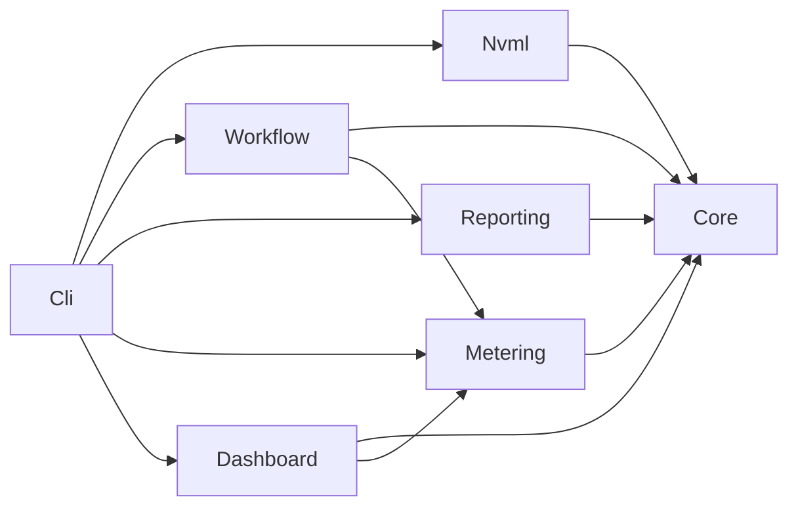
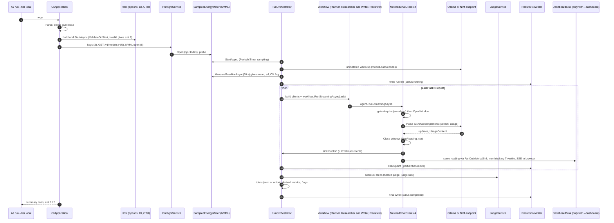

# Agent Joules - technical design

Status: binding input for the build session. Date: 2026-10-18. Author: system-architect.

Evidence labels used throughout: **verified (source)** = read in the named file or package, or measured with a named command; **inferred** = follows from verified facts, not executed; **assumed** = a decision input with no evidence, to be confirmed by the builder at the named step. Two source shorthands: "fork" = `D:\src\github\agent-framework\dotnet` (VersionPrefix 1.23.0, verified `dotnet/nuget/nuget-package.props` line 4); "stack-facts" = `docs/design/stack-facts.md` (throwaway probe projects measured on this laptop by csharp-expert, 2026-10-18).

## 1. Purpose, scope and binding inputs

This document fixes the architecture of the AgentJoules prototype so that the build session implements it without re-deciding structure, libraries or contracts. It covers code, tests, CI and the code paths that produce or consume documents. It does not write the documents themselves (README prose, methodology, posts, Devpost files); those are builder deliverables listed in the traceability matrix (section 3.9).

Binding inputs, in priority order:

| Input | Content | Rule |
|---|---|---|
| `docs/agent-joules.prompt.md` Layer 1 sections 2, 4, 5, 6, 8, 10, 11 | decisions, stack, tiers, honesty, secrets, time boxes, design constraints | wins over this document |
| Layer 2 REQ-001 to REQ-032, EDGE-001 to EDGE-019 (REQ-032, EDGE-018 and EDGE-019 added by user decision 2026-10-18), Out of scope, Definition of Done | acceptance criteria | every item maps to a component and a file in section 3.9 and section 5.2 |
| This document | everything the prompt leaves to "the builder" | recorded as ADRs in section 8 |

Where this document and the prompt disagree, the prompt wins and the builder records the conflict in `docs/build-log.md`. Known conflicts are listed in section 9.2.

## 2. Solution layout

### 2.1 Repository tree (code-relevant part)

```
agent-joules/
  AgentJoules.slnx                 single solution (SDK 10 default format)
  global.json  Directory.Build.props  Directory.Packages.props  .editorconfig (extended)
  src/AgentJoules.Nvml/            native NVML binding, power-source detection
  src/AgentJoules.Core/            domain: labels, readings, meter, math, cost, options, results model
  src/AgentJoules.Metering/        IChatClient middleware, retry, gate, sink, OTel instruments
  src/AgentJoules.Workflow/        providers, agents, executors, workflow, orchestration, judge
  src/AgentJoules.Reporting/       JSON context, schema, validation, Markdown, SVG, HTML, README, content
  src/AgentJoules.Dashboard/       live dashboard: Kestrel minimal API, SSE, embedded page, replay
  src/AgentJoules.Cli/             System.CommandLine + Generic Host composition root
  tests/AgentJoules.TestSupport/   fakes and fixture builders (class library, not a test project)
  tests/AgentJoules.UnitTests/     xUnit unit tests (contains the six REQ-023 class names)
  tests/AgentJoules.Specs/         Reqnroll BDD scenarios
  tests/AgentJoules.IntegrationTests/  gated by AGENTJOULES_INTEGRATION=1
  config/appsettings.json  config/prices.json  config/prices.schema.json  config/judge-rubric.md
  tasks/01-incident-brief.json  tasks/02-api-migration.json  tasks/03-energy-explainer.json
  docs/results-schema.json  docs/.nojekyll  docs/report/ (generated)
  .github/workflows/ci.yml
```

### 2.2 Projects

| Project | Folder | Output | Purpose | Main REQ / EDGE |
|---|---|---|---|---|
| AgentJoules.Nvml | `src/AgentJoules.Nvml` | classlib | `LibraryImport` NVML binding, DllImport resolver, `NvmlGpuTelemetrySource` implementing Core's port, `PowerSourceDetector` (Windows `GetSystemPowerStatus`, Linux `/sys/class/power_supply`) | REQ-003, 006, 031; EDGE-001, 002, 013, 014, 015 |
| AgentJoules.Core | `src/AgentJoules.Core` | classlib | `Metric` label object, readings, `IEnergyMeter` + `SampledEnergyMeter` + `DeterministicEnergyMeter`, integration, baseline, union windows, cost, derived metrics, judge parsing, options + validators, results model, exit codes, redaction | REQ-004, 005, 009, 010, 013, 015, 021, 029; EDGE-003, 004, 005, 007, 012, 017 |
| AgentJoules.Metering | `src/AgentJoules.Metering` | classlib | `MeteredChatClient`, `RateLimitRetryChatClient`, `IMeterGate`, `IMetricsSink`, `AgentJoulesInstruments` | REQ-007, 008, 013, 014; EDGE-006, 007 |
| AgentJoules.Workflow | `src/AgentJoules.Workflow` | classlib | provider clients, agent factory, four executors, workflow factory, task loader, preflight, dry-run, local runtimes, run orchestrator, judge, calibration, cloud budget guard | REQ-010, 011, 012, 013, 017, 020, 021, 031; EDGE-006, 008, 009, 011, 012, 016, 017 |
| AgentJoules.Reporting | `src/AgentJoules.Reporting` | classlib | source-generated JSON context, results writer, schema generator and validator, run-file naming and selection, Markdown, SVG, HTML, README block, content renderer, endpoints.md parser | REQ-015, 016, 018, 025, 026, 030; EDGE-003, 004, 007, 016 |
| AgentJoules.Dashboard | `src/AgentJoules.Dashboard` | classlib + `FrameworkReference Microsoft.AspNetCore.App` | in-process Kestrel minimal API on 127.0.0.1, `DashboardSink`, SSE endpoint, embedded page, replay service | REQ-032; EDGE-018, 019 |
| AgentJoules.Cli | `src/AgentJoules.Cli` | exe | commands `probe`, `run`, `report`, `validate`, `calibrate`, `dashboard`; host, DI, logging, telemetry, exit-code mapping | REQ-006, 014, 017, 018, 021, 029, 032 |
| AgentJoules.TestSupport | `tests/AgentJoules.TestSupport` | classlib | `FakeChatClient`, `ScriptedNvmlApi`, `FakeHttpMessageHandler` (+ SSE builder), `RunDocumentFixtures`, `TempWorkspace`, `CliHarness`, `FakeTimeDriver` | test seams |
| AgentJoules.UnitTests | `tests/AgentJoules.UnitTests` | test | all unit tests, no GPU, network or keys | REQ-023 |
| AgentJoules.Specs | `tests/AgentJoules.Specs` | test | Reqnroll features driving the CLI in-process with fakes | stories (product-owner) |
| AgentJoules.IntegrationTests | `tests/AgentJoules.IntegrationTests` | test | NVML on the laptop, live endpoints; skipped unless `AGENTJOULES_INTEGRATION=1` | REQ-003, 023 |

Dependency graph (no cycles; Core has no native, AI or ASP.NET dependency; only Dashboard references ASP.NET Core):



### 2.3 Build files

`global.json` (stack-facts section 11, verified):

```json
{ "sdk": { "version": "10.0.401", "rollForward": "latestPatch", "allowPrerelease": false } }
```

There is deliberately **no** `"test"` section: the repository runs VSTest (ADR-03). `latestPatch` pins the 10.0.4xx band (verified, Learn global.json page via stack-facts).

`Directory.Build.props` (all projects):

| Property | Value | Reason |
|---|---|---|
| `TargetFramework` | `net10.0` | REQ-001; projects never redeclare it |
| `TreatWarningsAsErrors` | `true` | REQ-001 literal string |
| `Nullable` | `enable` | REQ-001 literal string |
| `ImplicitUsings` | `enable` | idiom |
| `LangVersion` | `latest` | C# 14 on SDK 10 |
| `AnalysisLevel` | `10.0-recommended` | ADR-19 |
| `EnforceCodeStyleInBuild` | `true` | IDE rules with configured severity fail the build |
| `GenerateDocumentationFile` | `true` | required for IDE0005 in build |
| `NoWarn` | `$(NoWarn);CS1591` | no XML-doc obligation on every public member |
| `InvariantGlobalization` | `true` in `src/**` only, set in `src/Directory.Build.props`, which begins with `<Import Project="$([MSBuild]::GetPathOfFileAbove(Directory.Build.props, $(MSBuildThisFileDirectory)../))" />` because MSBuild reads only the nearest `Directory.Build.props` (measured, design-review R-01: without the import `TargetFramework` and `TreatWarningsAsErrors` are lost); test projects leave it unset (`false`) | Reqnroll resolves `en-US` and every scenario throws `CultureNotFoundException` under invariant mode (measured, design-review B-02); formatting correctness comes from explicit `InvariantCulture` (section 5.5), not from this switch. Amended 2026-10-18 (post-M0 review, measured): set as `RuntimeHostConfigurationOption` items in `src/Directory.Build.props`, not as the MSBuild property, because the property is forwarded to the analyzers and silences CA1304 to CA1311 (section 5.5); the Cli runtimeconfig is unchanged. |
| `EnableConfigurationBindingGenerator` | `true` | source-generated options binding; works only with mutable `set` properties (measured, design-review B-01; section 3.2 Options) |
| `IsPackable` | `false` | no NuGet publishing (Out of scope) |
| `Deterministic`, `ContinuousIntegrationBuild` (CI only) | `true` | reproducible builds |

`tests/Directory.Build.props` imports the root file and adds `IsTestProject=true` (except TestSupport), `NoWarn` `CA1707;CA2007;CA1515`, and the shared test packages. `src/AgentJoules.Nvml` alone sets `AllowUnsafeBlocks=true` (required by `LibraryImport` with `Span<byte>` buffers). `src/AgentJoules.Dashboard` alone carries `<FrameworkReference Include="Microsoft.AspNetCore.App" />` (shared framework, no NuGet package; reference pack `Microsoft.AspNetCore.App.Ref/10.0.12` present on this machine, verified by listing) and `<EmbeddedResource Include="wwwroot/index.html" LogicalName="AgentJoules.Dashboard.index.html" />`; the framework reference flows to Cli and the test projects that reference Dashboard (inferred).

`.editorconfig` additions (append to the existing file, keep its content): `csharp_style_namespace_declarations = file_scoped:warning`; `dotnet_diagnostic.IDE0005.severity = warning`; `dotnet_diagnostic.IDE0161.severity = warning`; `dotnet_diagnostic.CA1305.severity = warning`; `CA1304`, `CA1307`, `CA1309`, `CA1310` at `warning`; `dotnet_diagnostic.CA1848.severity = warning` (forces `[LoggerMessage]`); `[*.{cs,json,md,svg,html}] end_of_line = lf`. A rule that yields a false positive is suppressed in `.editorconfig` with a one-line comment giving the reason, never with an unexplained `#pragma`.

`.gitattributes` change (REQ-001, REQ-024): prepend `* text=auto eol=lf` as the first line of the existing file and keep every other line (including `*.ps1 text eol=crlf`). Reason: this laptop has `core.autocrlf=true` (measured, design-review M-02), the current `* text=auto` has no `eol`, and `dotnet format --verify-no-changes` exits 2 with `ENDOFLINE` on CRLF files when `end_of_line = lf` (measured); with `eol=lf` every checkout, including `windows-latest`, stays LF. The worktree is already LF (0 CR bytes, measured 2026-10-18). `ReadmeResultsBlock` normalizes with `ReplaceLineEndings("\n")` before comparing and writing.

`.gitignore` additions (section 8 requires the first three; verified absent by grep on 2026-10-18): `*.pem`, `id_ed25519*`, `id_rsa*`, `results/*.partial`. `artifacts/` is already ignored (existing line 66) and holds the linux-x64 publish and the demo run (section 10).

### 2.4 Central package versions (`Directory.Packages.props`, `ManagePackageVersionsCentrally=true`)

| Package | Version | Evidence | Referenced by |
|---|---|---|---|
| Microsoft.Agents.AI | 1.23.0 | verified (nuget.org flat container 2026-10-18; prompt pin) | Workflow |
| Microsoft.Agents.AI.Abstractions | 1.23.0 | verified (same) | Workflow |
| Microsoft.Agents.AI.Workflows | 1.23.0 | verified (same; nuspec depends on MEAI 10.10.0, MEAI.Abstractions 10.10.1, OpenTelemetry.Api 1.18.0) | Workflow |
| Microsoft.Agents.AI.OpenAI | 1.23.0 | verified (nuspec depends on MEAI.OpenAI 10.10.1, OpenAI 2.14.0) | Workflow |
| Microsoft.Extensions.AI | 10.10.0 | verified (prompt pin, fork `Directory.Packages.props` line 87) | Metering, Workflow |
| Microsoft.Extensions.AI.Abstractions | 10.10.1 | verified (fork line 88) | Metering |
| Microsoft.Extensions.AI.OpenAI | 10.10.1 | verified (fork line 92) | Workflow |
| OpenAI | 2.14.0 | verified (fork line 136) | Workflow |
| OpenTelemetry, .Extensions.Hosting, .Exporter.Console, .Exporter.OpenTelemetryProtocol | 1.18.0 | verified (fork lines 72-77) | Cli |
| OpenTelemetry.Exporter.InMemory | 1.18.0 | verified (fork line 75) | UnitTests |
| Microsoft.Extensions.Hosting | 10.0.12 | verified (fork line 103, nuget.org) | Cli |
| Microsoft.Extensions.Http | 10.0.12 | verified (nuget.org) | Workflow |
| System.CommandLine | 2.0.13 | verified (stack-facts section 4: GA since 2.0.0 on 2025-11-11, net8.0 asset runs on net10.0) | Cli |
| JsonSchema.Net | 8.0.5 | verified (nuspec: MIT; every 9.x is `OSMFEULA.txt`, not OSI; lib net9.0 used on net10.0) | Reporting |
| xunit | 2.9.3 | verified (stack-facts sections 5, 6, project `rq2` exit 0) | test projects |
| xunit.runner.visualstudio | 3.1.5 | verified (same) | test projects |
| Microsoft.NET.Test.Sdk | 18.11.0 | verified (same) | test projects |
| Reqnroll.xUnit | 3.3.4 | verified (same; net10.0 listed on the Reqnroll compatibility page) | Specs |
| Microsoft.Extensions.TimeProvider.Testing | 10.11.0 | verified (stack-facts section 12) | TestSupport, UnitTests, Specs |

No version attribute appears in any `.csproj` (REQ-002). No AgentHooks, Mcp, DevUI, A2A, Tools.Shell or Workflows.Generators package is referenced. Not referenced on purpose: OllamaSharp (ADR-09), any mocking library (section 6.1), any charting or browser package (REQ-016), `Microsoft.AspNetCore.TestHost` (dashboard server tests use a real loopback socket, section 6.2). The dashboard (REQ-032) needs no new pin: ASP.NET Core 10 comes from the shared framework of the installed runtime.

## 3. Component design

Signatures below are illustrative contracts; names are binding, bodies are the builder's.

### 3.1 AgentJoules.Nvml

Files: `Interop/NvmlNative.cs` (LibraryImport declarations), `Interop/NvmlLibraryResolver.cs`, `Interop/NvmlReturn.cs`, `NvmlApi.cs` (`INvmlApi` real implementation), `NvmlGpuTelemetrySource.cs`, `NvmlGpuTelemetrySourceFactory.cs`, `Platform/PowerSourceDetector.cs`, `AssemblyAttributes.cs`.

- `AssemblyAttributes.cs` carries `[assembly: DefaultDllImportSearchPaths(DllImportSearchPath.System32)]` and `[assembly: DisableRuntimeMarshalling]`. Verified (stack-facts section 8): every `LibraryImport` raises CA5392 without the first attribute; adding `AssemblyDirectory` raises CA5393; System32 alone builds clean.
- `NvmlLibraryResolver` registers once (static `Lazy<bool>`) through `NativeLibrary.SetDllImportResolver(typeof(NvmlNative).Assembly, Resolve)` for the logical name `nvml`. Candidates: Windows `nvml.dll` via `NativeLibrary.TryLoad(name, assembly, DllImportSearchPath.System32, out h)`, then the absolute path `%ProgramW6432%\NVIDIA Corporation\NVSMI\nvml.dll` via `TryLoad(path, out h)`; Linux and WSL2 `libnvidia-ml.so.1`, then `libnvidia-ml.so`. Returning `IntPtr.Zero` lets the runtime throw `DllNotFoundException` on the first call. Verified (stack-facts section 8, `lib/P.cs`: a missing mapping surfaces as `DllNotFoundException`); Linux resolution inferred (no Linux NVIDIA host here; WSL2 exposes the library under `/usr/lib/wsl/lib`, inferred). Amended 2026-10-19 (AJ-021 security gate, measured): the bare Windows name is loaded through its full path under `Environment.SystemDirectory` with `NativeLibrary.TryLoad(path, out h)`, never with the `(name, assembly, DllImportSearchPath.System32)` overload, because the .NET host probes its own native-library folders before honouring the flag (an `nvml.dll` beside a self-contained executable would win); the Linux soname is loaded with `TryLoad(name, out h)` (direct dlopen); when no candidate loads for the logical name `nvml` the resolver throws `DllNotFoundException` instead of returning zero, so the runtime's default search never probes the application folder (the exception type the factory catches is unchanged); the first non-zero handle is cached in a static and returned for every import (the runtime does not cache resolver results); the NVSMI candidate is added only for a fully qualified `ProgramW6432`. The candidate list of the story (`nvml.dll` then the NVSMI path) is unchanged; the load path is what changed. Linux resolution was measured on 2026-10-19 in Docker containers on the laptop (missing library: DllNotFoundException naming both sonames; `--gpus all`: the soname loads and reads the GPU); the cloudgpu VM remains to be exercised.
- `NvmlNative`: one `[LibraryImport("nvml", EntryPoint = "...")]` per function, `int` return, `nint` device handle, `Span<byte>`/`byte*` for `char*` buffers decoded as UTF-8 up to the first NUL (no `StringMarshalling`, verified SYSLIB1051 otherwise). Each declaration carries a comment citing `https://docs.nvidia.com/deploy/nvml-api/api/group__nvmlDeviceQueries.html` (or the system-queries group). Amended 2026-10-19 (AJ-021, measured): `nvmlInit_v2` and `nvmlShutdown` cite `group__nvmlInitializationAndCleanup.html`, `nvmlDeviceGetMigMode` cites `group__nvmlMultiInstanceGPU.html` where it is documented, all in the `/api/` path form; the deprecated `nvmlDeviceGetCurrentClocksThrottleReasons` is declared next to the new export.

NVML functions used (signatures and units verified against `nvml.h` 13.4.92 and executed on the laptop, stack-facts section 9):

| Function | Use | Unit / handling |
|---|---|---|
| `nvmlInit_v2`, `nvmlShutdown` | session lifecycle | ref-counted by NVML; one pair per process |
| `nvmlSystemGetDriverVersion` | probe | buffer 80 |
| `nvmlDeviceGetCount_v2`, `nvmlDeviceGetHandleByIndex_v2` | device selection (`Gpu:Index`) | index out of range = no device |
| `nvmlDeviceGetName`, `nvmlDeviceGetUUID` | probe, environment | buffer 96 each |
| `nvmlDeviceGetVbiosVersion`, `nvmlDeviceGetCudaComputeCapability` | probe | `N/A` on non-zero rc (signatures inferred from the NVML reference, not executed in stack-facts) |
| `nvmlDeviceGetEnforcedPowerLimit` | probe | mW / 1000 |
| `nvmlDeviceGetPowerUsage` | sampling, avg/peak W | mW; 1 s driver average on Ampere and newer except GA100 |
| `nvmlDeviceGetTotalEnergyConsumption` | counter method | mJ since driver load; rc 3 = unsupported |
| `nvmlDeviceGetMigMode` | probe, cloudgpu precondition | rc 3 (measured on the laptop) = `not-supported`, treated as MIG off |
| `nvmlDeviceGetCurrentClocksEventReasons`, fallback `nvmlDeviceGetCurrentClocksThrottleReasons` | EDGE-013 | new export first; on `EntryPointNotFoundException` use the deprecated name; both fail = unsupported |

Throttle bits mapped to reason strings (inferred from `nvml.h` macro names; builder copies values from the header): `SwPowerCap` 0x4, `HwSlowdown` 0x8, `SwThermalSlowdown` 0x20, `HwThermalSlowdown` 0x40, `HwPowerBrakeSlowdown` 0x80. Any of these sets flag `throttled`.

```csharp
public interface INvmlApi                       // seam for ScriptedNvmlApi in tests
{
    NvmlReturn Init();
    NvmlReturn Shutdown();
    NvmlReturn GetHandleByIndex(uint index, out nint device);
    NvmlReturn GetPowerUsage(nint device, out uint milliwatts);
    NvmlReturn GetTotalEnergyConsumption(nint device, out ulong millijoules);
    NvmlReturn GetClocksEventReasons(nint device, out ulong reasons);
    NvmlReturn GetMigMode(nint device, out uint current, out uint pending);
    // plus GetCount, GetName, GetUuid, GetVbios, GetComputeCapability, GetPowerLimit, GetDriverVersion
}
```

Lifecycle: `NvmlGpuTelemetrySourceFactory.Open(int gpuIndex)` returns `GpuOpenResult` = `Available(IGpuTelemetrySource)` or `Unavailable(string reason)`. It catches `DllNotFoundException`, `EntryPointNotFoundException` and `BadImageFormatException` and maps a non-zero `nvmlInit_v2` rc to `Unavailable`; no exception escapes the library (REQ-003). `NvmlGpuTelemetrySource : IGpuTelemetrySource` owns the session: `Dispose` calls `nvmlShutdown` exactly once (Interlocked flag); it has no lock of its own because every read happens under the meter lock (section 5.3), which keeps timestamp, read and append atomic. A `SafeHandle` is not used for the device handle because NVML device handles are borrowed, not owned; the owned resource is the init/shutdown pair, modelled by `IDisposable`. Amended 2026-10-19 (AJ-022): `NvmlGpuTelemetrySource` keeps one private lock of its own (taken after an Interlocked dispose check and re-checked inside it) because the probe command reads outside any meter lock; the lock never calls out, so it cannot deadlock with the meter lock of section 5.3; `Dispose` swallows the three native exception types from `nvmlShutdown`; `Open` shuts the session down in a `finally` on any exception after a successful `nvmlInit_v2`, and only the three native types map to `Unavailable`; the constructor is internal, the factory is the only producer.

Amended 2026-10-19 (AJ-021 code-review gate): the clock-event fallback (new export, then the deprecated `nvmlDeviceGetCurrentClocksThrottleReasons`, then `NotSupported` when both are missing) lives in `Interop/ClocksEventReader.cs` behind two injected `NvmlClocksExport` delegates so every path is unit-tested; a missing export surfaces as `NotSupported` from the seam, never as `EntryPointNotFoundException`.

`PowerSourceDetector.Detect()` returns `ac`, `battery` or `unknown`: Windows `GetSystemPowerStatus` (`LibraryImport("kernel32.dll")`, ACLineStatus 1 = ac, 0 = battery); Linux reads `/sys/class/power_supply/*/type` = `Mains` and `online`; no supply files (VM, WSL2) = `unknown` (inferred paths).

### 3.2 AgentJoules.Core

Folders and files: `Labels/Metric.cs`, `Labels/MetricLabel.cs`, `Labels/ReadingFlags.cs`; `Gpu/IGpuTelemetrySource.cs`, `Gpu/GpuIdentity.cs`, `Gpu/ProbeResult.cs`; `Energy/IEnergyMeter.cs`, `Energy/SampledEnergyMeter.cs`, `Energy/DeterministicEnergyMeter.cs`, `Energy/UnmeteredEnergyMeter.cs`, `Energy/PowerSample.cs`, `Energy/PowerIntegrator.cs`, `Energy/BaselineCalculator.cs`, `Energy/ReadingCalculator.cs`, `Energy/UnionWindowCalculator.cs`, `Energy/EnergyReading.cs`; `Cost/PriceTable.cs`, `Cost/CostCalculator.cs`; `Quality/JudgeScoreParser.cs`, `Quality/DerivedMetrics.cs`; `Configuration/*Options.cs`, `Configuration/*Validator.cs`; `Results/*.cs` (results model records); `Runs/StepIdentity.cs`, `Runs/Tier.cs`, `Runs/IRunCheckpointWriter.cs`, `Runs/CloudGpuBudgetGuard.cs`; `Cli/ExitCode.cs`, `Cli/AgentJoulesException.cs`; `Security/SecretRedactor.cs`; `CoreJsonContext.cs` (tasks, prices).

**Label object.** `Metric` is the only representation of a metric value anywhere in the code.

```csharp
public enum MetricLabel
{
    [JsonStringEnumMemberName("measured")] Measured,
    [JsonStringEnumMemberName("estimated")] Estimated,
    [JsonStringEnumMemberName("model-judged")] ModelJudged,
    [JsonStringEnumMemberName("N/A")] NotApplicable,
    [JsonStringEnumMemberName("not-reported")] NotReported,
}
public sealed record Metric
{
    [JsonConstructor]   // private: validates value/label/reason together, throws on any violation
    private Metric(double? value, MetricLabel label, string? reason, string? unit, string? currency) { ... }
    public double? Value { get; }            // always serialized, null included
    public MetricLabel Label { get; }
    [JsonIgnore(Condition = JsonIgnoreCondition.WhenWritingNull)] public string? Reason { get; }
    [JsonIgnore(Condition = JsonIgnoreCondition.WhenWritingNull)] public string? Unit { get; }
    [JsonIgnore(Condition = JsonIgnoreCondition.WhenWritingNull)] public string? Currency { get; }
    // only public entry points: Measured(v, unit), Estimated(v, currency), ModelJudged(v), NotApplicable(reason), NotReported(reason)
}
```

The constructor sees all five values at once, so the invariant check is real (an `init`-assigned label would be set after the constructor ran, design-review N-01); source-generated serialization with `JsonStringEnumMemberName` and the private `[JsonConstructor]` round-trips (`"label": "N/A"`, verified by design-review).

Amended 2026-10-19 (AJ-024 code-review gate, measured): a private `[JsonConstructor]` is not accessible to the System.Text.Json source generator (SYSLIB1222, an error under warnings-as-errors; `Deserialize` through a `JsonSerializerContext` throws NotSupportedException), and a missing `label` would deserialise as `measured` (the enum default). `Metric` therefore carries `[JsonConverter(typeof(MetricJsonConverter))]`: the converter writes `value` (always, null included), `label` from one ordered table of the five strings, then `reason`, `unit` and `currency` when non-null, independent of the caller's naming policy or enum converter; it reads strictly (both `value` and `label` required, ordinal label match, number tokens, unknown and duplicate properties rejected with JsonException) and calls the private validating constructor, whose ArgumentException surfaces unwrapped. A source-generated context needs no option for `Metric`; `UseStringEnumConverter` and camelCase stay for the other types. The constructor also rejects a `reason` on a valued label, a `unit` outside `measured` and a `currency` outside `estimated`. The schema (`$defs`) is hand-written for `Metric`, so an opaque converter costs nothing (line 423). `MetricLabel` is numbered from 1 so `default(MetricLabel)` is never a valid label. Unit and currency rule (design addition 2026-10-19, raised by all three AJ-024 gates: the five factory signatures could not express the design's own `totals.gco2e` labelled estimated with unit gCO2e, REQ-032 R3's estimated running joules, a model-judged value with a unit, or a measured cost carrying its currency as the prompt requires of every cost): a measured or estimated value carries exactly one of `unit` or `currency`; a model-judged value carries an optional `unit` and never a `currency`; N/A and not-reported carry a `reason` and neither `unit` nor `currency`; `reason` is forbidden on the three valued labels. Factories: `Measured(v, unit)`, `MeasuredCost(v, currency)`, `Estimated(v, currency)`, `EstimatedQuantity(v, unit)`, `ModelJudged(v)`, `ModelJudged(v, unit)`, `NotApplicable(reason)`, `NotReported(reason)`; these are the only public entry points. The context that holds the results records (AJ-055, AJ-078) needs `RespectNullableAnnotations = true` and `RespectRequiredConstructorParameters = true` (or `required` members), because a JSON `null` or a missing key for a non-nullable `Metric` member bypasses the converter and yields a null reference (measured by the code-review gate); `Metric` itself needs no context option. Error messages that echo document text are bounded to 64 characters with control, format and separator characters replaced (`TextEcho`), shared by `ReadingFlagNames.Parse` and `MetricJsonConverter`.

`JsonStringEnumMemberNameAttribute` verified in the net10.0 reference pack (`System.Text.Json.xml`). The invariant "value null exactly when N/A or not-reported, never 0" is enforced in the constructor, in the schema and in a unit test (REQ-015).

**GPU port.**

```csharp
public interface IGpuTelemetrySource : IDisposable
{
    GpuIdentity Identity { get; }        // name, uuid, driver, vbios, compute capability, power limit W, MIG mode
    bool EnergyCounterSupported { get; }
    double ReadPowerWatts();
    double? ReadEnergyMillijoules();     // null when the counter is unsupported
    ThrottleReasons ReadThrottleReasons();
}
public interface IGpuTelemetrySourceFactory { GpuOpenResult Open(int gpuIndex); }
```

Amended 2026-10-19 (AJ-022): `IGpuTelemetrySource` also exposes `string? EnergyCounterUnsupportedReason` (`counter-not-supported: NVML_ERROR_NOT_SUPPORTED` for rc 3, `counter-not-supported: <code>` otherwise, null when supported) for the AJ-027 selector and the probe; `ReadPowerWatts`, `ReadEnergyMillijoules` and `ReadThrottleReasons` throw `InvalidOperationException` on a failed read (never 0) and `ObjectDisposedException` after Dispose; `GpuOpenResult` carries `[MemberNotNullWhen]` hints on `IsAvailable`.

**Energy meter (REQ-004, REQ-005, REQ-013, ADR-16).** One process-wide meter per measured tier. `SampledEnergyMeter` runs a single background loop over `PeriodicTimer(TimeSpan.FromSeconds(1.0 / options.SampleRateHz), timeProvider)` (`SampleRateHz` is a `double`; integer division would yield a zero period) (constructor verified in the reference pack and executed with `FakeTimeProvider`, stack-facts section 12) that appends `PowerSample(double Seconds, double Watts, ThrottleReasons Reasons)` to a lock-protected buffer. Timestamps come from `TimeProvider.GetTimestamp()` and are converted to seconds since meter start, so integration uses actual sample times, never the nominal interval. A window is a time slice of that buffer: opening a window takes an immediate sample and a counter read, closing does the same, so every window has edge samples at its exact boundaries. For the dashboard the loop also calls `ILiveEventSink.Emit(new PowerEvent(...))` with a sample it already took, at most once per `Dashboard:PowerIntervalMs` (default 100 ms; when the interval is shorter than the sampling period `1000 / SampleRateHz`, every sample is forwarded and the effective interval is the sampling period); no extra NVML call is made, so the dashboard adds no GPU work (REQ-032 R2).

```csharp
public interface IEnergyMeter : IAsyncDisposable
{
    MeterCapabilities Capabilities { get; }     // Method (counter|sampling), CounterSupported, SampleRateHz, IsFallback
    ValueTask StartAsync(CancellationToken cancellationToken);
    ValueTask<BaselineResult> MeasureBaselineAsync(TimeSpan duration, double maxCoefficientOfVariation, CancellationToken cancellationToken);
    IMeterWindow OpenWindow();
    UnionEnergy ComputeUnion(IReadOnlyList<WindowSpan> windows);   // concurrent-mode totals
}
public interface IMeterWindow { WindowSpan Span { get; } EnergyReading Close(); }
```

Amended 2026-10-19 (AJ-027): `MeterCapabilities` also carries `CounterUnsupportedReason` (`counter-not-supported: NVML_ERROR_NOT_SUPPORTED` or `counter-not-supported: <code>`, null when supported) and validates its own state; `MeterMethodSelector` exposes `Parse`, `TrySelect` and `Select` (see the build log, AJ-027); the selector performs no counter read of its own, the factory's single read at Open is the REQ-004 probe.

Amended 2026-10-19 (AJ-028): `throttleReasons` follows a coverage rule: the names of the set power and thermal bits when any window sample carries one, an empty list only when every sample of the window was supported and none carried one, and null when any sample was unsupported and nothing was active (a negative claim needs full coverage); the five mapped bits are SwPowerCap 0x4, HwSlowdown 0x8, SwThermalSlowdown 0x20, HwThermalSlowdown 0x40 and HwPowerBrakeSlowdown 0x80 (values verified against nvml.h); DisplayClockSetting 0x100, BoardLimit 0x200 and Reliability 0x400 are unmapped pending D-13.

Amended 2026-10-19 (AJ-029): the meter contract as shipped: `IEnergyMeter` has `Capabilities`, `StartAsync` and `OpenWindow` without `MeasureBaselineAsync` until AJ-030 adds it with its result type; `WindowSpan` is a record of start and stop in seconds; a sample at the same instant as the buffer's last sample replaces it (an edge sample supersedes a tick at the same instant); skipped failed or non-finite or negative power reads and throttle read failures are counted (`SkippedReadCount`, `ThrottleReadFailures`); counter marks are taken at open and close only under the `Counter` method, with the delta `(long)Math.Round(close - open)` behind a range guard; a zero-duration `Close` throws `InvalidOperationException` and produces no reading; the meter never disposes the source. Fix round (2026-10-19): `LoopFault` (Exception?, under the lock): a source exception other than InvalidOperationException or ObjectDisposedException ends the loop; OpenWindow and Close then throw InvalidOperationException "The sampling loop stopped." with the source exception as inner, while DisposeAsync observes the fault without rethrowing and is a no-op the second time; the constructor rejects a period in milliseconds that is not finite or outside [1, uint.MaxValue - 1] with ArgumentOutOfRangeException; a wattage above uint.MaxValue / 1000.0 (4,294,967.295 W, the NVML milliwatt ceiling) is skipped and counted; a negative raw counter difference is floored so it never rounds to 0 and reads counter-went-backwards.

Amended 2026-10-19 (AJ-030): `MeasureBaselineAsync` carries the threshold parameter (`MeasureBaselineAsync(duration, maxCoefficientOfVariation, cancellationToken)`). `BaselineResult` is a record of `MeanW` and `StdDevW` (Metric, unit W), `Seconds`, `SampleCount`, `CoefficientOfVariation` (double?), `MaxCoefficientOfVariation` and `Flags`. The meter takes its two edge samples at the start and at the stop of the wait, and waits `Task.Delay(duration, timeProvider, token)` without holding the lock, copying the stop slice under the lock. A stored mean is set only when the mean is measured, and any earlier baseline is cleared by a not-reported result (a later net then reads `no-baseline`). `ConsoleReporter` (src/AgentJoules.Cli/Output) writes the criterion 3 line `Warning: idle baseline unstable (CV 0.20 > 0.10)` plus the writer's NewLine to the error writer only when the baseline is flagged. Fix round (2026-10-19): `MeasureBaselineAsync` rejects a duration below 1 ms (Task.Delay with a TimeProvider waits whole milliseconds) and above uint.MaxValue - 1 ms; the meter links a meter-owned interrupt token, cancelled when the loop ends and by `DisposeAsync`, into the delay; the statistics are computed and the mean stored inside the stop lock; a non-finite coefficient of variation is rejected as a statistics overflow; `BaselineResult` validates its state in a public `[JsonConstructor]` constructor (CV null if and only if MeanW is not measured; `baseline-unstable` if and only if CV is strictly above the threshold).

Amended 2026-10-19 (AJ-031): `DeterministicEnergyMeter` is in `src/AgentJoules.Core/Energy/Testing/DeterministicEnergyMeter.cs`, namespace `AgentJoules.Core.Energy.Testing`. Its constructor takes a `TimeProvider`, a `Func<double, double>` watts-at-time function, the sample rate, the counter-support switch, the `MeterMethodSetting` and an optional baseline mean. Its grid rule synthesizes samples at the start edge, at every grid instant k / rate strictly inside the window and at the stop edge, with a 1e-9 tolerance so an edge on the grid is not duplicated, and a cap of 1,000,000 samples per window (32 MB), a time-domain clamp of the first and last grid indices (`firstIndex / rate <= start` advances, `lastIndex / rate >= stop` retreats) applied after the tolerance, the rate bounds of the real meter (period within [1, uint.MaxValue - 1] ms), a faulted or cancelled ValueTask for argument and state errors (only an error thrown by wattsAt escapes the call), a second StartAsync throws InvalidOperationException, and a wattage ceiling of 4,294,967.295 W (negative or non-finite refused); both baseline edges come from the clock (TimeSpan ticks, so the stop never drifts past a grid instant), the cap is decided on the exact synthesized count (exactly 1,000,000 accepted) with a baseline pre-check guaranteeing the ArgumentOutOfRangeException(duration) path, the power function's ArgumentException and InvalidOperationException fault the baseline task while any other exception from it leaves the call, a cancelled token surfaces as OperationCanceledException exactly, and the architecture test scans type names, global usings and project files; the counter delta is the trapezoid integral in millijoules rounded to a long. `MeasureBaselineAsync` completes synchronously over the virtual interval with `BaselineCalculator`. The feature's bindings are scoped (`[Scope(Feature = ...)]`) so that the unscoped step texts of AJ-026 and AJ-029 stay unambiguous.

Amended 2026-10-20 (AJ-040): `EnergyMethod` gains `Unmetered` (JSON `unmetered`) for the hosted-tier `UnmeteredEnergyMeter`; `MeterCapabilities` accepts it only with the counter unsupported, reason `hosted-tier`, rate 0 and no fallback, and `Describe()` prints `Energy method: unmetered (hosted tier)`; an unmetered `EnergyReading` carries four N/A `hosted-tier` metrics, sample count 0, rate 0, no flags and null throttle reasons; `ReadingCalculator` and `StepReading.Method` reject `Unmetered`, so it never reaches a results file (a hosted step stores `method: null`). The shape rules shared by `EnergyReading` and `StepReading` live in the internal `Energy/EnergyShapeRules.cs`. The `Tier` and `EnergyMethod` JSON converters are exact-match converters (string token, lowercase literal names), and `AgentJoulesJsonContext` sets `AllowDuplicateProperties = false`; the results context of AJ-055 must also set `RespectRequiredConstructorParameters` and the schema generator must add `enum` lists for `tier` and `method`.

`ReadingCalculator.Compute(...)` is the single pure function both meters call. Rules:

- Sampling integral: trapezoid between consecutive samples; the first sample is held from window start to its timestamp and the last from its timestamp to window stop. With 21 samples of 50 000 mW at 0.0 to 2.0 s the result is 100 J (REQ-004 test).
- `grossJoules` = counter delta / 1000 when the method is `counter`, else the sampling integral. `avgW` = sampling integral / duration (time-weighted), `peakW` = max sample, `sampleCount` = samples inside the window including both edges, `sampleRateHz` = configured rate. These four always come from samples (REQ-005).
- `netJoules` = gross - baseline mean W x duration s; negative values are kept and flagged `below-baseline`.
- Flags: `sampling-fallback` only when `Meter:Method=auto` fell back (forced `sampling` is not a fallback); `low-resolution` when duration < 2 / SampleRateHz (EDGE-003); `throttled` when any window sample carries a power or thermal reason, with `throttleReasons` filled (EDGE-013). `shared-window` is added later by the run assembler (concurrent mode).
- Baseline (`BaselineCalculator`): mean and population standard deviation of the samples over `Baseline:Seconds`; coefficient of variation = sd / mean; above `Baseline:MaxCoefficientOfVariation` sets `baseline-unstable` in `baseline.flags` and the CLI prints `Warning: idle baseline unstable (CV 0.20 > 0.10)` (EDGE-005).
- Union (`UnionWindowCalculator`): merge overlapping `WindowSpan`s; counter method sums counter deltas at merged-segment boundaries (every boundary is some window's open or close, where a counter mark was recorded); sampling method integrates the buffer over merged segments; net subtracts baseline x union duration.

`DeterministicEnergyMeter` (public, namespace `AgentJoules.Core.Energy.Testing`) satisfies "deterministic fake" (REQ-005): constructed with a `TimeProvider`, a power function `Func<double, double> wattsAt`, a sample rate and a counter-support switch; on `Close` it synthesizes samples on the nominal grid between the window's start and stop (edges included), exposes `LastWindowSampleCount`, and computes the reading with the same `ReadingCalculator`. (constructor also takes the method setting and an optional baseline mean, 2026-10-19 AJ-031) `UnmeteredEnergyMeter` serves hosted tiers: every reading's energy metrics are `N/A` with reason `hosted-tier`.

**Cost (REQ-009).** `PriceTable.Load(path)` reads `config/prices.json`: rows `{ tier, modelId, inputUsdPer1M, outputUsdPer1M, sourceUrl, retrievedDate }`, validated against `config/prices.schema.json` (both `sourceUrl` and `retrievedDate` required, price fields `exclusiveMinimum: 0` so a zero price is unrepresentable). `CostCalculator.Compute(StepIdentity, TokenCounts, EnergyReading, double wallSeconds)` returns one `Metric` labelled `estimated` with currency:

| Tier | Formula | Missing input |
|---|---|---|
| nvidia, nebius | (in x inputUsdPer1M + out x outputUsdPer1M) / 1e6, USD | no row: N/A, reason = `Tiers:<t>:MissingPriceReason` (`free-tier-no-price` for nvidia, `price-not-found` default); tokens not reported: N/A `tokens-not-reported` |
| local | net J / 3.6e6 x `Cost:ElectricityPricePerKwh`, `Cost:Currency` (EUR) | energy N/A: N/A `energy-not-measured`; net J < 0: N/A `below-baseline` (never a negative cost) |
| cloudgpu | `CloudGpu:HourlyPriceUsd` x step wall seconds / 3600, USD (ADR-15) | price unset: N/A `hourly-price-not-configured` |

Totals group cost by currency (`costByCurrency`), no conversion. `Cost:GCo2ePerKwh` null makes `totals.gco2e` N/A `not-configured`; set, it is net kWh x factor, `estimated`.

**Quality (REQ-010, EDGE-012).** `JudgeScoreParser.Parse(string reply)` strips `<think>...</think>` blocks and surrounding whitespace, then accepts exactly `^[1-5]$`; anything else returns `ParseFailure` with the first 60 characters of the reply. `DerivedMetrics.JoulesPerQualityPoint(netJoules, quality)` and `CostPerQualityPoint(cost, quality)` return `model-judged` values only when both inputs have values, else N/A with reason `missing-input`.

**Options (section 5.1).** One mutable `sealed class` per section with `{ get; set; }` properties, C# defaults where the prompt gives one, and DataAnnotations (`[Required]`, `[Range]`) for mandatory values; **no `required` keyword and no `init` accessors on any type bound from configuration**; dictionaries are `Dictionary<string, TierOptions>` with a getter and initializer; positional records are not used for bound types. Measured by design-review B-01: with the binding generator, `required` members fail with CS9035, and `init` properties are silently never bound (JSON and `AGENTJOULES__*` ignored); `set` properties bind and the environment override wins. `Meter:SampleRateHz` is a `double`. Validation, shaped around the generator's limits (SYSLIB1202 on annotation-free sections and SYSLIB1212 on dictionaries with `[ValidateEnumeratedItems]`, measured as warnings, build errors under warnings-as-errors): `[OptionsValidator] public partial class FlatSectionsValidator : IValidateOptions<AgentJoulesOptions>` (the validated type is the root `AgentJoulesOptions`; design-review R-04) covers only the flat annotated sections (`MeterOptions`, `BaselineOptions`, `CostOptions`; `OptionsValidatorAttribute` verified in Microsoft.Extensions.Options 10.0.12 XML docs), with no `[ValidateObjectMembers]` on annotation-free sections and no `[ValidateEnumeratedItems]`; the hand-written `CrossFieldValidator : IValidateOptions<AgentJoulesOptions>` loops over `Tiers` (known tier names, absolute `BaseUrl`, non-empty `ModelId`, `ExtraBodyJson` parseable, `MaxTokensField` value) and checks cross-section rules (rate below 10 Hz without `AllowBelowMinRate`, `Meter:Method` values, `Judge:Tier` exists). Unit test `ConfigValidationTests.EnvironmentOverrideBinds` sets `AGENTJOULES__Gpu__Index=7` through the in-memory override and asserts 7. 2026-10-19 (AJ-033): `[Range]` is replaced by a Core `MinimumValueAttribute` because the `[OptionsValidator]` generator re-implements `RangeAttribute` with the default message template and drops `ErrorMessage` (measured), so colon-key messages need a custom `ValidationAttribute`; `OptionsLoader` (Bind, ValidateOrThrow, Load) is the host-free entry point used by tests and by AJ-034's host; a wrong-typed value maps to `ConfigurationException` exit 2 with the key path. Fix round (2026-10-19): a wrong-typed value gives one key-only line (the value is not echoed) and `OptionsLoader` never forwards or chains the binder's exception; an internal shape pre-check walks the AgentJoules section against the option types and rejects unknown keys, empty leaf values, and a value where a section belongs or the reverse, one line each; the bounds come from the real meter's limits (`Meter:SampleRateHz` finite, from 1000 / (uint.MaxValue - 1) Hz to 1000 Hz; `Baseline:Seconds` from 0.001 to 4294967.294; `Baseline:MaxCoefficientOfVariation` finite and above 0). (2026-10-19, AJ-033: tests normalise the environment form into an in-memory provider and never set a process variable.)

**Results model (REQ-015).** Records mirroring the prompt's skeleton exactly, camelCase names: `RunDocument { SchemaVersion = "1", Run, Environment, Probe, Baseline, Steps, Judge, Totals }`. Additions beyond the skeleton (allowed, documented in the schema): `run.status` (`running|completed|failed|partial|incomplete`), `run.flags` (`partial-offload`), `run.stopReason`, `run.selfJudged`, `step.throttleReasons`, `judge[].judgedAgent`, `totals.gco2e`, `environment.cloudCostObservedUtc`, `probe.gpuUuid`, `probe.migMode`. `StepReading.OutputText` exists in memory for the judge and is `[JsonIgnore]`; only `outputSha256` and `outputChars` are persisted.

**Exit codes.** `public enum ExitCode { Success = 0, Unexpected = 1, InvalidArguments = 2, MissingKey = 3, ModelNotFound = 4, Unreachable = 5, PreconditionFailed = 6, ContentDiffers = 7 }`. `AgentJoulesException(ExitCode code, string message)` with subclasses `ConfigurationException`, `MissingKeyException`, `ModelNotFoundException`, `EndpointUnreachableException`, `StepFailedException`, `MeasurementPreconditionException`, `ContentDiffersException`.

**Redaction (REQ-029).** `SecretRedactor` holds every configured key value (loaded once at startup from all `ApiKeyVariable`s, `NGC_API_KEY`) and a pattern `nvapi-[A-Za-z0-9_-]{4,}`; `Redact(string)` replaces an `nvapi-` key with the literal public prefix plus `****` (`nvapi-****`) and every other secret (Nebius, NGC) with `****`, so no key entropy reaches a log.

**Cloud budget guard (EDGE-017).** `CloudGpuBudgetGuard(TimeProvider, CloudGpuOptions)` with `BudgetDecision Check()`: stop when `ObservedCostUsd >= CostStopUsd (25)` or `now - TierStartUtc >= TimeBoxHours (4)`, whichever first; returns the stop reason (`cost-cap` or `time-box`).

### 3.3 AgentJoules.Metering

Files: `MeteredChatClient.cs`, `RateLimitRetryChatClient.cs`, `RetryLedger.cs`, `RetryOptions.cs`, `OutcomeClassifier.cs`, `IMeterGate.cs`, `SerializedMeterGate.cs`, `NoOpMeterGate.cs`, `IMetricsSink.cs`, `InMemoryMetricsSink.cs`, `MeteringServices.cs`, `AgentJoulesInstruments.cs`, `ChatClientBuilderMeteringExtensions.cs`.

**Pipeline per agent** (built in Workflow's `AgentFactory`; `ChatClientBuilder` applies factories in reverse order, first `Use` is outermost, verified comment in fork `src/Microsoft.Agents.AI/ChatClient/ChatClientExtensions.cs` lines 57, 112):

```
ChatClientAgent (UseProvidedChatClientAsIs = true) -> OpenTelemetryAgent (UseOpenTelemetry)
  MeteredChatClient            window, gate, reading, sink, instruments
    RateLimitRetryChatClient   429 only, Retry-After, full jitter, ledger
      OpenAIChatClient         OpenAI SDK 2.14.0 with RetryPolicy = new ClientRetryPolicy(0)
```

`UseProvidedChatClientAsIs = true` is required: otherwise `ChatClientAgent` inserts its default decorators (function invocation and others) above our client (verified, fork `ChatClientAgentOptions.cs` lines 50-62).

```csharp
public sealed record StepIdentity(string Agent, string ModelId, Tier Tier, string Task, int Repeat, bool IsJudge);
public sealed record MeteringServices(IEnergyMeter Meter, IMeterGate Gate, IMetricsSink Sink,
    ICostCalculator Cost, AgentJoulesInstruments Instruments, TimeProvider Time,
    ILiveEventSink Live);    // NullLiveEventSink unless --dashboard (section 3.10)

public sealed class MeteredChatClient(IChatClient inner, StepIdentity identity,
    MeteringServices services, RetryLedger ledger) : DelegatingChatClient(inner)
{
    public override Task<ChatResponse> GetResponseAsync(IEnumerable<ChatMessage> messages,
        ChatOptions? options = null, CancellationToken cancellationToken = default);
    public override IAsyncEnumerable<ChatResponseUpdate> GetStreamingResponseAsync(IEnumerable<ChatMessage> messages,
        ChatOptions? options = null, CancellationToken cancellationToken = default);
}
```

`DelegatingChatClient` members and both `ChatClientBuilder.Use(Func<IChatClient, IChatClient>)` overloads verified in `Microsoft.Extensions.AI(.Abstractions)` 10.10.x XML docs in the local NuGet cache. Behaviour:

1. Attribution by construction (section 11 of the prompt): the identity is a constructor argument; there is no `AsyncLocal`, ambient context or log correlation. A fresh set of clients is built per (tier, task, repeat), so `task` and `repeat` are also constructor data. A second concurrent call on the same instance throws `InvalidOperationException` (one in-flight call per agent is a design invariant, which also makes the per-instance `RetryLedger` safe).
2. Order per call: `await gate.AcquireAsync(ct)`; `ledger.Reset()`; `window = meter.OpenWindow()`; start = `Time.GetTimestamp()`; `Live.Emit(new StepStartedEvent(identity, startUtc))` (one non-blocking channel write, REQ-032); call inner; in `finally`: `reading = window.Close()`, release gate, build `StepReading`, compute cost, `sink.Publish`, `instruments.Record`. Gate wait is outside the window and outside latency. A call cancelled while waiting for the gate yields no reading (no window existed).
3. Streaming: an `async IAsyncEnumerable` iterator with `[EnumeratorCancellation]`; TTFT = first update containing a non-empty `TextContent` (or reasoning text) minus start minus `ledger.WaitMs`; usage = the **last** non-null `UsageContent.Details` seen in the stream (replace, never add); `ToChatResponse().Usage` is not used for streaming readings because it sums every `UsageContent` (a server sending cumulative usage on each chunk folded 11/2 into 33/5, measured by design-review M-03). MEAI.OpenAI sends `stream_options.include_usage` itself and usage normally arrives once in the last update; a server that omits it leaves usage null (verified stack-facts section 1). Normative iterator shape (an iterator cannot `yield return` inside a `try` that has a `catch`, verified by design-review N-12): take the inner enumerator manually, wrap only `await e.MoveNextAsync()` in `try { ... } catch (Exception ex) { error = ex; throw; }`, `yield return e.Current` outside that block, and close the window, release the gate and publish in an outer `finally`. The `finally` runs on completion, exception, cancellation and early abandonment of the enumerator, so there is exactly one reading per call.
4. Buffered: usage = `ChatResponse.Usage`; `ttftMs` = N/A `buffered-call`.
5. Tokens: `UsageDetails.InputTokenCount` / `OutputTokenCount` (`long?`) -> `measured`; null -> `not-reported` `provider-omitted-usage` (EDGE-007, never 0).
6. Outcome via `OutcomeClassifier.Classify(Exception?, CancellationToken)`: none -> `ok`; `OperationCanceledException` with the caller token cancelled, or an abandoned enumerator -> `cancelled`; `IOException`, `SocketException` or `HttpRequestException` without `StatusCode` anywhere in the chain -> `incomplete` only on the `cloudgpu` tier, or on any tier when the drop happens after the first update was received (EDGE-016); the same transport failure before the first update on `local`, `nvidia` or `nebius` (DNS failure, refused connection) -> `error`; everything else, including HTTP-status errors, timeouts and `RetriesExhaustedException` -> `error` (EDGE-006). The exception is rethrown after publishing.
7. `latencyMs` = elapsed - `waitMs`; `retries` and `waitMs` come from the ledger; `outputSha256` (hex, lowercase) and `outputChars` from the concatenated text.

**Retry (EDGE-006, ADR-11).** `RateLimitRetryChatClient(IChatClient inner, RetryLedger ledger, RetryOptions options, TimeProvider time, Random random)`. Retries only `ClientResultException` with `Status == 429` (members `Status` and `GetRawResponse()` verified in System.ClientModel 1.15.0 XML docs), raised by the buffered call or by the first `MoveNextAsync` of a stream before any update was yielded. Delay: `Retry-After` header (seconds or HTTP date, read via `PipelineResponse.Headers.TryGetValue`, verified) wins; otherwise full jitter `random.NextDouble() x min(30 s, 1 s x 2^attempt)`. `await Task.Delay(delay, time, ct)` (TimeProvider overload, inferred .NET 8 API). At most 5 attempts in total; the fifth 429 throws `RetriesExhaustedException`. The SDK's own retry is disabled with `OpenAIClientOptions.RetryPolicy = new ClientRetryPolicy(0)` (`ClientRetryPolicy(Int32)` constructor and `ClientPipelineOptions.RetryPolicy` verified in System.ClientModel 1.15.0; `OpenAIClientOptions` deriving from `ClientPipelineOptions` inferred).

**Gate (REQ-013).** `public interface IMeterGate { ValueTask<IAsyncDisposable> AcquireAsync(CancellationToken cancellationToken); }`. `SerializedMeterGate` wraps one `SemaphoreSlim(1, 1)`; `NoOpMeterGate` returns a cached completed releaser. One instance per process, chosen by `--mode`, shared by every `MeteredChatClient` of the run including the judge.

Amended 2026-10-19 (AJ-032): `SerializedMeterGate` also implements `IDisposable` and exposes `CurrentCount`; the releaser is idempotent; `Release` and `Dispose` are serialised through a `Lock`; admission is FIFO; a queued waiter is not woken by `Dispose`; `NoOpMeterGate.Instance` is the static no-op gate. Delivered under REQ-005 in M1, with REQ-013's mode wiring in M2.

Amended 2026-10-20 (AJ-041): `MeteringServices` ships with `Meter`, `Gate`, `Sink` and `Time` (`Cost`, `Instruments` and `Live` are added by AJ-042, AJ-051 and M3) and the `RetryLedger` argument arrives with AJ-045 (retries and waitMs are 0 until then). `OutcomeClassifier.Classify(Exception? error, Tier tier, bool firstUpdateSeen, CancellationToken callerToken)` takes the tier and whether any update (a role-only chunk included) was received, because item 6's incomplete rule needs them; `cancelled` is recorded only when the finally runs while the iterator is paused at its yield (abandonment or a consumer exception) or the caller token is cancelled; a failed read of an update, a failing inner `DisposeAsync` and a cancellation with an inner `TimeoutException` are `error`; `AggregateException` trees are walked breadth-first with a 64-node limit. A stream that ends without any text or reasoning update has `ttftMs` N/A `no-content-update`; `outputSha256`, `outputChars` and the in-memory `OutputText` cover `TextContent` only. When the call already failed, a meter `Close` failure is attached under `Exception.Data[MeteredChatClient.MeterCloseFailureKey]` and an inner dispose failure under `InnerDisposeFailureKey`, the call's exception reaches the caller and no reading is published; a meter failure after a successful call surfaces. The guard, the gate and the window of a stream start at the first `MoveNextAsync`; an undisposed enumerator holds the window and the gate for the life of the gate, so the orchestrator consumes every stream with `await foreach` or `await using` and passes a deadline token; `endUtc` is clamped to at least `startUtc`.

Amended 2026-10-20 (AJ-042): tokens are read from `UsageDetails.InputTokenCount` and `OutputTokenCount` only (`AdditionalCounts` is never read); `TokenCounts.From(long?, long?)` in Core/Cost is the single mapping rule: a count is measured with unit `tokens`, null is not-reported `provider-omitted-usage`, a negative count is not-reported `provider-invalid-usage`; streaming usage replaces per count (a later non-null count replaces that count, a null leaves the earlier value, never added); the step flag `max-tokens-exceeded` is set when the reported output count is strictly above the call's `ChatOptions.MaxOutputTokens` and is absent when the options, the limit or the output count are missing; `EnergyReading` rejects that step flag; `MeteringServices` carries `ICostCalculator Cost` and the decorator obtains cost only through `Compute(StepIdentity, TokenCounts, EnergyReading, double wallSeconds)` (wall seconds are the call's latency until AJ-045 decides; M2 ships `NotConfiguredCostCalculator`, always N/A `cost-not-configured`); a cost, reading-construction or publish failure after a failed call is attached under `Exception.Data[MeteredChatClient.ReadingFailureKey]` and the call's exception reaches the caller.

Amended 2026-10-20 (AJ-046): the per-mode gate is registered by `ServiceCollectionExtensions.AddAgentJoulesMeterGate(IServiceCollection, RunMode)` in AgentJoules.Workflow (one `IMeterGate` singleton: a `SerializedMeterGate` created by a factory and disposed by the container, or `NoOpMeterGate.Instance`; a second non-keyed registration throws, an undefined mode throws); `RunMode` (`serialized`, `concurrent`) is an enum in Core/Runs with an exact-match JSON converter; tests replace the gate through `CliHostOverrides.Services` with `RemoveAll<IMeterGate>()` plus `AddSingleton`; the composition root (AJ-054, AJ-056) registers the gate before the overrides run and builds the workflow and judge `MeteringServices` from the one resolved instance.

**Sink (REQ-008).** `public interface IMetricsSink { void Publish(StepReading reading); }`; `InMemoryMetricsSink` (thread-safe list, `IReadOnlyList<StepReading> Snapshot()`). The orchestrator creates one workflow sink and one judge sink per tier run; the judge clients are constructed with the judge sink, so judge exclusion from totals is by construction. `FanOutMetricsSink(params IMetricsSink[] targets)` forwards each reading to every target and isolates them: an exception from one target is caught, logged once and never reaches the caller or the other targets. With `--dashboard` the workflow sink handed to the clients is `FanOutMetricsSink(inMemorySink, dashboardSink)`, so the dashboard sees exactly the readings that feed the results file (REQ-032).

**Instruments (REQ-014).** `AgentJoulesInstruments(IMeterFactory factory)` (`System.Diagnostics.Metrics.IMeterFactory`; resolves from the host built with `DisableDefaults` without an explicit `AddMetrics()`, verified by design-review; tests build it from `new ServiceCollection().AddMetrics()`) creates `Meter` `AgentJoules` with: `agentjoules.step.energy` (Histogram<double>, `J`, attribute `aj.energy.kind` = gross|net), `agentjoules.step.power` (Histogram<double>, `W`, avg), `agentjoules.step.tokens` (Counter<long>, `{token}`, attribute `aj.token.type` = input|output), `agentjoules.step.latency` (Histogram<double>, `ms`), `agentjoules.step.cost` (Counter<double>, attribute `aj.currency`). Every measurement carries `gen_ai.agent.name`, `aj.tier`, `gen_ai.request.model`. A metric with a null value is not recorded (no zeros), and no negative value is ever recorded (a negative cost cannot occur, section 3.2 cost table).

### 3.4 AgentJoules.Workflow

Files: `Providers/ProviderClientFactory.cs`, `Providers/RequestBodyPatchHandler.cs`, `Providers/ModelCatalogClient.cs`; `Agents/AgentCatalog.cs`, `Agents/AgentFactory.cs`; `Graph/Messages.cs`, `Graph/PlannerExecutor.cs`, `Graph/ResearcherExecutor.cs`, `Graph/WriterExecutor.cs`, `Graph/ReviewerExecutor.cs`, `Graph/AgentJoulesWorkflowFactory.cs`; `Tasks/TaskDefinition.cs`, `Tasks/TaskSetLoader.cs`; `Local/ILocalRuntime.cs`, `Local/OllamaRuntime.cs`, `Local/NimRuntime.cs`; `Runs/PreflightService.cs`, `Runs/DryRunService.cs`, `Runs/RunOrchestrator.cs`, `Runs/RunAssembler.cs`, `Runs/CalibrationService.cs`; `Judge/JudgeService.cs`; `ServiceCollectionExtensions.cs`.

**Provider clients.** `ProviderClientFactory.Create(Tier tier, string modelId)` builds, per tier, `new OpenAIClient(new ApiKeyCredential(key ?? "no-key"), new OpenAIClientOptions { Endpoint = new Uri(baseUrl), RetryPolicy = new ClientRetryPolicy(0), Transport = new HttpClientPipelineTransport(httpClient), NetworkTimeout = TimeSpan.FromSeconds(TimeoutSeconds) })` and returns `client.GetChatClient(modelId).AsIChatClient()`. Pattern verified: fork `samples/04-hosting/af-hosting/local_responses/Client/Program.cs` lines 33-36; `AsIChatClient(OpenAI.Chat.ChatClient)` verified in MEAI.OpenAI 10.10.1 XML docs; `HttpClientPipelineTransport(HttpClient)` verified in System.ClientModel 1.15.0; the base URL ends in `/v1` (verified stack-facts section 2). `httpClient` comes from `IHttpClientFactory` named `aj-tier-<tier>` with `HttpClient.Timeout = Timeout.InfiniteTimeSpan` (the factory default of 100 s would cut calls the configured 300 s `NetworkTimeout` allows; the combination compiles, verified by design-review N-18) and `RequestBodyPatchHandler`, a `DelegatingHandler` on `POST .../chat/completions` that (a) deep-merges `Tiers:<t>:ExtraBodyJson` into the JSON body (ADR-12) and (b) renames the output cap when `Tiers:<t>:MaxTokensField = max_tokens` (the OpenAI SDK sends `max_completion_tokens`, verified from a captured request by design-review N-16; which name each endpoint honours could not be verified and is recorded per tier in `docs/endpoints.md`). After each step, `outputTokens > maxOutputTokens` sets step flag `max-tokens-exceeded` (reported, never hidden). Tests replace the primary handler with `FakeHttpMessageHandler`.

**Agents.** `AgentCatalog` holds four `AgentDefinition(Name, Instructions)` constants (any `Tiers:<t>:SystemPromptPrefix` is prepended): `Planner` = "Break the task into 3 to 5 numbered steps; no prose."; `Researcher` = "Given the task and plan, list the facts, constraints and risks the answer must respect."; `Writer` = "Given the task and plan, write the complete answer."; `Reviewer` = "Given the task, the research notes and the draft, return the corrected final answer only." The user message of each step is assembled by its executor from labelled sections (`Task:`, `Plan:`, `Research:`, `Draft:`). `AgentFactory.Create(StepIdentity id, ChatOptions chatOptions)`:

```csharp
IChatClient pipeline = new ChatClientBuilder(providerClients.Create(id.Tier, id.ModelId))
    .Use(inner => new MeteredChatClient(inner, id, services, ledger))
    .Use(inner => new RateLimitRetryChatClient(inner, ledger, retryOptions, time, random))
    .Build();
AIAgent agent = new ChatClientAgent(pipeline, new ChatClientAgentOptions
    { Name = id.Agent, ChatOptions = chatOptions, UseProvidedChatClientAsIs = true })
    .AsBuilder().UseOpenTelemetry(sourceName: "AgentJoules").Build();
```

`ChatClientAgent(IChatClient, ChatClientAgentOptions?, ...)`, `AsBuilder()`, `UseOpenTelemetry(this AIAgentBuilder, string? sourceName, Action<OpenTelemetryAgent>?)` and `AIAgentBuilder.Build(IServiceProvider?)` verified in the fork (`ChatClientAgent.cs` line 134, `AgentExtensions.cs` line 32, `OpenTelemetryAgentBuilderExtensions.cs` line 48, `AIAgentBuilder.cs` line 49). `ChatOptions`: `Temperature = 0`, `MaxOutputTokens = task.MaxOutputTokens`, `ModelId`, `Seed = Workflow:Seed` when `Tiers:<t>:SupportsSeed`; property names verified in MEAI.Abstractions 10.10.1 XML docs.

**Workflow shape (REQ-011, ADR-10).** Planner -> fan-out [Researcher, Writer] -> fan-in barrier -> Reviewer, built per (tier, task, repeat) because executors hold per-run state:

```csharp
var workflow = new WorkflowBuilder(planner)
    .AddFanOutEdge(planner, [researcher, writer])
    .AddFanInBarrierEdge([researcher, writer], reviewer)
    .WithOutputFrom(reviewer)
    .Build();
await using StreamingRun run = await InProcessExecution.RunStreamingAsync(workflow, input: taskInput, cancellationToken: ct);
await foreach (WorkflowEvent evt in run.WatchStreamAsync(ct)) { /* WorkflowOutputEvent, ExecutorFailedEvent, WorkflowErrorEvent */ }
```

All names verified in the fork: `WorkflowBuilder(ExecutorBinding)` line 47, `AddFanOutEdge` line 406, `AddFanInBarrierEdge` line 499, `WithOutputFrom` line 115, `Build(bool)` line 672 (`WorkflowBuilder.cs`); `InProcessExecution.RunStreamingAsync<TInput>(Workflow, TInput, string?, CancellationToken)` line 49; `StreamingRun.WatchStreamAsync` and `IAsyncDisposable` (`StreamingRun.cs` lines 17, 76); event types `WorkflowOutputEvent`, `WorkflowErrorEvent`, `ExecutorFailedEvent` (one file each). Executors in one super step run through `Task.WhenAll` (verified `InProc/InProcessRunnerContext.cs` line 488), so concurrent mode is real concurrency and serialized mode relies on the gate.

Executors are typed and own their agent; they are `internal sealed partial class` and declare every message type they send or yield (an undeclared type fails at run time, verified stack-facts section 3; `partial` keeps them valid if the optional generator is ever added):

| Executor | Base (verified `Executor.cs` lines 382, 407) | Declares | Behaviour |
|---|---|---|---|
| `PlannerExecutor` | `Executor<TaskInput, PlanMessage>` | `[SendsMessage(typeof(PlanMessage))]` | streams Planner over the task prompt; returned value is auto-sent (`ExecutorOptions.AutoSendMessageHandlerResultObject` default true, verified `ExecutorOptions.cs` line 20) |
| `ResearcherExecutor`, `WriterExecutor` | `Executor<PlanMessage, BranchOutput>` | `[SendsMessage(typeof(BranchOutput))]` | each streams its agent over task + plan |
| `ReviewerExecutor` | `Executor<BranchOutput>` | `[YieldsOutput(typeof(FinalOutput))]` | collects both branches in `HandleAsync`; in `OnMessageDeliveryFinishedAsync` (verified line 329) streams Reviewer over task + research + draft and calls `context.YieldOutputAsync` |

Executors call `agent.RunStreamingAsync(messages, session: null, options: null, cancellationToken)` (verified `AIAgent.cs` line 465) and fold updates into text, so every call takes the metered streaming path and TTFT exists on every tier. The built-in `AIAgentHostExecutor` is not used: it streams only when a `TurnToken` asks for events (verified `Specialized/AIAgentHostExecutor.cs` lines 217-292), forwards accumulated conversation between agents, and suffixes executor ids with GUIDs (stack-facts section 3).

**Tasks (REQ-012).** Three files in `tasks/` (exactly three JSON files, nothing else in the folder): `01-incident-brief.json` (turn a supplied outage timeline into a postmortem brief, `maxOutputTokens` 512), `02-api-migration.json` (plan a versioned REST API migration, 768), `03-energy-explainer.json` (explain GPU energy measurement to developers, 384). Shape `{ "name", "prompt", "maxOutputTokens" }`; prompts are self-contained. `TaskSetLoader` reads them in file-name order with `CoreJsonContext` and validates the three fields (exit 2 otherwise).

**Local runtimes (REQ-019, REQ-020, EDGE-009).** `ILocalRuntime { string Name; Task<LocalRuntimeInfo> DescribeAsync(ct); Task<TimeSpan> WarmUpAsync(string modelId, ct); }`. `OllamaRuntime` uses the native API at the tier base URL minus `/v1`: `GET /api/version`, `POST /api/generate {model, prompt:"", keep_alive:"30m"}` for the unmetered warm-up (its wall time = `environment.modelLoadSeconds`), `GET /api/ps` for `size_vram / size x 100` = `gpuOffloadPercent` (below 100 adds run flag `partial-offload`), `POST /api/show` for `details.quantization_level` -> `precision` (Ollama endpoints and fields inferred from Ollama docs; builder verifies and records in `docs/endpoints.md`). `NimRuntime`: warm-up = one short chat completion through an unmetered client, `gpuOffloadPercent` = 100 by construction, precision from `Tiers:<t>:Precision`. Connection refused -> `EndpointUnreachableException` "Ollama not reachable at <url>; start it with `ollama serve`" (exit 5); configured tag missing from the model list -> `ModelNotFoundException` with `ollama pull <tag>` (exit 4).

**Preflight and dry-run (REQ-017, EDGE-008, EDGE-011).** `PreflightService.CheckAsync(tiers, dryRun)` in this order: (1) options already validated at host start (exit 2); (2) keys for every selected workflow tier, plus SSH variables for cloudgpu only when `CloudGpu:RequireSshVariables` is true (set on the laptop, false on the VM) -> exit 3 listing every missing variable and the `dotnet user-secrets set "<NAME>" "<value>" --project src/AgentJoules.Cli` alternative, never a value; in `--dry-run` the judge key joins the same message; outside dry-run a missing judge key only warns; (3) `ModelCatalogClient.ListAsync(tier)` = `GET {BaseUrl}/models` with bearer key on every tier (Ollama serves `/v1/models` too, inferred), unreachable -> exit 5, configured ID absent -> exit 4 printing the ID and up to 20 available IDs, Nemotron and Qwen first; (4) measured tiers: `GpuOpenResult` unavailable -> exit 6 naming the missing library; cloudgpu with MIG enabled -> exit 6; `Meter:Method=counter` while unsupported -> exit 6. `DryRunService` prints per tier `<tier> <endpoint> <matched ids> OK` and makes no completion call (unit test asserts no request path ends in `/chat/completions`). With `--dashboard`, `--dry-run` also starts `DashboardServer` on the requested or fallback port, prints `Dashboard: <uri>` (REQ-032 acceptance: line starts with `Dashboard:` and contains the loopback URL), disposes it immediately and exits 0 when the other checks pass; no events, no browser (covered by a Specs dashboard scenario, because it binds a loopback socket, section 6.2).

**Run orchestration (REQ-013, REQ-017, REQ-021).** `RunOrchestrator.RunTierAsync(Tier, RunRequest, ct)`:

1. Measured tiers: probe, `meter.StartAsync`, unmetered warm-up, `MeasureBaselineAsync(--baseline-seconds, default 30)`. cloudgpu: `CloudGpuBudgetGuard.Check()` before the run (blocked -> exit 6) and before every (task, repeat).
2. Create the run file name and write the initial document (`run.status = running`) through `IRunCheckpointWriter`.
3. For each task (file order, or `--task`), for repeat 1..n (`--repeat`, default 3): build clients + workflow for that (task, repeat), run it, collect readings from the workflow sink, checkpoint the document. A failed step (`outcome = error`) stops the tier: status `failed`, exit 5. An `incomplete` step or host shutdown (Ctrl+C, SIGTERM, SIGHUP through `IHostApplicationLifetime.ApplicationStopping`) marks in-flight steps `incomplete`, status `incomplete`, exit 5. A budget stop sets status `partial`, `stopReason`, exit 0 with a warning.
4. Judge every `ok` step (section below), then compute derived metrics and totals in `RunAssembler`: serialized totals = sums; concurrent totals = `meter.ComputeUnion(all windows)`, and every step whose window overlaps another gets `shared-window`; tokens and cost = sums (cost per currency); `wallClockMs` = sum of workflow wall times; judge excluded from all of these and summed separately into `totals.judge` (tokens, `costByCurrency`; judge energy N/A `hosted-tier` for a hosted judge).
5. Final write with status `completed`. `--tier all` = tiers with `Tiers:<t>:Enabled = true` in the fixed order local, cloudgpu, nvidia, nebius (ADR-13); keys of all selected tiers are checked before the first call; the first failing tier stops the command with its exit code.

**Environment fields (REQ-015, REQ-020, REQ-031).** `RunAssembler` fills `environment` from these sources only:

| Field | local | cloudgpu | nvidia / nebius |
|---|---|---|---|
| `gpuName`, `driverVersion`, `gpuUuid` | NVML | NVML | null |
| `os`, `dotnetVersion` | `RuntimeInformation.OSDescription`, `Environment.Version` | same | same |
| `localRuntime`, `runtimeVersion` | `ollama` / `nim`, `ILocalRuntime.DescribeAsync` | `nim`, NIM describe | null |
| `gpuOffloadPercent`, `modelLoadSeconds` | Ollama `/api/ps` or 100 for NIM; warm-up wall time | 100; warm-up time | null |
| `powerSource` | `PowerSourceDetector` | `PowerSourceDetector` (`unknown` expected) | detector on the calling machine |
| `reasoningMode`, `precision`, `temperature` | `Tiers:<t>:ReasoningMode`, Ollama quantization or `Tiers:<t>:Precision`, 0 | config, `FP8` from `Tiers:cloudgpu:Precision`, 0 | config, `Tiers:<t>:Precision` or `not-reported`, 0 |
| `provider` | `laptop` | `nebius-ai-cloud` | `build.nvidia.com` / `nebius-token-factory` |
| `instancePreset`, `region`, `containerImage`, `containerDigest` | null (NIM image fields when `Local:Runtime=nim`) | `CloudGpu:*` | null |
| `cloudCostUsd` | N/A `not-cloudgpu` | `CloudGpu:ObservedCostUsd` as `measured` USD, else `not-reported` | N/A `not-cloudgpu` |
| `assumptions.electricityPrice`, `assumptions.gco2ePerKwh` | `Cost:*` as `estimated` (N/A `not-configured` when null) | same | same |
| `models[]` | one row per agent: `agent`, `modelId`, `baseline` (true when the ID lacks `nemotron`) | same | same |
| `energyScope` | constant `GPU-board only` | same | same |

`run.toolVersion` and `run.gitCommit` come from `AssemblyInformationalVersionAttribute`: the SDK appends `+<commit>` when building inside a git repository (SourceLink default since .NET 8, inferred); the part before `+` is the tool version, the part after is the commit, `unknown` when absent.

**Judge (REQ-010, EDGE-012).** `JudgeService.ScoreAsync(steps, ct)` builds one metered client per judged step with identity `Agent = "Judge"`, tier `Judge:Tier`, model `Judge:ModelId`, the judge sink, `Temperature = 0`, and buffered calls; prompt = `config/judge-rubric.md` + task prompt + judged agent name + step output, ending with "Reply with one integer from 1 to 5 and nothing else."; reply parsed by `JudgeScoreParser`. The rubric file (builder-authored) defines the five levels against the step's role: 1 off-task or wrong, 2 major gaps, 3 usable with gaps, 4 correct and complete, 5 correct, complete and concise. Any judge exception, 429 exhaustion or parse failure gives `quality` N/A (reason `judge-failed: <type>` or `parse-error: <excerpt>`), `qualityReason = "not-scored"`, derived metrics N/A, a warning, and never a changed exit code. `run.selfJudged` is true when the judge model equals any step model.

**Calibration (REQ-021, EDGE-015).** `CalibrationService.RunAsync(task, seconds)`: measured tier only (no GPU -> exit 6); warm-up, then one window during which the task's workflow runs repeatedly until `--seconds` (default 60) elapsed; the closed reading yields both `counterJoules` (or N/A with the probe's reason, for example `counter-not-supported: NVML_ERROR_NOT_SUPPORTED`) and `samplingJoules`; `relativeDifference` = (counter - sampling) / counter, N/A when either is missing. Writes `results/calibration-<ts>[-cloudgpu].json`.

### 3.5 AgentJoules.Reporting

Files: `Json/AgentJoulesJsonContext.cs`; `Results/ResultsFileWriter.cs`, `Results/RunFileName.cs`, `Results/RunFileSelector.cs`; `Schema/SchemaGenerator.cs`, `Schema/SchemaValidator.cs`; `Render/ReportModel.cs`, `Render/ReportAggregator.cs`, `Render/SummaryMarkdownRenderer.cs`, `Render/JoulesSvgRenderer.cs`, `Render/ReportHtmlRenderer.cs`; `Readme/ReadmeResultsBlock.cs`; `Content/ContentTemplateRenderer.cs`; `Endpoints/EndpointsDocParser.cs`; `ConfigModelValidator.cs`.

- **JSON (ADR-05).** `[JsonSourceGenerationOptions(PropertyNamingPolicy = JsonKnownNamingPolicy.CamelCase, UseStringEnumConverter = true, WriteIndented = true, NewLine = "\n")]` on `AgentJoulesJsonContext : JsonSerializerContext` with `RunDocument`, `ProbeResult`, `CalibrationDocument` (attribute properties verified in the net10.0 reference pack). General defaults, so `NumberHandling` stays strict (a Web-defaults context makes numbers accept strings, verified stack-facts section 7). Model types carry `[JsonUnmappedMemberHandling(JsonUnmappedMemberHandling.Disallow)]` so the exporter emits `additionalProperties: false` (behaviour verified stack-facts section 7; attribute name inferred).
- **Writer.** `ResultsFileWriter : IRunCheckpointWriter` serializes to `<name>.json.partial` then `File.Move(overwrite: true)` onto `<name>.json`, so a crash never leaves a truncated file. UTF-8 without BOM, LF.
- **Run files.** `RunFileName` owns the regex `^\d{8}T\d{6}Z-(local|cloudgpu|nvidia|nebius)(-baseline)?\.json$` and formats `yyyyMMdd'T'HHmmss'Z'` with `CultureInfo.InvariantCulture`. The `-baseline` suffix is used when any agent model ID does not contain `nemotron` (case-insensitive), which also sets `models[].baseline = true`. `RunFileSelector.Latest(dir, tier)` = newest by name among matching files without `-baseline`, whose `run.status` is `completed` or `partial` and whose `run.flags` lacks `non-publishable`; `running`, `failed` and `incomplete` files are skipped (EDGE-016).
- **Schema (ADR-05).** `docs/results-schema.json` is committed and generated (bootstrap: the builder creates it once with `AGENTJOULES_UPDATE_SCHEMA=1 dotnet test --filter "FullyQualifiedName~CommittedSchemaMatchesGenerated"`, then commits it): `SchemaGenerator` calls `AgentJoulesJsonContext.Default.RunDocument.GetJsonSchemaAsNode(options)` (verified API, `JsonSchemaExporter` in the reference pack) with a `TransformSchemaNode` that adds `$schema: https://json-schema.org/draft/2020-12/schema` (allowed by the REQ-012 grep) and `$id: urn:agentjoules:results-schema:1` (a URN, so no other URL literal enters C#), and replaces every `Metric`-typed property by `$ref` to one of four hand-authored `$defs`: `metricMeasured` (labels measured, N/A, not-reported), `metricEstimated` (estimated, N/A), `metricJudged` (model-judged, N/A), `metricAny`. Each `$def` uses `if label in [N/A, not-reported] then value: null and reason minLength 1 else value: number`. `$defs/probe` and `$defs/calibration` cover the other two file kinds. Unit test `CommittedSchemaMatchesGenerated` regenerates and compares with `JsonNode.DeepEquals`; with `AGENTJOULES_UPDATE_SCHEMA=1` it rewrites the file instead. The schema is also an `EmbeddedResource` of Reporting (linked from `docs/results-schema.json`), so `validate` works on the VM without the docs folder.
- **Validator.** `SchemaValidator` loads with `JsonSchema.FromText(...)` and evaluates `JsonSchema.Evaluate(JsonElement, EvaluationOptions { OutputFormat = OutputFormat.List })`, reading `EvaluationResults.IsValid`, `Details`, `Errors` (all verified in the JsonSchema.Net 8.0.5 package XML docs). With `OutputFormat.List` the top-level `Errors` is empty for invalid documents (measured by design-review N-08), so failures are collected from `Details.Where(d => !d.IsValid && d.Errors is not null)` with `InstanceLocation` and each error text; the metric `$defs` if/then logic was confirmed to accept and reject the five label cases as designed. `validate <path|dir>` prints `Validated <n> files` and one line per failure `<file>: <instanceLocation> <error>`; exit 0 or 2.
- **Honesty rules in code (prompt section 6).** Renderers never aggregate across tiers (laptop and cloud rows stay separate, nothing is merged or averaged), never rank tiers or models, and emit no comparative sentence; when model IDs or precision differ across tiers the header states `Models differ across tiers: <tier>=<id> (<precision>), ...` and no cross-tier efficiency figure is printed (REQ-012). Every surface showing joules carries the GPU-board sentence.
- **Aggregation.** A report row is (tier, task, agent); its value cells show the median with `[min-max]` and `n` over repeats (REQ-021). "One table row per step" (REQ-030) means one row per (task, agent) per tier; section 9.2 records the reading. A label other than measured, and any flag, is printed next to the value (`12.3 J low-resolution`, `not-reported`, `N/A`).
- **Markdown (REQ-016).** `summary.md`: header lines GPU, driver, run date (UTC), local runtime, model IDs and precision per tier, reasoning mode per tier, power source, judge model and self-judging, then `Energy is GPU-board energy only.`; one table with columns tier, task, agent, gross J, net J, avg W, peak W, input tokens, output tokens, latency ms, TTFT ms, cost, quality, labels, flags; a tier with no file renders `<tier> | not run`; a concurrent run adds `Per-step energy overlaps in concurrent mode and does not sum to the run total.`; sampling disclosure `Energy method: sampling (counter unsupported)` when applicable; `partial` for budget-stopped runs.
- **SVG (REQ-016, ADR-06).** `JoulesSvgRenderer` writes with `XmlWriter` (`Indent`, `NewLineChars = "\n"`): one group per (task, agent), one slot per tier in the fixed order; measured median net J -> `<rect>` with height scaled to the max, value label; N/A -> `<text>N/A</text>` and no `<rect>`; tier not run -> `<text>not run</text>`; negative net -> a bar below the axis. Root `<svg xmlns="http://www.w3.org/2000/svg" ...>` (the one URL the REQ-012 grep allows). Fixed palette, invariant numbers, no fonts loaded.
- **HTML (REQ-030, ADR-07).** `ReportHtmlRenderer` emits a single static page with an inline `<style>`, the same header fields, the summary as `<table>`, ``, the sentence `Energy is GPU-board energy only.` and a link to `Report:RepositoryUrl` + `#readme` (the URL lives in configuration). All text through `WebUtility.HtmlEncode`. No `<script>`, no external resource. `AJ report` also writes `docs/.nojekyll` when absent.
- **README block (REQ-025).** `ReadmeResultsBlock.Render(latestPerTier, dashboardScreenshotExists)` produces the table and, only when `docs/report/dashboard.png` exists at generation time, a final line `` (REQ-032 R6; the file is a user action, so the line appears after the user adds it and the next `--update-readme` runs; `--verify-readme` applies the same rule, so it stays deterministic) (one row per tier and GPU, including `cloudgpu` or `cloudgpu | not run`, `partial` and `sampling` words when applicable, header with GPU, driver, date, runtime, model IDs). `--update-readme` replaces the text between `<!-- results:begin -->` and `<!-- results:end -->`; `--verify-readme` compares and exits 7 on any difference. Output is deterministic: no generation timestamp, LF only, invariant formatting.
- **Content (REQ-026).** `ContentTemplateRenderer` resolves `{{results.<tier>.<dot.path>}}` with `[index]` segments and an optional `|<format>` suffix (`|F0`, `|F1`, invariant) against the latest file per tier; a missing path throws `ConfigurationException` naming the placeholder (exit 2); `{{repo.url}}` is left unresolved; variants are split on `## Variant:` headings and each rendered variant above 1 300 characters fails (exit 2). The rendered file starts with `Sources: <file names>`.
- **Endpoints and config check (REQ-018).** `EndpointsDocParser` reads `docs/endpoints.md` sections `## local|cloudgpu|nvidia|nebius`, their `Verified: YYYY-MM-DD` line and `- model: <id>` lines. `ConfigModelValidator` checks every `Tiers:<t>:ModelId`, every `AgentModelIds` value and `Judge:ModelId` (against the judge tier's section); any absent ID -> exit 4 listing it.

### 3.6 AgentJoules.Cli

Files: `Program.cs` (one line: `return await CliApplication.RunAsync(args, CancellationToken.None);`), `CliApplication.cs`, `Commands/ProbeCommand.cs`, `Commands/RunCommand.cs`, `Commands/ReportCommand.cs`, `Commands/ValidateCommand.cs`, `Commands/CalibrateCommand.cs`, `Hosting/AgentJoulesHostFactory.cs`, `Hosting/TelemetrySetup.cs`, `Output/RedactingTextWriter.cs`, `Output/ConsoleReporter.cs`, `ExitCodeMapper.cs`, `Log.cs` (`[LoggerMessage]` partials).

```csharp
public static class CliApplication
{
    public static Task<int> RunAsync(string[] args, CancellationToken cancellationToken,
        CliHostOverrides? overrides = null);                       // null in production
}
public sealed record CliHostOverrides(
    Action<IServiceCollection>? Services = null,                   // fakes replace real services
    IReadOnlyDictionary<string, string?>? Configuration = null,    // in-memory keys and settings
    bool IncludeProcessEnvironment = false,                        // tests never see the laptop's real keys
    bool IncludeUserSecrets = false,
    TextWriter? Stdout = null, TextWriter? Stderr = null, string? WorkingDirectory = null);
```

Test isolation is part of the contract and is deny-by-default: when overrides are non-null, (a) the environment-variable and user-secrets sources are omitted unless explicitly requested, so a laptop with `NVIDIA_API_KEY` set still gets exit 3 in the missing-key tests; (b) the default services become `UnavailableGpuTelemetrySourceFactory`, a `DenyAllHttpMessageHandler` as every primary handler (throws naming the request URL), and an `IPowerSourceDetector` returning `unknown`; a test opts in to fakes by overriding; (c) no code touches `Console` statics, the harness writers are used; (d) every relative path (config, tasks, prices, endpoints, rubric, `--in`, `--out`, README, content) resolves against `IHostEnvironment.ContentRootPath`, which is `WorkingDirectory` (verified by design-review: with `DisableDefaults`, `AddJsonFile` resolves against the content root). The OTLP decision reads `IConfiguration["OTEL_EXPORTER_OTLP_ENDPOINT"]`, never `Environment` directly.

- **Parsing (ADR-02).** System.CommandLine 2.0.13: `RootCommand`, `Command`, `Option<T>(name)` with `DefaultValueFactory`, `AcceptOnlyFromAmong`, `SetAction((parseResult, ct) => Task<int>)`, `Parse(args)`, `ParseResult.Errors`, `InvokeAsync(InvocationConfiguration)` with `Output`/`Error` (all verified in the System.CommandLine 2.0.0 XML docs and the fork sample `samples/05-end-to-end/AGUIClientServer/AGUIClient/Program.cs` lines 24-28; 2.0.13 compiled in stack-facts section 4). A parse error returns 1 by default (measured, stack-facts section 4), so `CliApplication` checks `parseResult.Errors.Count > 0` first, prints the errors and returns 2 (`AJ run --tier bogus` exits 2).
- **Commands and options.**

| Command | Options |
|---|---|
| `probe` | `--json`, `--save` (writes `results/probe-<ts>[-<suffix>].json`), `--suffix <text>` (for example `cloudgpu`), `--config <path>` |
| `run` | `--tier local\|cloudgpu\|nvidia\|nebius\|all` (required), `--task <name>`, `--mode serialized\|concurrent` (default serialized), `--out <dir>` (default `results/`), `--baseline-seconds <n>` (30), `--repeat <n>` (3), `--dry-run`, `--no-console-telemetry`, `--dashboard`, `--dashboard-port <n>` (5178), `--config <path>` |
| `dashboard` | `--replay <run file>` (required), `--speed <factor>` (1.0, must be > 0), `--exit-after <seconds>` (default: serve until Ctrl+C; counted from replay start), `--start-delay <seconds>` (default: wait for the first browser connection, at most 120 s), `--dashboard-port <n>` (5178) |
| `report` | `--in <files or dir>` (multiple, default `results/`), `--out <dir>` (default `docs/report/`), `--update-readme`, `--verify-readme`, `--render-content`, `--config <path>` |
| `validate` | argument `<path\|dir>` (optional), `--config [<path>]` (arity zero-or-one: flag form validates `config/appsettings.json` model IDs against `docs/endpoints.md`; with a value, that config file) |
| `calibrate` | `--task <name>` (default first task), `--seconds <n>` (60), `--no-console-telemetry`, `--config <path>` |

- **Host (ADR-18).** Each command action builds a host through `AgentJoulesHostFactory.Build(commandOptions, overrides)`: `new HostApplicationBuilder(new HostApplicationBuilderSettings { DisableDefaults = true, ContentRootPath = Directory.GetCurrentDirectory() })` (verified Microsoft.Extensions.Hosting 10.0.12 XML docs); configuration sources in order: JSON file (`--config` or `config/appsettings.json`), `AddUserSecrets(typeof(CliApplication).Assembly, optional: true)` (overload inferred), `AddEnvironmentVariables()` (unprefixed, so `AGENTJOULES__Gpu__Index` maps to `AgentJoules:Gpu:Index` because keys are case-insensitive, and `NVIDIA_API_KEY` is readable by name, inferred); options bound with `BindConfiguration("AgentJoules")`, `ValidateOnStart()` (verified in Microsoft.Extensions.Options XML docs); `await host.StartAsync(ct)` triggers validation; `OptionsValidationException` -> exit 2. Commands that need no configuration (`validate <path>`, `report`) still use the host for logging and DI.
- **Logging.** Console logger writing every level to stderr (`LogToStandardErrorThreshold = Trace`) so stdout carries only command output (`probe --json` is parseable); `System.Net.Http.HttpClient` category at Warning. In production only (overrides null), `Console.SetOut` / `Console.SetError` are replaced by `RedactingTextWriter(inner, SecretRedactor)` before the host is built, so logger output, System.CommandLine output and exception messages are all redacted; under the harness the supplied writers are wrapped the same way. The host registers a no-op `IHostLifetime` (`DisableDefaults` still registers `ConsoleLifetime`, which installs a second Ctrl+C handler and prints `Application started...` on every command, verified by design-review N-07), so System.CommandLine's token is the single cancellation source (superseded 2026-10-19, AJ-034: SignalHostLifetime registers SIGHUP to StopApplication; the command token is linked to ApplicationStopping); `Microsoft.Hosting.Lifetime` is filtered to Warning. `InvocationConfiguration.ProcessTerminationTimeout` is set to 15 s (default 2 s, verified by design-review) so the `incomplete` checkpoint can finish after Ctrl+C.
- **Exit mapping.** `ExitCodeMapper.Map(Exception)`: `AgentJoulesException` -> its code; `OptionsValidationException` -> 2; `OperationCanceledException` from Ctrl+C or host shutdown -> 5 after the orchestrator wrote `incomplete` (the EDGE-016 path; prompt exit code 5 as amended 2026-10-18); a cancellation outside shutdown -> 1; anything else -> 1. Every failure prints one redacted line `error: <message> (<exception type>)` to stderr; the stack trace goes to the logger at Debug level only.

Amended 2026-10-19 (AJ-034): the console statics (`Console.Out` and `Console.Error`) are swapped under the harness too and restored in the `finally` of `CliApplication.RunAsync`; this supersedes point (c) of the M0 review list (criterion 4 of AJ-034). `CliHostOverrides` carries three test seams (the design record, `AdditionalCommands`, `OnHostStarted` after `StartAsync` and before the action, and `OnInvocationConfigured`). `HostedAction` runs every command inside the started host, with its token linked to `ApplicationStopping`. The hidden debug option `--debug-throw-on-worker` is a root option, and the options path goes through `OptionsLoader.Bind`, so the AJ-033 shape and typo checks reach the CLI. A missing, unparsable or duplicate-key config file gives `ConfigurationException` exit 2 naming the file only. No logger exists while the host is being built, so a failure in that window prints the error line without a Debug stack trace (a recorded gap). The stock console formatter was replaced by OneLineConsoleFormatter after the gates measured a record containing ESC emitted as three calls with colour changes. Fix round (2026-10-19, AJ-034): configured keys are registered (`KeyRegistry`) from user-secrets, the process environment (per overrides) and the in-memory override before any parse and before the JSON file is read, and again idempotently at host time; response files are off (`ResponseFileTokenReplacer = null`), so an `@file` argument cannot echo file contents; every printed line, parse errors included, passes `ErrorLine.Sanitize` (mask first, then fold every line-terminator run, then replace control characters with `?`); `OneLineConsoleFormatter` (through `AddAgentJoulesConsole()`) writes one WriteLine per record, masked, folded and scrubbed, with stack traces keeping their line feeds; `SignalHostLifetime` registers SIGHUP to StopApplication (registration measured on Windows 11, delivery not measured); `IStartupValidator.Validate()` runs before StartAsync and the hosting logger `Microsoft.Extensions.Hosting.Internal.Host` is filtered to None, so a configuration failure prints one line at Information; the config file is read through `PhysicalFileProvider(directory, ExclusionFilters.None)`, and FileNotFound, IO, UnauthorizedAccess and parse failures, user-secrets included, map to `ConfigurationException` exit 2 naming the path only; Logging:LogLevel values are validated before AddConfiguration with a key-only message; the exit path removes the handlers only under overrides (in production both stay registered for the process life), restores the console streams, then drains each wrapper in its own guarded call (`DrainQuietly`), and a static `RunGate` serialises RunAsync.

Amended 2026-10-19 (AJ-035): `ProbeResult` (in Core/Gpu) carries the eleven probe fields and is built by the single mapping point `ProbeResult.Create(GpuIdentity, bool, MeterCapabilities?, double)`; `AgentJoulesJsonContext` (src/AgentJoules.Reporting/Json) is the source-generated camelCase context with nulls written, WriteIndented and LF newlines; the text labels are fixed in the order GPU name, GPU UUID, Driver version, Compute capability, VBIOS version, Power limit W, MIG mode, Energy counter supported, Method, Sample rate Hz; criterion 6's default (a forced counter on an unsupported GPU prints method null with exit 0) is recorded in the build log; the fallback disclosure goes to stderr through `Describe()`; every GPU path, including no GPU, exits 0. Fix round (2026-10-19): `ProbeResult.Create` maps blank or whitespace strings to null (Name, GpuUuid, DriverVersion, ComputeCapability, VbiosVersion, MigMode), maps PowerLimitW to null unless finite and above 0, and maps SampleRateHz to null unless finite; the text form folds and scrubs driver strings like every other echoed string (a name with a line break cannot forge an eleventh line; ESC and BEL never reach stdout) while the JSON keeps the exact value; `[JsonUnmappedMemberHandling(Disallow)]` is on ProbeResult (design 3.5).
- **Probe output (REQ-006, REQ-031).** Text form, one `key: value` line each: GPU name, UUID, driver version, compute capability, VBIOS (or `N/A`), power limit W, MIG mode, energy counter supported, chosen method, sample rate Hz; without NVML or a device the single line `no GPU`. `--json` prints one object with `gpuPresent`, `name`, `driverVersion`, `computeCapability`, `vbiosVersion`, `powerLimitW`, `energyCounterSupported`, `method`, `sampleRateHz`, plus `gpuUuid` and `migMode` (`disabled|enabled|not-supported`); all null except `gpuPresent:false` without a GPU; exit 0 in both cases.
- **Run console output.** One line per finished step `<task> r<repeat> <agent> <outcome> netJ=<v|N/A> avgW=<v|N/A> in=<v|not-reported> out=<v|not-reported> latency=<ms>` and, at the end, the results file path and totals; the same strings use the label vocabulary, never 0 for a missing value.

Amended 2026-10-19 (AJ-037): `--save` writes `results/probe-<yyyyMMddTHHmmssZ>.json` (with `-<suffix>` before `.json` when `--suffix` is given) holding the JSON bytes of `--json` (UTF-8, no BOM, trailing LF); the instant is the registered TimeProvider in UTC, invariant form; the suffix must match `^[A-Za-z0-9]{1,20}$` (anchored with `\z`), and `--suffix` without `--save` is an argument error (exit 2). The save writes `results/.probe-<ts>.<guid>.tmp` with CreateNew and moves it onto the final name without overwrite, so an existing file, a directory or a dangling link at the final name gives `error: file exists: results/<name>` with exit 1 and the file unchanged, any other I/O failure gives `error: cannot write results/<name>: <ExceptionType>` with exit 1, no absolute path reaches stderr, and a `results` junction is followed (dated 2026-10-20). The save happens before any stdout write, so a failed save leaves stdout empty; the `saved: results/<name>` line goes to stderr. A no-GPU run saves ProbeResult.NoGpu (exit 0). The results folder is created under the content root (IHostEnvironment.ContentRootPath).

### 3.7 OpenTelemetry (REQ-014, ADR-08)

`TelemetrySetup.Add(IServiceCollection, bool consoleEnabled)` uses `services.AddOpenTelemetry()` (OpenTelemetry.Extensions.Hosting). Metrics: `AddMeter("AgentJoules")`, `AddConsoleExporter()` when console telemetry is on (default on for `run` and `calibrate`, off for every other command so `probe --json` stays clean), `AddOtlpExporter()` when `IConfiguration["OTEL_EXPORTER_OTLP_ENDPOINT"]` is set, with the endpoint passed explicitly from that value (so the isolated test configuration controls it). Traces: `AddSource("AgentJoules")` and `AddSource("Microsoft.Agents.AI.Workflows*")` (verified fork `samples/03-workflows/Observability/AspireDashboard/Program.cs` lines 40-43), exported only to OTLP, never to the console (agent spans are too verbose for the terminal). `EnableSensitiveData` stays off (no prompts or outputs in spans). The host flushes providers on stop.

### 3.8 Configuration file (`config/appsettings.json`, root `AgentJoules`)

| Key | Default | Source |
|---|---|---|
| `Gpu:Index` | 0 | prompt |
| `Meter:Method` | `auto` (`auto\|counter\|sampling`) | prompt |
| `Meter:SampleRateHz` / `Meter:AllowBelowMinRate` | 10 / false | prompt |
| `Baseline:Seconds` / `Baseline:MaxCoefficientOfVariation` | 30 / 0.10 | prompt |
| `Cost:ElectricityPricePerKwh` / `Cost:Currency` / `Cost:GCo2ePerKwh` | 0.30 / EUR / null | prompt |
| `Local:Runtime` | `ollama` (`ollama\|nim`) | prompt; set after REQ-019 decision |
| `Judge:Tier` / `Judge:ModelId` | `nvidia` / from `docs/endpoints.md` | prompt |
| `Tiers:<t>:BaseUrl`, `ModelId`, `AgentModelIds`, `ApiKeyVariable` | per tier; local and cloudgpu have no key | prompt |
| `Tiers:<t>:Enabled` | true; cloudgpu false in the committed file | extension, ADR-13 |
| `Tiers:<t>:Precision`, `ReasoningMode` (`off\|on\|unsupported`), `ExtraBodyJson`, `SystemPromptPrefix`, `SupportsSeed`, `MissingPriceReason`, `TimeoutSeconds` (300), `MaxTokensField` (`max_completion_tokens\|max_tokens`) | null / `off` / null / null / false / `price-not-found` / 300 / `max_completion_tokens` | extension, ADR-12, design-review N-16 |
| `Workflow:Seed` | 42 | extension |
| `Dashboard:PowerIntervalMs` | 100 (`[Range(50, 1000)]` on `DashboardOptions`, validated by `FlatSectionsValidator`; outside the range = exit 2) | REQ-032 R2 |
| `CloudGpu:Provider`, `InstancePreset`, `Region`, `ContainerImage`, `ContainerDigest`, `HourlyPriceUsd`, `HourlyPriceSource`, `TierStartUtc`, `ObservedCostUsd`, `CostStopUsd` (25), `TimeBoxHours` (4), `RequireSshVariables` | `nebius-ai-cloud`, values set by the builder on the VM through `AGENTJOULES__CloudGpu__*` | extension, REQ-031, EDGE-017 |
| `Paths:Tasks`, `Paths:Prices`, `Paths:Rubric`, `Paths:Endpoints` | `tasks`, `config/prices.json`, `config/judge-rubric.md`, `docs/endpoints.md` | extension |
| `Report:RepositoryUrl` | `https://github.com/tomas-rampas/agent-joules` | extension (URLs live in config only) |

Model IDs and base URLs are filled by the builder from `docs/endpoints.md` after verification; this design names none (standing order 3).

### 3.9 Traceability matrix (REQ to component, files, tests)

| REQ | Component and main files | Unit test class (all `[Trait("Spec","<ID>")]`) / other evidence |
|---|---|---|
| 001 | build files, `AgentJoules.slnx` | CI build step; DoD command |
| 002 | `Directory.Packages.props`, `.gitignore`, `LICENSE` | grep acceptances |
| 003 | Nvml: `NvmlNative.cs`, `NvmlLibraryResolver.cs`, `NvmlGpuTelemetrySourceFactory.cs` | `NvmlBindingTests`; `NvmlIntegrationTests` (gated) |
| 004 | Core: `PowerIntegrator.cs`, `ReadingCalculator.cs`, `SampledEnergyMeter.cs` | `PowerIntegrationTests` |
| 005 | Core: `IEnergyMeter.cs`, `BaselineCalculator.cs`, `DeterministicEnergyMeter.cs` | `AttributionBaselineTests` |
| 006 | Cli `ProbeCommand.cs`; Core `ProbeResult.cs` | `ProbeCommandTests`; committed `results/probe-*.json` |
| 007 | Metering `MeteredChatClient.cs`, `ChatClientBuilderMeteringExtensions.cs` | `MeteredChatClientTests` |
| 008 | Metering `MeteredChatClient.cs`, `InMemoryMetricsSink.cs` | `MeteredChatClientTests` |
| 009 | Core `PriceTable.cs`, `CostCalculator.cs`; `config/prices.json`, `config/prices.schema.json` | `CostModelTests` |
| 010 | Core `JudgeScoreParser.cs`, `DerivedMetrics.cs`; Workflow `JudgeService.cs`; `config/judge-rubric.md` | `JudgeParsingTests` |
| 011 | Workflow `Graph/*.cs`, `AgentFactory.cs` | `AttributionBaselineTests.WorkflowReadingsMatchOwningAgent`; greps |
| 012 | Workflow `ProviderClientFactory.cs`, `TaskSetLoader.cs`; `tasks/*.json`; config `Tiers` | `TaskSetTests`; dry-run commands |
| 013 | Metering gates; Core `UnionWindowCalculator.cs`; Workflow `RunAssembler.cs` | `ExecutionModeTests` |
| 014 | Metering `AgentJoulesInstruments.cs`; Cli `TelemetrySetup.cs`; `AgentFactory` | `TelemetryTests` |
| 015 | Core `Results/*.cs`; Reporting `AgentJoulesJsonContext.cs`, `SchemaGenerator.cs`, `SchemaValidator.cs`; `docs/results-schema.json` | `SchemaValidationTests` |
| 016 | Reporting `SummaryMarkdownRenderer.cs`, `JoulesSvgRenderer.cs` | `ReportRenderingTests` |
| 017 | Cli `RunCommand.cs`; Workflow `PreflightService.cs`, `DryRunService.cs` | `DryRunTests`, `ExitCodeTests` (one test per code 1 to 7) |
| 018 | Reporting `EndpointsDocParser.cs`, `ConfigModelValidator.cs`; `docs/endpoints.md` (builder) | `ConfigValidationTests` |
| 019 | `docs/nim-local-attempt.md` (builder); `NimRuntime.cs` | document acceptance |
| 020 | Workflow `OllamaRuntime.cs`, `NimRuntime.cs`; environment fields | `LocalRuntimeTests`; latest local file |
| 021 | Workflow `RunOrchestrator.cs`, `CalibrationService.cs`; Nvml `PowerSourceDetector.cs` | `CalibrationTests`; committed calibration file |
| 022 | `docs/methodology.md` (builder) | heading greps |
| 023 | test projects | `dotnet test`, `--list-tests` |
| 024 | `.github/workflows/ci.yml` | greps; local commands |
| 025 | Reporting `ReadmeResultsBlock.cs`; `README.md` (builder) | `ReadmeBlockTests` |
| 026 | Reporting `ContentTemplateRenderer.cs`; `content/linkedin-posts.template.md` (builder) | `ContentRenderingTests` |
| 027 | `content/demo-script.md`, `content/article.md` (builder) | greps; `--help` exits 0 |
| 028 | `docs/devpost-*.md` (builder) | document acceptance |
| 029 | Core `SecretRedactor.cs`; Cli `RedactingTextWriter.cs` | `RedactionTests`; secret scan |
| 030 | Reporting `ReportHtmlRenderer.cs`; `docs/.nojekyll` | `ReportRenderingTests` |
| 031 | Nvml MIG/UUID; Core cloudgpu fields, `CloudGpuBudgetGuard.cs`; Workflow cloudgpu paths; `docs/cloudgpu-run.md` (builder) | `CloudGpuTests`, `IncompleteRunTests` |
| 032 | Dashboard `DashboardServer.cs`, `DashboardSink.cs`, `DashboardSnapshot.cs` (`LiveStepState`), `DashboardEventSerializer.cs`, `ReplayService.cs`, `wwwroot/index.html`; Core `Live/*.cs`, `Configuration/DashboardOptions.cs`; Metering `FanOutMetricsSink.cs`, `MeteredChatClient.cs` (`StepProgressEvent`); Core `SampledEnergyMeter.cs` (power forwarding at `Dashboard:PowerIntervalMs`); Cli `DashboardCommand.cs`, `RunCommand.cs`; two methodology sentences (builder) | `DashboardEventSerializationTests`, `ReplayTimelineTests`, `DashboardPageTests` (incl. R4 source rules), `DashboardSinkTests`, `LiveEstimateTests` (R3), `ConfigValidationTests` (R2 range), `DashboardStyleTests` (R6), `ReadmeBlockTests` (R6 screenshot link); Specs `Features/Dashboard/*.feature` (incl. the 250 ms latency scenario, R1) |

### 3.10 AgentJoules.Dashboard (REQ-032, EDGE-018, EDGE-019)

Files: `DashboardServer.cs`, `DashboardSink.cs`, `DashboardSnapshot.cs`, `DashboardEventSerializer.cs`, `DashboardJsonContext.cs`, `ReplayService.cs`, `ReplayTimeline.cs`, `DashboardPage.cs`, `wwwroot/index.html` (embedded resource). Core adds `Live/LiveEvent.cs`, `Live/ILiveEventSink.cs`, `Live/NullLiveEventSink.cs`; Metering adds `FanOutMetricsSink.cs`; Cli adds `Commands/DashboardCommand.cs`.

**Event model (Core, no ASP.NET).** Live events reuse the results model so labels travel unchanged:

```csharp
public interface ILiveEventSink { void Emit(LiveEvent liveEvent); }   // must never block or throw
public abstract record LiveEvent(DateTimeOffset AtUtc, bool Replay);
public sealed record RunStartedEvent(...) : LiveEvent;      // tier, mode, models[], tasks[], repeat, gpuName, energyMeasured
public sealed record BaselineEvent(...) : LiveEvent;        // Metric MeanW, Metric StdDevW, flags
public sealed record ProgressEvent(...) : LiveEvent;        // task, repeat, index, total
public sealed record StepStartedEvent(...) : LiveEvent;     // StepIdentity
public sealed record StepProgressEvent(...) : LiveEvent;    // StepIdentity, int OutputChunks (estimated), max 10 per second
public sealed record StepCompletedEvent(...) : LiveEvent;   // StepReading (all Metric fields, outcome, flags)
public sealed record PowerEvent(...) : LiveEvent;           // Metric Watts, double SampleSeconds, active agents[]
public sealed record RunCompletedEvent(...) : LiveEvent;    // status, run flags, totals
```

Emitters: `RunOrchestrator` (run started, baseline, progress, completed; in concurrent mode, after each (task, repeat) it computes window overlaps for that workflow run with `UnionWindowCalculator` and re-emits the affected `StepCompletedEvent`s with `shared-window`, so the flag appears within one workflow run, not only at the end), `MeteredChatClient` (step started; and, for streaming calls, `StepProgressEvent` with the count of received updates that carry non-empty text, throttled to at most one per 100 ms by comparing `TimeProvider` timestamps, so at most 10 per second and one `TryWrite` each), the workflow `FanOutMetricsSink` (step completed, through `DashboardSink.Publish`), `SampledEnergyMeter` (power, from existing samples). Hosted tiers emit one `PowerEvent` with `Watts` = N/A `hosted-tier`.

**DashboardSink.** `public sealed class DashboardSink : IMetricsSink, ILiveEventSink, IAsyncDisposable`. `Publish(reading)` maps to `Emit(new StepCompletedEvent(...))`. `Emit` does exactly one `TryWrite` into an ingress `Channel<LiveEvent>` created with `BoundedChannelOptions(1000) { FullMode = BoundedChannelFullMode.DropOldest, SingleReader = true }` (enum value verified in the net10.0 reference pack) inside `try/catch`; the measured code path never awaits the dashboard (EDGE-019). One pump task reads ingress, updates `DashboardSnapshot` (last run-started, baseline, per-agent status, every completed step so far and the server-side cumulative values; in memory only), serializes once with `DashboardEventSerializer` and writes the payload to every connection's `Channel<string>` (bounded 1000, `DropOldest`), so a slow or absent browser loses its oldest events and nothing else. Because events can be dropped, every `step-completed` and `power` payload carries the server-side cumulative values per agent (`cumulativeNetJoules`, `cumulativeInputTokens`, `cumulativeOutputTokens`, each a label object); the page displays them and never sums events itself.

**Running estimates (REQ-032 R3, R5).** `DashboardSnapshot` keeps a `LiveStepState` per active step (state machine `running -> completed`). On each `PowerEvent` it integrates power minus the baseline mean over the active step with the trapezoid rule over `SampleSeconds` (the meter's own sample timestamps; the first sample after `StepStartedEvent` is held back to the step start, the same rule as `PowerIntegrator`), giving `runningNetJoules` labelled `estimated`; on each `StepProgressEvent` it stores `runningOutputChunks` labelled `estimated`. Hosted tiers have no power, so `runningNetJoules` is N/A `hosted-tier`. With two active steps (concurrent mode) each estimate integrates the full device power and carries `shared-window`, mirroring the measured semantics. The `power` and `step-progress` payloads carry these server-side running values for the active steps. On `StepCompletedEvent` the state replaces both running values with the measured `netJoules` and `outputTokens` from the `StepReading` (labels `measured`, or N/A / `not-reported` as recorded) and drops the estimate. The estimate is computed in C# rather than in the page so that it survives dropped events (the page shows the latest server value instead of integrating what it happened to receive) and so the replacement rule is unit-testable. Estimates exist only inside `AgentJoules.Dashboard`: no type from that project is referenced by Workflow or Reporting, so an estimate cannot reach a results file by construction (R5). The builder adds to `docs/methodology.md`: "Running estimates shown on the live dashboard never enter results files; only measured step readings do."

`FirstClientConnected` is a `Task` completed when the first `/events` connection subscribes (used by replay). A pump exception is logged once, the pump restarts, and `Emit` keeps returning normally.

**Serializer.** `DashboardEventSerializer.Serialize(LiveEvent)` returns one compact JSON envelope `{"type":"step-completed","atUtc":"...","replay":false,"data":{...}}` using `DashboardJsonContext` (source-generated, same naming and enum options as `AgentJoulesJsonContext`, so a metric serializes as `{"value":null,"label":"N/A","reason":"hosted-tier"}`, never 0). Event type names: `run-started`, `baseline`, `progress`, `step-started`, `step-completed`, `power`, `run-completed`, `snapshot`.

**Server.** `DashboardServer.TryStartAsync(int preferredPort, DashboardSink sink, string repositoryUrl, CancellationToken ct)` returns the bound URI or null:

- `WebApplication.CreateSlimBuilder()` with `ConfigureKestrel(o => o.Listen(IPAddress.Loopback, port))` (`ConfigureKestrel` lives in namespace `Microsoft.AspNetCore.Hosting`; all compiled and run on net10.0 by design-review); never `Any` or a host name, so the server listens on 127.0.0.1 only. The web host registers a no-op `IHostLifetime` and `HostOptions.ShutdownTimeout = 2 s`, so it installs no second Ctrl+C handler and the CLI's token stays the single cancellation source (design-review D-11).
- Logging: `builder.Logging.ClearProviders()` and one provider that forwards Warning and above from the dashboard's own categories to the CLI logger, plus Kestrel bind failures at Debug; Kestrel otherwise logs `Hosting failed to start` with a stack trace at error level on every refused port (measured, design-review D-07).
- Port fallback (EDGE-018): try `preferredPort`, then the next 19 ports. A taken port surfaces from `StartAsync` as `IOException` -> `AddressInUseException` -> `SocketException (10048)` (measured, design-review section 2.1), so the catch walks the inner-exception chain for `AddressInUseException` and moves to the next port. The URL is printed as `Dashboard: <uri>` to stdout. All 20 ports busy: `run` prints a warning and continues without a dashboard; `dashboard --replay` exits 5 with `no free dashboard port in <start>-<end>` (code 5 = unreachable; 6 is reserved for measurement preconditions, design-review D-09). Startup is bounded by a 5 s timeout and happens before warm-up and baseline, so it never delays a measured window.
- Request hardening (design-review D-08): requests whose `Host` header is not `127.0.0.1:<port>` or `localhost:<port>` get 421 (blocks DNS rebinding); every response carries `Content-Security-Policy: default-src 'none'; script-src 'unsafe-inline'; style-src 'unsafe-inline'; connect-src 'self'; img-src data:` and `X-Content-Type-Options: nosniff`.
- `GET /` returns the embedded page (`text/html; charset=utf-8`) with the `{{repo.url}}` placeholder replaced by `Report:RepositoryUrl` (HTML-encoded). `GET /events` returns `TypedResults.ServerSentEvents(stream)` where `stream` is an `IAsyncEnumerable<SseItem<string>>` that first yields one `snapshot` item from `DashboardSnapshot`, then the connection channel's payloads, each as `new SseItem<string>(json, eventType: "aj")`. Measured by design-review: the string is written raw (wire lines `event: aj` and `data: {"type":"snapshot",...}`), items are flushed individually, so no hand-written fallback is needed. No response compression, output caching or buffering middleware is registered on the dashboard app, so nothing delays a flushed item (REQ-032 R1). The enumerator's token is `CancellationTokenSource.CreateLinkedTokenSource(httpContext.RequestAborted, lifetime.ApplicationStopping).Token`: with only `RequestAborted`, `StopAsync` with one open connection took 30 042 ms; with the linked token 11 ms (measured, design-review D-01). Client disconnect or shutdown cancels the enumerator and removes the connection channel.
- Server failures after start (exceptions in endpoints, Kestrel faults) are logged at Warning and never propagate to the orchestrator. `DashboardServer.DisposeAsync` runs after `RunCompletedEvent` plus a 2 s grace (the browser renders the final state) and calls `StopAsync` with a 2 s cancellation token; a test connects a client, disposes, and asserts completion in under 3 s.
- No URL literal appears in C#: the printed URI is built with `UriBuilder(Uri.UriSchemeHttp, IPAddress.Loopback.ToString(), port)`, which keeps the REQ-012 grep clean.

**Page (`wwwroot/index.html`).** One file, inline `<style>` and one inline `<script>` without `src`, no `<link>`, no fonts, no `http://` or `https://` text anywhere except the repository link placeholder. It renders: header (tier, model IDs and precision, mode, task and repeat progress `task 2 of 3, repeat 1 of 3`, run flags, replay banner when `replay` is true); one power chart (rolling 120 s) drawn with the canvas 2D API, whose line segments are coloured by the active agent, a dashed baseline reference line labelled with its mean W, and `shared-window` shading where two agents are active; the page contains no `createElementNS` and no SVG namespace string, so the no-URL page test holds (design-review D-04); one card per agent with status (`waiting`, `running`, `ok`, `error`, `cancelled`, `incomplete`), running net J and running output chunks while the step runs (both tagged `estimated`), then the measured net J and output tokens, cumulative net J, last avg W, cumulative tokens in and out, last latency, flags. A single formatter `fmt(metric)` prints `metric.value` with its unit and label tag, and prints the label text (`N/A`, `not-reported`) when `value === null`; no code path converts null to 0. A fixed note under the chart reads: "NVML power on this GPU class (Ampere and newer, except GA100) is a one-second driver average; the chart shows that average at the forwarding interval, not instantaneous power." (REQ-032 R2; consequence: on the RTX 3080 Ti Laptop the 10 Hz line is a smoothed moving average, so short spikes are flattened and the chart lags real power by up to about one second.) The page footer repeats `Energy is GPU-board energy only.`

**Visual design (REQ-032 R6, normative for the page markup and style).**

- One `<style>` block in `<head>`; no `<link>`, no `@import`, no `url(` pointing anywhere, no web fonts, no images (the only graphic is the canvas). Custom properties on `:root` define colours, spacing and the type scale: `--bg`, `--panel`, `--fg`, `--muted`, `--accent`, `--measured`, `--estimated`, `--na`, `--grid`, `--agent-1` to `--agent-4`, `--space-1` (4 px), `--space-2` (8 px), `--space-3` (16 px), `--font-size-base` (15 px), `--font-size-small` (13 px), `--font-size-value` (22 px), `--radius` (6 px). Every colour, gap and font size in the stylesheet uses a `var(...)`; the canvas painter reads the same properties with `getComputedStyle(document.documentElement)` once per theme change, so chart and cards always share colours.
- Themes: the dark palette is the `:root` default; `@media (prefers-color-scheme: light) { :root { ... } }` overrides only the colour properties. A `change` listener on `matchMedia("(prefers-color-scheme: light)")` sets `dirty = true` so the next frame repaints the canvas with the new palette.
- Type: `font-family: system-ui, -apple-system, "Segoe UI", Roboto, "Helvetica Neue", Arial, sans-serif`; numeric cells add `font-variant-numeric: tabular-nums` and a fixed `ch` width.
- Regions, in document order: `<header id="header">` with the title `Agent Joules`, then tier, model IDs with precision, mode, and progress (`task 2 of 3, repeat 1 of 3`) as one flex row with `flex-wrap: wrap` and `overflow-wrap: anywhere` for long model IDs, plus the replay and reconnecting badges; `<section id="agents">`, a CSS grid `grid-template-columns: repeat(auto-fit, minmax(260px, 1fr))` of one card per agent; `<section id="chart">`, the chart panel; `<footer id="footer">` with `Energy is GPU-board energy only.`, the driver-average note and the repository link.
- Agent card: a 4 px left border in the agent's colour (`--agent-n`, assigned in agent-list order Planner, Researcher, Writer, Reviewer, the same index the chart uses for that agent's line and legend swatch); the agent name in `--fg`; status pill; value rows for live watts, running then measured net J, cumulative net J, tokens in and out, latency; each value followed by a label badge: `measured` (text `--measured`, solid border), `estimated` (text `--estimated`, solid border), `N/A` (text `--na`, solid border), `not-reported` (text `--na`, dashed border), badge text always spelled out so colour is never the only cue.
- Chart panel: canvas sized to the panel width (device-pixel-ratio aware, re-measured through a `ResizeObserver` that only sets `dirty`), x axis labelled `seconds` (relative to run start, ticks every 10 s), y axis labelled `W` (0 to the GPU power limit from `run-started`, or to the observed maximum for replays), grid lines in `--grid`, one line per active agent in its colour, the baseline as a dashed `--muted` line, `shared-window` intervals as a translucent `--estimated` band; a legend row under the canvas with one swatch per agent, a dashed swatch `idle baseline (mean W)` and a band swatch `shared-window`.
- Layout: `body` uses `max-width: 1600px; margin: 0 auto; padding: var(--space-3)`; grid and flex children set `min-width: 0`; nothing has a fixed width above 1248 px, so 1280 px and 1920 px windows show no horizontal scrollbar (checked manually at both widths during the demo rehearsal and recorded in `docs/build-log.md`; the unit test checks only the static rules).

Palette (chosen here; ratios computed with the WCAG 2.x relative-luminance formula by an awk script in the session scratchpad, text measured against `--panel`, the lower-contrast surface; `--bg` gives higher ratios):

| Property | Dark value | Ratio on dark panel `#1a2129` | Light value | Ratio on light panel `#f6f8fa` |
|---|---|---|---|---|
| `--bg` / `--panel` | `#0f1419` / `#1a2129` | n/a | `#ffffff` / `#f6f8fa` | n/a |
| `--fg` | `#e6edf3` | 13.74 (15.67 on bg) | `#1f2328` | 14.84 (15.80 on bg) |
| `--muted`, `--na` | `#9aa7b4` | 6.62 | `#57606a` | 6.00 |
| `--accent`, `--agent-1` | `#58a6ff` | 6.43 | `#0969da` | 4.88 |
| `--measured` | `#3fb950` | 6.39 | `#1a7f37` | 4.77 |
| `--estimated` | `#d29922` | 6.43 | `#8a5a00` | 5.57 |
| `--agent-2` | `#f778ba` | 6.46 | `#bf3989` | 4.74 |
| `--agent-3` | `#bc8cff` | 6.44 | `#8250df` | 4.74 |
| `--agent-4` | `#39c5cf` | 7.78 | `#1b7c83` | 4.63 |
| `--grid` (decorative, not text) | `#3a4450` | 1.64 | `#c8d1da` | 1.45 |

Every text colour meets WCAG AA 4.5:1 in both themes (lowest: 4.63, light `--agent-4`); `--grid` is non-text decoration and exempt. Agent colours are distinct from the label colours, so a badge colour is never confused with an agent.

**Rendering model (REQ-032 R4, normative for the page script).**

1. One page load and one `EventSource`: `const es = new EventSource("/events")` (relative URL) with `es.addEventListener("aj", onEvent)`; the server sends named events and `onmessage` does not fire for them (verified wire format, design-review D-06). The browser's built-in reconnect is the only reconnect mechanism.
2. Event handlers only mutate a plain `state` object (run header, baseline, agents keyed by name, chart ring buffer of `{t, watts, agents}` points) and set `dirty = true`; they never touch the DOM or the canvas.
3. One `requestAnimationFrame` loop: `function frame() { if (dirty && !document.hidden) { paint(); dirty = false; } requestAnimationFrame(frame); }` started once by calling `frame()`. The token `requestAnimationFrame(` appears exactly once in the source. `paint()` redraws the canvas and writes only the text nodes whose formatted value changed since the previous paint (a per-cell `lastText` cache), so each display frame repaints at most once regardless of the event rate.
4. Values are written with `textContent` into fixed-width cells styled `font-variant-numeric: tabular-nums` with a `ch`-based width, so changing digits never reflow the layout; every dynamic string (agent names, model IDs, flags, reasons) goes through `textContent`, never `innerHTML`.
5. Elements are created only in `buildAgentCards(agents)`, which runs when the agent list first arrives through `run-started` or `snapshot` (and again only if a later `snapshot` names a different agent set); no other function calls `createElement`.
6. No timers or `fetch` for data: no `setInterval`, no `setTimeout`, no `fetch(`; all data arrives through the `EventSource`.
7. No CSS `transition` or `animation` on layout properties (width, height, top, left, margin, padding); the stylesheet declares no `transition` at all, so the page test can assert its absence.
8. While `document.hidden` is true, `paint()` is skipped (the loop keeps the state current, and browsers throttle `requestAnimationFrame` in hidden tabs anyway); a `visibilitychange` to visible sets `dirty = true`.
9. On a connection error the page keeps its last state and shows a `reconnecting` badge; when the server's first `snapshot` arrives after reconnect, `state` is replaced wholesale from it and the badge clears.

Latency budget (R1, within 250 ms from emit to receipt on loopback): one `TryWrite` at the emitter, one pump hop, one per-connection channel hop, one SSE item flushed individually (measured by design-review: items arrive individually, not batched); no stage waits on a timer. Repaint adds at most one display frame (about 16.7 ms at 60 Hz) after receipt.

**Replay (`AJ dashboard --replay`).** `ReplayService.RunAsync(path, speed, exitAfter, ct)`: the file must match the run-file regex and pass `SchemaValidator` (otherwise exit 2); `ReplayTimeline.Build(RunDocument)` creates events at recorded offsets from `run.startUtc`: run started at 0; baseline at 0 (the file stores no baseline timestamps); progress at each first step of a (task, repeat); step started at `step.startUtc`; step completed at `step.endUtc`; power as one `PowerEvent` per step at start and end carrying the step's recorded `avgW` (the file has no power trace, so the replay banner says `power shown as recorded per-step average`); run completed at the last `endUtc` with the file's totals and flags. Start trigger (design-review D-03): after printing `Dashboard: <uri>`, replay waits for `DashboardSink.FirstClientConnected` (or `--start-delay <seconds>` when given, for unattended recording); if no client connects within 120 s, or within `--exit-after` seconds when that is given and shorter, it exits 0 with a warning (design-review R-02). Event 0 is emitted only then, and `--exit-after` counts from that moment. Events are emitted through the same `DashboardSink` after `Task.Delay((offset - previous) / speed, timeProvider, ct)`. Without `--exit-after` the server runs until Ctrl+C (exit 0). Replay events carry `replay: true`. A reconnecting browser rebuilds state from the `snapshot`, which includes every completed step so far. Tests count `step-completed` events, not all events.

**What it never does.** It stores nothing on disk, adds no NVML call, never holds the meter gate, and never changes a reading, a results file or an exit code. The builder adds to `docs/methodology.md`: "The live dashboard displays readings and power samples the meter already takes; it does not change what is measured. A browser rendering the page on the measured GPU adds compositing load, so the published results files were recorded without a browser open on the laptop; only the demo recording shows the live page. Running estimates shown on the dashboard never enter results files." (REQ-032 body and R5.)

## 4. Data flow for one `run`



For hosted tiers steps 6, 8 and 9 are skipped and `UnmeteredEnergyMeter` is used; for cloudgpu the CLI runs on the VM against NIM on localhost and the budget guard runs before each iteration.

## 5. Cross-cutting concerns

### 5.1 Configuration and secrets

Configuration precedence: JSON file < user-secrets < environment variables. Keys are read only by name from `IConfiguration` (environment or user-secrets, REQ-029); they never appear in options objects that are logged, in results (`environment` has no key field), or in exception messages (the redactor is a second line of defence). The `UserSecretsId` is set in `AgentJoules.Cli.csproj`. On the VM, keys exist only as environment variables of the SSH session (section 8 of the prompt). Raw request logging is not implemented; if the builder adds it, files go to `results/*.raw` (git-ignored). Test fixtures build fake keys at run time (`"nvapi-" + "abcdef1234567890"`).

### 5.2 Error handling per EDGE item

| EDGE | Component | Behaviour |
|---|---|---|
| 001 | Nvml factory, PreflightService, ProbeCommand | `Unavailable(reason)`; `probe` prints `no GPU` / JSON `gpuPresent:false`, other fields null, exit 0; `run --tier local` exit 6 naming `nvml.dll` or `libnvidia-ml.so.1`; hosted tiers unaffected |
| 002 | SampledEnergyMeter, report header, README block | auto falls back to sampling; reading `method: sampling` + `sampling-fallback`; console line at start; header and README say `sampling` |
| 003 | ReadingCalculator, renderers | duration < 2 / rate -> `low-resolution`; reading kept; flag printed next to the value |
| 004 | RunAssembler, SummaryMarkdownRenderer | overlaps -> `shared-window`; totals = union; fixed sentence in the summary |
| 005 | BaselineCalculator, ConsoleReporter | CV > threshold -> `baseline.flags` `baseline-unstable`, warning line containing `baseline` and `unstable`; gross and net still reported |
| 006 | RateLimitRetryChatClient, RunOrchestrator | 429 retried (max 5 attempts, Retry-After, jitter, cap 30 s, TimeProvider); `retries`, `waitMs` stored; exhaustion -> `outcome:error`, partial file written, exit 5; other 5xx and timeouts -> error, exit 5 |
| 007 | MeteredChatClient, CostCalculator, renderers | null usage -> tokens `not-reported`, cost N/A; report prints `not-reported` / `N/A` |
| 008 | PreflightService / ModelCatalogClient | missing ID -> exit 4 before any completion, prints ID and up to 20 IDs, Nemotron and Qwen first |
| 009 | OllamaRuntime | refused -> exit 5 with `ollama serve`; missing tag -> exit 4 with `ollama pull <tag>` |
| 010 | builder process; `Local:Runtime` | NIM failure documented, config switched to `ollama`; run records `localRuntime: ollama` |
| 011 | PreflightService | missing workflow key -> exit 3, names variable and user-secrets alternative; dry-run lists all including judge in one message; values never printed |
| 012 | JudgeService | judge failure or parse error -> quality N/A, `qualityReason: not-scored`, derived N/A, warning, exit unchanged |
| 013 | SampledEnergyMeter, Nvml | throttle bits read per sample; power or thermal -> `throttled` + `throttleReasons`; unsupported API -> no flag, methodology says so |
| 014 | NvmlLibraryResolver | Linux candidates; absent library -> `Unavailable`, no crash |
| 015 | as 002 on cloudgpu; CalibrationService | sampling + flag; calibration `counterJoules` N/A with the probe reason; nothing estimated |
| 016 | OutcomeClassifier, RunOrchestrator, RunFileSelector | transport drop or host shutdown -> in-flight step `incomplete`, `run.status: incomplete`, file kept, exit 5; selector and report skip it; no automatic retry |
| 017 | CloudGpuBudgetGuard, RunOrchestrator | observed cost >= 25 USD or 4 h elapsed -> no new (task, repeat) or run starts; `status: partial`, `stopReason`; report and README show `partial` |
| 018 | DashboardServer | preferred port taken -> next of 20 consecutive ports, `Dashboard: <uri>` printed, run continues; all taken -> warning, run continues without dashboard (`run`), exit 5 `no free dashboard port in <start>-<end>` (`dashboard --replay`); Kestrel's per-attempt error log is suppressed |
| 019 | DashboardSink, FanOutMetricsSink, DashboardServer | `Emit` is one non-blocking `TryWrite`; ingress and per-connection channels bounded at 1000 with `DropOldest`; no browser = events dropped; pump or endpoint exceptions logged at Warning, readings, results file and exit code unchanged |
| extra | TaskSetLoader | `--task` names no task file: exit 2 listing the available names |
| extra | CLI parse | `--repeat < 1`, `--speed <= 0`, `--seconds < 1`: exit 2 |
| extra | RunOrchestrator | `--baseline-seconds < 30`: allowed for experiments, warning, `run.flags` gets `non-publishable`; `RunFileSelector.Latest` skips files with that flag (REQ-021 needs >= 30 s) |
| extra | RunOrchestrator | explicit `--tier cloudgpu` while `Tiers:cloudgpu:Enabled=false`: runs (explicit wins, ADR-13) with a console note |
| extra | ReadingCalculator | energy counter decreases inside a window (driver reload): gross from sampling, flag `counter-reset`, never a negative gross |
| extra | ResultsFileWriter | results directory not writable: exit 1 before any completion call (writability probed at run start by writing the initial `running` document) |
| extra | SampledEnergyMeter | `Dashboard:PowerIntervalMs` shorter than the sampling period: every existing sample is forwarded, the effective interval is the sampling period, a startup note says so; never an extra NVML read (REQ-032 R2) |
| extra | MeteredChatClient, JudgeService | empty model output: `outputChars` 0, `outputSha256` of the empty string, judge skipped with quality N/A `empty-output`, `qualityReason: not-scored` |

### 5.3 Concurrency model

Single process, async throughout, no `Task.Run` for I/O. Shared mutable state is limited to: the meter's sample buffer and counter marks, guarded by one meter lock inside which the timestamp is taken, NVML is read and the sample is appended, so samples are always in timestamp order (the integrator asserts non-decreasing timestamps (amended 2026-10-19, AJ-025: strictly increasing, per story criterion 5; the meter guarantees one sample per instant; a window is integrated from a slice of `CollectionsMarshal.AsSpan(buffer)` taken under the meter lock or from a copy of that slice made under the lock, and a span over the buffer never outlives the lock (growth re-allocates the storage and trimming shifts elements under the span)); `NvmlGpuTelemetrySource` is only called under that lock (amended 2026-10-19, AJ-022: the source also holds its own lock, see 3.1)); the gate (semaphore); the sinks (lock); the redactor (immutable after start). The sampling loop is one background task started by `StartAsync` and stopped by `DisposeAsync` (amended 2026-10-19, AJ-029: the build disposes the `PeriodicTimer` so the pending `WaitForNextTickAsync` returns false, with the same observable behaviour) (cancels the `PeriodicTimer` wait, awaits the task). Each `MeteredChatClient` allows one in-flight call. With `--dashboard`, Kestrel runs on thread-pool threads and the `DashboardSink` pump is one more background task; the only interaction with the measured path is a bounded `TryWrite`, so the dashboard can never block a window, the gate or the sink (REQ-032, EDGE-019). Cancellation flows from System.CommandLine's token (Ctrl+C) and `IHostApplicationLifetime.ApplicationStopping` through every async API; every public async method takes a `CancellationToken`.

### 5.4 Time and clocks

One `TimeProvider` singleton (`TimeProvider.System` in production, `FakeTimeProvider` in tests). Durations use `GetTimestamp()` / `GetElapsedTime(start, end)` (monotonic); wall times use `GetUtcNow()` and are stored as ISO 8601 UTC (`DateTimeOffset` with offset zero). Run file names use the UTC run start. The retry delay, the sampling timer and the budget guard all take the injected provider, so no test waits on the wall clock; `ExecutionModeTests` also runs on `FakeTimeProvider` (section 6.1, design-review R-03).

Amended 2026-10-19 (AJ-029, testing): `FakeTimeProvider` 10.11.0 with a `PeriodicTimer` at 0.1 s fires one tick per period crossed: one `Advance(2.0 s)` fires 20 ticks, all stamped 2.0 (measured, 8 runs), and `Advance(0.13 s)` fires one tick stamped 0.13. Correction (2026-10-19, AJ-029 fix round): the ticks run inline on the thread that calls `Advance` (measured by the code reviewer on 100 runs and by the builder's thread-id probe on 50 runs), so one `Advance(2.0 s)` at 10 Hz gives exactly 21 power reads before `Advance` returns, deterministically. The barrier (advance one period, `Task.Yield` until the fake's power read count rises, read `SampleCount` under the lock) is kept as a hedge against a change in the `PeriodicTimer` implementation, not a necessity, and no test waits on the wall clock.

### 5.5 Culture and number formatting

`InvariantGlobalization=true` in `src/**` projects only (test projects run Reqnroll, which needs `en-US`, design-review B-02); CA1304/1305/1307/1309/1310 at warning; every `ToString`, `string.Format` and interpolation that formats a number in an output path uses `CultureInfo.InvariantCulture` explicitly, which is what guarantees invariant output in tests and production alike. Report numbers: joules and watts `F1`, latency `F0`, cost `F4`, quality integer. JSON numbers are written by System.Text.Json (invariant, shortest round-trip). All generated text files use LF and UTF-8 without BOM regardless of OS; `.gitattributes` starts with `* text=auto eol=lf` (section 2.3). Amended 2026-10-18 (post-M0 review): the switch is set through `RuntimeHostConfigurationOption` items in `src/Directory.Build.props`, not through the MSBuild property, because the property silences the culture analyzers this section relies on; see section 2.3.

### 5.6 Linux, WSL2 and the cloudgpu VM path

- Windows: `nvml.dll` from System32 (measured present). WSL2: `libnvidia-ml.so.1` under `/usr/lib/wsl/lib` (inferred); `PowerSourceDetector` returns `unknown`. CI runners have no NVIDIA driver (inferred), so CI exercises the `no GPU` path only.

Amended 2026-10-19 (AJ-021 security gate):

Linux and WSL2 (inferred for the cloudgpu VM; measured in Docker on the laptop): the resolver passes `libnvidia-ml.so.1`, then `libnvidia-ml.so`, to `NativeLibrary.TryLoad(name, out h)`, which hands the soname to `dlopen` unchanged. The dynamic loader then searches `LD_LIBRARY_PATH`, the executable's `DT_RUNPATH`, `/etc/ld.so.cache` (on WSL2 this includes `/usr/lib/wsl/lib` through `/etc/ld.so.conf.d`), then `/lib` and `/usr/lib`. The .NET host's native-library folders, including the application folder of a self-contained publish, are not probed. When neither soname loads, the resolver throws `DllNotFoundException`, so the runtime's default search never runs. Anyone who can set `LD_LIBRARY_PATH` can already inject code through `LD_PRELOAD` or `DOTNET_STARTUP_HOOKS`, so no privilege boundary is crossed. Operating rules: run the CLI as an unprivileged user, never as root; never run it with an `LD_LIBRARY_PATH` that contains an empty entry or `.`, because `dlopen` reads those as the current directory; keep `artifacts/linux-x64` on the VM writable only by the deploying user.

Windows (measured 2026-10-19): `nvml.dll` is loaded by its full path under `Environment.SystemDirectory`. Its static imports are `KERNEL32.dll` and `ADVAPI32.dll` only, both KnownDLLs, so its dependencies never come from the current directory or PATH. The NVSMI fallback is tried only when `ProgramW6432` is a fully qualified path and the System32 copy fails to load. Anyone who controls the environment can already run code in the process.
- cloudgpu (ADR-14): the builder publishes `dotnet publish src/AgentJoules.Cli -c Release -r linux-x64 --self-contained true -o artifacts/linux-x64` (folder git-ignored), copies it with `config/`, `tasks/` and `docs/endpoints.md` via `scp` to `$CLOUDGPU_SSH_USER@$CLOUDGPU_SSH_HOST`, and runs `./AgentJoules.Cli probe --json --save --suffix cloudgpu`, `./AgentJoules.Cli run --tier cloudgpu --dry-run`, `./AgentJoules.Cli run --tier cloudgpu`, `./AgentJoules.Cli calibrate` inside `tmux` so an SSH drop does not kill the process. Environment on the VM: `AGENTJOULES__Tiers__cloudgpu__Enabled=true`, `AGENTJOULES__CloudGpu__RequireSshVariables=false`, `AGENTJOULES__CloudGpu__TierStartUtc`, `AGENTJOULES__CloudGpu__InstancePreset`, `...__Region`, `...__ContainerImage`, `...__ContainerDigest`, `...__HourlyPriceUsd`, judge key. Results return with `scp`. `environment.provider = nebius-ai-cloud`, `environment.precision = FP8`.
- EDGE-001 container check mounts the Windows checkout into `mcr.microsoft.com/dotnet/sdk:10.0`; restore inside the container rewrites `obj/project.assets.json`; the next host build re-restores implicitly (inferred); if it does not, run `dotnet restore`.

## 6. Test strategy

### 6.1 Unit tests (`tests/AgentJoules.UnitTests`)

Framework: xUnit v2 2.9.3 on VSTest (ADR-03). Every test named by an acceptance carries `[Trait("Spec","<ID>")]`; a test covering two IDs carries two traits. Test classes never set `DisplayName`, so `dotnet test --list-tests` prints fully qualified names (verified format, stack-facts section 6). No mocking library: hand-written fakes from TestSupport, because the seams are narrow interfaces (`IChatClient`, `INvmlApi`, `HttpMessageHandler`, `TimeProvider`) and reflection-based mocks add a dependency and hide behaviour.

Fakes (TestSupport): `FakeChatClient` (scripted text chunks, per-chunk delays applied by calling `FakeTimeProvider.Advance` before yielding, optional `UsageDetails`, scripted exceptions including `ClientResultException`-equivalent 429 via the HTTP fake); `ScriptedNvmlApi : INvmlApi` (power trace, counter support, throttle bits, missing-library mode that throws `DllNotFoundException`); `FakeHttpMessageHandler` (routes `GET /v1/models`, `POST /v1/chat/completions` with SSE bodies built by `SseBuilder`, status codes, `Retry-After`, connection-refused and mid-stream drop modes, request recording); `RunDocumentFixtures` (builders for results documents); `TempWorkspace` (temp dir with copied `config/`, `tasks/`, `docs/endpoints.md`, README stub); `CliHarness` (calls `CliApplication.RunAsync` with overrides, captures stdout, stderr, exit code); `FakeTimeDriver.RunUntilCompleteAsync(task, fake, step)` (advances fake time until a task completes).

| Class | Covers (Spec traits) |
|---|---|
| `MeteredChatClientTests` | one reading per buffered and streaming call; TTFT equals the fake first-chunk delay (fake time, exact, within the 20 ms tolerance by construction); cancelled stream -> exactly one reading `cancelled`; built via `new ChatClientBuilder(inner).Use(...)`; usage 120/45 measured; no usage -> not-reported; nvidia tier energy N/A; a fake emitting cumulative usage on every chunk (final 11/2) yields 11/2, not the sum; a stream that throws after two updates yields one `error` reading; cancellation while waiting for the gate yields no reading (REQ-007, REQ-008, EDGE-007) |
| `AttributionBaselineTests` | 3 s at 60 W vs 20 W -> 180/120/60/60 and fake sample count; 15 W -> negative net + `below-baseline`; alternating 20/30 W baseline -> `baseline-unstable` and console line; workflow with fake clients -> one reading per agent with matching names (REQ-005, REQ-011, EDGE-005) |
| `CostModelTests` | 1M/0.5M tokens at 0.10/0.40 -> 0.30 USD; 3.6 MJ at 0.30 EUR/kWh -> 0.30 EUR; missing row -> N/A; nvidia `free-tier-no-price`; committed `config/prices.json` validates against its schema (REQ-009) |
| `JudgeParsingTests` | `4` -> model-judged and J/QP = net / 4; energy N/A -> J/QP N/A; non-integer -> N/A + parse error; failing judge -> `not-scored`, exit 0; totals unchanged with judge readings (REQ-010, EDGE-012) |
| `ReportRenderingTests` | N/A step -> `<text>N/A</text>` and no `<rect>`; `low-resolution` in the row; no-usage row shows `not-reported` and `N/A`; concurrent sentence; HTML has one `<tr>` per (task, agent) and no `<script>`; `not run` tier (REQ-016, REQ-030, EDGE-003, EDGE-004, EDGE-007) |
| `SchemaValidationTests` | generated document validates; no N/A or not-reported metric has a numeric value; committed schema equals the generated one; committed `results/probe-*.json` validate against `$defs/probe`; `validate` exit codes 0 and 2 (REQ-015) |
| `PowerIntegrationTests` | 21 samples at 50 W -> 100 J within 1 percent; irregular timestamps -> analytic integral; auto fallback -> `sampling` + flag; counter NOT_SUPPORTED; power-cap bit -> `throttled` + reason (REQ-004, EDGE-002, EDGE-013) |
| `NvmlBindingTests` | missing library -> typed `Unavailable`, no exception; resolver with a non-existent candidate returns false; MIG rc 3 -> `not-supported`; `run --tier local` with missing NVML -> 6 (REQ-003, EDGE-001, EDGE-014) |
| `ExecutionModeTests` | serialized: no overlapping windows, no `shared-window`; concurrent: two 1 s branches -> both flagged, total = union energy, not the sum (REQ-013, EDGE-004); branches await `Task.Delay(1 s, fakeTime)` and complete on one `FakeTimeProvider.Advance`, windows are compared by recorded timestamps (the TimeProvider overload completes under `Advance`, verified by design-review N-04); no test uses `TimeProvider.System` |
| `RetryPolicyTests` | 429, 429, 200 -> `retries: 2`, `ok`, `waitMs` excluded from latency; always 429 -> 5 attempts, exit 5, file with `outcome: error`; Retry-After honoured; SDK retry disabled (exactly 5 HTTP requests recorded) (EDGE-006) |
| `DryRunTests` | no request to `/chat/completions`; missing model -> exit 4 with ID and listed IDs; `--tier all --dry-run` with empty environment -> exit 3 naming `NVIDIA_API_KEY` and `NEBIUS_API_KEY` (REQ-017, EDGE-008, EDGE-011) |
| `ExitCodeTests` | one test per code through `CliHarness`: 1 = a service override that throws `InvalidOperationException`; 2 = `--tier bogus`; 3 = no key in the in-memory configuration; 4 = model absent from the fake `/models`; 5 = connection refused; 6 = NVML unavailable on `--tier local`; 7 = `report --verify-readme` after a manual edit (REQ-017) |
| `LocalRuntimeTests` | refused -> 5 with `ollama serve`; missing tag -> 4 with `ollama pull nemotron-3-nano:30b`; offload below 100 -> `partial-offload` (EDGE-009, REQ-020) |
| `TelemetryTests` | in-memory exporter (`Sdk.CreateMeterProviderBuilder().AddMeter("AgentJoules").AddInMemoryExporter(List<Metric>)`, then `ForceFlush`; the fork uses `AddInMemoryExporter` for traces in `tests/Microsoft.Agents.AI.Foundry.Hosting.UnitTests`, the metric overload is inferred) records all five instruments with the three attributes for one metered local fake call (REQ-014) |
| `ConfigValidationTests` | `validate --config` exit 4 for an ID absent from `docs/endpoints.md`, 0 otherwise; sample rate 5 Hz without override -> 2; `AGENTJOULES__Gpu__Index=7` binds to 7 (guards the `set`-accessor rule); a `Tiers` entry with a relative `BaseUrl` -> 2 from `CrossFieldValidator`; `Dashboard:PowerIntervalMs` of 49 or 1001 -> 2, 50 and 1000 -> accepted (REQ-018, REQ-032 R2) |
| `ReadmeBlockTests` | update then verify -> 0; manual edit inside markers -> 7; idempotent second update; the screenshot link appears exactly when `docs/report/dashboard.png` exists in the workspace (REQ-025, REQ-032 R6) |
| `ContentRenderingTests` | missing placeholder path fails; each variant <= 1 300 characters; sources line lists existing files (REQ-026) |
| `RedactionTests` | runtime-built `nvapi-` value redacted; failing endpoint output does not contain the suffix (REQ-029, EDGE-011) |
| `CalibrationTests` | both methods -> relative difference; cloudgpu with counter NOT_SUPPORTED -> `sampling`, flag, `counterJoules` N/A with reason (REQ-021, EDGE-015) |
| `IncompleteRunTests` | mid-stream drop -> `incomplete`; report renders no row for it; latest selection for cloudgpu skips it (EDGE-016) |
| `CloudGpuTests` | budget guard stops at 25 USD or 4 h, whichever first; MIG enabled -> exit 6 (EDGE-017, REQ-031) |
| `TaskSetTests`, `ProbeCommandTests` | task files parse with three fields; probe JSON keys and `no GPU` path (REQ-012, REQ-006) |
| `DashboardEventSerializationTests` | a fixture reading serialized to the SSE payload contains the agent name and `netJoules` with its label, and no key material (a runtime-built `nvapi-` value present in the test configuration does not appear in any payload); `step-progress` and `power` payloads carry `runningNetJoules` / `runningOutputChunks` labelled `estimated`; envelope `type`, `atUtc`, `replay`; a hosted step's `netJoules` serializes as `{"value":null,"label":"N/A",...}` and tokens as `not-reported`, never `0`; flags such as `shared-window` present (REQ-032) |
| `ReplayTimelineTests` | fixture run file -> event order and offsets equal the recorded timestamps; `--speed 4` divides every delay by 4 (driven by `FakeTimeProvider`); power events carry the step `avgW`; all events `replay: true`; invalid file -> exit 2 (REQ-032) |
| `DashboardPageTests` | embedded page loads; contains no `<script src`, no `<link href`, no `http://` or `https://` except the configured repository URL after placeholder replacement; contains `EventSource("/events")` exactly once, `addEventListener("aj"`, the null-to-label formatter, the driver-average note and `GPU-board energy only`; contains no `createElementNS` and no `innerHTML`; R4 source rules: `requestAnimationFrame(` occurs exactly once, no `setInterval`, no `setTimeout`, no `fetch(`, no CSS `transition`, `tabular-nums` present, and every `createElement` occurrence lies inside the body of `function buildAgentCards` (body located by brace matching) (REQ-032 R2, R4) |
| `DashboardStyleTests` | the embedded page source defines at least six CSS custom properties (asserts these thirteen, named in 3.10: `--bg`, `--panel`, `--fg`, `--muted`, `--accent`, `--measured`, `--estimated`, `--na`, `--grid`, `--space-1` to `--space-3`, `--font-size-base`), contains `@media (prefers-color-scheme: light)`, contains `id="header"`, `id="agents"`, `id="chart"` and `id="footer"`, contains exactly one `<style`, `tabular-nums` and `system-ui`, the title `Agent Joules` and the footer sentence, and contains no `<link`, no `@import`, no `url(http` and no ` `runningNetJoules` is the trapezoid value labelled `estimated` and `runningOutputChunks` is 2 labelled `estimated`; then `StepCompletedEvent` -> both values are replaced by the reading's `netJoules` and `outputTokens` labelled `measured` and no estimate remains; hosted step -> running energy N/A `hosted-tier`; `StepProgressEvent` throttling: 50 streaming updates within 0.3 s of fake time emit at most 4 progress events (REQ-032 R3) |
| `DashboardSinkTests` | 1 500 events with no reader -> the connection channel holds the newest 1 000; `Emit` returns while the pump is faulted; a throwing target inside `FanOutMetricsSink` leaves the in-memory sink complete; `step-completed` payloads carry server-side cumulative values that stay correct when earlier events were dropped (EDGE-019) |

### 6.2 BDD with Reqnroll (`tests/AgentJoules.Specs`)

Stories are written later by product-owner from this design; these conventions are binding for them and for the step code.

- Packages: `Reqnroll.xUnit` 3.3.4 (verified on net10.0 with xunit 2.9.3, stack-facts section 5). Project properties: `ReqnrollUseIntermediateOutputPathForCodeBehind=true` (generated code under `obj/`, so analyzers treat it as generated); `reqnroll.json` with `"runtime": { "missingOrPendingStepsOutcome": "Error" }` so an unbound step fails the build's test run.
- Layout: `Features/<Capability>/<Story>.feature` with capabilities `Metering`, `Workflow`, `Cli`, `Reporting`, `Configuration`, `CloudGpu`, `Dashboard`; `Steps/<Capability>Steps.cs`; `Support/ScenarioWorld.cs` (context-injected state: `TempWorkspace`, overrides, captured output, exit code, last results document); `Support/Hooks.cs` (`[BeforeScenario]` creates the workspace and a `FakeTimeProvider`, `[AfterScenario]` deletes it).
- Tags: every scenario carries its story tag `@AJ-S<nn>`, the covered requirement tags (`@REQ-007`, `@EDGE-006`), and exactly one of `@positive` or `@negative`. Every story has at least one positive and one negative scenario.
- Execution without GPU, network or keys: scenarios drive `CliHarness` (real commands, real DI graph) with `CliHostOverrides.Services` replacing `IGpuTelemetrySourceFactory` by a `ScriptedNvmlApi`-backed factory, the primary HTTP handler by `FakeHttpMessageHandler` (real OpenAI SDK and MEAI.OpenAI parse the fake SSE, which also covers usage parsing), and `TimeProvider` by `FakeTimeProvider`. Keys are runtime-built fakes set through an in-memory configuration override, never process environment variables (tests stay parallel-safe).
- Step style: steps state domain facts (`Given the GPU draws a constant 60 W`, `When I run "run --tier local --repeat 1"`, `Then the exit code is 6`, `Then step "Planner" has flag "low-resolution"`); no step mentions classes or HTTP internals. Assertions use the parsed results document, not console text, except for console contracts (EDGE-005 warning, EDGE-009 hints).
- Dashboard scenarios (`Features/Dashboard/`, tags `@REQ-032`, `@EDGE-018`, `@EDGE-019`) start the real `DashboardServer` on 127.0.0.1 on a free port the step code finds by briefly binding a `TcpListener` to port 0, and read `/events` with `HttpClient` over loopback (in-process, no external network): positive "a hosted step streams N/A" (the `step-completed` payload has `value: null`, `label: N/A`, and the served page contains the null-to-label formatter); positive "the SSE wire format is `event: aj` plus `data: {json}`" (regression guard for the raw-string behaviour measured by design-review); positive "responses carry the CSP and nosniff headers and a foreign `Host` header gets 421"; positive "dispose with a connected client completes in under 3 s"; positive "live events arrive within 250 ms" (R1: a headless SSE client, `HttpClient` with `ResponseHeadersRead` reading lines, connects to a dashboard fed by a scripted run on `TimeProvider.System`; for every received event it compares receipt `DateTimeOffset.UtcNow` with the payload's `atUtc` and asserts each difference is below 250 ms; the scenario emits at least 50 events including `power` at the 100 ms default interval; it is the one scenario that uses the system clock, because it measures real latency); positive "`run --tier local --dashboard --dry-run` prints a line starting `Dashboard:` with the loopback URL and exits 0"; negative "preferred port is taken" (a `TcpListener` holds it, the run prints the next port and completes); negative "the dashboard fails" (a `DashboardSink` override whose pump throws and a server that cannot bind any port, the run exits 0 and the results file equals the one from a run without `--dashboard` in step count, outcomes and status); positive "replay waits for the first client, then emits one `step-completed` per recorded step at speed 10, and `--exit-after 2` exits 0" (the step code connects before asserting, so the count does not race). Rendering in a real browser is checked manually during the demo rehearsal; no browser engine enters the test suite.
- Reqnroll scenarios list by display name only (verified stack-facts section 5), so REQ-023's six class names live in UnitTests; Specs add coverage, not acceptance evidence. Tags become xUnit traits named `Category` (inferred), so `--filter "Spec=<ID>"` selects unit tests only.

### 6.3 Integration tests (`tests/AgentJoules.IntegrationTests`)

`[IntegrationFact]` derives from `FactAttribute` and sets `Skip = "Set AGENTJOULES_INTEGRATION=1"` in its constructor when the variable is not `1`, so the tests are reported as skipped (standard xUnit v2 pattern, inferred). Tests: real NVML on the laptop (device name contains `3080`, power limit 50 to 200 W, REQ-003); `GET /v1/models` per configured tier when its key is present; one live metered call per tier. They never run in CI.

### 6.4 CI (`.github/workflows/ci.yml`, REQ-024)

Workflow-level `permissions: { contents: read }`; job `timeout-minutes: 20`; matrix `windows-latest`, `ubuntu-latest`; every shell step declares `shell: bash` (Git Bash on Windows, so the same commands run on both). Steps: `actions/checkout@v4` (current major not verified, design-review N-10; the builder checks the action's README and uses its current major); `actions/setup-dotnet@v6` with `global-json-file: global.json` (version current per stack-facts section 11); `dotnet restore`; `dotnet build -warnaserror -tl:off --no-incremental --no-restore` (an incremental build skips compilation and hides warnings, measured stack-facts section 11); `dotnet format --verify-no-changes --no-restore` (relies on the `eol=lf` `.gitattributes` line, section 2.3); `dotnet test --no-build`; `dotnet run --project src/AgentJoules.Cli --no-build -- probe --json | tee probe.json && grep -q '"gpuPresent": *false' probe.json`; `git grep -nE "nvapi-[A-Za-z0-9_-]{8,}" && exit 1 || exit 0`. No `secrets.` reference. Locally the DoD build check is `dotnet build -warnaserror -tl:off --no-incremental` (and the literal REQ-001 command after it).

## 7. .NET 10 design principles checklist

| Principle | How the design meets it |
|---|---|
| Generic Host and DI | every command composes services through `HostApplicationBuilder` with `DisableDefaults`; tests swap services and configuration via `CliHostOverrides`, with process environment and user-secrets excluded |
| Options with validation | mutable `set`-property classes bound by the configuration binding generator (no `required`, no `init`: measured to fail or not bind), `[OptionsValidator]` only on flat annotated sections plus a hand-written cross-field validator over `Tiers`, `ValidateOnStart` + `StartAsync`, failure = exit 2 |
| `LibraryImport` | all NVML and kernel32 calls are source-generated P/Invoke with `DisableRuntimeMarshalling`, System32 search path and a DllImport resolver |
| `TimeProvider` | one injected provider for sampling, timestamps, retry delays and the budget guard; `FakeTimeProvider` in tests |
| `IAsyncDisposable` and cancellation | meter, NVML source, `StreamingRun`, dashboard and host disposed deterministically; every async API takes a token; one cancellation source (System.CommandLine, no-op host lifetime, 15 s termination timeout); Ctrl+C marks steps `incomplete` |
| Records and `required` members | readings, identities, live events and the results model are records (`required` where no default exists, never on configuration-bound types); `Metric` validates in a private `[JsonConstructor]` |
| File-scoped namespaces, implicit usings | IDE0161 at warning with `EnforceCodeStyleInBuild`; `ImplicitUsings` on |
| Nullable | enabled everywhere, warnings are errors; nullable values model `N/A` and `not-reported` explicitly |
| Analyzers, warnings as errors | `AnalysisLevel 10.0-recommended`, globalization and logging rules raised, `-warnaserror` with `--no-incremental` in CI |
| Central package management | one `Directory.Packages.props`, no `Version` attribute in any project |
| Source-generated JSON | `AgentJoulesJsonContext` and `CoreJsonContext`; schema exported from the same context |
| Invariant formatting | explicit `InvariantCulture` everywhere, invariant globalization in `src/**` only as `RuntimeHostConfigurationOption` items (amended 2026-10-18, section 2.3), LF output enforced by `.gitattributes` and `.editorconfig` |
| OpenTelemetry | `Meter` `AgentJoules` via `IMeterFactory`, agent spans via `UseOpenTelemetry`, console metrics exporter and env-driven OTLP |
| Minimal APIs and SSE | dashboard on `WebApplication.CreateSlimBuilder`, loopback-only Kestrel, `TypedResults.ServerSentEvents` with `SseItem<T>`, bounded `Channel<T>` back-pressure |
| No reflection-based mocking | fakes in TestSupport; no Moq or NSubstitute |
| Structured logging with redaction | `[LoggerMessage]` partial methods (CA1848 at warning), stderr console logger, all console output through `RedactingTextWriter` |

## 8. Architecture decision records

Each record: context, decision, alternatives, consequences.

**ADR-01 Project decomposition.** Context: the prompt fixes only the CLI path. Decision: six source projects as in section 2.2, Core free of native and AI dependencies. Alternatives: one project (fast, untestable seams); merging Metering into Workflow (couples middleware to orchestration). Consequences: fakes plug in at Core ports; more project files to create.

**ADR-02 CLI parser.** Context: REQ-017 needs options, choices and exit 2 on bad arguments. Decision: System.CommandLine 2.0.13 (GA, verified), explicit `ParseResult.Errors` check returning 2. Alternatives: Spectre.Console.Cli 0.57 (pre-1.0), hand parsing. Consequences: Microsoft-supported parser on its net8.0 asset; one known deviation (default parse-error code 1) handled in code.

**ADR-03 Test framework and runner.** Context: the prompt's test-trait check uses VSTest syntax (`--filter "Spec=<ID>" --logger "console;verbosity=normal"`); on SDK 10 xUnit v3 fails under VSTest and v2 fails under Microsoft.Testing.Platform, so one runner must serve every project (all measured, stack-facts section 6). Decision: xUnit v2 2.9.3 + xunit.runner.visualstudio 3.1.5 + Microsoft.NET.Test.Sdk 18.11.0 on VSTest; no `test` section in `global.json`. Alternatives: xunit.v3 4.0.2 on MTP (rejected: `--logger` is VSTest-only and v3's trait filter is `--filter-trait`, so the prompt's acceptance command would not run as written, inferred); MSTest or NUnit (prompt fixes xUnit). Consequences: dynamic skip needs the `[IntegrationFact]` pattern; v3-only features (`Assert.Skip`, `SkipUnless`) unavailable.

**ADR-04 BDD framework.** Context: the brief asks for BDD with positive and negative scenarios. Decision: Reqnroll 3.3.4 via `Reqnroll.xUnit` on the same VSTest runner (measured working on net10.0). Alternatives: Given/When/Then-named xUnit tests (kept as escape hatch); Reqnroll.xunit.v3 (would force MTP, see ADR-03). Consequences: feature files are readable by product-owner; scenario names are not fully qualified in listings.

**ADR-05 JSON schema approach.** Context: REQ-015 needs a draft 2020-12 schema; the exporter cannot express the label rule (value null iff N/A or not-reported). Decision: generate `docs/results-schema.json` from the source-generated context with `JsonSchemaExporter`, inject hand-authored `$defs` for metrics through `TransformSchemaNode`, commit the file, guard drift with a unit test; validate with JsonSchema.Net 8.0.5 (last MIT release). Alternatives: purely hand-written schema (drifts silently); JsonSchema.Net 9.x (OSMF EULA, not OSI, conflicts with an MIT repository); NJsonSchema (no full 2020-12 support, inferred); Corvus.Json.Validator 5.7.9 (Apache-2.0, viable, heavier, not chosen). Consequences: model and schema cannot diverge without a red test; the validator stays on an unmaintained-for-MIT line, acceptable for a prototype.

**ADR-06 SVG rendering.** Decision: `XmlWriter` in project code (REQ-016 forbids charting libraries). Alternatives: string concatenation (escaping errors), a plotting library (forbidden). Consequences: well-formed XML guaranteed; layout code is ours to test.

**ADR-07 HTML page.** Decision: single static page from `XmlWriter`-style building with `WebUtility.HtmlEncode`, inline CSS, no script, no template engine. Alternatives: Razor or Scriban templates (dependency for one page), Markdown-to-HTML library (dependency, less control). Consequences: GitHub Pages serves it as-is with `.nojekyll`.

**ADR-08 Telemetry exporter.** Decision: console metrics exporter on by default for `run` and `calibrate` only; OTLP for metrics and traces when `OTEL_EXPORTER_OTLP_ENDPOINT` is set; traces never to console; `EnableSensitiveData` off. Alternatives: console traces (unreadable volume), Aspire dashboard (stretch goal). Consequences: `probe --json` output stays machine-readable.

**ADR-09 Local model access.** Context: section 4 allows OllamaSharp or Ollama's `/v1` route. Decision: OpenAI SDK against Ollama `/v1` for all completions (one code path for every tier, streaming usage via `include_usage`), raw `HttpClient` for `/api/ps`, `/api/version`, `/api/show`, `/api/generate`. Alternatives: OllamaSharp `AsAIAgent` (second client stack, different usage reporting). Consequences: the builder must verify that Ollama honours `include_usage` (unverified, stack-facts section 1) and record it in `docs/build-log.md`; if not, tokens are `not-reported` for local streaming and the builder switches local calls to buffered (TTFT then N/A) only with a build-log entry.

**ADR-10 Agent invocation in the workflow.** Decision: custom typed executors that own a `ChatClientAgent` and always stream. Alternatives: `AgentWorkflowBuilder.BuildConcurrent` or agent-bound executors with `TurnToken` (forward whole conversations, buffered unless events are requested, GUID-suffixed ids). Consequences: exact control of each agent's input; `AddFanOutEdge` and `AddFanInBarrierEdge` appear in code for the REQ-011 greps.

**ADR-11 Retry implementation.** Decision: project `RateLimitRetryChatClient` inside `MeteredChatClient`, SDK retry off (`ClientRetryPolicy(0)`). Alternatives: SDK retry (cannot report retries or exclude wait), Polly / Microsoft.Extensions.Http.Resilience at the HTTP layer (invisible to the reading). Consequences: one reading spans all attempts as EDGE-006 requires.

**ADR-12 Reasoning toggle mechanism.** Context: the per-endpoint mechanism is unverified. Decision: per-tier `ExtraBodyJson` merged into the request body by `RequestBodyPatchHandler`, plus optional `SystemPromptPrefix`; `ReasoningMode` recorded in `environment.reasoningMode`. Alternatives: OpenAI SDK `JsonPatch` on options (exists in OpenAI 2.14.0 but not confirmed on `ChatCompletionOptions`, inferred). Consequences: the builder fills the exact JSON per tier after verification in `docs/endpoints.md`; no code change per endpoint.

**ADR-13 `--tier all` semantics.** Context: the DoD expects three files from the laptop, but cloudgpu only runs on the VM. Decision: `all` expands to enabled tiers in fixed order; cloudgpu is disabled in the committed config and enabled on the VM by environment variable. Alternatives: hard-coding three tiers (breaks the tier order rule). Consequences: `AJ run --tier all --dry-run` succeeds on the laptop.

**ADR-14 cloudgpu CLI delivery.** Decision: self-contained `linux-x64` publish copied with `scp`. Alternatives: install the .NET SDK on the VM (more time inside the 4 h box, more disk). Consequences: no SDK on the VM; acceptance commands run as `./AgentJoules.Cli` there.

**ADR-15 cloudgpu cost.** Context: REQ-009 defines hosted and local cost only. Decision: step cost = configured hourly GPU price x step wall time, `estimated`, USD; whole-run billed cost in `environment.cloudCostUsd` from the billing page (`measured` when given, otherwise `not-reported`). Alternatives: electricity model (wrong for a rented VM), N/A (loses the comparison). Consequences: documented in methodology as rental-time attribution excluding idle VM time.

**ADR-16 Meter architecture.** Decision: one sampler per process, windows as slices of a shared buffer with edge samples and counter marks. Alternatives: one timer per window (races and duplicate NVML reads under concurrency). Consequences: union energy and shared-window detection are exact and cheap.

**ADR-17 Run file checkpointing.** Decision: write after every (task, repeat) via temp file and atomic move, with `run.status`. Alternatives: write once at the end (loses data on VM loss or 429 exhaustion). Consequences: EDGE-006 and EDGE-016 partial files exist by construction.

**ADR-18 Host and options.** Decision: `HostApplicationBuilder` with `DisableDefaults`, explicit sources, `ValidateOnStart` triggered by `StartAsync`. Alternatives: `Host.CreateApplicationBuilder` defaults (reads `appsettings.json` from the content root and environment-specific files, not wanted). Consequences: configuration sources are exactly the three the prompt names.

**ADR-19 Analyzer level.** Decision: `10.0-recommended` plus a raised list of globalization, logging and style rules. Alternatives: `10.0-all` (the fork's choice; raises CA5392-style findings and many style rules that would dominate a one-session build). Consequences: strict where it matters for correctness and honesty, without churn.

**ADR-21 Dashboard hosting.** Context: REQ-032 needs an in-process HTTP server with SSE; Core and Metering must stay free of ASP.NET. Decision: separate project `src/AgentJoules.Dashboard` with `FrameworkReference Microsoft.AspNetCore.App`, Kestrel via `WebApplication.CreateSlimBuilder`, minimal API endpoints `/` and `/events`, bound to `IPAddress.Loopback`. Alternatives: the framework reference inside `AgentJoules.Cli` (dashboard code then lives in the exe, and unit tests would reference the CLI to test it); `HttpListener` (no SSE helper, hand-rolled routing, legacy API); a separate process (cannot share the sink). Consequences: no NuGet pin (shared framework); the self-contained linux-x64 publish grows by the ASP.NET Core runtime (inferred, tens of MB), acceptable for the VM copy; Core, Metering, Workflow and Reporting remain ASP.NET-free, enforced by the dependency graph in section 2.2.

**ADR-22 SSE transport.** Context: ASP.NET Core 10 ships `TypedResults.ServerSentEvents` (verified in the 10.0.12 reference pack). Decision: use it with `IAsyncEnumerable<SseItem<string>>`, one event type `aj`, and a JSON envelope carrying the logical type; payloads are serialized by our source-generated context so the label object is byte-identical to the results file. Alternatives: `ServerSentEvents<T>` with framework JSON serialization (needs `ConfigureHttpJsonOptions` with our resolver and could diverge from the results serializer); hand-written `text/event-stream` (not needed: design-review measured that `SseItem<string>` is written raw); WebSockets (bidirectional, not needed). Consequences: payload serialization is unit-testable without a server; the page must listen with `addEventListener("aj", ...)` because named events do not reach `onmessage`; the wire format is guarded by one Specs scenario. Real-time consequences (REQ-032 R1 to R4): per-item flushing plus channel hops with no timer keep emit-to-receipt within the 250 ms budget on loopback (asserted by a Specs scenario); the page coalesces any event rate into at most one repaint per display frame through its single `requestAnimationFrame` loop, so a 10 Hz power stream plus up to 10 progress events per second per agent costs at most one canvas redraw per frame; and because NVML power on the laptop GPU is a one-second driver average, the 10 Hz chart shows that driver average at a finer cadence, not instantaneous power, which the page states under the chart.

**ADR-23 Replay semantics.** Context: run files store per-step timestamps and averages, not power traces. Decision: replay on recorded `startUtc`/`endUtc` offsets scaled by `--speed`, power drawn as the recorded per-step `avgW`, every event marked `replay: true` and the page banner saying so. Alternatives: store a power trace in run files (schema change, larger files, not required by REQ-032); synthesize a trace (would invent data, violates honesty rule 1). Consequences: judges without a GPU and the video get the same page from committed data; replayed power is visibly an average, never presented as a live trace.

**ADR-20 Disposition of the stack-facts recommendations.**

| # | Recommendation | Decision | Reason |
|---|---|---|---|
| 1 | Pin MEAI 10.11.0, MEAI.OpenAI 10.11.0, Agents.AI.Workflows 1.25.0 (and OpenTelemetry 1.20.0) | rejected | prompt section 4 and REQ-002 bind exact pins (MAF 1.23.0, MEAI 10.10.0/10.10.1, OpenTelemetry 1.18.0) and allow deviation only when a version is missing from NuGet or restore/build fails; all pinned versions exist (verified) and MAF 1.23.0's nuspec depends on exactly those MEAI versions. Escalated as open point O-01 |
| 2 | `DelegatingChatClient` metering, `try/finally`, tolerate null usage | adopted | section 3.3 |
| 3 | Attribute energy per workflow window, per-call only approximate | partly adopted | serialized mode (default) gives exclusive per-call windows, so per-step values are measured; concurrent mode flags `shared-window` and totals use the union; the device-wide counter and display load are listed limitations |
| 4 | System32 search-path attribute, `Span<byte>`, resolver, rc 3 = unsupported, fake NVML in CI | adopted | section 3.1 |
| 5 | Generate schema from the source-gen context, Strict numbers, Disallow, add `$schema`, diff in a test | adopted, extended | section 3.5 plus hand-authored metric `$defs` |
| 6 | xunit.v3 4.0.2 + Reqnroll.xunit.v3 + MTP | rejected in favour of v2 + VSTest | ADR-03 (acceptance command syntax); the note's own measurements show v2 + Reqnroll.xunit works |
| 7 | System.CommandLine 2.0.13, avoid 3.0 rc | adopted | ADR-02 |
| 8 | `latestPatch`, setup-dotnet v6, `--no-incremental`, `dotnet format --verify-no-changes` | adopted | sections 2.3, 6.4 |
| 9 | Declare `[SendsMessage]`/`[YieldsOutput]`, generator optional, `TurnToken`, `AddFanInBarrierEdge` | adopted (TurnToken not needed: typed executors) | section 3.4 |
| 10 | OpenTelemetry exporters, `UseOpenTelemetry(sourceName)`, `AddSource` same name, sensitive data off | adopted at 1.18.0 | section 3.7; version per row 1 |

## 9. Risks, conflicts and open points

### 9.1 Risks with chosen defaults

| ID | Risk | Default / mitigation |
|---|---|---|
| R-01 | Energy counter unsupported on the GeForce laptop GPU | auto falls back to sampling with full disclosure; stack-facts measured a working counter on this GPU (33 840 mJ over 2 s), so counter is expected |
| R-02 | `nvmlDeviceGetPowerUsage` is a 1 s driver average (Ampere) | sampling at 10 Hz still reports; methodology states the averaging; calibration quantifies counter vs sampling |
| R-03 | Endpoints ignore `include_usage` | tokens `not-reported`, cost N/A, recorded per tier in `docs/endpoints.md` |
| R-04 | build.nvidia.com 429 at about 40 rpm with 36 judge calls per tier | retry client; judge failures never fail the run |
| R-05 | Reasoning cannot be disabled on a tier | `reasoningMode: unsupported` in the file, report header and README |
| R-06 | Ollama unloads the model between calls (keep-alive reset to 5 min by `/v1` requests, inferred) | warm-up with `keep_alive: 30m`; README tells users to set `OLLAMA_KEEP_ALIVE=30m` |
| R-07 | JsonSchema.Net 8.0.5 API differs from older samples | names verified from its XML docs (section 3.5) |
| R-08 | NVML export names differ on older drivers | event-reasons fallback to the deprecated throttle export |
| R-09 | (moot) `ExecutionModeTests` timing on slow CI | resolved: the test runs on `FakeTimeProvider` (section 6.1) |
| R-10 | Container EDGE-001 check rewrites `obj/` assets | host build re-restores; `dotnet restore` if needed |
| R-11 | REQ-032 costs session time: estimated 9 to 11.5 hours (event model and sink 1.5 h, server and SSE 1.5 h, page script with the R4 rendering model 2.5 h, R6 visual design with palette, both themes, legend and the two-width check 1.5 to 2 h, R3 running estimates and progress events 1 h, replay 1 h, unit tests and Specs including the R1 latency scenario 2 to 2.5 h; the R1 to R6 additions account for about 3 to 3.5 h of the total; estimate inferred, not measured) on top of the core build | build order: local-tier DoD first, then the dashboard before cloudgpu (the cloudgpu box starts only after the local DoD anyway); page kept to one SVG chart plus cards; if the session runs short, replay ships before polish because the video and judges depend on it |
| R-12 | (resolved) `TypedResults.ServerSentEvents` might JSON-quote `string` data | measured raw by design-review; the Specs wire-format scenario stays as a regression guard |
| R-14 | Shutdown hangs 30 s with a connected browser | SSE token linked to `ApplicationStopping`, 2 s stop token (measured 11 ms, design-review D-01) |
| R-13 | A browser tab on the laptop adds GPU load (compositing) during measurement | methodology and README tell users to keep the dashboard on another screen or use replay for the video; the dashboard itself adds no NVML work; the published runs are made without a browser on the measured GPU, recorded in `docs/build-log.md` |

### 9.2 Conflicts between the prompt, the coordinator note and reality

| ID | Conflict | Resolution in this design |
|---|---|---|
| C-01 | Coordinator asks for MEAI 10.11.0, MAF 1.25.0, OpenTelemetry 1.20.0; the prompt binds 10.10.x, 1.23.0, 1.18.0 | prompt wins (ADR-20 row 1); open point O-01 |
| C-02 | Prompt's trait check uses VSTest syntax; the fork uses MTP | VSTest with xUnit v2 (ADR-03) |
| C-03 | JsonSchema.Net latest (9.x) is OSMF EULA, not OSI | 8.0.5 (MIT) |
| C-04 | System.CommandLine returns 1 on parse errors; the prompt requires 2 | explicit error check |
| C-05 | `--config` is both the global config-path override and `validate --config` | per-command option; on `validate` it has arity zero-or-one |
| C-06 | `--tier all` vs cloudgpu running only on the VM | ADR-13 |
| C-07 | REQ-030 "one row per step" vs REQ-021 median over repeats | row = (tier, task, agent) aggregate |
| C-08 | REQ-009 defines no cloudgpu cost | ADR-15 |
| C-09 | Section 8 requires `*.pem`, `id_ed25519*`, `id_rsa*` in `.gitignore`; absent today (grep, 2026-10-18) | builder adds them under REQ-029 |
| C-10 | Section 9 says "initialise git"; the folder already contains `.git` (listed 2026-10-18) | builder must not re-initialise |
| C-11 | Laptop power limit: prompt 94.62 W (nvidia-smi, 2026-10-17); NVML enforced limit 85.059 W (stack-facts, 2026-10-18) | methodology quotes the committed probe value and notes the difference (dynamic power management, inferred); REQ-003 range 50 to 200 W holds either way |
| C-12 | Agent Framework 1.25.0 is current on NuGet; the fork is 1.23.0 | pinned 1.23.0 per prompt; all used APIs verified in the 1.23.0 fork and compiled against 1.25.0 by stack-facts (same shape) |
| C-13 | REQ-032 says readings stream "from the same metrics sink", but live power and step status are not readings | readings go through `FanOutMetricsSink` (same instances as the results file); power, progress and step-started travel as `LiveEvent`s from already-taken samples and orchestrator state; nothing reaches the dashboard that the run did not already compute |
| C-14 | REQ-012 grep forbids `"http` literals in C#, the dashboard must print its URL | URI built with `UriBuilder(Uri.UriSchemeHttp, ...)`; the page uses relative URLs and a configured repository link |
| C-16 | The prompt lists seven reading flags; this design adds `counter-reset` and `max-tokens-exceeded` (step) and `non-publishable` (run) for cases the prompt does not cover (design-review N-16, N-17) | the additions are documented in the schema and methodology; if the user wants the vocabulary closed, the same facts move to dedicated boolean fields with no logic change |
| C-15 | REQ-030 forbids `<script>` in `docs/report/index.html`; REQ-032's page needs inline JavaScript | different pages: the dashboard page is served only by the CLI and never written to `docs/report/` |

### 9.3 Open points (each with its default)

| ID | Open point | Default the builder applies |
|---|---|---|
| O-01 | Adopt the newer stack versions (C-01)? needs a user decision because it changes a binding rule | stay on the prompt pins |
| O-02 | Reasoning-off JSON per endpoint | `{"chat_template_kwargs":{"enable_thinking":false}}` for NIM and hosted Nemotron tiers (assumed); verified per tier before the first measured run, else `unsupported` |
| O-03 | Model IDs, base URLs, Nebius pricing | from `docs/endpoints.md` and the Nebius pricing page; none hard-coded |
| O-04 | Ollama honours `include_usage` | assumed yes; if not, ADR-09 fallback |
| O-05 | NIM-local success | `Local:Runtime = ollama` unless the 90-minute attempt succeeds |
| O-06 | Judge model | the nvidia-tier Nemotron model recorded in `docs/endpoints.md`; self-judging disclosed |
| O-07 | cloudgpu hourly price | USD 1.35 (user-observed console price, 2026-10-18) unless the console shows another value at VM creation |

## 10. The demo

The demo program is the CLI itself on the fixed task set, run from the repository root.

| Step | Command | Produces |
|---|---|---|
| 1 | `AJ probe --json --save` | `results/probe-<ts>.json` |
| 2 | `AJ run --tier all --dry-run` | console check per tier (no files) |
| 3 | `AJ run --tier all` (local, nvidia, nebius; 3 tasks x 3 repeats x 4 agents each) | `results/<ts>-local.json`, `results/<ts>-nvidia.json`, `results/<ts>-nebius.json` |
| 4 | `AJ calibrate` | `results/calibration-<ts>.json` |
| 5 (VM) | `./AgentJoules.Cli probe --json --save --suffix cloudgpu`, `run --tier cloudgpu`, `calibrate` | `results/probe-<ts>-cloudgpu.json`, `results/<ts>-cloudgpu.json`, `results/calibration-<ts>-cloudgpu.json` |
| 6 | `AJ validate results/` | `Validated <n> files` |
| 7 | `AJ report --update-readme --render-content` | `docs/report/summary.md`, `docs/report/joules-per-step.svg`, `docs/report/index.html`, `docs/.nojekyll`, README results block, `content/linkedin-posts.md` |
| 8 | `AJ report --verify-readme` | exit 0 |
| 9 (video) | `AJ run --tier local --task energy-explainer --repeat 1 --dashboard --out artifacts/demo-run` | live page at the printed `Dashboard:` URL; the illustrative run file goes to the git-ignored `artifacts/demo-run/`, never to `results/`, so it can never become the latest file for README, posts or `validate`; rehearsals use the same `--out` |
| 10 (fallback) | `AJ dashboard --replay results/<ts>-nebius.json --speed 4 --exit-after 60` | the same page replaying a committed hosted run; nothing written |
| 11 (user, rehearsal) | during the REQ-027 demo rehearsal of row 9 the user takes a screenshot of the live page at 1920 px wide and saves it as `docs/report/dashboard.png`; then `AJ report --update-readme` | `docs/report/dashboard.png` (user-made, never generated); the README results block links it only when the file exists (section 3.5) |

The video (at most 170 seconds, shot list owned by `content/demo-script.md`) shows: the one-line pitch; `AJ probe` on the laptop GPU; `AJ run --tier local --task energy-explainer --repeat 1 --dashboard --out artifacts/demo-run` with the terminal's per-step lines next to the live dashboard (power line coloured by the active agent against the dashed idle baseline, agent cards filling with net joules, tokens and latency); when the local tier is unavailable at recording time, the hosted-only fallback is `AJ dashboard --replay` on a committed run file, with its replay banner visible; the committed report page `docs/report/index.html` with the per-step bar chart and the four tier rows (hosted tiers marked `N/A`, cloudgpu in its own row); the README results block and the honesty sentence `Energy is GPU-board energy only.` Every number shown on screen comes from a committed results file; the live run in the video is illustrative and is not the source of any published figure. The demo URL is the GitHub Pages path `/report/` serving `docs/report/index.html` (section 3 of the prompt).

## 11. Self-scoring loop

Rubric (fixed by the caller, weights sum to 100): conformance to binding decisions and REQ/EDGE items 25; API and package reality with labels 20; .NET 10 idiom adherence 15; testability and BDD strategy clarity 15; build-readiness (every REQ maps to a component and file path) 15; decisiveness (no open question without a default) 10.

| Criterion (weight) | Iteration 1 | Iteration 2 | Iteration 3 (final) | Final justification |
|---|---|---|---|---|
| Conformance to binding decisions, REQ and EDGE (25) | 22 | 23 | 24 | every REQ and EDGE mapped (sections 3.9, 5.2); honesty rules enforced in renderers; one point withheld because C-01 rejects a coordinator instruction and needs the user's confirmation |
| API and package reality with labels (20) | 17 | 18 | 18 | all framework names checked against the fork or package XML docs with file and line; a handful of BCL and Ollama details remain labelled inferred (`Task.Delay` TimeProvider overload, `OpenAIClientOptions` base type, Ollama `/api/*` fields, metric `AddInMemoryExporter` overload) |
| .NET 10 idiom adherence (15) | 14 | 14 | 14 | host, options validation, LibraryImport, TimeProvider, source-gen JSON, CPM, analyzers; analyzer level deliberately `recommended`, not `all` |
| Testability and BDD strategy (15) | 12 | 14 | 14 | narrow seams, fakes without mocking libraries, environment-isolated CLI harness, Reqnroll conventions; `ExecutionModeTests` still relies on wall-clock time |
| Build-readiness (15) | 12 | 14 | 14 | file paths per component, traceability matrix, environment field sources, agent instructions; exact SVG geometry left to the builder |
| Decisiveness (10) | 8 | 9 | 9 | every open point has a default; O-01 needs a user decision by nature |
| **Total (100)** | **85** | **92** | **93** | |

Trajectory: 85 -> 92 -> 93. Stopped after iteration 3: the last gain (1 point) is below the 3-point threshold.

**REQ-032 change loop (changed sections only: 1, 2.1 to 2.4, 3.2, 3.3, 3.6, 3.9, 3.10, 4, 5.2, 5.3, 6.1, 6.2, 7, 8, 9.1, 9.2, 10).** Same rubric.

| Criterion (weight) | Pass A | Pass B (final) | Final justification |
|---|---|---|---|
| Conformance (25) | 23 | 24 | every REQ-032 clause, EDGE-018 and EDGE-019 mapped to a component, file and test; pass A showed `shared-window` only at the end of a tier run and left section 1's scope at REQ-031; one point withheld for C-13 (live power is not a sink reading, resolved by design, not by the prompt text) |
| API reality (20) | 18 | 18 | `TypedResults.ServerSentEvents`, `ServerSentEventsResult<T>`, `SseItem<T>`, `CreateSlimBuilder`, `KestrelServerOptions.Listen(IPAddress, int)`, `AddressInUseException`, `BoundedChannelFullMode.DropOldest` verified in 10.0.12 reference packs; raw-string SSE payload and the exception surface on bind are inferred and guarded |
| .NET 10 idiom (15) | 14 | 14 | minimal API, slim builder, bounded channels, source-generated payloads, loopback binding |
| Testability and BDD (15) | 14 | 14 | serializer, timeline, page and sink are socket-free unit tests; server behaviour in Specs over loopback; browser rendering is manual |
| Build-readiness (15) | 14 | 14 | files, endpoints, event names, options and exit codes specified; page layout described, not pixel-specified |
| Decisiveness (10) | 9 | 9 | every inference has a named fallback; build order for the extra hours is fixed |
| **Total (100)** | **92** | **93** | |

Trajectory for the change: 92 -> 93; stopped (gain below 3 points).

**Review-fix loop (design-review.md verdict CHANGES_REQUIRED; changed sections: 2.3, 2.4, 3.1 to 3.8, 3.10, 5.2, 5.3, 5.5, 6.1, 6.2, 6.4, 7, ADR-22, 9.1, 9.2, 10).** Same rubric. All 2 BLOCKER, 8 MAJOR and 24 MINOR findings applied; none rejected.

| Criterion (weight) | Before review (claimed) | Pass A | Pass B (final) | Final justification |
|---|---|---|---|---|
| Conformance (25) | 24 | 24 | 24 | demo run isolated from `results/`, dry-run prints the `Dashboard:` line, EDGE-006 vs EDGE-016 classification fixed, extra edge rows; one point withheld for C-01 and C-16 (user decisions) |
| API reality (20) | 18 | 19 | 19 | SSE raw output, port-in-use chain, shutdown timing, `ProcessTerminationTimeout`, `ConsoleLifetime`, binding behaviour now measured by the reviewer; `actions/checkout` major and provider `max_*_tokens` handling remain unverified with defaults |
| .NET 10 idiom (15) | 14 | 14 | 14 | options shape matches the binder's real rules, single cancellation source, private validating constructor, linked SSE tokens |
| Testability and BDD (15) | 14 | 15 | 15 | deny-by-default harness, no wall-clock tests, cumulative-usage and env-binding tests, `InvariantGlobalization` kept out of test projects |
| Build-readiness (15) | 14 | 13 | 14 | pass A left `MaxTokensField` and `--start-delay` out of the configuration and command tables; fixed in pass B |
| Decisiveness (10) | 9 | 9 | 9 | every unverified item has a default; C-01 and C-16 need the user |
| **Total (100)** | **93** | **94** | **95** | |

Trajectory for the review fix: 93 (pre-review claim, which the review showed to be overstated on conformance and API reality because of B-01 and B-02) -> 94 -> 95; stopped (gain below 3 points).

**REQ-032 R1 to R6 loop (changed sections: 3.2 meter paragraph, 3.5 README block, 3.8, 3.9 row 032, 3.10 event model, sink, running estimates, server, page, visual design and palette, rendering model, methodology sentences, 5.2, 6.1, 6.2, 9.1 R-11, 10, ADR-22).** Same rubric.

| Criterion (weight) | Pass A | Pass B (final) | Final justification |
|---|---|---|---|
| Conformance (25) | 23 | 24 | every R1 to R6 clause and every new acceptance item mapped to a component and a test; pass A missed the "no key material" assertion in the serialization test and left the screenshot link without a mechanism; one point withheld because the running estimate is computed server-side (the page displays it) rather than integrated in the page script, a deliberate reading of R3 recorded in 3.10 |
| API reality (20) | 19 | 19 | SSE per-item flushing measured; contrast ratios computed; `requestAnimationFrame`, `document.hidden`, `prefers-color-scheme` change events, `ResizeObserver` and EventSource reconnect behaviour are browser semantics, inferred and not run in a browser here; the 250 ms budget is inferred until the Specs scenario runs |
| .NET 10 idiom (15) | 14 | 14 | bounded channels, TimeProvider-based throttling, source-generated payloads, options range validation by the generated validator |
| Testability and BDD (15) | 15 | 15 | estimate state machine testable in C#, page script and style rules checked on the source, latency measured by a headless client; the two-width layout check is manual by necessity |
| Build-readiness (15) | 14 | 14 | option, events, payload fields, nine rendering rules, named palette with ratios, regions, card and chart anatomy specified; exact pixel geometry left to the builder |
| Decisiveness (10) | 9 | 9 | every rule has a concrete mechanism and default; the C-01 and C-16 user decisions remain |
| **Total (100)** | **94** | **95** | |

Trajectory for R1 to R6: 94 -> 95; stopped (gain below 3 points).

Iteration notes. Iteration 1 found two defects: the CLI test seam let process environment variables (real keys on the laptop) leak into the missing-key tests, and the document did not say where each `environment` field comes from. Iteration 2 added `CliHostOverrides` with environment and user-secrets isolation, the environment-field source table, concrete agent instructions, per-code `ExitCodeTests` triggers, `totals.judge`, probe and run console contracts, and the schema bootstrap command. Iteration 3 added the honesty rules for renderers, the models-differ disclosure and the judge prompt and rubric levels.
